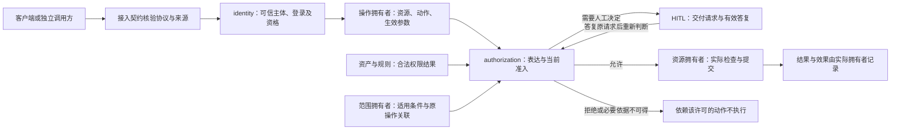

# 身份与授权的领域关系

状态为待审技术设计。正式维护位置不授予技术接受、实施或支持；精确公开形状仍待定义。

## 在全系统中的位置

身份与授权提供可信主体、成员资格、登录有效性、授权含义及当前准入结果。操作拥有者定义资源、动作、检查时机和业务后果。资产与规则拥有配值及求值，HITL 拥有人工交互，Session 拥有工作推进，具体能力拥有实际访问及执行效果。

账号、组织、租户、成员资格与登录分别建模。租户由组织与账号共同确定，成员退出后重新加入沿用原租户身份。客户端选择、连接和 Cordis Context 不能替代可信行事身份，管理角色不自动取得成员私有内容。

图中的允许仅表示准入通过。独立调用使用自己的可信主体、范围及操作契约，不需要伪造 Session。系统装配可以将 Session 模式、租户设置或人工决定接入上述契约，但这些业务对象不是所有授权调用的前提。

## 撤权与独立生命周期

成员、角色、权限或表达变化供后续准入识别。具体业务定义检查时机，并保护其要求的判断与提交一致性。撤权不证明实际工作已经停止，也不撤销已经发生的外部效果。

会话承担逻辑治理，三个 runtime 生命周期独立。登录到期、会话归档、业务取消和物理执行终止分别处理。身份与授权只说明对应资格和授权事实，执行及结果保管由原拥有者负责。

恢复须认回原身份、授权、消费和终局依据。缓存、旧快照、模型记忆或 Cordis Context 都不能代替当前资格。读取服务故障不产生撤回事实，事实缺失也不能补造允许。

## 本阶段边界

本节是 issue 266 的设计候选。本页其余正文仍是待审技术设计。接受本节之前，落位不授予技术接受。

0.0.0 到 0.1.0 是单机交付。进程崩溃、操作系统崩溃或断电后，已确认事实按耐久保证保留。介质或整机损毁后，本阶段不提供重新打开。账号、组织和租户的停用、恢复与终结不是本阶段操作。

隶属请求在接收方处理前核对发起组织仍然存在。发起组织不存在时，请求失效，并且该失效是唯一终结。成员退出后重新加入仍沿用原租户身份。这条重入句子继续待审，不因本节候选而变成已接受。
