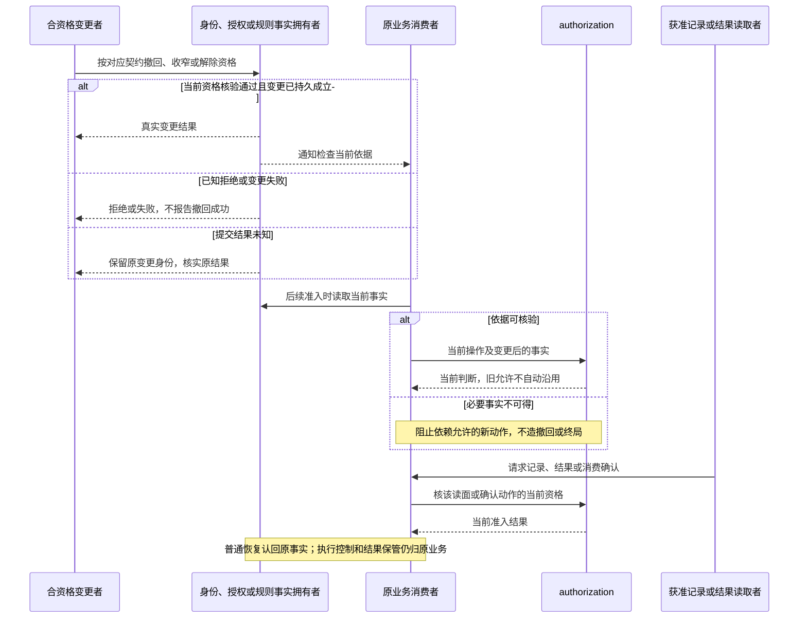

# 身份领域的跨域交接

状态为待审技术设计。正式维护位置不授予技术接受、实施或支持；精确公开形状仍待定义。

## 责任、来源与流程边界

[产品需求](../../../.meta_harness/design/product/identity-and-authorization/design.md#关键用户旅程)拥有用户规则；[领域架构](architecture.md)拥有协作分解。[identity SPEC](../../../packages/identity/identity/SPEC.md)拥有主体、治理、登录及关系事实，[authorization SPEC](../../../packages/identity/authorization/SPEC.md)拥有表达解释、绑定、准入、撤回及消费含义。图以这些正文为机制责任源，没有定义另一套状态机。

参与者是逻辑角色，可独立调用或经系统装配。identity 读取采用的认证及治理依据，维护可信身份事实；authorization 消费可信身份、合法权限、原操作及范围。资产与规则拥有配值求值和正式设置写入，HITL 拥有卡片及唯一有效答复，原工作拥有者维护等待、原位置、控制、终局和结果保管。Run、Session、工具与模型的生命周期不归本领域。

图中实线请求箭头表示核验、操作或判断请求，返回箭头表示事实或结果。通知标作通知，不能代替提交、撤销或实际控制。图中的“共同成立”是业务完成条件，不指定全局锁、数据表、单机事务或跨成员提交方式。flowchart 只表示活动及依赖，时序图表达逻辑交接，不承诺各参与者同进程或共同寿命。

下表约束所有流程。每个流程的正文再说明特定分支和缺项。

| 守卫或观察 | 必须保留的后果 | 责任及定位 |
| --- | --- | --- |
| 身份、时间、配置或规则依据不可得 | 返回无法判定或不可用，不作为允许、确定无效或空数据 | identity ID-03、ID-09、ID-12、ID-13；authorization AU-04 |
| 当前资格、隔离或明确禁止不满足 | 拒绝依赖该资格的操作，不通过临时批准放宽 | identity ID-08；authorization AU-02 |
| 所需事实尚未共同成立 | 不报告完成，明确已知失败与结果未知 | identity ID-09；authorization AU-06 |
| 回执丢失、客户端断开或取消等待 | 按原操作查询或对账，不推断未发生或自动重做 | identity ID-02、ID-04、ID-09；authorization AU-06、AU-07 |
| 普通故障恢复或提供者替换 | 认回原事实与责任，不复活到期、撤销或消费 | identity ID-09；authorization AU-06、AU-07 |
| 读取记录、结果或跨边界交付 | 检查该读面当前资格，诊断关联不公开秘密 | identity ID-09；authorization AU-07 |

提交与查询关联、可信时间、共同完成、传输和可运行验证分别仍缺 T01 至 T06 的精确交接。以下步骤明确其位置；缺项不是准许绕过守卫的理由。

## F-ID08 撤回、后续准入、受控读取与恢复

对应 [J-ID08](../../../.meta_harness/design/product/identity-and-authorization/design.md#j-id08)。身份、授权和规则拥有者分别保存成员、登录、表达或权限的变更事实。通知只是要求消费者核实当前状态，不是停止命令，更不能作为已停止证据。

原业务若需要停止工作，使用自己的控制协议并记录实际结果；撤权或 disposer 不回滚外部输出。停止向失去资格者交付不免除生产方或合法承接方保管责任。读取、交付与消费确认分别授权，诊断仅关联既有事实，不能触发重做或泄露凭据。

恢复认回原主体、操作、范围、决定、消费及终局，当前资格来自权威事实。已确认持久的撤销、到期及消费在普通崩溃或断电后保持。介质或整机损毁后的开放仍依赖 U01，不能用备份角色直接开放。当前事实与提交的一致性归 T03，缓存和跨边界来源归 T05，真实故障与读取验证归 T06。规格为 ID-09、AU-06、AU-07，验证见 [V-ID-J08](../../../packages/identity/identity/SPEC.md#v-id-j08)及 [V-AU-J08](../../../packages/identity/authorization/SPEC.md#v-au-j08)。

## 缺项与持续维护

八条流程可定位到成员规格及验证义务，仍没有具体 Schema、API、提交查询关联、并发围栏、缓存时限、传输或可信时间实现。缺项按[原问题登记](../../../.meta_harness/design/product/identity-and-authorization/design.md#未决问题与待定事项) T01 至 T06 承接，不把图完整称为实施交接完成。

0.0.0 到 0.1.0 的单机阶段不提供介质或整机损毁后的重新打开。普通崩溃、重启和断电仍认回已确认事实。发起组织不存在时，接收方处理隶属请求之前的检查使该请求失效，不能接受。目标组织不存在，以及成员邀请所属组织不存在，仍按过期处理。相邻资产创作委托 U02、Runtime Context 偏好 U03 不在本域补定。本页不改变 CAP-ID01 至 CAP-ID12 的完整承诺，也不把 CAP-ID13 至 CAP-ID15 的非创建操作纳入 0.0.0 -> 0.1.0。上述阶段句子是 issue 266 的候选，接受前不提升本页的待审状态。

改变有效规则时先更新唯一拥有者，再同步旅程、流程及成员持续验证。修改位置不更新历史评审结论，本页及对应新增场景须另行审查，实际实现和行为证据以后独立取得。
