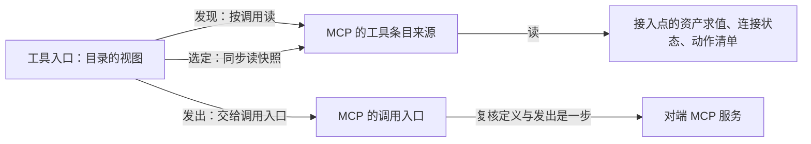

# MCP领域交接设计

状态：技术草案，未获技术接受。已接受职责沿[领域入口](README.md)，本页只维护事实拥有者和跨领域交接。工程细化见[组工程设计](../../../packages/mcp/docs/architecture.md)，精确公开行为尚未分配正式成员。

## 事实与责任

| 拥有者 | 权威事实与操作 | 消费者和交接 |
| --- | --- | --- |
| 资产/规则、身份授权 | 接入点身份/持有、配值资格、权限界、禁用和当前主体资格；每个 MCP 接入点一项「调用这个接入点的动作」权限（禁止、询问、自动，缺省询问），由 MCP 类别声明；授权的动作规则可按来源匹配 | 接入点采用及每道使用边界消费，权限按条目的来源取这一项，不按动作一项，工作区文件不授予权利 |
| 接入点定义/采用 | 完整候选来源、定义/实现及专有设置的采用依据 | 装配消费；不拥有资产公共求值或 Agent Definition 身份 |
| 秘密保管与获准认证适配 | 每租户持有的凭据、同账号续期及秘密使用/释放。认证在接入点上，由人在登记或点「连接」时完成 | 连接适配消费最小必要使用能力，清单及 Tool 普通数据不带值。agent 不在会话里发起认证 |
| 连接提供者 | 对端身份、真实连接代际、状态、到接入点地址的连接资源；连接按租户与凭据账号分开，不跨租户共用。只按地址接入，不起进程，命令型不支持 | 发现和调用取得条件，连接不判 Run/Job/调用终局 |
| 发现/采用协调者 | 合法取得清单、来源版本、当前可用集合、已知身份及发布顺序 | 工具发现读面和动作桥接消费；与原调用捕获分开 |
| 动作桥接与 Tool 准入 | 接入点/对端能力关联、动作映射、工具条目来源、原主体和匹配输入的交接 | 工具入口消费条目来源。Tool/实际提供者保管真实调用、控制、效果和结果 |
| 人工介入 | 卡片与一次有效决定 | 对端要求补充输入时，调用的执行体走工具内「等人决定」的原语，把表单变成卡片，答复回原调用，不另做一套 |
| 原调用/结果消费者 | 调用身份、原消费位置、结果/账目、待消费及消费确认 | 会话或独立程序接续；归档后不恢复推进 |
| 读面/Context/交付面 | 各自权威的合法投影、必要内容转换与披露 | 不反写权威、不重做动作、不以缓存授权 |

原租户、接入点 name 与持有、采用修订、对端/连接代际、动作身份及定义来源、原调用、原工作与消费位置各可核验。名称复用不使旧清理或响应命中新实例；路径、Context、插件实例、运行句柄不是租户身份或持久数据格式。非动作能力按明确桥接契约另行消费，不与动作工具身份混拼。

## 工具条目来源

MCP 向[工具入口](../tool-execution/architecture.md#工具目录与条目来源)登记一个工具条目来源，来源独占一个名字前缀。条目是视图：一个动作能不能被搜到、被调用，按这个主体此刻的事实现算。接入点合法可用，连接上有这份清单，条目才可用。清单变了，下一次搜索就不同，不经装配。动作桥接是唯一同时认识工具契约与 MCP 契约的地方，工具不依赖 MCP，MCP 的连接、清单和调用成员不依赖工具。

一个动作的条目带键、定义、实现和此刻能不能调。对端的输入结构接纳不了的动作，是已知不可用，原因写明。对端给的结构化结果是函数的返回值，内容块是给模型看的投影，两样都留。

发现、选定、发出是三个时刻，各有拥有者：

| 时刻 | 归谁 | 为什么这样分 |
| --- | --- | --- |
| 发现（搜索、看用法） | 工具入口的目录视图并入来源交出的条目 | 要读资产的求值与连接状态，是异步的 |
| 选定（把一次调用绑到实现） | 工具入口选定，实现取自来源内存里的清单快照 | 选定是同步的，可能读到刚过时的清单，没有关系 |
| 发出 | MCP 的调用入口，复核定义与发出是一步 | 定义在受理之后、发出之前变了，答「定义已变」，不发。不依赖选定时读得新不新 |

这些是已接受的目标，实现在 4 号线，尚未实现。

对端要求补充输入时，调用的执行体走工具内「等人决定」的原语，把表单变成人工介入的卡片。人答了，按原调用继续并把答复交对端。人拒绝或没答，把相应的答复告诉对端。这个等待没有超时，也没有默认答复。对端转成任务的调用仍是原调用，按任务号查到终局或调用被停止。

本页关于接入点权限、认证、只按地址接入、条目来源和补充输入的规则来自负责人 2026-11-12 的裁定，是已接受的目标。MCP 领域内已有的实现还没有进轨道，其余实现在 4 号线，见[领域页的实现现状](README.md#实现现状)。
