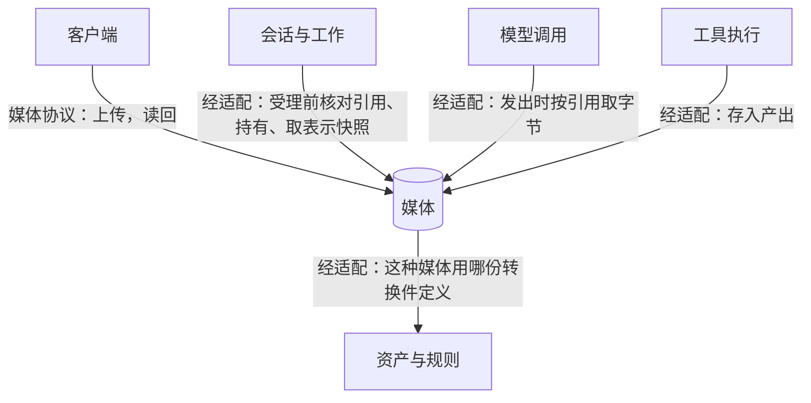

# 媒体

## 范围与边界

媒体保管租户的非文字内容：图片、语音与文件。它回答这份字节在不在、是谁的、对不对；它有哪些别的表示、各是谁做的；按一个型号的限额，同一份内容的合规版本是什么。做表示的转换件由它开放成可登记、可替换的机制。

它是接在核心系统上的支撑能力。核心域的成员不依赖它：去掉它，纯文字的会话、agent、模型与工具原有的流程不变；带媒体的输入被拒并说明原因，历史里已有的媒体在它回来之前读不出字节，数据不丢。

它不拥有引用它的那些事实：

| 事实 | 归谁 |
| --- | --- |
| 哪条消息引用了哪份媒体；一条输入能不能受理 | [会话与工作](../sessions-and-work/README.md) |
| 一个型号原生收下哪些模态与文件类型；引用怎样变成请求里的字节 | [模型调用](../model-invocation/README.md) |
| 一次请求里每一块用原件、别的表示还是文字兜底 | [Context](../runtime-context/README.md) |
| 一次工具执行产出了什么 | [工具执行](../tool-execution/README.md) |
| 屏幕上此刻是什么；文件在哪 | [执行环境](../execution-environments/README.md) |
| 哪一份转换件定义对这个租户生效 | [资产与规则](../assets-and-rules/README.md) |
| 谁能为哪个租户行事 | [身份与授权](../identity-and-authorization/README.md) |

## 模块角色与事实归属

| 模块角色 | 责任 |
| --- | --- |
| 保管 | 媒体对象的状态：上传中、暂存、持有、删除中；到期清扫；引用方的持有 |
| 上传 | 分片、续传、提交与认回 |
| 表示 | 一次转换的编排：求值定义、借出引擎、校验结果、记下结局与出处 |
| 请求版本 | 按目标的限额做同一种模态下的适配版 |
| 存放与元数据 | 两个端口：字节放在哪，元数据记在哪。提供者可以换 |
| 引擎登记 | 现在有哪些转换引擎；一份份登记，撤回只撤自己的 |
| 适配 | 把邻域声明的端口接到媒体；向资产登记「转换件」类别 |
| 开放与展示 | 对客户端的协议、接入与界面模块 |

## 协作

箭头是运行时的调用。源码依赖只从媒体的适配成员指向邻域的公开契约：会话、模型调用与工具执行各自声明一个用自己的词说的端口，不知道是谁来接。

一份媒体有三级表示：原件、另一种模态的表示、文字兜底。后两级由转换件做出来，挂在原件上，原件不动。每次请求用哪一级由 Context 按型号的能力选，媒体不参与这个选择。

组合保证：会话日志里引用的媒体一定读得出。它由两处合起来成立：会话的受理流水线让处理件先于提交运行；媒体让持有先于清扫生效。承担者是媒体适配里的受理前处理件。有限模型见[媒体保管](../../architecture/verification/media-custody/MediaCustody.tla)。

精确规则见[包组规格](../../../packages/media/SPEC.md)与[产品正文](../../../.meta_harness/design/product/media/design.md)。
