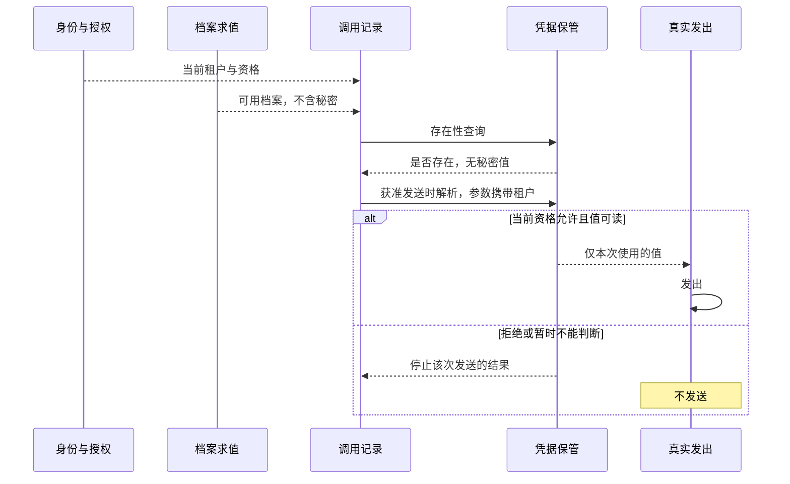

# 模型调用的角色与交接

本页在正式维护位置保存待审技术设计。领域分解已评审不等于成员技术接受、阶段选择或实现支持。具名目录只有文档，公开形状和实际验证仍待设计及补证。

## 责任分解

目标能力组为 `packages/model/`，当前具名成员为 `model/model`。档案事实、调用执行、转换共同契约、结果保管和结算行为就近组织；内部模块不自动形成独立包、插件或进程。

| 角色 | 事实或保证 | 外部协作 |
| --- | --- | --- |
| 档案与能力 | 所在范围、路由名、来源、在册状态、模态、限额、参数及供应商声明 | 设置求值消费 assets 公共契约，资格消费 identity |
| 发起适配 | 已固定的最终输入、调用身份、真实发出及适用资格 | request-context 组织输入，发起协调者最终采用 |
| 调用执行 | 每次供应商发出、首内容、原输出、真实收场及控制结果 | Agent、扩展、压缩和独立程序按原用途消费 |
| 转换契约 | 模态与媒体类型选择、合规派生及 transcript、失败语义 | Agent 消息前扩展运行；Context 选实际表示 |
| 保管与清理 | 未确认结果、ACK 条件、有效确认、真实读取保护及清理续做 | 存储兑现耐久，消费方承担已交接后的责任 |
| 费用事实 | 原调用与各次真实发出的已知或未知用量、迟到结算关联 | 账目及查询拥有者按当前读取资格投影 |

Session 拥有选择事实、工作及有效推进关系，模型维护求值所需档案和执行事实。Context 拥有派生请求与模态投影的具体读取维护；模型提供含义和能力依据。模型不会写消费者私有状态，也不会执行工具建议。

完整行为读[能力组](../../../packages/model/README.md)，精确机制与流程随成员维护。

## 凭据引用与保管

本节已由 D-04 接受。它不修改上文角色表的已有行。成员里已有对应实现。已接受的上层规则仍以[数据保护](../../architecture/security/data-and-privacy.md#凭据与秘密生命周期)和[模型请求运行时](../../architecture/runtime/model-runtime.md)为准。

模型调用记录保存凭据身份、租户和用途。秘密值由凭据保管持有。获准的真实发出当时，按当前资格解析。存在性查询不返回秘密值。这个引用不是 Runtime Context 的块。Context 继续拥有注册块和一次请求的派生输入。身份与授权提供租户和当前资格，不保存模型秘密。资产与规则参与档案求值，档案自身不存凭据。Session 在会话路径上治理工作的发起、取消和消费位置，不执行这次解析。没有 Session 的独立调用由调用应用治理生命周期。

| 角色 | 拥有的事实 | 不拥有 |
| --- | --- | --- |
| 调用记录 | 凭据身份、租户、用途 | 秘密值、密封副本 |
| 凭据保管 | 秘密值、当前绑定、读取资格的判定 | 档案选择、接收方、重试 |
| 发出前复核 | 目标、权限、接收方、完整输入 | 保管库里的秘密正文 |

Runtime Context 不在上图中。它继续负责注册块和派生输入，不承载凭据引用，也不把秘密交给模型或工具。

本交付把调用记录和凭据保管放在同一成员 `packages/model/model` 的两个角色里。公开表面是存在性查询和获准发送时的解析。保管库的存储布局留在该成员内部。调用执行依赖这个操作类型，不依赖保管库的表结构。Cordis 只装配这一道接缝，服务定义与本地保管实现同成员共置。精确模块和集成入口见[包内架构](../../../packages/model/model/docs/architecture.md)、[建模](../../../packages/model/model/docs/model.md)和 [Cordis](../../../packages/model/model/docs/cordis.md)。

另有一种切法是在 `packages/model` 下新增兄弟成员，专管保管。组规则要求，只有独立消费、依赖隔离、替换或验证收益已经明确，内部接口才成为兄弟成员。当前只有一个要验收的本地保管，最小消费者可以调用本成员的公开解析入口，不必启动完整调用执行。因此本交付不新增兄弟包。出现第二个真实保管后端时，再把保管角色拆出去。那个拆分不在本卡。
