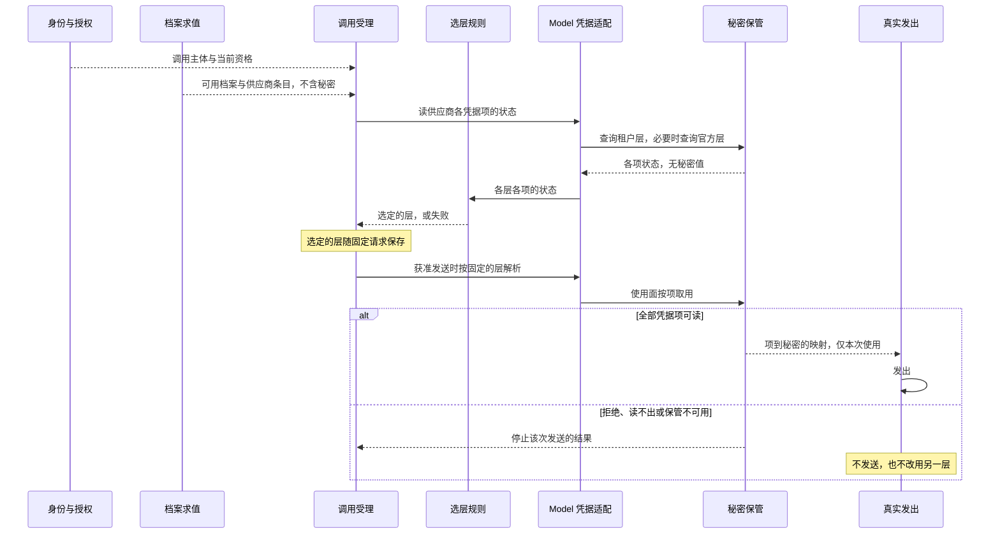

# 模型调用的角色与交接

本页的领域关系与非 pi-ai 技术设计已接受。Model 契约、内部机制和 Cordis 集成按各拥有者正文实施；pi-ai 的采用范围由[组架构各节](../../../packages/model/docs/architecture.md#成员与新增条件)维护。运行实现及实际验证仍待完成。

## 责任分解

目标能力组为 `packages/model/`，当前已初始化骨架的成员为 `model-contract`、`model-cordis-contract` 与 `model`，分别拥有领域契约、Cordis 定义和可复用实现。档案事实、调用执行、转换共同契约、结果保管和结算行为就近组织；内部模块不自动形成独立包、插件或进程。

| 角色 | 事实或保证 | 外部协作 |
| --- | --- | --- |
| 档案与能力 | 所在范围、路由名、来源、在册状态、模态、限额、参数及供应商声明 | 设置求值消费 assets 公共契约，资格消费 identity |
| 发起适配 | 已固定的最终输入、调用身份、真实发出及适用资格 | request-context 组织输入，发起协调者最终采用 |
| 调用执行 | 每次供应商发出、首内容、原输出、真实收场及控制结果 | Agent、扩展、压缩和独立程序按原用途消费 |
| 转换契约 | 模态与媒体类型选择、合规派生及 transcript、失败语义 | Agent 消息前扩展运行；Context 选实际表示 |
| 保管与清理 | 未确认结果、ACK 条件、有效确认、真实读取保护及清理续做 | 存储兑现耐久，消费方承担已交接后的责任 |
| 费用事实 | 原调用与各次真实发出的已知或未知用量、迟到结算关联 | 账目及查询拥有者按当前读取资格投影 |

Session 拥有选择事实、工作及有效推进关系，模型维护求值所需档案和执行事实。Context 拥有派生请求与模态投影的具体读取维护；模型提供含义和能力依据。模型不会写消费者私有状态，也不会执行工具建议。Model 不依赖 Tool；调用建议和 ToolMessage 通过 common/message 交接，内容块通过 common/content-block 交接。上层请求组装者拥有模型声明到原工具及命令的映射，Model 不承担工具准入或注册发现。

完整行为读[能力组](../../../packages/model/README.md)，精确机制与流程随成员维护。

## 凭据引用与保管

本节不修改上文角色表的已有行。已接受的上层规则仍以[数据保护](../../architecture/security/data-and-privacy.md#凭据与秘密生命周期)和[模型请求运行时](../../architecture/runtime/model-runtime.md)为准。

模型凭据是模型供应商声明的秘密设置项（凭据项）在某一层的值。层是租户层或官方层。秘密值由 Settings 的[秘密保管](../assets-and-rules/architecture.md#秘密设置项与秘密保管)持有，Model 不另开保管库。官方层只由部署写入，租户经设置操作写、清自己这一层。

调用记录为每个供应商条目保存一个凭据引用：供应商、层、用途。租户不由调用方填写，取自这次调用的调用主体。存在性查询不返回秘密值。这个引用不是 Runtime Context 的块。Context 继续拥有注册块和一次请求的派生输入。身份与授权提供租户和当前资格，不保存模型秘密。资产与规则参与档案求值，档案自身不存凭据。Session 在会话路径上治理工作的发起、取消和消费位置，不执行这次解析。没有 Session 的独立调用由调用应用治理生命周期。

凭据的使用分两步：

1. 受理时，Model 为每个供应商条目选定一层，并把这一层随固定请求保存。供应商不声明凭据项时，层为「无」。
2. 发送时，Model 按固定的层读该供应商全部凭据项在这一层的当前值，把「项到秘密」的映射交给这一次真实发出。

层在受理后不变。清除不让在途调用改用另一层；绑定被替换时，用取用那一刻的值。

选层是 Model 拥有的纯函数规则 `selectCredentialLayer`。它的输入是供应商声明的凭据项、租户层与官方层每一项的状态、档案是否官方、供应商是否官方。规则按整层选定，不在两层之间逐项拼用；租户层有任一项配置时不退回官方层。规则的产品含义归模型调用产品正文的「凭据的范围」。

| 角色 | 拥有的事实 | 不拥有 |
| --- | --- | --- |
| 调用记录 | 每个供应商条目的凭据引用：供应商、层、用途 | 秘密值、密封副本 |
| 选层规则 | 受理时选哪一层；缺凭据、凭据不全、读不出、被撤销的失败分类 | 秘密值、绑定键 |
| Model 凭据适配 | 把秘密保管的状态读成每层每项的状态；发送时按项取当前值 | 绑定键的编码，它由应用装配给出 |
| 秘密保管 | 秘密值、当前绑定、按键取用 | 选层、档案、接收方、重试 |
| 发出前复核 | 目标、权限、接收方、完整输入 | 保管里的秘密正文 |

Runtime Context 不在上图中。它继续负责注册块和派生输入，不承载凭据引用，也不把秘密交给模型或工具。

调用执行只依赖凭据端口的两个动作：受理时定层，发送时取值。它不依赖秘密保管的绑定格式。凭据纯契约归 model-contract，选层规则归 model，把秘密保管适配成凭据端口的实现归 model-host-local，从（供应商、层、项）到绑定键的映射归应用装配。Model 不认识 Settings 的目标编码。领域与可复用实现不依赖 Cordis，具体宿主通过 Cordis 组合这些能力。
