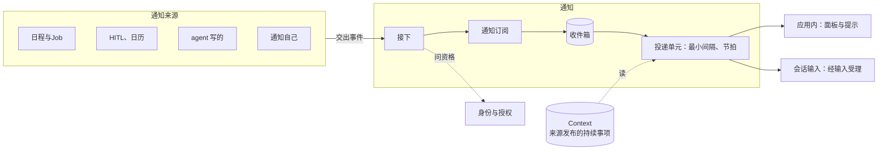

# 通知的协作设计

完整必要行为见[通知包组规格](../../../packages/notification/SPEC.md#应然设计)，产品范围见[产品正文](../../../.meta_harness/design/product/notifications/design.md)。

## 参与者与接缝

实线是事件与通知的流向，虚线是「知道」与「问许不许」。图里没有一条线从会话、agent、模型或工具指向通知。

## 责任与公开消费

| 拥有者 | 交接及事实 |
| --- | --- |
| 通知来源 | 事件的真假与内容；在通知接下之前保管待交的事件；持续事项的当前值 |
| 身份与授权 | 发送、读、处置、订阅、管去处的资格；内容往外能披露到哪一步 |
| 通知 | 接下与认回；收件人的选择；通知与处置；投递单元与结果；目录 |
| 投递渠道 | 在声明的范围内投递，答成功、失败或未知；同一投递身份不产生第二份效果 |
| 会话 | 输入受理与开不开一轮。它不认识通知 |
| HITL | 卡与答复。agent 订阅的确认卡是它的卡 |
| 应用装配 | 选提供者与渠道；把来源发布的块绑到通知的需要上；不借装配授予资格 |

跨拥有者只消费公开事实与操作，不私读存储。

## 三处组合保证

| 场景 | 组合承担者 | 必须保持 |
| --- | --- | --- |
| 来源已记下事件而通知没接下 | 来源的贡献成员 | 凭来源的记录按同一发送身份再交，不重做来源的动作 |
| 通知已入箱而会话没收到输入 | 通知一侧的会话适配成员 | 通知留在箱里；按同一投递身份再投；会话里至多一条输入 |
| 持续事项已了结而提醒还在路上 | 通知 | 提醒不算答复；下一次读到的是当前值，已了结的不再提醒 |

## 装配上的位置

每个参与方在装配树上是「一个核，加一圈薄成员」。核只依赖地基与更内层的领域；跨领域的接线都在薄成员里，每个薄成员只依赖自己的领域与一个宿主。

- 指向通知的薄成员属于来源：日程、日历、HITL 各带一个。
- 通知指向核心的薄成员属于通知：工具成员，与认识会话的适配成员。
- 核心域没有任何成员指向通知。

所以卸下通知时，跟着卸下的只有这些薄成员；卸下会话时，通知对人的一半照常，给 agent 的通知留在箱里等会话回来。
