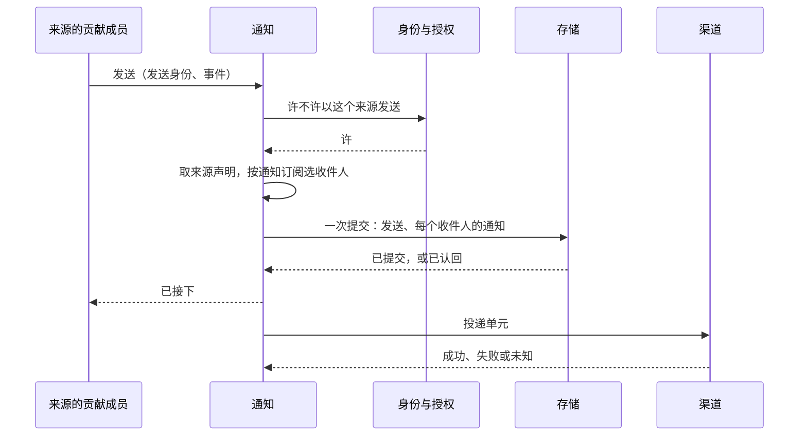

# 通知的关键流程

完整必要行为见[通知包组规格](../../../packages/notification/SPEC.md#应然设计)，产品范围见[产品正文](../../../.meta_harness/design/product/notifications/design.md)。

## F-NO01 来源交出事件，收件人收到

覆盖 J-NO01、J-NO02，保护 INV-NO02 至 INV-NO05。

来源没收到答复时用同一个发送身份再交，存储认回，不多出通知。

## F-NO02 agent 订阅，事件叫醒它

覆盖 J-NO05、J-NO06，保护 INV-NO14 至 INV-NO19。

1. agent 列目录，为自己所在的会话设一条通知订阅。这次调用许不许由身份与授权按「订阅」这道关口判断；要人决定时由 Agent 的准入出放行卡片，卡上的放行详情由通知的工具给。放行之后工具一次提交，通知从同意端口读到这次调用凭什么放行，订阅成立并记下依据。
2. 事件到达。通知选出这个 agent，通知入箱。
3. 取值是强、且这个去处已过最小间隔时，形成一个强单元；适配成员经会话的输入来源送一条输入，提交标识取投递身份。间隔之内再来的强通知等间隔结束后一起形成下一个单元。
4. 取值是弱时不形成强单元。节拍到点，箱里有没了结的才形成节拍单元。
5. agent 被叫醒后用工具读箱、了结。它因通知去做的事照会话当前的权限。

## F-NO03 持续事项的提醒

覆盖 J-NO08，保护 INV-NO12、INV-NO13。

来源把还开着的事项发布成 Context 的一个块。通知读它：新出现的一项，取值是强的收件人被提醒一次，并记下提醒过；节拍时还开着的并进节拍单元。事项了结只发生在来源那里。读不到时不提醒，也不当成没有。

## F-NO04 结果不知道与装卸

覆盖 J-NO09，保护 INV-NO04、INV-NO22。

发送的结果不知道时，来源按原发送身份查询或再交。投递的结果不知道时，通知用同一投递身份再投；到上限后停止自动重投，通知留在箱里，这个去处成为一件「投递受阻」。来源撤下后，它的新发送得到依据不可用，已入箱的通知与订阅都保留。
