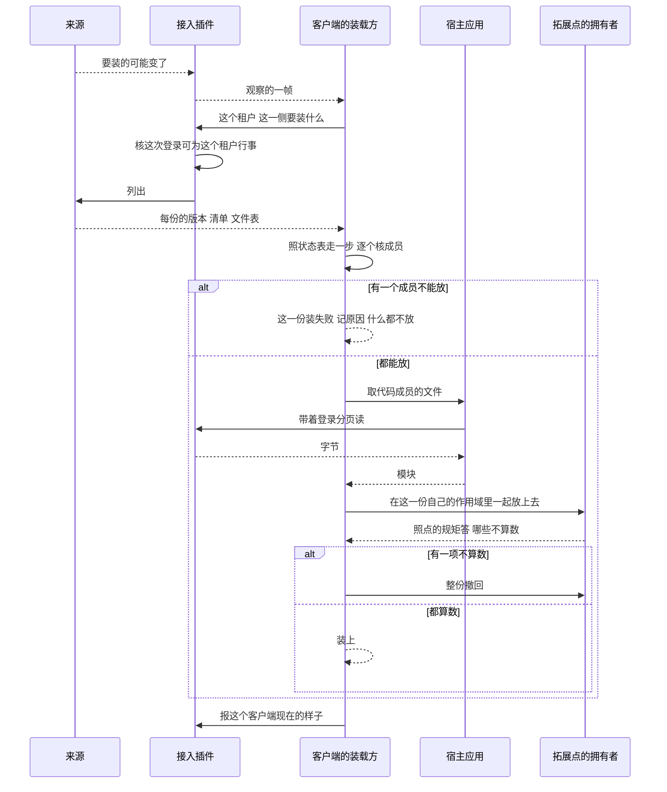
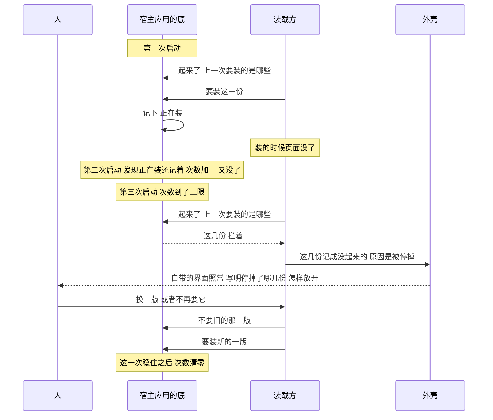

# Plugin跨领域关键流程

图表达责任，不指定线程、进程或寿命；不变式见[包组规格](../../../packages/plugin/SPEC.md#不变式)。端口的实现方见[领域交接设计](architecture.md#端口与实现方)。

## F-PL01 应用开着，一份 Plugin 装上

对应 PL-I05、PL-I06、PL-I08、PL-I09、PL-I10。

读表与取文件都带身份。读不到表时装载方什么都不改：读不到不等于表是空的。

代码成员的文件里不写包名。装载方取它写的那个导出，用宿主应用交的共用库与一个不带「放」的外壳调一次，得到的画法由装载方放到清单写的点与键上。

## F-PL02 换一版、拿走

对应 PL-I04、PL-I08。

表里一份换了版本：新的一代去装，旧的一代留着；新的一代有了结局，旧的一代才卸下。新的一代没装成，旧的一代也卸下，因为表里已经没有它那一版，这一份记成装失败。

表里不再有它：卸下。卸下的总是先前装上过的那一代。

装的过程中表又变了，装载方不半路换：这一次装完，再照表最后说的走。

## F-PL03 一份 Plugin 让应用起不来

对应 PL-I11，桌面应用的 DT-44。

「稳住」有三个条件：读到了表；表里每一份都有了结局；这之后应用再活过一段时间，并且已经把自带的界面画出来。只启动、还没读到要装什么就关掉的那一次，不算倒下。

拦的是上一次要装的全部：底分不出是哪一份让应用倒下的。没闯祸的那几份同样要换一版或被拿掉才放开。

## F-PL04 画的时候抛出

对应外壳契约的 FE-I45。

一份 Plugin 装上了，它的画法在画的时候抛出：那一处落回自带的画法或宿主通用的画法，别的部位、别的键不受影响。这一份仍算装上，不经过底，也不算装失败。

## F-PL05 再起来时的第一帧

对应桌面应用的 DT-45。

装载是异步的，第一帧等不到它。所以整个应用上算数的令牌存在本机，宿主应用在第一帧之前把它们写回去。要装的每一份有了结局之前，本机存的与第一帧写上的都不动；有了结局，第一帧写上的去掉，改由装上的那一份说，并把当时算数的存下。没登录或退出时两样都去掉：下一个人的第一帧不带上一个人的颜色。

## F-PL06 客户端把自己的样子报给服务端

对应 PL-I12、PL-I13。

客户端读到一次表之后报一份全量：每份有了结局的 Plugin 的状态与原因，这棵树上声明了的点与部位。之后状态动了或树变了再报；和服务端上一次收下的相同就不报；没被收下的下一次再报。

服务端只记现在连着的客户端：客户端开着「要装的」那条观察就算在，最后一条观察结束，它报的就去掉；不在的客户端报的不记。读回报与别的操作一样先核登录可为那个租户行事。
