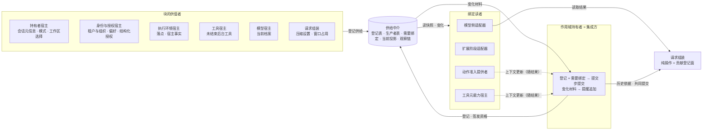

# 运行感知与请求的事实归属

本页在正式位置维护领域级角色与交接。产品既定规则保持原确认范围，阶段支持见产品正文；成员契约为待审，本页不证明实现。

## 1. 参与者与接缝

控制线与信息线分开：取租约、拒绝、收场、准入决定、提交都走各自的直连端口；「知道」走供给中介。中介从不向任何领域发指令。

## 2. 事实拥有者与派生范围

| 数据或计算 | 唯一语义拥有者 | 本域责任 |
| --- | --- | --- |
| 块声明 | 值的语义拥有者（身份、设置、工作区、执行、工具、模型、会话、请求组装各自的契约） | 提供声明协议与块表的增补点；契约不含任何具体键 |
| 原块值与读取资格 | 生产者 | 经生产者句柄供给，不复制成共享权威 |
| 注册、需要绑定、参数 | 作用域持有者 | 提供登记材料的核对与读面，提交归持有者 |
| 读取资格 | 作用域持有者签发 | 每次读核对；不从运行环境推断 |
| 状态块的更新与步提交 | 写者提更新，持有者在步边界合并提交 | 提供纯函数合并与冲突判定，不提交 |
| 当前块快照 | 由有效注册与原来源共同求值 | 说明来源与覆盖范围，不能当成长期授权 |
| 变化材料与提醒 | 中介产出材料，持有者的变化消费路径生成提醒并追加历史 | 区分状态推送和可靠业务输入，前值按读者资格过滤 |
| 历史内容及块标注 | 消息生产者与历史持有者 | 只读取合法投影，不回写原件 |
| 历史视图、前缀摘要与未结工作集合 | 历史持有者 | 经历史源读口分页读；组装按锚点比对摘要 |
| CompactionMessage | 原压缩协调消费路径形成的追加事实；形状与规则归[消息成员](../../../packages/common/message/SPEC.md) | 请求计算决定覆盖范围、保留名单与摘要，持有者核对后保存共同结果 |
| 压缩计划与进度 | 请求组装给计划与步请求，调用方持久保存进度 | 不发模型调用；步调用归协调者 |
| 提示词贡献 | 贡献者 | 只拥有登记面与组装规则 |
| 派生表示与 transcript | 原内容及转换责任拥有者 | 保留来源、资格和原件关系，按实际模型选用 |
| 请求候选、装入裁定、覆盖证据 | 请求组装 | 交付明确输入范围及裁定结果；固定归协调者 |
| 请求输入及本次采用依据 | 发起协调者与模型原调用 | 协作固定采用；快照锚点经采用回传 |
| 派生集合、索引、缓存 | 原事实的可重建读面 | 标明输入范围、覆盖进度、失效与重建责任 |
| 原结果、真实费用与交接位置 | 模型、工具及各自合法消费者 | 沿原用途继续，不以块通知替代消费 |

来源及边界由原数据与消费拥有者公开契约维护。同数据库不能证明同提交，实例或连接不决定数据归属。

## 3. 作用域链

作用域引用是不透明的，可以带父引用；子作用域读一个块键先查自己再查父级，同键遮蔽。本版只有会话一个持有者。父引用保留给将来的租户级持有者（登记身份与结构化授权到租户作用域）与运行级持有者（不持久的状态块）。

## 4. 与邻域的交接

| 邻域 | 它对本域是什么 | 经哪个契约 | 失败与未知怎样交接 |
| --- | --- | --- | --- |
| 会话 | 作用域持有者，兼若干块的生产者，历史持有者 | 本域契约的持有者面与生产者面；历史源读口与共同提交由其契约承接 | 提交未知按同一操作查询，中介不先生效后补记；来源不可用报缺项 |
| Agent | 模型侧与扩展侧读者；请求准备的协调者 | 本域契约的读者面与请求组装的纯操作，经适配器翻译 | 读取不可用则请求不准备；资格或来源未知不返回空集合 |
| 模型 | 当前档案块的生产者；计量与转换结果的提供方 | 生产者面；模型契约的计量与准备端口 | 档案不可用在块上表现为缺项；限额未知保持未知 |
| 工具 | 未结束后台工具块的生产者；工具私有块经工具注入能力按工具类读取 | 生产者面；读者面 | 查不到当前状态不虚构进度 |
| 执行环境 | 落点与宿主事实块的生产者 | 生产者面 | 不读块 |
| 身份与授权 | 身份、偏好与结构化授权块的生产者；动作准入以扩展类读取自己的需要 | 生产者面；读者面与需要绑定 | 需要不可用时准入整批拒绝，中介不替它降级 |
| 存储 | 中介值的持久化端口的提供方 | 存储线的端口契约 | 端口缺席时按块的恢复方式报缺项，不伪造 |
