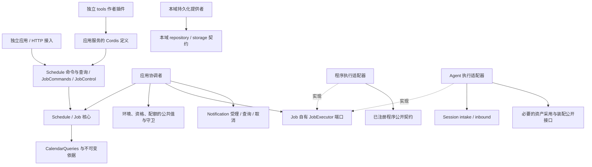

# 日程与 Job 协作设计

本页维护已确认的目标领域边界，不表示实现、装配或运行验证。范围归[领域入口](README.md)，精确行为归[schedule/schedule SPEC](../../../packages/schedule/schedule/SPEC.md)，产品规则归[产品正文](../../../.meta_harness/design/product/schedules-and-jobs/design.md)。类型定义由实际成员唯一维护，下列接口名表达目标消费责任，不声称已经导出。

## 独立部署与本地实现

本域公共服务可以独立于 Session、Agent runtime 部署。公共请求、结果和身份采用可序列化协议，不依赖同进程对象或跨域共享事务。本次由 `-local` 后端提供单机装配；公开契约、实现、绑定和工具分别维护。具体安装依赖、强一致前提和未实现范围见[包组织](../../package-organization.md#日历与日程的安装和部署边界)。

## 事实拥有者与消费者

| 拥有者                                   | 权威事实及交接                                               | 本域必须保护的边界                                            |
| ---------------------------------------- | ------------------------------------------------------------ | ------------------------------------------------------------- |
| Schedule 定义与控制                      | 完整工作描述、时间和政策、owner/author、控制、修订和 lineage | 原子完整保存；当前读写资格；重要变更换身份，旧 Job 不改       |
| Job 接受与协调                           | 来源、冻结要求、日期依据、次数、候选处置、等待控制和整体结算 | 最新依据与接受一致；同一来源去重；未知不换键重建              |
| Calendar                                 | 不可变版本、覆盖、出处、日期计算和发布守卫                   | 日程不发布供应数据，不读写日历私有表                          |
| 环境、身份、权限、配额、资产和资源拥有者 | 原身份、环境 revision、当前资格、定义身份、实际采用及资源条件    | 公共值用于当前决定，不复制完整外域对象；持有引用不授权        |
| 外部执行适配器                           | JobExecutor 到程序或 Session 协议的翻译、原执行关联          | 核心不导入 Session/Agent；适配器不改 Job 规则或原执行内部状态 |
| Session、Agent、Model、Tool 或程序能力   | 合法输入、消息、Run/attempt、推进与实际执行、原结果和效果    | 入队不是完成；Run 终态不直接结算 Job；保留 executionRef       |
| Notification                             | 通知耐久受理、可取回、渠道尝试、送达和确认                   | 同一意图不重复发送；补送不重做原工作                          |
| 结果回传、发布与归档拥有者               | 原成果、master 承接、用户 artifact、发布及归档回执           | 各维度独立结算，主题模型不进入 Routine                        |
| 接入、工具和呈现                         | 可信调用上下文、参数与显示投影                               | 查询不重做业务，工具响应不是权威回执                          |
| Cordis 与应用装配                        | 具体实现选择、服务绑定和自身资源生命周期                     | 不提供业务授权、原子提交或持久完成含义                        |

## 公开契约消费与依赖方向

实线为消费者到公开契约的源码依赖，虚线为实现关系。运行时回执可沿端口返回，不要求执行方反向导入 Job。

核心不依赖 Session、Agent、Tool 宿主、HTTP、Cordis 或具体 SQLite provider。应用协调者知道自己的消费端口，不读取装配根或外域私有表。工具贡献由独立作者插件提供，经 inject 调用应用服务，不把 Agent runtime 变成日程契约的消费者。执行适配器与 tools 分离：前者承接已接受工作的执行，后者是用户或 Agent 发起应用命令的入口。

### 工作值与外域引用

Work 区分 program 与 agent。program 保存已注册 programRef 和合法 input，不接受任意脚本。agent 保存必需 instruction，并区分 new 的 agentDefinitionRef 与 existing 的不透明 sessionRef。new/existing 是本次工作的要求，Session 聚合、消息类、Run 和 Agent Loop 是外域内部知识，不进入核心 DTO。

JobExecutor 声明 inspect、start、query 和 requestStop 所需语义。inspect 的 proof 描述有范围、有版本的当前条件及 query/stop 能力，不是永久许可。start/query 区分 accepted、pending、unknown、rejected，并保留原 executionRef。程序或会话适配器负责可靠承接、原身份查询和真实停止证明；核心按这些事实推进自己的状态。接口能力不足时在准入拒绝，不能模拟成功。

### 创建来源与结果消费

Job 应用服务接受人、agent 和系统调度器三类来源。人和 agent 经直接创建入口提交，调度器经日程接受入口提交。两条准入路径共用 Job 的执行、取消和结果处理。来源由可信调用与已保存安排导出，核心只保存必要引用，不读取 Session 私有状态。

Schedule.author 保存安排作者。定时 Job 同时保存本次 scheduler 身份、日程修订及作者快照。来源会话只是追踪事实，执行会话按 Work 声明，master 按显式返回关系确定。系统调度租户安排不改变 owner，也不取得租户全部权限。

userDeliverable 明确由 master 或已登记结果适配器形成正式成果。无 master 时使用后者，不创建隐含会话。外部结果适配器负责准备和发布，本域分别保管回执与未完责任。masterInternal 必须有返回目标。查询分别报告执行、回传、发布和归档，未请求的维度不记为成功。

### 三条执行路径

| 路径           | 外部适配责任                                         | 必须保留的边界                                     |
| -------------- | ---------------------------------------------------- | -------------------------------------------------- |
| program        | 核对注册程序、版本、参数和当前资格，按稳定工作键提交 | 无 Session/Agent 也可执行，程序回执才是执行事实    |
| agent-new      | 按 Job 的稳定执行键幂等创建目标并承接 instruction        | 重试与 attempt 恢复查询原创建和输入结果，不多建会话               |
| agent-existing | 只向指定 sessionRef 承接本次 instruction             | 目标不存在、归档或无权时受阻或拒绝，不能静默改 new |

Session intake/inbound 根据来源及政策将 instruction 解释为合法输入和消息，包括其拥有的 SystemReminderMessage/UserMessage 规则。Job 不选择消息类或 role。existing Session 可承接多个 Job，Session 管理其排队和推进，适配器按本次 executionRef 对账；最近消息、空闲和最近 Run 结束均不足以结算任意 Job。

## SOLID 与替换边界

| 原则     | 具体边界                                                           | 必须拒绝的反例                                             |
| -------- | ------------------------------------------------------------------ | ---------------------------------------------------------- |
| 单一职责 | Calendar 管日期，Schedule 管未来，Job 管一次工作，适配器管协议翻译 | 更换通知渠道迫使修改 recurrence 算法                       |
| 开闭     | 在既定 program/agent 语义内注册程序或替换执行适配                  | 每添程序就让核心直接构造提供者；把新业务语义藏进任意 JSON  |
| 里氏替换 | 保持同一工作身份、幂等、unknown、查询和停止含义                    | 把入队当成功，不支持 existing 却新建，收到取消就报 stopped |
| 接口隔离 | 查询、定义控制、内部接受和结果入账分开；只授所需操作面             | 预览必须取得供应发布权限，读者被迫实现 start/stop          |
| 依赖倒置 | Job 拥有 JobExecutor 消费协议，外部适配器实现                      | Job import Session 服务、Tool 宿主或具体 storage 实现      |

接口隔离不要求一方法一服务，确需组合端口的执行协调者可消费完整协议。替换后端不能改变日历计算、次数、重叠或最终接受规则。若新增执行引擎或改变完成条件，必须演进工作契约及真实消费者。

## 跨领域一致性与协调者

| 协调者        | 参与者及稳定点                                                            | 未完责任                                            |
| ------------- | ------------------------------------------------------------------------- | --------------------------------------------------- |
| Schedule 命令 | 定义与控制、权限、环境、配额、幂等回执同提交；replace 含前后继及 lineage  | 提交未知查原操作；失败不留孤立后继                  |
| 候选接受      | 版本及环境守卫、权限、控制、来源去重、次数、Receipt、Job 和 outbox 同提交 | Job 可靠承接前仍由日程保管交接                      |
| 执行交接      | JobExecutor 按稳定键耐久承接，Job 保存原执行关联                          | 执行方保管原执行，Job 保管观察、控制和整体结算      |
| 通知交接      | 冻结内容、目标和语义键，正式通知承接回执可恢复                            | 交接前日程/outbox，交接后通知保管交付，Job 保管结算 |
| 结果处分      | masterReturn、publication、archive 分别取得真实回执                       | 只恢复未完成维度，不重执行或覆盖原成果              |

只读依据、共同提交和提交后反应分开。先读公共版本不自动保护后续接受。每个拥有者注册具名 participant，日程不跨域查询私有 schema；网络和计算在事务外完成，同提交只校验版本及决定。latest 校验 publication generation，pinned 校验指定不可变版本及访问资格，follow 还校验 environment revision。

存储提交状态必须保留 committed、rolled_back、unknown、identity_conflict、rejected 的含义。unknown 持有可查询操作引用，没有完整未提交证据时不换键重建。outbox 发出、Cordis emit 和 HTTP 成功均不能代替对方耐久承接。

### 当前存储前提与未验证边界

[sql-contract](../../../packages/storage/sql-contract/SPEC.md)及[sqlite-provider](../../../packages/storage/sqlite-provider/SPEC.md)已有实现。本域日程管理 participant、schema 与原操作恢复已实现；Job恢复扫描和dispatcher仍待后续波段。目标不得超出其[已知限制](../../../packages/storage/sqlite-provider/SPEC.md#已知限制)：L-1 留有资格核验至提交窗口，L-4 不保证跨进程写者排除；L-2 合并收益、L-3 Worker 容量、L-5 中断与恢复时限、L-6 内存、L-7 受信构建、L-8 磁盘、L-9 authorizer、L-10 关闭残留表示、L-11 控制查询延迟均须按原条款处理。这里不以目标同提交设计宣称这些限制已经消失。

本域尤其须由权限拥有者提供符合撤权语义的 fence，并由装配验证它和接受提交的保护边界。远端快照、回调或缓存不足以证明强撤权竞争保证；缺少该协议时停止相关后台接受，保留受阻事实。Cordis 只绑定服务和生命周期，不填补业务原子性。

## 控制、撤权与原身份恢复

开始前取消须与启动竞争同一保护边界；取消先成立后不能发起执行。启动已不确定时保留 stopRequested/unknown，按原 executionRef 查询，不通过新尝试逃避对账。requestStop 不表示已经停止，更不表示外部效果可逆。existing 模式只允许控制本次工作的范围，不取消无关会话、Run 或其他 Job；能力不足则明确拒绝依赖停止保证的策略。

当前资格在最终接受、启动和受保护动作处分别核验。已接受冻结要求不因撤权自动改写，撤权仍可阻止新的启动和后续动作。恢复沿同一权威身份及可比较版本，迟到的旧恢复不能覆盖终局失效。提供者换代后旧实例不得启动新动作，可信晚到回执仍按原工作归属对账，不重开已终结工作。

## 外部产品组合

系统功能定义、每 owner 订阅和平台系统维护分开。订阅引用固定定义版本、合法参数及适用权威，每个订阅独立去重；取消订阅阻止新接受，已接受工作沿 Job 控制。系统 scope 不假扮用户同意，也不跨租户读取资料。

self-wake 是 Session 当前工作的耐久挂起和继续，由 SessionContinuation、checkpoint、唤醒提供者和原进展监测保护，不是创建未来 Schedule。它沿同一 Run/trace 的 lineage、generation、截止与预算，不因挂起或重启重置无进展检测。这些接口不进入 Schedule imports、inject 或根导出。

定时 handoff 是 agent-new 的一种外部执行与结果回传组合，绑定同租户 AgentDefinition 身份和不透明 master 返回目标；新 Run 由 Session 动态采用该定义最新合法发布，普通恢复沿用原采用，执行回执保留实际版本。它不能把所有 agent-existing 改成 child 创建。master busy、归档、永久失效及回传背压由原拥有者解释；Job 只保留稳定关联和分别结算的结果。用户交付物、原始 child report 和主题归档不能混为同一完成事实。
