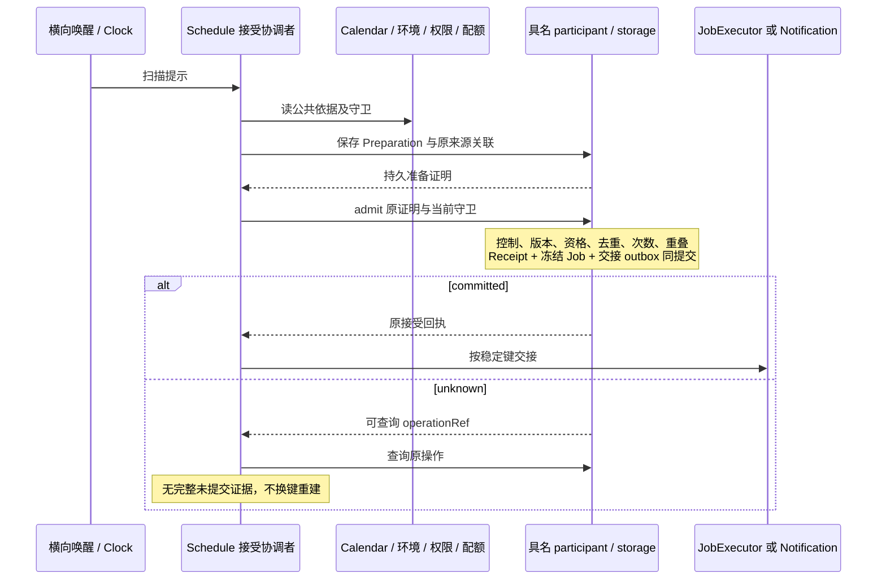
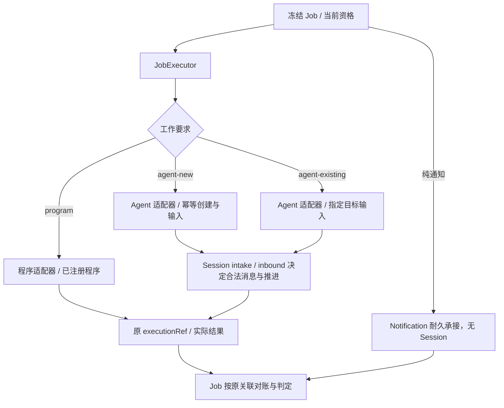
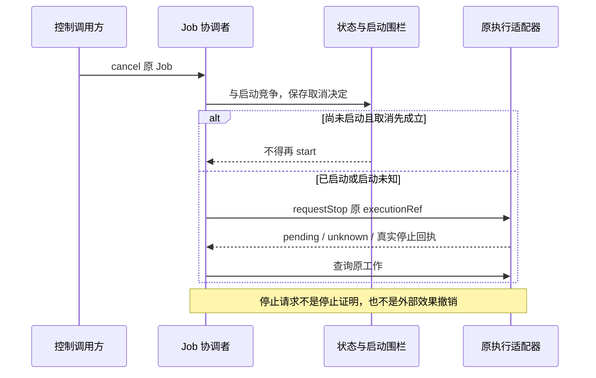

# 日程与 Job 跨领域关键流程

本页维护已确认的目标流程，尚不表示实现、模型验证或运行验证。精确状态与失败协议归[schedule/schedule SPEC](../../../packages/schedule/schedule/SPEC.md)，领域责任归[协作设计](architecture.md)，规则归[产品正文](../../../.meta_harness/design/product/schedules-and-jobs/design.md)。既有 F-SJ05 与不变量编号保留作追溯。

## F-SJ01 定义、草稿与替换

命令入口核对可信 owner、author、动作资格、同意、环境和配额，完整定义与幂等回执同提交。draft 不保存到期扫描水位、不接受 occurrence；原作者或 owner 可用 reviseDraft 完整修订。promote 按当前资格、依赖、环境及时间重新核验，找不到严格未来时隙返回 no_future_slot，保留 draft。discard 只用于 draft。直接 active 创建仍受支持。

已生效安排的 label 和同 purpose 的 agent instruction/提醒文本可原地修订，保留 CAS 与修订史。purpose、时间结构、绑定、programRef/input、会话模式/目标/配置、catch-up、重叠或结果政策变更走 replace。前任 superseded、后继创建、双向 lineage、配额转移和回执同提交，后继继承 active/paused 控制，旧 Job 不改。失败不得留下两个活跃安排或孤立后继。

Agent granular authoring 可先形成零未来接受的 draft，owner promote 才确认生效；已生效命令的同意绑定动作、规范 payload 与目标。blanket 授权及其撤销由原拥有者治理，重新授予后须逐条 reconfirmConsent，不能自动消除 paused 或复活终态。工具可见不是写资格。

## F-SJ02 对账环境、日期与依赖

每次 due 扫描先对账 followUserEnvironment 的原子环境值，再计算候选。explicit 固定日历身份及 timezone，版本 latest/pinned 独立选择。旧准备证明因环境或 current generation 改变而失效时重新准备，不能替换其冻结依据。已接受 Job 不改。环境不相容恢复从当前时刻重锚，不回补该停泊区间。

依赖只接受原拥有者带身份、版本和范围的权威事实，核心只应用 ready/blocked/terminal 及原因。读取失败或含混 404 保持未知受阻，不推断永久删除。恢复只承认同一身份的更高有效版本，不能用同名新对象、latest release 或旧 restore 复活终态。依赖 ready 与用户 paused 可并存。

## F-SJ03 准备与最终接受

Preparation 固定定义及控制 revision、来源、时区、calendar version、environment revision、工作内容、截止和政策依据，不消耗 jobLimit，不表示已执行或已通知。最终接受重新核验当前守卫；来源去重跨多份准备证明成立。网络及日期计算在事务外，具名 participant 在同一提交边界保护自己的事实。提交已成而唤醒失败时只恢复 outbox。

eligibleLimit 限制经过规则、日期处理、DST 与同刻合并后的合格 occurrence 序列；jobLimit 限制实际创建 Job，两者可并存，先耗尽者阻止新接受。重叠 skip、错过或准入拒绝不退还合格序列计数，却不增加 Job 次数；过滤、排除和 DST gap 在合格序列之前，不扣 eligibleLimit。等待、失败和取消不退还已接纳 Job 次数。纯提醒接受为 notification Job，计 jobLimit，不消耗 execution budget。

## F-SJ04 周期补跑、once 与提醒窗口

周期 execution 统一使用 none 或 latestN，N 是正整数。固定本轮 T 与待处理区间，按最新合法日期依据选择严格早于 T 的最近至多 N 个；none 不选旧候选。更早部分明确保存为不补，下一 tick 不得分页补光。T 当刻的正常候选不占 N，与补跑项按原定时刻升序处理，每项重新检查资格、重叠和次数。overlap=skip 不从更早区间补位。来源 pending 没有优先权，设备恢复、日历恢复和积压扫描采用同一算法。

一次性 execution 沿自己的 lapse/awaitRecovery 政策：普通扫描迟到本身不构成 lapse；可恢复依赖受阻的 awaitRecovery 保留原定时刻，没有隐含五分钟期限。pause 跨过原定时刻后 resume 或准入遇到指定 blocker 时，按 once 政策处置。已接受 Job 恢复继续原工作，不占 N、不重复计数。

源 reminder profile 不补跑，通知首次接受窗口为半开区间 `[W, min(W+300s, nextEffectiveSlot))`；无下一有效时隙取 W+300s。下一时隙须已完成规则边界、排除、日历、DST 与碰撞处理。截止随 Preparation 冻结，恰在截止即 missed。窗口内已耐久接受后允许传输晚到，不另建通知。once reminder 不带 calendar overlay。长停机保存有界 lapse span，不为每分钟无限造行。

环境不相容恢复按 F-SJ02 重锚，不套用周期补跑。计算预算耗尽明确记录 catchup_degraded 和 skipped 区间，按 none 重锚，不能假报完整枚举。

## F-SJ05 专属执行、成果与目标结算

对应 J-SJ06/J-SJ07，保留 INV-SJ02、INV-SJ12 至 INV-SJ15、INV-SJ19、INV-SJ21 的追溯入口。本流程的“专属”指原工作关联，不要求所有 agent Job 新建会话。

启动先核验当前资格与 inspect 能力。agent-new 重试只查询原创建与输入承接；agent-existing 只进入指定目标，失效不改 new。Session 决定指令如何成为消息、忙碌时如何排队及何时真正推进。入队、装配完成和普通回复均不确认执行成功，实际开始才记录开始事实。

进度、候选成果和问题保留原 Job 及 executionRef。检查冻结目标并保存达成证据；工具返回、最新消息、会话空闲或任意 Run 终态均不足以替代本次结算。程序按原调用结果结算，不创建会话。超时或回执丢失先查询原执行，不新建 Job 或重复开始。

重叠 skip 明确处置不建 Job；parallel 分别接受；wait 先接受冻结 Job，再按原时刻与稳定 ID 排队；replace 先接受新 Job，请求所有冲突前序真实停止，必要确认齐全后才启动，未知则受阻。含执行的 Job 以执行部分判断重叠，组合通知尾部不阻塞下一执行。纯通知主动作另以自身真实结束为依据，不把 HTTP 请求结束当停止。

## F-SJ06 取消、撤权与换代恢复

取消 existing 路径只控制本次提交，不取消整个 Session 或其他工作。不具备隔离控制与真实停止能力的适配器不能通过依赖该保证的策略准入。撤权在最终接受、启动和实际受保护动作处生效；恢复不重新赋予已经失效的资格。换代后的旧 provider 不发起新动作，可信晚到回执仍沿原归属对账，不复活终态。

纯通知尚未交接的 outbox 可在同提交取消；交接竞争已发生时沿同一 intent 请求取消并查询。只有原提供者确认 cancelledBeforeAcceptance 才结算 cancelled；acceptedAlready 保留真实耐久接受结果，pending/unknown 保留责任。HTTP abort 或 disposer 不撤回通知。

## F-SJ07 结果处分、通知与读面

execution、masterReturn、publication、archive 分别结算；某一项成功不能覆盖其他失败或未知。原始报告不可变，用户 artifact 引用其来源，归档拥有者解释主题目标。masterInternal 不自动进入普通结果中心或用户通知；audience、attention、archive 是不同决定。

通知冻结内容、目标及稳定语义键，原提供者确认耐久可取回，渠道投递与 acknowledgement 另行观察。执行已成功而归档或通知失败只恢复相应部分，不再执行。standing 转移以 scheduleId、standing generation、transition kind 去重；提示失败不清除 blocker，恢复提示不声称旧工作已补做。

读面区分预测 agenda、已处理 occurrence、原执行账和 Job 结果。每期结果独立保留，不用最新 artifact 覆盖历史；权限在实际读取与披露处核验。查询、预览及取消查询等待本身均不改变业务状态。
