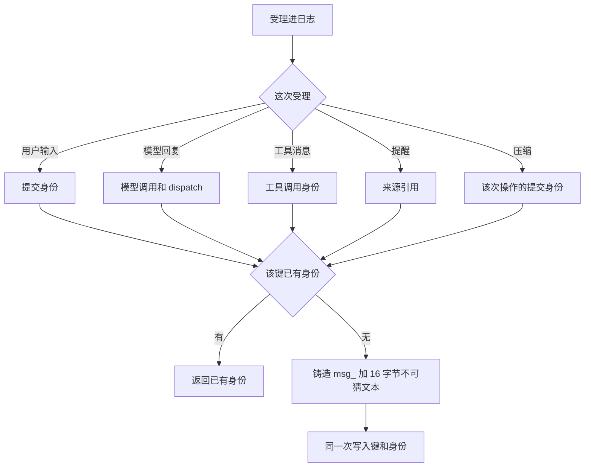
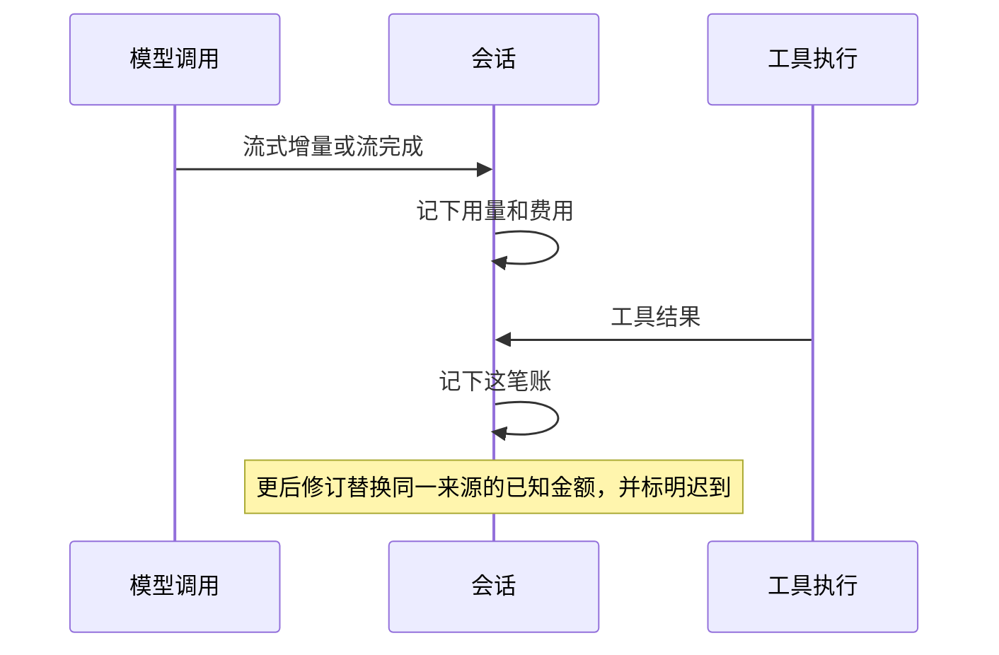

# 会话与逻辑工作

本页维护已接受的应然模块分工与公开协作，采用范围见[领域入口](../README.md#维护与状态)。引用的上游约束保持原采用范围；正文接受不表示当前代码已实现。

## 范围与边界

本节是候选修订，技术接受前不扩大本页既有承诺。

本责任治理会话路径中的输入与逻辑工作，包括 Session、Run、执行尝试、消费位置和有效推进资格。Session 拥有业务治理与耐久事实，不是第四个 runtime。它按业务规则协调 Agent、Model 和 Tool 三个 runtime，不要求它们共享线程、实例或寿命。

Session 与六个邻域协作：Agent、Model、Tool、Runtime Context、Request Context 和执行环境。邻域的契约只使用通用角色，不认识 Session。Session 在会话路径上担任这些角色，名称与形状的翻译只在 Session 的适配成员里发生。每一对关系见[与邻域的交接](architecture.md#与邻域的交接)。

[日程Job](../schedules-and-jobs/README.md)、独立模型/工具调用和通知各有治理者，不为复用能力创建隐式Session。

## 模块角色与事实归属

本节是候选修订，技术接受前不扩大本页既有承诺。

| 模块角色 | 事实与责任 |
| --- | --- |
| 输入受理 | 到达、实际内容、去处与可靠承接依据；受理前后的业务流程拓展点按固定顺序执行 |
| 队列与工作承接 | 待处理输入、采用关系和对应逻辑工作 |
| Session治理 | 会话身份与归属、模式与设置声明、会话关系、归档、作用域释放任务及恢复业务 |
| Run/推进治理 | 本次工作、执行尝试、唯一有效推进资格、指向 Agent 执行的执行引用和逻辑收束 |
| 消费与历史承接 | 原调用关联、消费位置、可靠取得内容、未结工作的判断依据及会话历史的持有 |

六个成员承担上面的角色。依赖方向与落位判据见[能力组](../../../packages/session/README.md)。

| 成员 | 责任 |
| --- | --- |
| [session-contract](../../../packages/session/session-contract/README.md) | 会话的值、身份、端口、事件目录与不变量。不依赖任何邻域契约，也不依赖 Cordis |
| [session-cordis-contract](../../../packages/session/session-cordis-contract/README.md) | 唯一的 Cordis 服务定义，以及 Session 自己的提交通知 |
| [session](../../../packages/session/session/README.md) | 不含 Cordis 的治理机制：命令处理、归约、投影、受理流水线、协调器与调度器的决策 |
| [session-cordis](../../../packages/session/session-cordis/README.md) | Service 实现，接上计时、通知、事务与出站端口 |
| [session-adapters](../../../packages/session/session-adapters/README.md) | 全部邻域适配插件。它是唯一依赖邻域契约的成员 |
| [session-storage-sql](../../../packages/session/session-storage-sql/README.md) | 会话事务端口的 SQL 实现：权威表、派生索引与读路径 |

日志表达需要记录的事实，不替代各执行账或资源状态。共享值由实际定义拥有者维护。会话必须记住的事实在[事件目录](../../../packages/session/session-contract/docs/object-model/session-log-events.md)。活跃、休眠和等待结束不单独立条目。记入标准见[必须进入日志的事实](../../architecture/runtime/session-and-run.md#必须进入日志的事实)。

会话在受理进日志时铸造消息身份，格式是 `msg_` 加 16 字节不可猜文本。同一次受理返回已有身份。用户输入用那次提交身份。模型回复用模型调用和 dispatch。工具消息用工具调用身份。提醒用来源引用。压缩用那次操作的提交身份。键和身份一次写入。解析与相等在 `packages/common/message`。

人能看到的内容只来自两处：会话日志的历史投影，以及生产方已经可靠保管的在途增量，见[用户可见内容的两处来源](../../architecture/runtime/streaming-and-consumption.md#用户可见内容的两处来源)。

会话在收到一份账时把它记入日志。这条记录只表示会话已经收到。载体是模型响应的一次流式增量、该流的完成，或一次已完成工具执行的工具结果。

同一主体、同一费用来源的更后修订整份替换旧快照。后到的修订标明 `receipt` 为 `late`，`revision` 加一。修订准入、按来源小计、应付金额、单位与精度的规则归[调用账目](../../../packages/common/call-account/README.md)。会话按这些规则求和，不另定第二套规则。

## 协作与依赖

本节是候选修订，技术接受前不扩大本页既有承诺。

受理消费交付面输入及[命令展开](../slash-commands/README.md)，使用治理提供的合法身份与资格。受理成功须有可恢复去处，不把临时消息发送当作可靠接手。

工作治理向 Agent 交出当前工作及推进资格依据。Agent 拥有执行与执行挂接。Session 只保存执行引用，不保存 Agent 的接续值。Model 和 Tool 的调用、重试与中断都由 Agent 发起。Session 与 Model、Tool 只有三种关系：资格的参加（Model 受理点守卫的参加者，以资格参加者协议闭合为前提；Tool 启动围栏的资格版本拥有者）、消费侧的 ACK 与账目、恢复对账时的查询与内容读取。

Runtime Context 注册的业务决定归会话，块内容归生产者。会话历史由 Session 持有，请求组装经历史读口读取。需要共同成立的事实在一次权威提交里成立，见[共同提交与参加关系](../../architecture/runtime/session-and-run.md#共同提交与参加关系)。

## 主路径与交接

本节是候选修订，技术接受前不扩大本页既有承诺。

1. 入口验证输入和范围。受理流水线保存实际内容及承接依据。
2. 按会话规则从队列承接工作，关联Run、当前执行尝试与消费位置。
3. Session 交出推进资格依据。Agent 打开执行时核对这份依据，按Loop求值并调用 Model 和 Tool。
4. 可靠取得结果后继续原工作，分别记录逻辑终态和调用实际收场。

推进者换代保持原调用与消费位置。取消/归档按各自业务规则控制，迟到结果归原调用，不能重新打开终结Run或假定所有后台执行已停。归档同批产生作用域释放任务。物理收场由执行环境报告，Session 只对账，见[执行环境的寿命对应](architecture.md#执行环境的寿命对应)。

## 契约与验证导航

本节是候选修订，技术接受前不扩大本页既有承诺。

[会话契约](../../../packages/session/session-contract/SPEC.md)拥有受理、工作治理、消费位置和日志的不变量。[通用实现](../../../packages/session/session/SPEC.md)拥有协调器、调度器与恢复的精确行为。[适配成员](../../../packages/session/session-adapters/SPEC.md)拥有与六个邻域契约的翻译。[存储成员](../../../packages/session/session-storage-sql/SPEC.md)拥有权威表与读路径。日志格式及公开值随实际定义。

上层沿[Session/Run](../../architecture/runtime/session-and-run.md)、[流式与消费](../../architecture/runtime/streaming-and-consumption.md)、[控制恢复](../../architecture/runtime/control-and-recovery.md)。六个邻域角色见[Session 的三层与邻域角色](../../architecture/runtime/session-and-run.md#session-的三层与邻域角色)。产品依据见[本域产品正文](../../../.meta_harness/design/product/sessions-and-work/design.md)，范围及状态沿该源判断。验证见[组合入口](../verification.md)。

## 后续设计与维护

本节是候选修订，技术接受前不扩大本页既有承诺。

输入绑定与 Agent 终结的共同提交、推进映射与重装配交接、日志与消费责任的集成，闭合位置见[SW-M01 技术兑现义务](../../../packages/session/session/docs/architecture/mechanisms.md#sw-m01-技术兑现义务)。共享存储事务域、压缩转换协调者一侧的唯一提交点、有界恢复者和迟到账目的读取资格仍是具名待决，见[联合前提与具名待决](../../architecture/runtime/session-and-run.md#联合前提与具名待决)。跨会话派发、跨会话授权和外部委托按原未决处理。下层机制待细化不取消唯一推进及可靠承接保证。

局部队列或Run变更先读所属契约；涉及换代、执行或跨域Job再展开邻接责任。日志、界面及模型上下文均不成为另一份工作终态。

## 正式产品与技术承接

[产品正文](../../../.meta_harness/design/product/sessions-and-work/design.md)维护当前产品阅读稿及有效未决，topic 状态为 draft，已定承诺保持。[本域技术关系](architecture.md)与[能力组](../../../packages/session/README.md)定位正式维护责任；详细设计仍按各源声明判断，不由落位取得接受。
