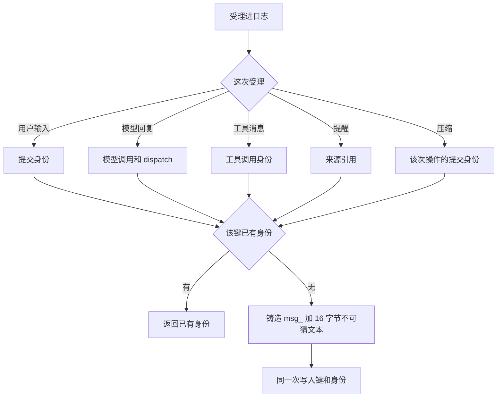
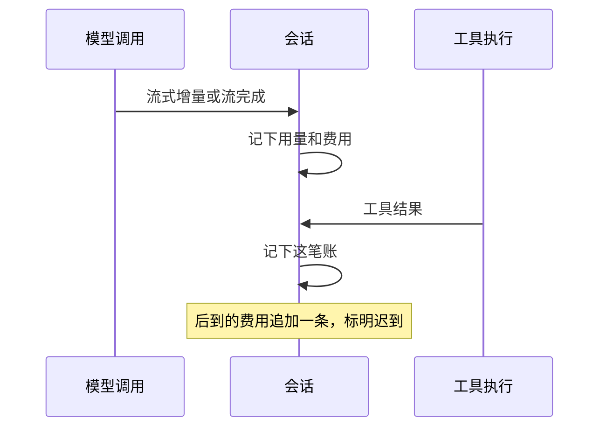

# 会话与逻辑工作

本页维护已接受的应然模块分工与公开协作，采用范围见[领域入口](../README.md#维护与状态)。引用的上游约束保持原采用范围；正文接受不表示当前代码已实现。

## 范围与边界

本责任治理会话路径中的输入与逻辑工作，包括Session、Run、推进尝试、消费位置和有效推进资格。它按业务规则控制runtime，不要求它们共享线程、实例或寿命。

[日程Job](../schedules-and-jobs/README.md)、独立模型/工具调用和通知各有治理者，不为复用能力创建隐式Session。

## 模块角色与事实归属

| 模块角色 | 事实与责任 |
| --- | --- |
| 输入受理 | 到达、实际内容、去处与可靠承接依据 |
| 队列与工作承接 | 待处理输入、采用关系和对应逻辑工作 |
| Session治理 | 会话归属、模式、关系、归档及恢复业务 |
| Run/推进治理 | 本次工作、attempt、唯一有效推进者和逻辑收束 |
| 消费与历史承接 | 原调用关联、消费位置、可靠取得内容及后续处理 |

日志表达需要记录的事实，不替代各执行账或资源状态。共享值由实际定义拥有者维护。

会话在受理进日志时铸造消息身份，格式是 `msg_` 加 16 字节不可猜文本。同一次受理返回已有身份。用户输入用那次提交身份。模型回复用模型调用和 dispatch。工具消息用工具调用身份。提醒用来源引用。压缩用那次操作的提交身份。键和身份一次写入。解析与相等在 `packages/common/message`。

人能看到的内容来自会话日志的投影。用量和费用在会话收到模型响应的流式增量、流完成或工具结果时入账。后到的费用追加一条，标明迟到。

## 协作与依赖

受理消费交付面输入及[命令展开](../slash-commands/README.md)，使用治理提供的合法身份与资格。受理成功须有可恢复去处，不把临时消息发送当作可靠接手。

工作治理向装配/Agent提供当前工作及推进条件，消费原模型/工具事实；控制须分别确认。Context注册的业务决定归会话，而数据内容归生产者。

## 主路径与交接

1. 入口验证输入和范围，受理协调者保存实际内容及承接依据。
2. 按会话规则从队列承接工作，关联Run、当前attempt与消费位置。
3. 取得合法推进资格和执行条件，Agent按Loop求值并调用独立能力。
4. 可靠取得结果后继续原工作，分别记录逻辑终态和调用实际收场。

推进者换代保持原调用与消费位置。取消/归档按各自业务规则控制，迟到结果归原调用，不能重新打开终结Run或假定所有后台执行已停。

## 契约与验证导航

输入/队列契约拥有受理及固定输入，Session/Run契约拥有工作治理；原消费者或协调者拥有可靠消费、认领及与提交的关系。日志格式及公开值随实际定义。

上层沿[Session/Run](../../architecture/runtime/session-and-run.md)、[流式与消费](../../architecture/runtime/streaming-and-consumption.md)、[控制恢复](../../architecture/runtime/control-and-recovery.md)。产品依据见[本域产品正文](../../../.meta_harness/design/product/sessions-and-work/design.md)，范围及状态沿该源判断。验证见[组合入口](../verification.md)。

## 后续设计与维护

受理同提交、推进认领、防旧实例继续、跨会话派发及可靠消费协议由工作/受理协调者设计。下层机制待细化不取消唯一推进及可靠承接保证；跨会话授权和外部委托按原未决处理。

局部队列或Run变更先读所属契约；涉及换代、执行或跨域Job再展开邻接责任。日志、界面及模型上下文均不成为另一份工作终态。

## 正式产品与技术承接

[产品正文](../../../.meta_harness/design/product/sessions-and-work/design.md)维护当前产品阅读稿及有效未决，topic 状态为 draft，已定承诺保持。[本域技术关系](architecture.md)与[能力组](../../../packages/session/README.md)定位正式维护责任；详细设计仍按各源声明判断，不由落位取得接受。
