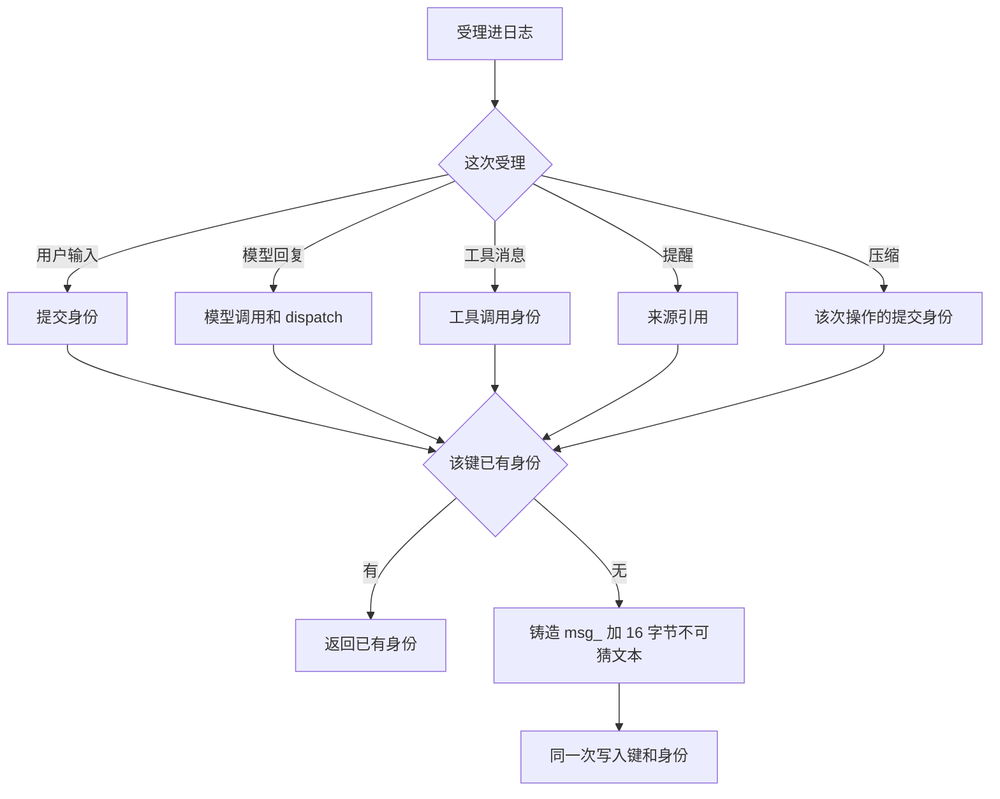
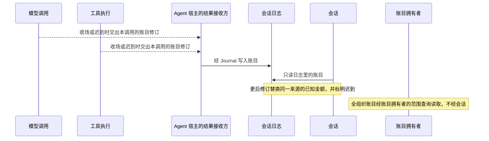

# 会话与逻辑工作

## 范围与边界

本责任治理会话路径中的输入与逻辑工作，包括 Session、Run、执行尝试、消费位置和有效推进资格。Session 拥有业务治理与耐久事实，不是第四个 runtime。它按业务规则协调 Agent、Model 和 Tool 三个 runtime，不要求它们共享线程、实例或寿命。会话日志是唯一的业务事实源。Session 自有的每个意图经一个具名操作进入。Agent 执行记录经 Agent Journal 的公开写入口写入同一份日志，由 Session 适配成员的提供者在同一事务域内兑现。

会话事实归租户。Session 是会话日志的唯一拥有者与存储边界，在自己的边界执行租户隔离：每个键都含租户，跨租户读取默认拒绝，会话不存在与跨租户得到同一个拒绝结果。租户随每次操作的访问依据显式传入，不从连接、进程、装配、作用域名或会话身份推断。

Session 与六个邻域协作：Agent、Model、Tool、Runtime Context、Request Context 和执行环境。邻域的契约只使用通用角色，不认识 Session。Session 在会话路径上担任这些角色，名称与形状的翻译只在 Session 的适配成员里发生。每一对关系见[与邻域的交接](architecture.md#与邻域的交接)。

[日程Job](../schedules-and-jobs/README.md)、独立模型/工具调用和通知各有治理者，不为复用能力创建隐式Session。

## 模块角色与事实归属

| 模块角色 | 事实与责任 |
| --- | --- |
| 输入受理 | 到达、实际内容、去处与可靠承接依据；受理前后的业务流程拓展点按固定顺序执行 |
| 队列与工作承接 | 待处理输入、采用关系和对应逻辑工作 |
| Session治理 | 会话身份与归属、模式与设置声明、会话关系、冻结、归档、作用域释放任务及恢复业务 |
| Run/推进治理 | 本次工作、执行尝试、唯一有效推进资格、指向 Agent 执行的执行引用和逻辑收束 |
| 消费与历史承接 | 原调用关联、消费位置、可靠取得内容、未结工作的判断依据及会话历史的持有 |

六个成员承担上面的角色。依赖方向与落位判据见[能力组](../../../packages/session/README.md)。

| 成员 | 责任 |
| --- | --- |
| [session-contract](../../../packages/session/session-contract/README.md) | 会话的值、身份、端口、事件目录与不变量。不依赖任何邻域契约，也不依赖 Cordis |
| [session-cordis-contract](../../../packages/session/session-cordis-contract/README.md) | 唯一的 Cordis 服务定义，以及 Session 自己的提交通知 |
| [session](../../../packages/session/session/README.md) | 不含 Cordis 的治理机制：命令处理、归约、投影、受理流水线、协调器与调度器的决策 |
| [session-cordis](../../../packages/session/session-cordis/README.md) | Service 实现，接上计时、通知、事务与出站端口 |
| [session-adapters](../../../packages/session/session-adapters/README.md) | 全部邻域适配插件。它是唯一依赖邻域契约的成员 |
| [session-storage-sql](../../../packages/session/session-storage-sql/README.md) | 会话事务端口的 SQL 实现：权威表、派生索引与读路径 |

日志表达需要记录的事实，不替代各执行账或资源状态。共享值由实际定义拥有者维护。会话必须记住的事实在[事件目录](../../../packages/session/session-contract/docs/object-model/session-log-events.md)。活跃、休眠和等待结束不单独立条目。记入标准见[必须进入日志的事实](../../architecture/runtime/session-and-run.md#必须进入日志的事实)。

会话常驻工具每一项的首次定义是会话必须记住的事实，种类是 `tool-resident-admitted`。当前记下的登记键从 Run 依据派生，不另写会话事实。常驻规则归[工具规格](../../../packages/tool/SPEC.md#定义采用与常驻)。

冻结是 Session 拥有的独立会话生命周期状态，不是归档。Tool 在采用点给出冻结判定与原因 `tool-shape-lost`，Session 执行状态转换。会话冻结后不再派发新 Run，在途 Run 自然收场。冻结不可逆。冻结的会话仍可按会话规则归档，撤销归档后回到冻结。

会话在受理进日志时铸造消息身份，格式是 `msg_` 加 16 字节不可猜文本。同一次受理返回已有身份。用户输入用那次提交身份。模型回复用模型调用和 dispatch。工具消息用工具调用身份。提醒用来源引用。压缩用那次操作的提交身份。键和身份一次写入。解析与相等在 `packages/common/message`。

人能看到的内容只来自两处：会话日志的历史投影，以及生产方已经可靠保管的在途增量，见[用户可见内容的两处来源](../../architecture/runtime/streaming-and-consumption.md#用户可见内容的两处来源)。

账目由生产者按调用给出，由模型调用与工具执行保管：模型调用是 dispatch 记录上的账目，工具执行是执行账。调用收场或迟到账目到达时，Agent 宿主的结果接收方经 Journal 把账目写入会话日志。日志里的账目记录只表示会话已经收到这份账。Session 只读日志里的账目，不按调用向模型调用或工具执行读取账目。全组织账目经账目拥有者的范围查询读取，Session 的读面只服务单租户。

同一主体、同一费用来源的更后修订整份替换旧快照。后到的修订标明 `receipt` 为 `late`，`revision` 加一。修订准入、按来源小计、应付金额、单位与精度的规则归[调用账目](../../../packages/common/SPEC.md#调用账目)。会话按这些规则求和，不另定第二套规则。

## 协作与依赖

受理消费交付面输入及[命令展开](../slash-commands/README.md)，使用治理提供的合法身份与资格。受理成功须有可恢复去处，不把临时消息发送当作可靠接手。

工作治理向 Agent 交出当前工作及推进资格依据。Agent 拥有执行与执行挂接，Session 只保存执行引用。Model 和 Tool 的调用、重试与中断由 Agent 发起。Tool 启动围栏归 Agent 日志的 `start-fence` 条目，在 Tool 排序域生效，Session 不拥有 Tool 启动资格版本。结果与账目经 Agent 宿主的结果接收方写入日志。结果接收方只返回 saved，生产者收到 saved 后自己解除交付责任。Session 只读日志里的结果与账目。

Runtime Context 注册的业务决定归会话，块内容归生产者。Runtime Context 的步提交由 Session 守卫，作为 Session 自己的一次提交写入会话日志，见[会话契约的守卫条款](../../../packages/session/session-contract/SPEC.md#守卫条款)。会话历史由 Session 持有，请求组装经历史读口读取。需要共同成立的事实在一次权威提交里成立，见[共同提交与参加关系](../../architecture/runtime/session-and-run.md#共同提交与参加关系)。

## 主路径与交接

1. 入口验证输入和范围。受理流水线保存实际内容及承接依据。
2. 按会话规则开始 Run 并逐条交入待处理输入。批界由 Agent 的承接决定，Session 读到承接事件后关联 Run、当前执行尝试与消费位置。
3. Session 交出推进资格依据。Agent 打开执行时核对这份依据，按Loop求值并调用 Model 和 Tool。
4. 可靠取得结果后继续原工作，分别记录逻辑终态和调用实际收场。

推进者换代保持原调用与消费位置。取消/归档按各自业务规则控制，迟到结果归原调用，不能重新打开终结Run或假定所有后台执行已停。归档同批产生作用域释放任务。物理收场由执行环境报告，Session 只对账，见[执行环境的寿命对应](architecture.md#执行环境的寿命对应)。
