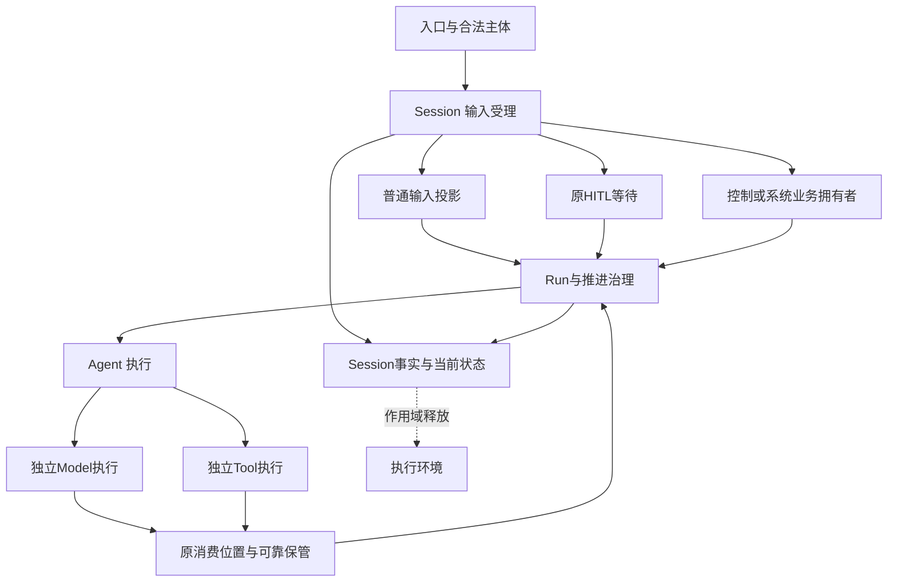

# 会话与工作的领域关系

状态为待审技术设计。正式维护位置不授予技术接受、实施或支持；精确公开形状仍待定义。

## 责任与事实源

本节是候选修订，技术接受前不扩大本页既有承诺。

| 拥有者 | 事实和承诺 | 不拥有 |
| --- | --- | --- |
| Session 输入受理 | 原输入、来源、提交身份、去处责任、拒绝和可靠受理；受理前后拓展点的顺序与提交边界 | 拓展点的语义、原卡片决定、工具效果、所有系统流程结果 |
| Session 治理 | 会话身份与归属、会话日志、会话状态、模式与设置声明、关系、归档、作用域释放任务、Context 注册决定 | 共享资产的内容、权限源、Runtime Context 块的内容、执行环境的物理状态 |
| Session Run 推进治理 | 本次工作、承接、执行尝试、唯一有效推进资格、执行引用、取消及逻辑终态 | Agent 执行与执行挂接、Agent 的接续值、独立Job终态 |
| Session 消费与历史承接 | 消费位置、可靠取得的内容、处理进度、未结工作的判断依据、会话历史 | 生产侧真实执行事实、模型调用与工具执行本身、统一清理所有全文 |
| Agent | Agent 执行、执行挂接、Loop 求值、对 Model 与 Tool 的发起与控制 | Session 身份、新Run准入、其他runtime生命 |
| Model和Tool | 原调用、固定输入、执行、真实收场、结果及交付 | Run业务终态、会话自动归档规则 |
| Runtime Context与Request Context | 块的供给与读取资格；请求组装、压缩记录的内容与保留名单 | 注册的业务决定、会话历史的权威记录 |
| 执行环境 | 落点、获取、租约与受管资源的物理状态 | 会话与 Run 的逻辑状态、作用域何时结束的判断 |
| HITL | 原卡片关联、获准呈现、一次有效答复及可靠交回 | 原问题业务含义、批准的权限解释、Run终态 |

Session 拥有的事实是会话身份、日志、Run 与执行尝试的治理事实、会话设置与模式，以及未结工作的判断依据。Agent 执行与挂接、模型调用、工具执行、context 内容和执行环境的物理状态归各自拥有者。Session 只经对方的公开契约读取、核对和对账这些事实。

日志维护可恢复的会话逻辑事实，消息只占其中一部分。队列、当前 Run、等待、有效推进状态及未结工作可从日志派生，标明覆盖进度。需要外部执行账、当前权限、共享设置或 Context 数据的查询是组合视图，标明各源，不冒称只靠日志重算的投影。

箭头表示契约消费或业务控制，不是进程父子、共同事务或物理部署拓扑。Session 不直接控制 Model 或 Tool，控制经 Agent 送达。

## 与邻域的交接

本节是候选修订，技术接受前不扩大本页既有承诺。

邻域的契约只使用通用角色。Session 在会话路径上担任这些角色，翻译只在[适配成员](../../../packages/session/session-adapters/SPEC.md)里发生。角色的系统级说明见[Session 的三层与邻域角色](../../architecture/runtime/session-and-run.md#session-的三层与邻域角色)。

| 邻域 | 它对 Session 是什么 | Session 对它是什么 | 经哪个公开契约 | 谁协调 | 失败与未知怎样交接 |
| --- | --- | --- | --- | --- | --- |
| Agent | Agent 执行与执行挂接的拥有者；对 Model 与 Tool 的唯一发起者与控制者 | 外部协调者、提交参加者、事件消费者、恢复发现者 | [托管协调与运行实例](../../../packages/agent/agent-contract/SPEC.md#托管协调与运行实例)、[提交参加者协议](../../../packages/agent/agent-contract/SPEC.md#提交参加者协议)、[外部协调者的前提](../../../packages/agent/agent-contract/docs/context.md#外部协调者的前提) | Session 决定开始、续入与恢复；在消息、压缩转换、保管与处理完成四种交接上参加 Agent 的提交；承接、调用登记、等待与执行结束从 Agent 事件派生；执行之内的节点、等待与控制处置归 Agent | 发起或交入回执丢失时按 Agent 的操作身份查询，不另开执行，也不重复交入。资格核对失败时 Agent 拒绝。挂接不在时先接续原执行，再发控制。执行已结束时按 Agent 的结论写 Run 终态。Agent 记录解释不了这次工作时，由[有界恢复者](../../architecture/runtime/control-and-recovery.md#有界恢复者)收束，这是与 Agent 拥有者的联合前提 |
| Model | 模型调用、真实发出、结果与账目的生产者 | 消费位置拥有者（受理点守卫的参加者，以资格参加者协议闭合为前提）、结果承接与 ACK 的消费侧、模型选择的保存者 | [资格、共同提交与实际发送](../../../packages/model/model-contract/SPEC.md#资格共同提交与实际发送)、[ACK 的前提与效果](../../../packages/model/model-contract/SPEC.md#ack-的前提与效果) | Agent 发起调用、重试与中断；Session 只参加受理点守卫 | 资格参加者协议由存储契约拥有者与 Model 契约拥有者闭合，是[联合前提](../../architecture/runtime/session-and-run.md#联合前提与具名待决)。闭合之前，Session 不能作为受守卫的 owner 装配到 Model，Model 一侧的兜底保护点不存在；闭合之后守卫不可用时 Model 不形成调用，Session 不替它放行。ACK 之后恢复不再向模型侧领取完整结果。迟到账目与收场的读取资格是与 Model 拥有者的联合前提 |
| Tool | 工具执行、外部效果、后台执行与收场的拥有者 | 启动围栏 ToolStartAuthority 的资格版本拥有者、对账与投影的读者 | [P04 实际发起围栏](../../../packages/tool/tool-contract/SPEC.md#p04-实际发起围栏)、[可靠交接与处理的两条路径](../../../packages/tool/tool-contract/SPEC.md#可靠交接与处理的两条路径)、[接续原调用与确认自身失联](../../../packages/tool/tool-contract/SPEC.md#接续原调用与确认自身失联) | Agent 发起与控制；后台工具不随 Run 取消停止。控制传播与归档在撤销资格之后调用 `invalidate`，等到失效已生效，计入对账进度 | 失效生效之前，不能声称 Tool 的新发起已被阻止。查询失败不能认定执行已不存在。Tool 失联后不重放原动作，保留已知、未知与待核查的结果。Run 终态之后的后台结果作为后继工作的输入受理，原 Run 不复活 |
| Runtime Context | 供给中介：保存注册、签发读取资格、产出变化材料 | 作用域持有者、`session.*` 块的生产者、变化材料的消费者 | [RC-01 消费者、身份与范围](../../../packages/context/runtime-context-contract/SPEC.md#rc-01-消费者身份与范围)、[RC-07 生产者句柄、并发、撤除与恢复](../../../packages/context/runtime-context-contract/SPEC.md#rc-07-生产者句柄并发撤除与恢复) | Session 提交注册决定；Runtime Context 在提交之后应用已确认的决定 | 提交未知时按同一操作查询，不先生效后补记。Runtime Context 重建后，Session 按日志顺序重放注册并重新发布 `session.*` 块 |
| Request Context | 请求组装：读取历史，形成压缩记录与请求输入 | 历史持有者（历史源读口与未结工作下界）、压缩转换的持有者一侧、人侧投影的调用方 | [历史源读口与 epoch 视图](../../../packages/context/request-context-contract/SPEC.md#历史源读口与-epoch-视图)、[RQ-06 压缩共同结果与保护边界](../../../packages/context/request-context-contract/SPEC.md#rq-06-压缩共同结果与保护边界) | 压缩转换由协调者提交，Session 作为历史持有者参加；协调者一侧的唯一提交点是[具名待决](../../architecture/runtime/session-and-run.md#联合前提与具名待决) | 历史读口不可用时答不可用，不当作空历史。压缩记录与本会话历史对不上时提交被拒，日志不变。提交未知时请求组装按原操作查询，见[压缩记录的提交](../../architecture/runtime/session-and-run.md#压缩记录的提交) |
| 执行环境 | 落点、获取、租约与受管资源的物理状态拥有者 | 不直接认识。执行环境模式变化时 Session 写一条会话层的目标环境设置声明，有效值经设置求值，在 Tool 装载时固定在 `FixedToolRequest.settings`；归档后 Session 的作用域释放插件担任维护者 | [恢复](../../../packages/execution/execution-environment-contract/SPEC.md#恢复)、[获取与租约](../../../packages/execution/execution-environment-contract/SPEC.md#获取与租约) | 执行环境契约规定维护者在本版由应用装配层的协调者担任；本版应用装配层把这个角色交给 Session 的作用域释放插件，恢复授权由装配注入 | 设置缺项或求值不可用时，Tool 一侧不猜落点，这次工具调用不发出。读回结果按[作用域释放](../../architecture/runtime/control-and-recovery.md#作用域释放)的处置分类记录。拒绝原因是未获授权或不可用。枚举失败表示资源未知，不表示没有资源 |

Session 依赖这些公开契约，邻域不依赖 Session。邻域契约变化时，只有适配成员需要同步。

## 执行环境的寿命对应

本节是候选修订，技术接受前不扩大本页既有承诺。

会话、Run、Agent runtime 和一次工具调用都有自己的寿命。执行环境不从这些状态直接推断资源已停。下表说明每种寿命结束时执行环境一侧发生什么。

| 发生的事 | 执行环境一侧发生什么 | 谁发起 | Session 能确认什么、不能推断什么 |
| --- | --- | --- | --- |
| 会话归档 | 作用域释放：停止该作用域的新获取，使该作用域的租约失效，再停止并认回受管资源；返回恢复结果或拒绝 | 归档同批提交产生作用域释放任务。Session 的作用域释放插件以维护者身份、凭恢复授权发起 | 能确认逻辑归档在提交时成立，以及读回结果落入哪几类处置：已释放、待续、不支持、不可用、未获授权。不能从归档提交推断资源已停。已释放作用域的耐久账本是 Session 日志里的释放读回事实。执行环境重启后不记得已释放的作用域；执行环境提供者换代时，释放插件对已归档会话的作用域按页重新释放。重启到重新释放之间的窗口是与执行环境契约拥有者的[联合前提](../../architecture/runtime/session-and-run.md#联合前提与具名待决) |
| Run 终态 | 作用域不释放。前台工具停止时，各自按 Tool 契约释放本次执行的获取；后台工具的获取照常保留 | Run 取消的控制经 Agent 送到 Model 与前台 Tool。没有一方因 Run 终态向执行环境发起释放 | 能确认 Run 的逻辑终态与推进资格已撤销。不能推断前台工具已停、后台工具已停或租约已失效 |
| Agent runtime 退出或重建 | 没有变化。获取与租约归发起它们的工具执行 | 没有一方向执行环境发起。恢复协调接续原 Agent 执行，取得新的执行挂接 | 能确认原执行挂接失去资格。不能推断原工具调用或其设施操作已停，也不能推断资源已释放 |
| 一次工具调用结束 | 工具宿主释放本次执行的获取。释放只作用于这一次获取，单次调用的无状态沙箱随之结束；共享环境与作用域不因此释放 | 工具宿主，见 Tool 契约的 [P03 环境准备和释放](../../../packages/tool/tool-contract/SPEC.md#p03-环境准备和释放) | 能确认这次调用的收场与结果交付。不能推断释放已完成，释放结果由 Tool 认回；释放也不证明外部效果已撤回 |

## 设置声明修订

会话的覆盖或继承声明（SE06）也是装配求值的一类来源。Session 治理为每个会话维护设置声明修订：每采用一次 SE06，修订加一，与这条事实在同一次提交中成立，之后不倒退。修订与会话所选工作区（SE05）一起随[比对代替求值](../../architecture/runtime/assembly-and-change.md#比对代替求值)进入采用依据的快照，由装配入口直接比对。共享设置、租户默认与工作区来源的计数归各自拥有者，见[资产领域关系](../assets-and-rules/architecture.md#变更计数与通知)与[工作区领域交接设计](../workspaces/architecture.md#来源修订计数)。

## 压缩记录

会话历史的持有者在提交压缩记录前核对它与本会话历史对得上，核对与共同提交的步骤见[压缩记录的提交](../../architecture/runtime/session-and-run.md#压缩记录的提交)。保留名单、压缩覆盖范围与摘要由请求组装决定，会话不重新决定，只核对它们与本会话历史及未结工作对得上。对人的历史视图只加标注，不隐藏原消息。
