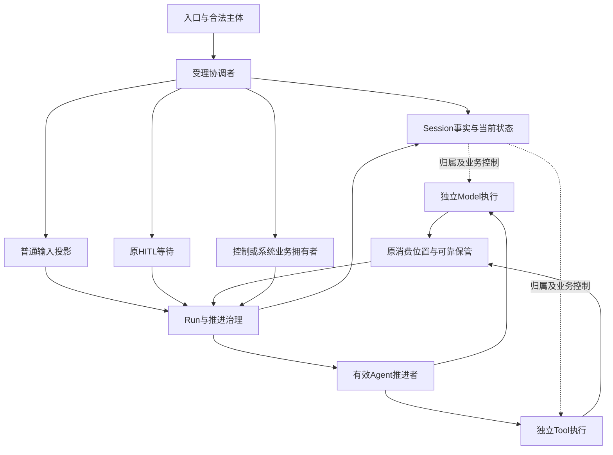

# 会话与工作的领域关系

状态为待审技术设计。正式维护位置不授予技术接受、实施或支持；精确公开形状仍待定义。

## 责任与事实源

| 拥有者 | 事实和承诺 | 不拥有 |
| --- | --- | --- |
| 输入受理协调者 | 原输入、来源、提交身份、去处责任、拒绝和可靠受理 | 原卡片决定、工具效果、所有系统流程结果 |
| Session治理 | 固定归属、Session log、会话状态、当前模式、关系、归档、会话注册及选择 | 共享资产的内容、权限源、物理执行全部停止 |
| Run推进治理 | 本次工作、承接、attempt、唯一有效推进资格、取消及逻辑终态 | 模型或工具自身生命周期、独立Job终态 |
| 原消费者或消费协调者 | 原位置、可靠取得内容、处理进度及后续责任 | 生产侧真实执行事实、统一清理所有全文 |
| Agent成员 | 在有效资格下求下一步、扩展、发起及消费执行 | Session身份、新Run准入、其他runtime生命 |
| Model和Tool成员 | 原调用、固定输入、执行、真实收场、结果及交付 | Run业务终态、会话自动归档规则 |
| HITL成员 | 原卡片关联、获准呈现、一次有效答复及可靠交回 | 原问题业务含义、批准的权限解释、Run终态 |

日志维护可恢复的会话逻辑事实，消息只占其中一部分。队列、当前 Run、等待及有效推进状态可从日志派生，标明覆盖进度。需要外部执行账、当前权限、共享设置或 Context 数据的查询是组合视图，标明各源，不冒称只靠日志重算的投影。

箭头表示契约消费或业务控制，不是进程父子、共同事务或物理部署拓扑。
