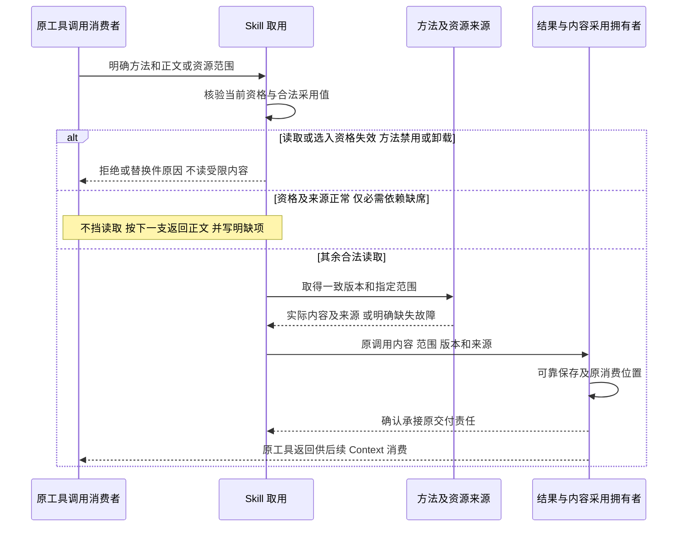
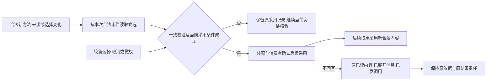
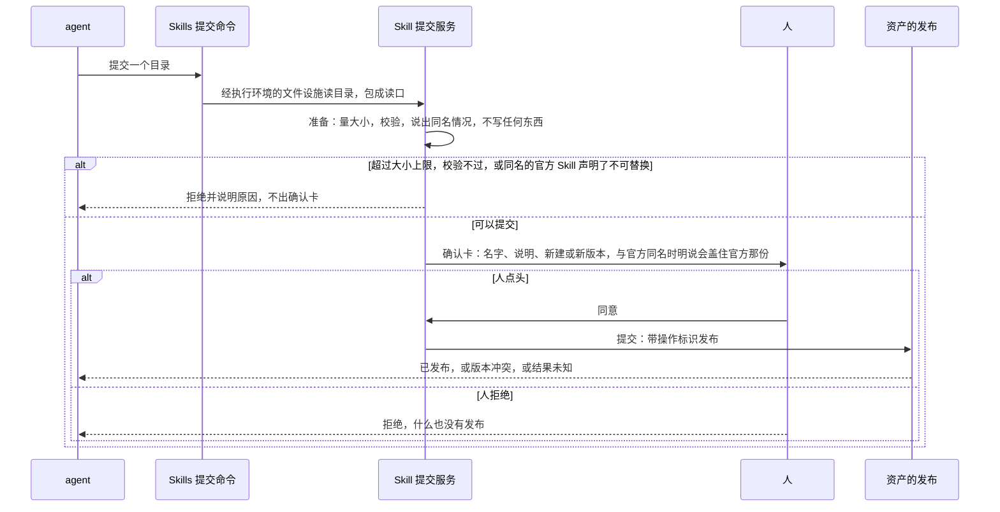

# Skill跨领域关键流程

状态：技术协作草案。图表达责任，不指定线程、进程或寿命；完整 INV 与 V 仍为正式成员承接缺项，责任见[正式承接缺口](../../../packages/skills/docs/architecture.md#完整行为候选的正式承接缺口)。

## F-SK01 合法来源、定义校验与候选交接

对应 J-SK01；INV-SK01、INV-SK02、INV-SK06、INV-SK08、INV-SK13。

来源拥有者确认主体、来源范围及当前读取资格，读取一次可核验材料；方法定义检查名称/说明/正文、资源及声明，资产拥有者处理持有、过滤与实现选择。工作区候选可在合法条件成立后读，正式采用仍等装配校验和交接。来源错误、完整包不一致或第三方冲突明确返回，读取失败不等同空目录。取消候选后释放自身读取句柄，已登记事实及原采用保留，原文件不改写。

## F-SK03 指定读取与工具消费者采用

对应 J-SK03；INV-SK01、INV-SK02、INV-SK05、INV-SK06、INV-SK08、INV-SK09、INV-SK11、INV-SK12。

读入口正文、按目录里的路径读和列目录走同一条流程。读口只给包清单里的文件，路径指到目录之外的请求被拒绝，摘要对不上的文件答材料不可用。

必需依赖缺席不挡读取。正文照常返回，缺什么写在搜索结果与这次读取的结果里。这是负责人 PanQiWei 2026-11-12 对 Q-SK08 的裁定。读取资格失效时不取原受限正文；依赖不足不等于该资格失效。脚本是目录里的文件，按路径读得到；读取不执行脚本、不产生激活、不改变系统提示词。来源在读取中变化时重读或失败，不能拼包。交接确认丢失时围绕原调用核实，不能新建一次返回来覆盖原状态；未可靠承接前取用/原调用按各自阶段保管。截断、缺资源与实际范围显式，Context 裁剪不重写已保存原结果。

## F-SK05 明确脚本、准入及真实执行

对应 J-SK05。这个流程退出，编号保留。依据是负责人 PanQiWei 2026-11-12 的裁定：`Skills` 没有执行命令，没有脚本桥接。

Skill 目录里的脚本是文件，按路径读，走 F-SK03。运行是 agent 发起的一次普通 Shell 工具调用：资产一定先加载到本地，单机装配下目录在本机的文件系统里，agent 从 `Skills` 的读取结果知道它的位置。准入、权限、环境与落点、等待、取消和结果归[工具执行](../tool-execution/README.md)与[执行环境](../execution-environments/README.md)。Skill 不持有执行权，Shell 的许可不因为脚本来自某个 Skill 而放宽，也不因此收紧。防护与隔离不在这一阶段。

## F-SK06 绑定命令读取与用户消息承接

对应 J-SK06；INV-SK02、INV-SK05、INV-SK07、INV-SK09、INV-SK10、INV-SK11、INV-SK12。

命令拥有者完成匹配和绑定核验，再请求 Skill 当前合法正文及获准设置。Skill 返回材料、来源和范围，命令/入站消费者确认实际展开与用户输入关系，按消息契约可靠保存用户内容块及原受理身份。失败不以空展开报告成功，读取确认与消息确认分开。响应丢失后查询原受理结果，不重展开重复投递；正文更新不改历史用户块。本流程不创建工具 read 日志来替代用户消息。

本流程的正文取得沿 F-SK03。只缺必需依赖时正文照常返回并写明缺项，命令适配不另定读取政策，已取得内容后的消息承接责任继续有效。

## F-SK07 合法新增、更新、选择、reload 与迟到候选

对应 J-SK07；INV-SK01、INV-SK03、INV-SK04、INV-SK08、INV-SK09、INV-SK10、INV-SK12、INV-SK13、INV-SK15。

租户新装或更新一个不常驻的 Skill，已有的会话下一次搜索就能看到，不经装配，不改变 Agent Definition，不因新增能力重建 Agent runtime。常驻简介是采用点上定下的记录，在已有的会话里不更新，只对新会话生效，因为会话与 Agent 的动态重装配还没有做。撤销永远立刻生效，不等装配。创作与提交见 [F-SK09](#f-sk09-提交一个-skill-目录)，组织提升流程不由本流程设计。图中的装配采用管常驻与工作区来源的候选，不常驻的合法新方法不经这一步。

工作区文件变化不自动采用，实际装配或显式 reload 才校验。迟到候选不能覆盖新选择，失败不发布混拼版本并保持原采用记录，不能延续已撤权资格；合法数据更新不必重建 Agent runtime。卸载只撤本实例贡献，旧在途工作和他方贡献保留；历史记录不延续已经撤销的访问权。

## F-SK08 控制、迟到宿主结果与恢复

对应 J-SK08。这个流程退出，编号保留。依据是负责人 PanQiWei 2026-11-12 的裁定：Skill 的脚本由 Shell 运行。运行脚本的那次 Shell 调用怎样停、迟到结果怎样保管、换代后怎样恢复，归[工具执行](../tool-execution/README.md)。Skill 不为它另设流程。

## F-SK09 提交一个 Skill 目录

对应 J-SK07 的创作与提交部分。agent 的执行落点里有一个它写好的 Skill 目录，要把它发布到租户名下。人的命令走同一个提交服务，只是发起者不同。

规则如下。

1. 每次提交都要人点头，agent 的每一次提交都不例外。准备这一步不写任何东西。
2. 包的大小上限（文件数、单文件、整包）超了，校验不过，或租户的同名提交撞上官方层声明了不可替换的 Skill（例如元技能），都在出确认卡之前拒绝。
3. 租户已有同名的 Skill 时，这次提交是它的新版本。与官方层同名且官方没有声明不可替换时，租户的那份胜出，确认卡上明说它会盖住官方那份。
4. 发布按操作标识幂等。结果未知时按原操作标识认回，不再发一次。版本号是包的摘要，同一版本内容不同答版本冲突。
5. agent 只能提交到租户名下，不能向组织层提交，也不能代用户提升。
6. 提交成功后，不常驻的 Skill 在已有会话下一次搜索就能看到。要让它常驻，要改会话执行类型的必需身份集合或 Agent 定义的引用，只对新会话生效。

本流程是已接受的目标，实现在 4 号线，尚未实现。
