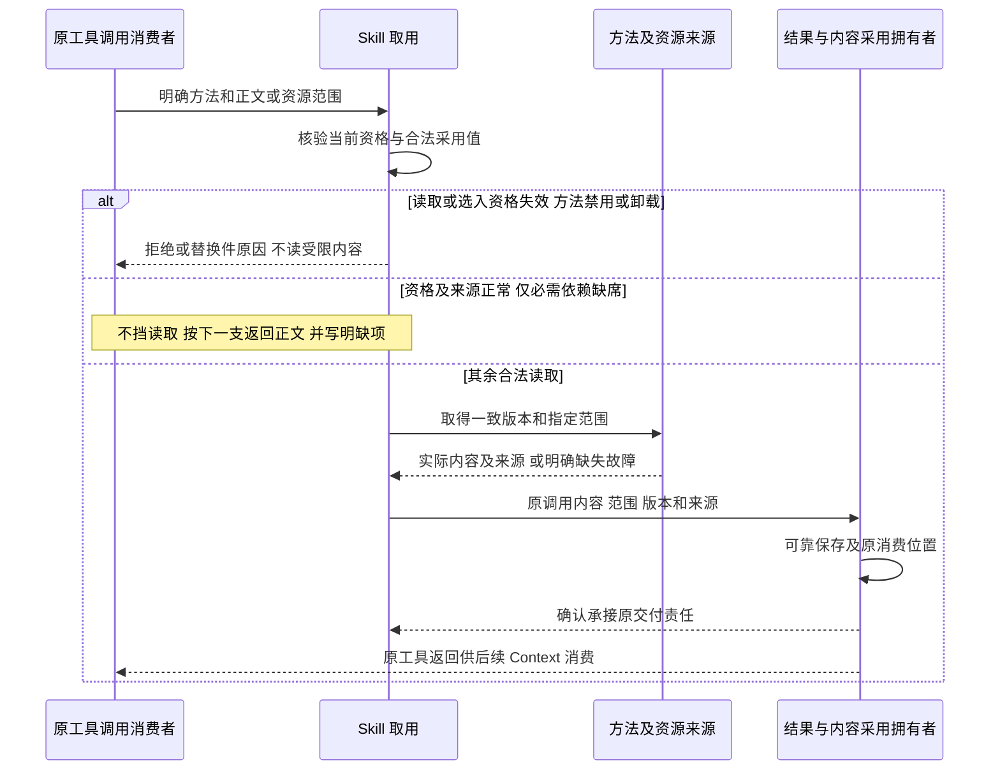
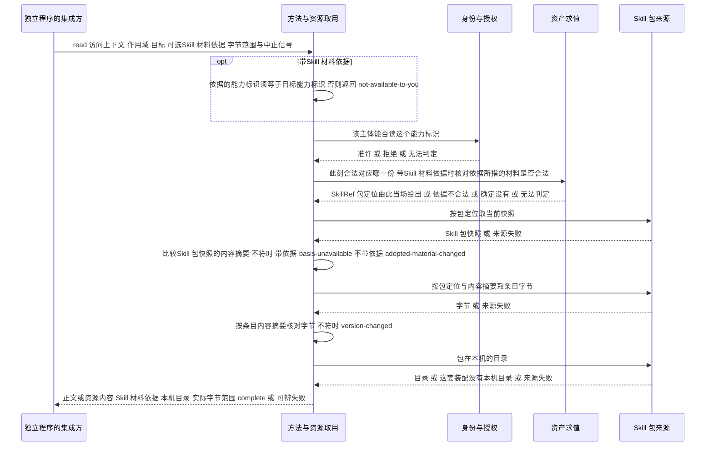
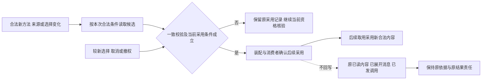
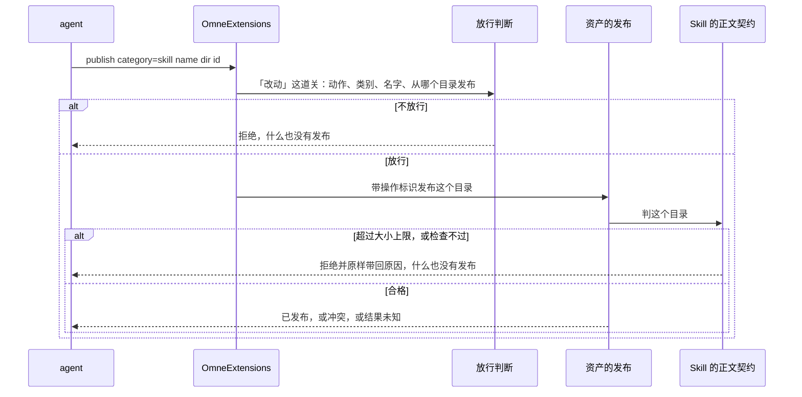

# Skill跨领域关键流程

图表达责任，不指定线程、进程或寿命；不变式见[包组规格](../../../packages/skills/SPEC.md#不变式)。端口的实现方见[领域交接设计](architecture.md#端口与实现方)。

## F-SK01 合法来源、定义校验与候选交接

对应 J-SK01；INV-SK01、INV-SK02、INV-SK06、INV-SK08、INV-SK13。

来源拥有者确认主体、来源范围及当前读取资格，读取一次可核验材料；方法定义检查名称/说明/正文、资源及声明，资产拥有者处理持有、过滤与实现选择。工作区候选可在合法条件成立后读，正式采用仍等装配校验和交接。来源错误、完整包不一致或第三方冲突明确返回，读取失败不等同空目录。取消候选后释放自身读取句柄，已登记事实及原采用保留，原文件不改写。

Skill 一侧的检查：方法定义经 Skill 包来源取得一次一致的 Skill 包快照，检查名称/说明/正文、资源及声明，交出一份解析后的定义或可辨的拒绝原因。定义只含清单、声明与 Skill 包快照（条目与内容摘要），不含正文。正文只经读取取得，读取现场核验读取权。name 与包根目录名不同时不拒绝，包带兼容提示，只有给出的期望名字不等于 name 时才拒绝。来源错误报来源不可达，读控制文件时字节不符报版本已变，格式冲突报拒绝原因。组内步骤见[组内检查](../../../packages/skills/SPEC.md#包与检查)。Skill 包来源只按内容摘要交字节。用哪一份、谁能读，由资产与身份拥有者判定，正式采用由装配决定。检查不授予读取。

## F-SK03 指定读取与工具消费者采用

对应 J-SK03；INV-SK01、INV-SK02、INV-SK05、INV-SK06、INV-SK08、INV-SK09、INV-SK11、INV-SK12。

读入口正文、按目录里的路径读和列目录走同一条流程。读口只给包清单里的文件，路径指到目录之外的请求被拒绝，摘要对不上的文件答材料不可用。

必需依赖缺席不挡读取。正文照常返回，缺什么写在搜索结果与这次读取的结果里。读取资格失效时不取原受限正文；依赖不足不等于该资格失效。脚本是目录里的文件，按路径读得到；读取不执行脚本、不产生激活、不改变系统提示词。来源在读取中变化时重读或失败，不能拼包。交接确认丢失时围绕原调用核实，不能新建一次返回来覆盖原状态；未可靠承接前由原调用按自己的阶段保管，Skill 不做临时保管。截断、缺资源与实际范围显式，Context 裁剪不重写已保存原结果。

## 独立消费者的读取

对应 J-SK02 的独立读取与 J-SK03。独立程序不经会话或 Agent Loop，直接消费 `SkillAccess`。依据层：要求 [SYS-OPEN](../../requirements.md#独立使用与替换sys-open)。

1. 集成方显式传入访问上下文与作用域，并实现 `SkillReadCheck` 与 `SkillResolution`。Skill 不要求调用方的运行体系或 Cordis。依赖在不在场、该 Skill 此刻能不能用，由集成方判定。Skill 只交依赖声明。
2. 每次 `read`、`list` 都现场核验。此前的成功和保存的 Skill 材料依据不代替核验。带 Skill 材料依据时，`read` 与 `list` 钉的是依据所指的材料，见成员规格[依据所指的材料](../../../packages/skills/SPEC.md#读取)。
3. 拒绝与「确定没有对应」都返回 `not-available-to-you`，对无权主体不披露身份是否存在。实现方先判合法已知但不可用，再判合法对应，所以替换件与是否带 Skill 材料依据无关。独立路径的实现方没有已知集合时，通常不出现替换件。
4. `read` 不带 Skill 材料依据时，读当时的合法版本。集成方带上此前结果给出的 Skill 材料依据时，`read` 按该依据交出旧材料，或返回 `basis-unavailable`，不改交新材料。Skill 材料依据含能力标识、来源层、资产版本与内容摘要，不含包定位。工作区来源的 Skill 材料依据可以不带资产版本。依据的能力标识不等于目标时返回 `not-available-to-you`。身份合法对应、依据所指的版本对该主体不合法时返回 `basis-unavailable`。包定位总是由 `SkillResolution` 的实现方当场给出，所以调用方不能借 Skill 材料依据指定包的位置。
5. 不带依据且资产正文缺 Skill 包快照的内容摘要时，`read` 与 `list` 返回 `unsupported`。带依据时，端口带回依据的内容摘要，读取照常走后续步骤，来源在引用的定位处没有包时返回 `basis-unavailable`。
6. 内容随成功结果交出，交出后归集成方。Skill 不做临时保管。
7. 撤权后的新读取被拒绝。已经交出的内容归集成方。
8. 集成方释放自己的路径，不卸载共享的 Skill，也不影响其他消费者。
9. `read` 与 `list` 收中止信号，在每次调用端口之前与每次端口返回之后各检查一次。检查点也包括读取判定与对应这两次端口调用。中止后操作答 `aborted`，不再调用端口，也不交部分内容。

失败种类与对独立消费者需求的承接见[组工程设计](../../../packages/skills/SPEC.md#读取)。

## F-SK05 明确脚本、准入及真实执行

对应 J-SK05。`Skills` 没有执行命令，没有脚本桥接。

Skill 目录里的脚本是文件，按路径读，走 F-SK03。运行是 agent 发起的一次普通 Shell 工具调用：资产一定先加载到本地，单机装配下目录在本机的文件系统里，agent 从 `Skills` 的读取结果知道它的位置。许不许归 Agent 发起时的放行判断；受理、环境与落点、等待、取消和结果归[工具执行](../tool-execution/README.md)与[执行环境](../execution-environments/README.md)。Skill 不持有执行权，Shell 的许可不因为脚本来自某个 Skill 而放宽，也不因此收紧。防护与隔离不在这一阶段。

## F-SK06 绑定命令读取与用户消息承接

对应 J-SK06；INV-SK02、INV-SK05、INV-SK07、INV-SK09、INV-SK10、INV-SK11、INV-SK12。

命令拥有者完成匹配和绑定核验，再请求 Skill 当前合法正文。Skill 返回材料、来源和范围，命令/入站消费者确认实际展开与用户输入关系，按消息契约可靠保存用户内容块及原受理身份。失败不以空展开报告成功，读取确认与消息确认分开。响应丢失后查询原受理结果，不重展开重复投递；正文更新不改历史用户块。本流程不创建工具 read 日志来替代用户消息。

本流程的正文取得沿 F-SK03。只缺必需依赖时正文照常返回并写明缺项，命令适配不另定读取政策，已取得内容后的消息承接责任继续有效。

## F-SK07 合法新增、更新、选择、reload 与迟到候选

对应 J-SK07；INV-SK01、INV-SK03、INV-SK04、INV-SK08、INV-SK09、INV-SK10、INV-SK12、INV-SK13、INV-SK15。

租户新装或更新一个不常驻的 Skill，已有的会话下一次搜索就能看到，不经装配，不改变 Agent Definition，不因新增能力重建 Agent runtime。常驻简介是采用点上定下的记录。撤销永远立刻生效，不等装配。创作与提交见 [F-SK09](#f-sk09-提交一个-skill-目录)，组织提升流程不由本流程设计。图中的装配采用管常驻与工作区来源的候选，不常驻的合法新方法不经这一步。

工作区文件变化不自动采用，实际装配或显式 reload 才校验。迟到候选不能覆盖新选择，失败不发布混拼版本并保持原采用记录，不能延续已撤权资格；合法数据更新不必重建 Agent runtime。卸载只撤本实例贡献，旧在途工作和他方贡献保留；历史记录不延续已经撤销的访问权。

Skill 一侧：Skill 检查候选包，交出一致快照的定义或可辨的拒绝原因，检查失败不发布混拼版本。带 Skill 材料依据的读取固定原材料，或报 `basis-unavailable`。不带 Skill 材料依据的读取遇到已采用材料已变时报 `adopted-material-changed`。已经交出的内容归接收方，Skill 不改写它。

## F-SK08 控制、迟到宿主结果与恢复

对应 J-SK08。Skill 的脚本由 Shell 运行。运行脚本的那次 Shell 调用怎样停、迟到结果怎样保管、换代后怎样恢复，归[工具执行](../tool-execution/README.md)。Skill 不为它另设流程。

## F-SK09 提交一个 Skill 目录

对应 J-SK07 的创作与提交部分。agent 的执行落点里有一个它写好的 Skill 目录，要把它发布到行事的租户名下。`Skills` 只读，不发布：发布走资产的工具 `OmneExtensions`。人从资产页发布，走的是同一个发布服务，只是发起者不同。

规则如下。

1. `Skills` 没有发布命令。agent 用 `OmneExtensions publish`，人用资产页，两个入口走同一套判定与发布。发布之前可以用 `OmneExtensions impact` 问这次改动会怎样，它不写任何东西。
2. 许不许照放行判断，按 `OmneExtensions` 的「改动」这道关。放行说明写明动作、类别、名字与从哪个目录发布。
3. Skill 的正文契约判这个目录：包的上限（文件数、单文件、整包），入口与检查规则，名字与能力名一致。不合格的整份不发，原因原样带回。
4. 租户已有同名的 Skill 时，这次发布是它的新版本。与官方层同名时，资产的求值定哪一份胜出：官方那份声明了不可替换（例如元技能），租户的那份不生效，`OmneExtensions show` 写明它没生效与原因。
5. 发布按操作标识幂等。结果未知时用同一个标识重发或问 `result` 认回，不另起一次。版本号是包的摘要，同一版本内容不同答冲突。
6. agent 只能发布到行事的租户名下：模型的参数里没有租户。agent 不能向组织层提交，也不能代用户提升。
7. 发布成功后，不常驻的 Skill 在已有会话下一次搜索就能看到。要让它常驻，要改会话执行类型的必需身份集合或 Agent 定义的引用，只对新会话生效。
