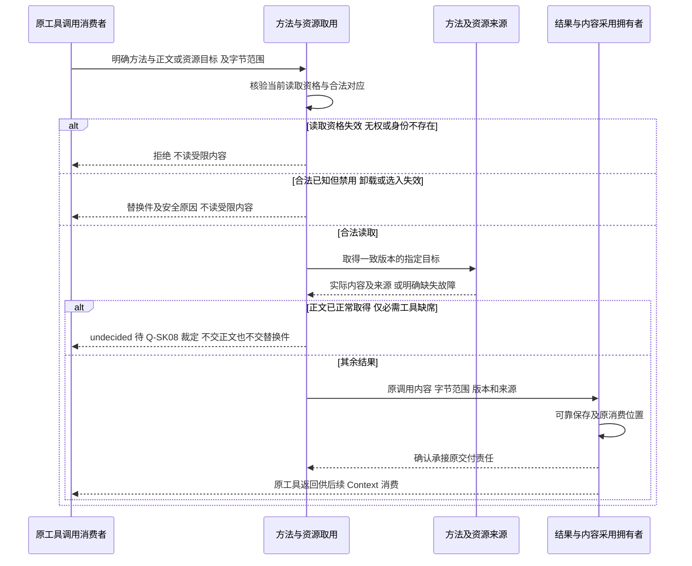
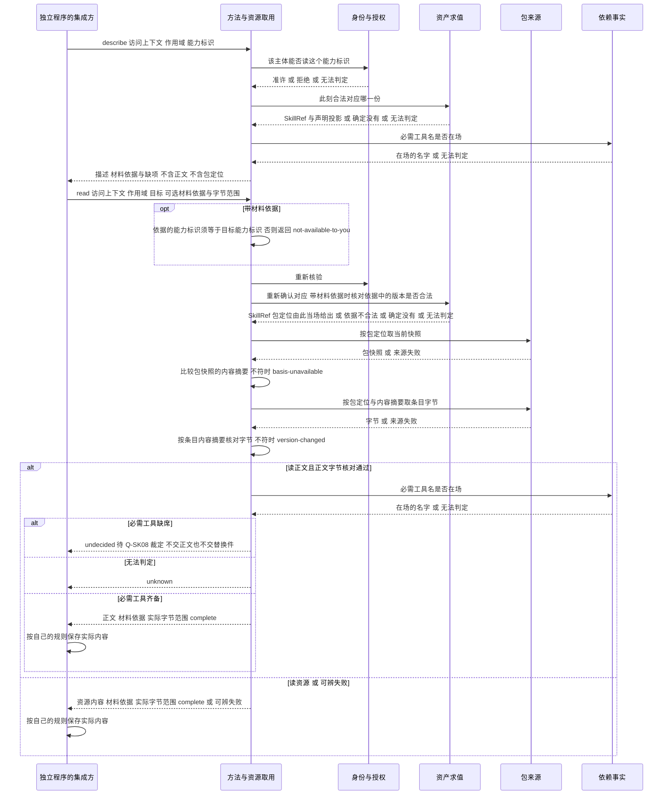
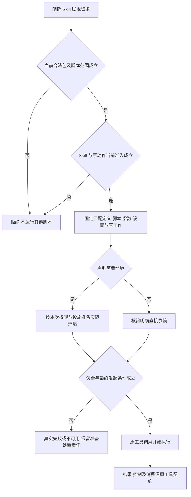
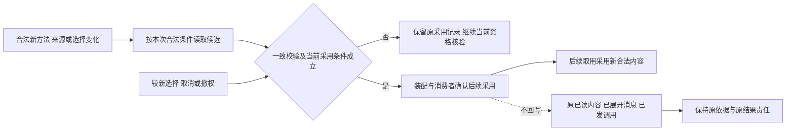

# Skill跨领域关键流程

状态：技术协作草案。图表达责任，不指定线程、进程或寿命；完整 INV 与 V 仍为正式成员承接缺项，责任见[正式承接缺口](../../../packages/skills/docs/architecture.md#完整行为候选的正式承接缺口)。端口的实现方见[领域交接设计](architecture.md#端口与实现方)。服务、端口与结果种类都是候选，尚未实现。

## F-SK01 合法来源、定义校验与候选交接

对应 J-SK01；INV-SK01、INV-SK02、INV-SK06、INV-SK08、INV-SK13。

来源拥有者确认主体、来源范围及当前读取资格，读取一次可核验材料；方法定义检查名称/说明/正文、资源及声明，资产拥有者处理持有、过滤与实现选择。工作区候选可在合法条件成立后读，正式采用仍等装配校验和交接。来源错误、完整包不一致或第三方冲突明确返回，读取失败不等同空目录。包来源只按内容摘要交字节。用哪一份、谁能读，仍由资产与身份拥有者判定。取消候选后释放自身读取句柄，已登记事实及原采用保留，原文件不改写。

## F-SK03 指定读取与工具消费者采用

对应 J-SK03；INV-SK01、INV-SK02、INV-SK05、INV-SK06、INV-SK08、INV-SK09、INV-SK11、INV-SK12。

图中 Q-SK08 分支在来源正常交出正文之后才判断，定案前返回 `undecided`，既不交正文，也不交替换件，不选默认回应。第一波只按必需工具依赖判定，脚本设施由第三波的脚本执行准备核验。资源读取不进入这一判断。规则见[组工程设计「Q-SK08 分支」](../../../packages/skills/docs/architecture.md#q-sk08-分支)。读取资格失效时不取原受限正文；仅执行依赖不足不等于该资格失效。无争议的读取不执行脚本、不产生激活、不改变系统提示词。来源在读取中变化时重读或失败，不能拼包。交接确认丢失时围绕原调用核实，不能新建一次返回来覆盖原状态；未可靠承接前取用/原调用按各自阶段保管。截断、缺资源与实际字节范围显式，Context 裁剪不重写已保存原结果。

## 独立消费者的描述与读取

对应 J-SK02 的独立读取与 J-SK03。独立程序不经会话或 Agent Loop，直接消费 `SkillAccess`。依据层：要求 [SYS-OPEN](../../requirements.md#独立使用与替换sys-open)。

1. 集成方显式传入访问上下文与作用域，并实现 `SkillReadCheck`、`SkillResolution` 与 `RequirementFacts`。Skill 不要求 Session、Agent 或 Cordis。
2. 每次 `describe`、`read`、`list` 都现场核验。此前的成功和保存的材料依据不代替核验。
3. 拒绝与「确定没有对应」都返回 `not-available-to-you`，对无权主体不披露身份是否存在。独立路径的实现方没有已知集合时，通常不出现替换件。
4. `read` 不带材料依据时，读当时的合法版本。集成方带上此前结果给出的材料依据时，`read` 按该依据交出旧材料，或返回 `basis-unavailable`，不改交新材料。材料依据只含能力标识、资产版本与内容摘要，不含包定位。依据的能力标识不等于目标时返回 `not-available-to-you`。依据中的版本对该主体不合法时返回 `basis-unavailable`。包定位总是由 `SkillResolution` 的实现方当场给出，所以调用方不能借材料依据指定包的位置。
5. 内容随成功结果交出，交出后归集成方。已记录的正文由集成方保管。Skill 不做临时保管。
6. 撤权后的新读取被拒绝。集成方已经合法保存的内容按它自己的保留与披露规则处理。
7. 集成方释放自己的路径，不卸载共享的 Skill，也不影响其他消费者。

失败种类与对独立消费者需求的承接见[组工程设计](../../../packages/skills/docs/architecture.md#独立消费者的需求承接)。独立路径上 `SkillResolution` 与 `SkillReadCheck` 的真实实现尚未交付，替身通过不证明资格已验证。

## F-SK05 明确脚本、准入及真实执行

对应 J-SK05；INV-SK02、INV-SK04、INV-SK06、INV-SK07、INV-SK14、INV-SK15、INV-SK19、INV-SK20。

排队、最终发起与更新/取消/撤权之间由原准入协调者保护，旧建议改变绑定或约定时回消费者重判。准备失败不降到宿主；脚本内访问另核验目标、用途和权利。为脚本物化的 Skill 包只进该次执行的私有落点。执行环境提供这个落点。读取路径不触发此流程，Skill 许可不能执行任意路径，也不能绕过受限代码域的资源和宿主接口边界。

## F-SK06 绑定命令读取与用户消息承接

对应 J-SK06；INV-SK02、INV-SK05、INV-SK07、INV-SK09、INV-SK10、INV-SK11、INV-SK12。

命令拥有者完成匹配和绑定核验，再请求 Skill 当前合法正文及获准设置。Skill 返回材料、来源和字节范围，命令/入站消费者确认实际展开与用户输入关系，按消息契约可靠保存用户内容块及原受理身份。失败不以空展开报告成功，读取确认与消息确认分开。响应丢失后查询原受理结果，不重展开重复投递；正文更新不改历史用户块。本流程不创建工具 read 日志来替代用户消息。

本流程的正文取得沿 F-SK03。只有必需工具不足的正文读取结果待 Q-SK08，定案前返回 `undecided`。命令适配不另定默认，已取得内容后的消息承接责任继续有效。

## F-SK07 合法新增、更新、选择、reload 与迟到候选

对应 J-SK07；INV-SK01、INV-SK03、INV-SK04、INV-SK08、INV-SK09、INV-SK10、INV-SK12、INV-SK13、INV-SK15。

创作入口和授权/资产拥有者先确认创建或修改授权，产物按实际提交位置属工作区或租户。Agent 不能直接提交组织资产或代用户提升；Skill 承接合法登记与选择后的候选。显式增量装载完成后，新方法当场可用，不改变 Agent Definition，不因新增能力重建 Agent runtime。具体创作入口和组织提升流程不由本流程设计。

工作区文件变化不自动采用，实际装配或显式 reload 才校验。迟到候选不能覆盖新选择，失败不发布混拼版本并保持原采用记录，不能延续已撤权资格；合法数据更新不必重建 Agent runtime。卸载只撤本实例贡献，旧在途工作和他方贡献保留；历史记录不延续已经撤销的访问权。旧未发建议的参数或绑定不匹配时交回重新判断。

## F-SK08 控制、迟到宿主结果与恢复

对应 J-SK08；INV-SK11、INV-SK12、INV-SK13、INV-SK16、INV-SK17、INV-SK18、INV-SK19、INV-SK20。

控制方定位原工具调用、代码域及资源并核验资格；各控制拥有者分别确认受理、实际停止及释放。代码域停止后，桥接与原调用拥有者继续保管已准入宿主工作和迟到结果，按当前披露资格交给原消费者或保留待交付责任。不能只向已销毁域返回，也不能通过新调用制造“重获结果”。

只丢失 Agent runtime 时认回原执行；确认工具计算丢失按原工具规则收束；查询失败保持未知。恢复读原调用、已确认效果和承接位置，仅接续未完成责任。资源回收由真实持有协议确认，结果与未完成消费不随计算消失。观察不重做执行，取消不撤销已经发生的效果，必要记录失败和剩余责任可查询。
