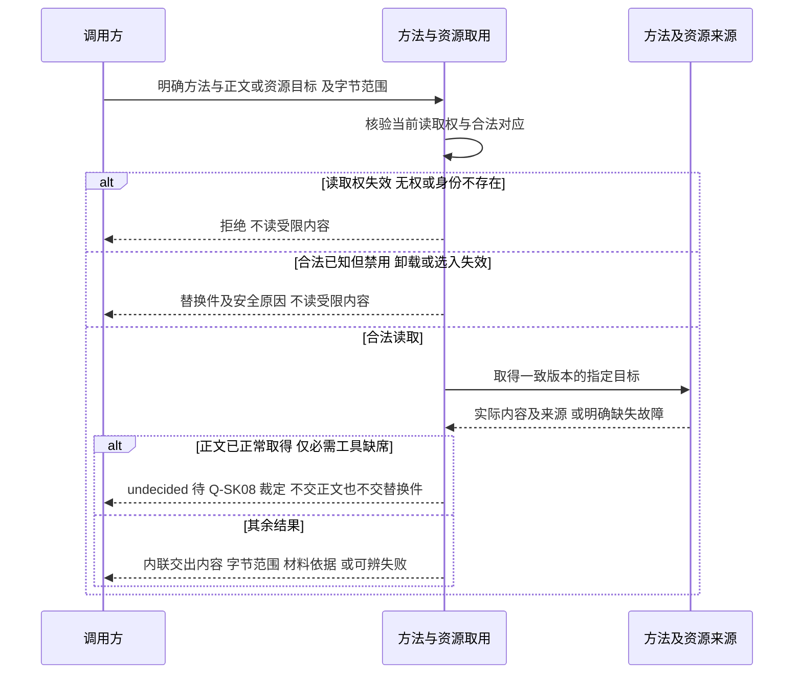
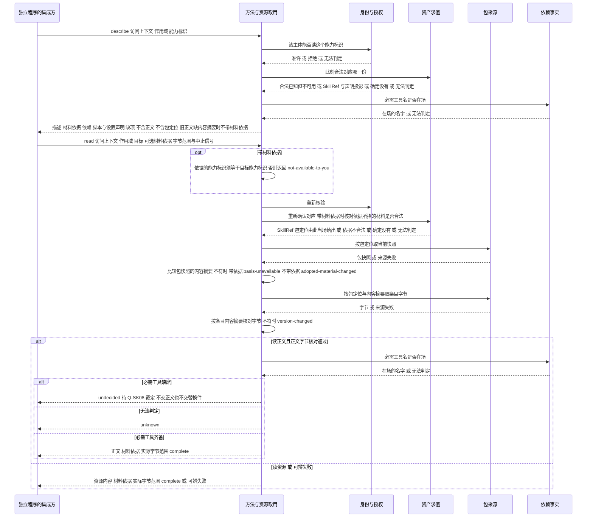
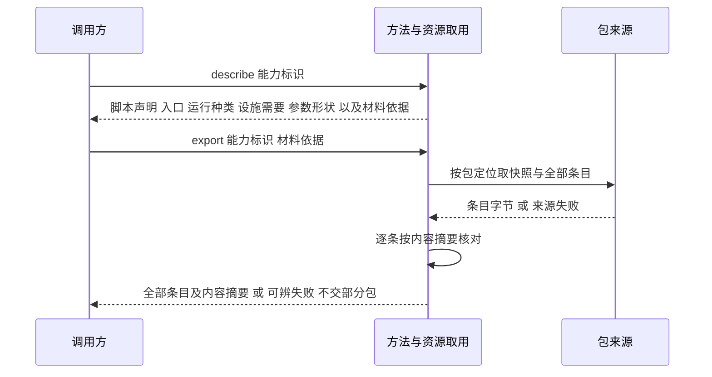

# Skill跨领域关键流程

状态：技术协作草案。图表达责任，不指定线程、进程或寿命；完整 INV 与 V 仍为正式成员承接缺项，责任见[正式承接缺口](../../../packages/skills/docs/architecture.md#完整行为候选的正式承接缺口)。端口的实现方见[领域交接设计](architecture.md#端口与实现方)。服务、端口与结果种类都是候选，尚未实现。各流程只写 Skill 承担的步骤与交出的东西。邻域在自己内部怎样处理，归邻域的契约。

## F-SK01 合法来源、定义校验与候选交接

对应 J-SK01；INV-SK01、INV-SK02、INV-SK06、INV-SK08、INV-SK13。

方法定义经包来源取得一次一致的包快照，检查名称/说明/正文、资源及声明，交出一份解析后的定义或可辨的拒绝原因。定义只含清单、声明与包快照（条目与内容摘要），不含正文。正文只经读取取得，读取现场核验读取权。name 与包根目录名不一致时一律拒绝。来源错误报来源不可达，检查途中字节不符报版本已变，格式冲突报拒绝原因，读取失败不等同空目录。组内步骤见[组内检查](../../../packages/skills/docs/key-flows.md#组内检查)。包来源只按内容摘要交字节。用哪一份、谁能读，由资产与身份拥有者判定，正式采用由装配决定。检查不授予读取。取消检查后释放自身读取句柄，不改写原文件。

## F-SK03 指定读取与工具消费者采用

对应 J-SK03；INV-SK01、INV-SK02、INV-SK05、INV-SK06、INV-SK08、INV-SK09、INV-SK11、INV-SK12。

图中 Q-SK08 分支在来源正常交出正文之后才判断，定案前返回 `undecided`，既不交正文，也不交替换件，不选默认回应。第一波只按必需工具依赖判定。脚本的设施需要随脚本声明交出，设施是否齐备不由 Skill 判定。资源读取不进入这一判断。规则见[组工程设计「Q-SK08 分支」](../../../packages/skills/docs/architecture.md#q-sk08-分支)。读取权失效时不取原受限正文；仅执行依赖不足不等于读取权失效。无争议的读取不执行脚本、不产生激活、不改变系统提示词。来源在读取中变化时重读或失败，不能拼包。内容随结果内联交出，交出后归调用方，Skill 不等待承接确认，也不做临时保管。截断、缺资源与实际字节范围显式。

## 独立消费者的描述与读取

对应 J-SK02 的独立读取与 J-SK03。独立程序不经会话或 Agent Loop，直接消费 `SkillAccess`。依据层：要求 [SYS-OPEN](../../requirements.md#独立使用与替换sys-open)。

1. 集成方显式传入访问上下文与作用域，并实现 `SkillReadCheck`、`SkillResolution` 与 `RequirementFacts`。Skill 不要求调用方的运行体系或 Cordis。
2. 每次 `describe`、`read`、`list`、`export` 都现场核验。此前的成功和保存的材料依据不代替核验。
3. 拒绝与「确定没有对应」都返回 `not-available-to-you`，对无权主体不披露身份是否存在。实现方先判合法已知但不可用，再判合法对应，所以替换件与是否带材料依据无关。独立路径的实现方没有已知集合时，通常不出现替换件。
4. `read` 不带材料依据时，读当时的合法版本。集成方带上此前结果给出的材料依据时，`read` 按该依据交出旧材料，或返回 `basis-unavailable`，不改交新材料。材料依据含能力标识、来源层、资产版本与内容摘要，不含包定位。工作区来源的材料依据可以不带资产版本。依据的能力标识不等于目标时返回 `not-available-to-you`。身份合法对应、依据所指的版本对该主体不合法时返回 `basis-unavailable`。包定位总是由 `SkillResolution` 的实现方当场给出，所以调用方不能借材料依据指定包的位置。
5. 资产正文缺包快照的内容摘要时，`describe` 照常交出声明，不带材料依据，并标明「没有可读的包」。`read`、`list` 与 `export` 返回 `unsupported`。
6. 内容随成功结果交出，交出后归集成方。Skill 不做临时保管。
7. 撤权后的新读取被拒绝。已经交出的内容归集成方。
8. 集成方释放自己的路径，不卸载共享的 Skill，也不影响其他消费者。

失败种类与对独立消费者需求的承接见[组工程设计](../../../packages/skills/docs/architecture.md#独立消费者的需求承接)。独立路径上 `SkillResolution` 与 `SkillReadCheck` 的真实实现尚未交付，替身通过不证明读取权已验证。

## F-SK05 明确脚本、准入及真实执行

对应 J-SK05；INV-SK02、INV-SK04、INV-SK06、INV-SK07、INV-SK14、INV-SK15、INV-SK19、INV-SK20。

Skill 在本流程中只交数据，不参与执行。

1. 脚本身份是能力标识加入口的包内路径。许可规则可以引用它，是否准许执行不由 Skill 判定。
2. 脚本的准入、执行环境、进程、结果与控制归[工具执行](../tool-execution/README.md)与[执行环境](../execution-environments/README.md)。Skill 没有执行脚本的服务。
3. Skill 已在工作区、执行一方有自己的执行权限时，它直接执行，不经 Skill 的服务。
4. 读取路径不触发执行。Skill 许可不能执行任意路径，`allowed-tools` 也不授予许可。

## F-SK06 绑定命令读取与用户消息承接

对应 J-SK06；INV-SK02、INV-SK05、INV-SK07、INV-SK09、INV-SK10、INV-SK11、INV-SK12。

命令一侧请求 Skill 当前合法正文。Skill 返回正文原字、材料依据与字节范围，并在描述中交出设置声明。Skill 不交设置值，也不按用途核验。匹配、展开、设置值的交付与消息受理归[Slash Command](../slash-commands/README.md)与消息接入。本流程不创建工具 read 日志来替代用户消息。

本流程的正文取得沿 F-SK03。只有必需工具不足的正文读取结果待 Q-SK08，定案前返回 `undecided`。调用方不另定默认。

## F-SK07 合法新增、更新、选择、reload 与迟到候选

对应 J-SK07；INV-SK01、INV-SK03、INV-SK04、INV-SK08、INV-SK09、INV-SK10、INV-SK12、INV-SK13、INV-SK15。

Skill 在本流程中只做两件事：检查候选包，并在采用之后按当时的合法版本读取。采用、选择、reload 与迟到候选的竞争归[装配与交接](../assembly-and-handoff/README.md)与[资产与规则](../assets-and-rules/README.md)。检查失败不发布混拼版本。带材料依据的读取固定原材料，或报 `basis-unavailable`。不带材料依据的读取遇到已采用材料已变时报 `adopted-material-changed`。已经交出的内容归接收方，Skill 不改写它。历史依据不延续已经撤销的访问权。

## F-SK08 控制、迟到宿主结果与恢复

对应 J-SK08；INV-SK11、INV-SK12、INV-SK13、INV-SK16、INV-SK17、INV-SK18、INV-SK19、INV-SK20。

Skill 在本流程中没有步骤。Skill 没有持续执行运行时，也不持有执行记录。读取没有执行副作用，重读重新核验读取权。脚本的控制、迟到宿主结果与恢复归[工具执行](../tool-execution/README.md)与[执行环境](../execution-environments/README.md)。
