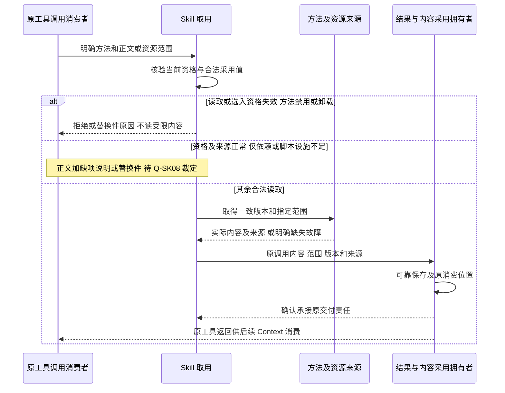
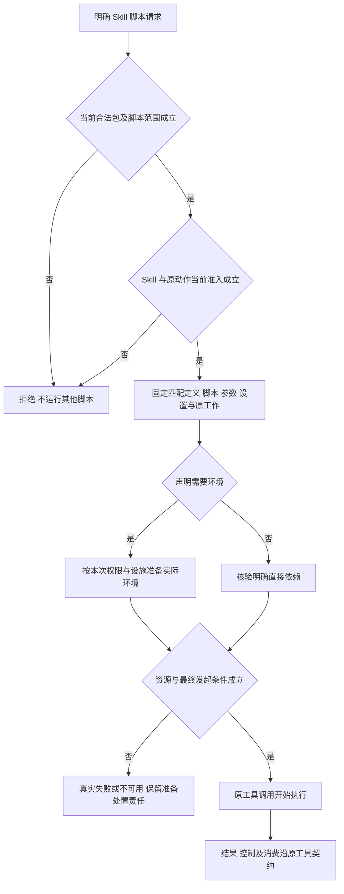
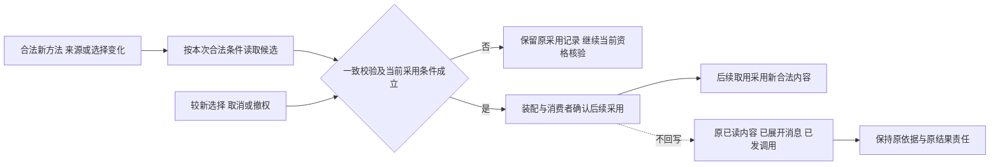

# Skill跨领域关键流程

状态：技术协作草案。图表达责任，不指定线程、进程或寿命；完整 INV 与 V 仍为正式成员承接缺项，责任见[正式承接缺口](../../../packages/skills/docs/architecture.md#完整行为候选的正式承接缺口)。

## F-SK01 合法来源、定义校验与候选交接

对应 J-SK01；INV-SK01、INV-SK02、INV-SK06、INV-SK08、INV-SK13。

来源拥有者确认主体、来源范围及当前读取资格，读取一次可核验材料；方法定义检查名称/说明/正文、资源及声明，资产拥有者处理持有、过滤与实现选择。工作区候选可在合法条件成立后读，正式采用仍等装配校验和交接。来源错误、完整包不一致或第三方冲突明确返回，读取失败不等同空目录。取消候选后释放自身读取句柄，已登记事实及原采用保留，原文件不改写。

## F-SK03 指定读取与工具消费者采用

对应 J-SK03；INV-SK01、INV-SK02、INV-SK05、INV-SK06、INV-SK08、INV-SK09、INV-SK11、INV-SK12。

图中 Q-SK08 仅标未裁的正文读取结果，不定义一种运行时默认回应。读取资格失效时不取原受限正文；仅执行依赖不足不等于该资格失效。无争议的读取不执行脚本、不产生激活、不改变系统提示词。来源在读取中变化时重读或失败，不能拼包。交接确认丢失时围绕原调用核实，不能新建一次返回来覆盖原状态；未可靠承接前取用/原调用按各自阶段保管。截断、缺资源与实际范围显式，Context 裁剪不重写已保存原结果。

## F-SK05 明确脚本、准入及真实执行

对应 J-SK05；INV-SK02、INV-SK04、INV-SK06、INV-SK07、INV-SK14、INV-SK15、INV-SK19、INV-SK20。

排队、最终发起与更新/取消/撤权之间由原准入协调者保护，旧建议改变绑定或约定时回消费者重判。准备失败不降到宿主；脚本内访问另核验目标、用途和权利。读取路径不触发此流程，Skill 许可不能执行任意路径，也不能绕过受限代码域的资源和宿主接口边界。

## F-SK06 绑定命令读取与用户消息承接

对应 J-SK06；INV-SK02、INV-SK05、INV-SK07、INV-SK09、INV-SK10、INV-SK11、INV-SK12。

命令拥有者完成匹配和绑定核验，再请求 Skill 当前合法正文及获准设置。Skill 返回材料、来源和范围，命令/入站消费者确认实际展开与用户输入关系，按消息契约可靠保存用户内容块及原受理身份。失败不以空展开报告成功，读取确认与消息确认分开。响应丢失后查询原受理结果，不重展开重复投递；正文更新不改历史用户块。本流程不创建工具 read 日志来替代用户消息。

本流程的正文取得沿 F-SK03。只有依赖或脚本设施不足的读取结果待 Q-SK08，命令适配不另定默认，已取得内容后的消息承接责任继续有效。

## F-SK07 合法新增、更新、选择、reload 与迟到候选

对应 J-SK07；INV-SK01、INV-SK03、INV-SK04、INV-SK08、INV-SK09、INV-SK10、INV-SK12、INV-SK13、INV-SK15。

创作入口和授权/资产拥有者先确认创建或修改授权，产物按实际提交位置属工作区或租户。Agent 不能直接提交组织资产或代用户提升；Skill 承接合法登记与选择后的候选。显式增量装载完成后，新方法当场可用，不改变 Agent Definition，不因新增能力重建 Agent runtime。具体创作入口和组织提升流程不由本流程设计。

工作区文件变化不自动采用，实际装配或显式 reload 才校验。迟到候选不能覆盖新选择，失败不发布混拼版本并保持原采用记录，不能延续已撤权资格；合法数据更新不必重建 Agent runtime。卸载只撤本实例贡献，旧在途工作和他方贡献保留；历史记录不延续已经撤销的访问权。旧未发建议的参数或绑定不匹配时交回重新判断。

## F-SK08 控制、迟到宿主结果与恢复

对应 J-SK08；INV-SK11、INV-SK12、INV-SK13、INV-SK16、INV-SK17、INV-SK18、INV-SK19、INV-SK20。

控制方定位原工具调用、代码域及资源并核验资格；各控制拥有者分别确认受理、实际停止及释放。代码域停止后，桥接与原调用拥有者继续保管已准入宿主工作和迟到结果，按当前披露资格交给原消费者或保留待交付责任。不能只向已销毁域返回，也不能通过新调用制造“重获结果”。

只丢失 Agent runtime 时认回原执行；确认工具计算丢失按原工具规则收束；查询失败保持未知。恢复读原调用、已确认效果和承接位置，仅接续未完成责任。资源回收由真实持有协议确认，结果与未完成消费不随计算消失。观察不重做执行，取消不撤销已经发生的效果，必要记录失败和剩余责任可查询。
