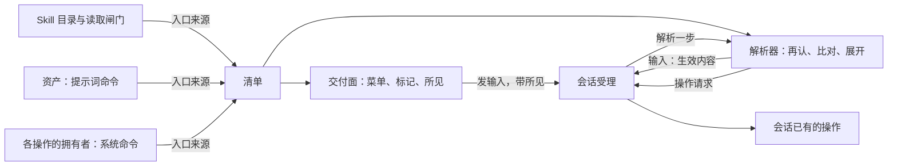

# Slash Command领域交接设计

已接受职责沿[领域入口](README.md)，本页只维护事实拥有者和跨领域交接。工程细化见[包组规格](../../../packages/slash-command/SPEC.md#应然设计)。

## 事实与责任归属

| 责任 | 自己拥有 | 交给相邻拥有者 |
| --- | --- | --- |
| 识别与匹配 | 名字的词法、全名与短名的解析、候选规则、补全与采用 | 呈现与按键归交付面 |
| 清单 | 合成、`missing`、公开的一半与只在服务端用的一半 | 每一项的事实归交出它的入口来源；租户、主体与会话由宿主显式给出 |
| 解析器 | 再认、比对所见、取用、展开、三种答复 | 受理流水线、提交、待处理与 Run 归会话；读取权归 Skill；操作的准入与效果归原操作 |
| 入口来源 | 拓展点的形状与十问的答案 | Skill 的来源归 Skill 的适配成员；提示词命令归资产的类别；系统命令归各操作的拥有者 |
| 提示词命令 | 定义校验与展开 | 持有、来源、同名替换与锁定归资产 |

命令领域不认识任何来源，也不认识会话：它给会话实现解析器这个端口，各来源实现它的入口来源拓展点。客户端的外壳动作与键位不进服务端，同一条控制在服务端是会话协议里已有的操作。

识别与匹配是纯契约，可以由显式给出文字与清单的程序直接用，不必启动 Cordis。清单与解析器经 Cordis 接到会话与各来源上。
