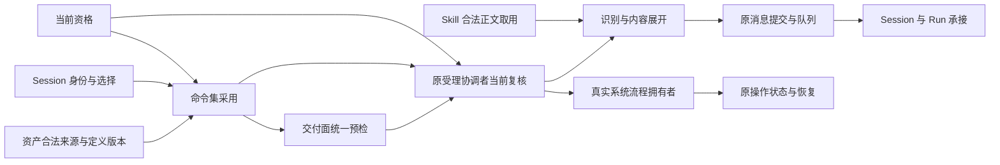

# Slash Command领域交接设计

状态：技术草案，未获技术接受。已接受职责沿[领域入口](README.md)，本页只维护事实拥有者和跨领域交接。工程细化见[组工程设计](../../../packages/slash-command/docs/architecture.md)，精确公开行为尚未分配正式成员。

## 事实与责任归属

| 责任 | 自己拥有 | 交给相邻拥有者 |
|---|---|---|
| 命令定义 | 名字、保留命名、三种绑定、参数声明及定义校验 | 资产持有/来源/替换、创作和提交授权 |
| 命令集采用 | 目标会话的采用集合、来源/版本依据、刷新与撤除边界 | Session 身份/选择、当前权限、必要装配与安全交接 |
| 识别与展开 | 统一语法、来源识别、参数校验、正文取用和确定的展开候选 | Skill 正文/资源/设置资格及实际取用，交付面呈现 |
| 原受理协调者 | 当前复核、本次输入固定、消息提交或流程交接 | 队列、日志与 Run 归会话与工作；流程效果归实际能力 |
| 原消息或流程拥有者 | 已受理/执行事实、原身份、确认、结果未知、取消及恢复 | 交付面只呈现事实；命令摘要不成为第二份权威状态 |

原受理协调者是相邻领域的组合责任，不是本域新队列或持久服务。资产求值供给合法来源，不承接命令的识别、展开或特殊刷新规则。Skill 取用供给实际正文，不承接命令解析。系统流程执行者拥有自己的准入、调用和副作用。

图中的命令定义/采用/展开可以由同一成员承载，也可以分开。成员采用不能复制同一公共形状或将操作消费者耦合到被选实现。独立识别和展开可由显式提供合法主体、定义及内容源的程序消费，不必启动 Cordis 或 Agent Loop；系统集成保证仍由相应协调者承担。
