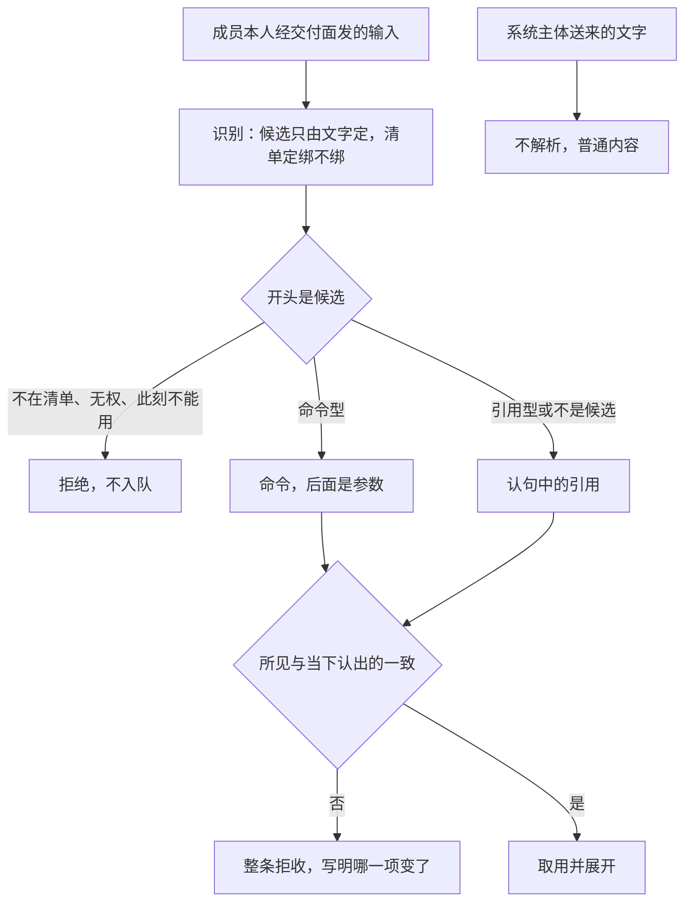
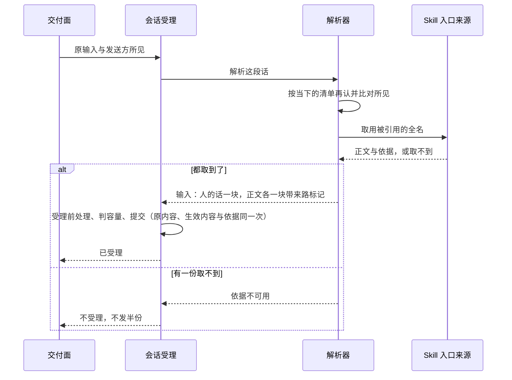

# Slash Command跨领域关键流程

图表达责任，不指定线程、进程或寿命；不变式见[包组规格](../../../packages/slash-command/SPEC.md#不变式)。

## F-SC02 识别、所见与受理时再认

对应 J-SC02、C-I1 到 C-I8。交付面与受理侧用同一个识别函数。开头不能用的命令停在交付面；发出时带发送方所见，受理侧按当下的清单再认，对不上整条拒收并写明哪一项变了，输入留在交付面。清单取不到是无法判断。

## F-SC03 提示词命令展开成消息

对应 J-SC03。解析器取这一版的提示词，代入参数，成为人的消息；之后照常走受理前处理、判容量、提交。脱敏作用于展开之后的内容。回执丢了按原请求认回，不按新定义重新展开。

## F-SC04 句中引用一份 Skill

对应 J-SC04、C-I9、C-I10、C-I15。解析器向 Skill 的入口来源取用：按原租户与主体读这一刻胜出的那一版，过 Skill 的读取闸门。人的话原样一块，每份正文各成一块文字块，带来路标记。任何一份取不到，整条不受理，不发半份。

## F-SC05 系统命令交给原操作

对应 J-SC05、C-I13。解析器答一个操作请求；会话用自己的同名操作去做，过它原来的访问裁定。不产生给模型的消息，不进待处理；会话留命令名、参数与结果摘要。原操作拒绝时显示它自己的拒绝；结果未知按原操作认回，不重做。

## F-SC06 Skill 装卸之后清单自动跟上

对应 J-SC06、C-I11、C-I12。Skill 目录背后的事实一变，下一次读清单就是新的，命令领域不做任何事。资产的变化经 Skill 的来源转成一帧「可能变了」，交付面收到就重读；读取权收回可能没有信号，由受理时现取守住。Skill 的提供者被卸下而装配声明它应当在时，清单的 `missing` 里写着它，有斜杠候选的输入答依据不可用，没有候选的照常受理。

## F-SC07 四种触发与客户端的控制

对应 CAP-SC09；不变式见[共用界面的规格](../../../packages/frontend/SPEC.md#不变式)的 FE-I52、FE-I53。按键、命令面板、按钮与 `/stop` 这类写法都只选中一个外壳动作。控制执行时调会话协议里已有的操作，点名界面此刻看到的那一轮或那一次调用；界面落后时服务端拒绝，新的一轮不受影响。一条命令此刻不能用，四种触发给出同一个原因。

## F-SC08 取消、未知提交与原身份恢复

对应 J-SC07。按原请求定位消息或操作，查询失败保持未知；已受理的接续其处理，已交出的操作交原拥有者控制，不重复投递或执行。来源撤下先不接新的取用，在途的各有结局。
