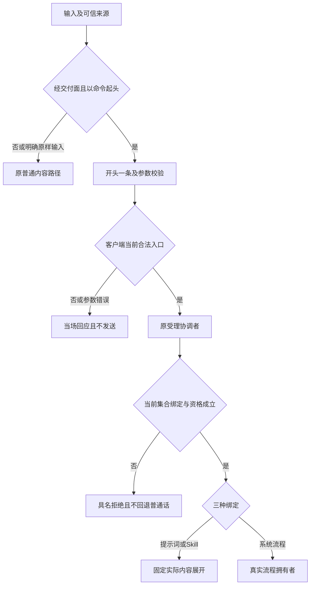
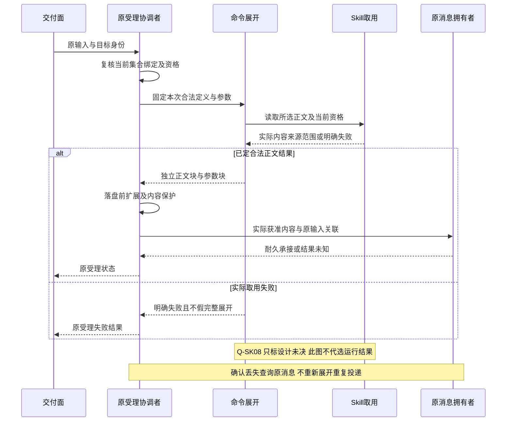

# Slash Command跨领域关键流程

状态：技术协作草案。图表达责任，不指定线程、进程或寿命；完整 INV 与 V 仍为正式成员承接缺项，责任见[正式承接缺口](../../../packages/slash-command/docs/architecture.md#完整行为候选的正式承接缺口)。

## F-SC02 交付预检与受理侧复核

对应 J-SC02、INV-SC03/08/09/10。人读/机读使用同一识别规则；未知/无权同回应和参数错误停在交付面。发出后原受理协调者重新核验当前集合、绑定和资格，不能信任客户端旧展开；名字已失效时具名拒绝，不进队列、流程或普通话路径。查询故障保持无法判断。

## F-SC03 提示词展开与消息持久承接

对应 J-SC03、INV-SC10/11/13/15/16。按受理时合法定义取得实际提示词及参数，展开后交落盘前扩展。改写/脱敏作用于展开内容；否决时原输入与展开正文一起不保存为消息，但拒绝事实须可查询且用户可见。通过后原消息拥有者共同保护内容、原命令关联和待处理资格，达到耐久边界后确认。通知失败不撤回提交；回执丢失查询原消息，不重展开重投。

## F-SC04 Skill 读取与用户内容的可靠交接

对应 J-SC04、INV-SC03/10/12/13/15/16。Skill 对原租户、所选方法和读取用途核验，返回实际正文、版本、来源和范围。命令形成逐字正文块及独立参数块，沿原消息位置提交。该操作不是工具 read 返回，不启动脚本。已读/已展开/已受理分别确认，后续 Skill 更新不替换历史块。

设计范围注记：Q-SK08 仅保留依赖/脚本设施不足时的读取结果分歧。下图覆盖已定正常结果与真实取用失败，不定义该未裁分支的运行时挂起、设计缺口回应或默认替换件。读取结果由 Q-SK08 唯一裁定后同步本流程。

## F-SC05 系统流程交接、失败及自动刷新

对应 J-SC05、INV-SC14/15/16/18。原受理协调者将合法动作交给实际流程；执行者给出原操作受理/拒绝/未知及后续结果。命令留痕不产生消息和队列资格，不替流程的恢复状态。服务缺席/拒绝先报告该次真实失败，再发起自动刷新；刷新失败单独可见，不抹掉原操作事实，不保证已经隐藏。取消或重连后查询原流程，迟到结果归原操作。

## F-SC06 指定范围 reload 与必要结构交接

对应 J-SC06、INV-SC04/05/06/07/17/18。采用协调者捕获请求范围及来源依据，校验合法一致候选；入口撤权即时保护，新授予/定义变化等刷新。只有注册表数据更新时发布该范围结果；Agent Definition 只采用会话已固定标识的新版本，不能更换身份。捕获的运行结构变化交装配校验完整构成并安全交接，保持原调用和消费位置。较新选择、取消或失效依据阻止迟到候选发布。候选失败保留原采用记录但不保留失效权利，真实新采用状态持久承接，不以命令摘要代替。

## F-SC07 取消、未知提交与原身份恢复

对应 J-SC03 至 J-SC07、INV-SC13/15/16/17/18。按原请求定位消息、流程或刷新状态，分别核对当前访问资格、已确认位置和未完成责任。查询失败保持未知；消息已确认只接续其处理，流程已准入交原拥有者控制，不重复投递或执行。提供者退出前可靠交接未完成工作，部分资源释放和迟到回调分别收束，不把 dispose 视为业务回滚。
