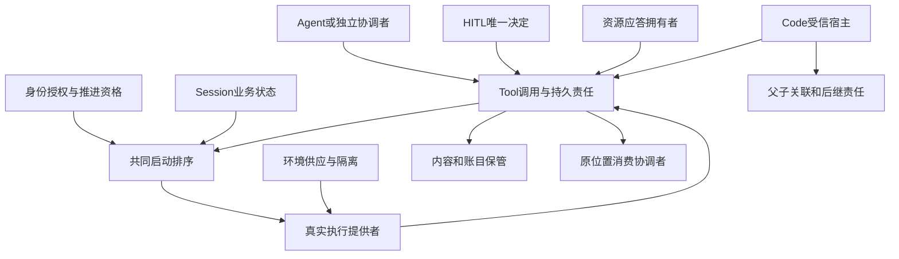

# 工具执行的角色与交接

本页在正式维护位置保存待审技术设计。领域分解已评审不等于成员技术接受、阶段选择或实现支持。契约包 `packages/tool/tool-contract` 与 `packages/tool/tool-cordis-contract` 已导出公开类型、契约函数、服务定义与端口一致性套件，见[支持范围](../../../packages/tool/README.md#支持范围)。实现成员位于 `packages/tool/tool` 与 `packages/tool/tool-host-local`，当前实现与组合验证范围仍以该支持表为准。

## 责任与依赖

Tool 组拥有工具专有定义、逻辑调用、真实执行、内部等待、控制实际结果、原结果、效果确定性及交付关系。契约包 `packages/tool/tool-contract` 定义这些契约，Cordis 定义归 `tool-cordis-contract`；`tool` 承担独立执行、账本与 runtime 的实现责任，`tool-host-local` 承担单机宿主适配的实现责任。具体支持与未交付部分见[组支持范围](../../../packages/tool/README.md#支持范围)。真实执行的提供者兑现共同契约，契约与实现分包，不合并二者版本和生命周期。

业务拥有者定义等待的请求/回应 schema 和工具输出性质；Schema 提供者负责通用形状检查。HITL 或资源响应拥有者在确认有效回应前完成校验，Tool 只接续原有效回应。成员的 [P12](../../../packages/tool/tool-contract/SPEC.md#p12-等待-schema-与响应提交)规定无效提交不消费等待，[P13](../../../packages/tool/tool-contract/SPEC.md#p13-双返回形态与程序输出契约)规定双返回归一化及程序数据校验。Code 和模型分别消费合法程序值与展示投影，不改变原结果与效果的拥有者。

Tool 通过公开能力访问被调用领域，不修改其私有状态或接管业务完成。包装工具的执行事实和被操作的业务对象分别有自己的身份和拥有者。

| 参与者 | 拥有的事实和责任 | Tool 的消费边界 |
| --- | --- | --- |
| assets、settings、permissions 及身份治理 | 持有、选择、设置、上界、主体和当前资格 | 使用合法求值结果及可解释依据，不从历史授权反推当前允许。 |
| 装配协调 | 已知身份、合法定义和实现选择、本次采用关系 | 已知不可用可用 dummy；从未合法取得不得猜造。装配只给候选，实现的装载、卸载与替换由 Tool 宿主的换代协调者执行。 |
| Agent 与独立发起协调者 | 可信调用方式与来源、生效参数、发起资格、准入及原用途 | 参数收齐后发起；脚本编排逐目标核对作者许可，独立入口不强制 Loop 或 Session。 |
| 执行环境提供者 | 隔离、设施、资源、可用性和真实故障域 | 准入后选择和准备环境，不能降级满足。 |
| Tool Execution 提供者 | 原调用、真实运行、等待、控制、收场、效果及执行账 | 前后台属于等待与交付关系，实际执行拥有者不变。 |
| HITL | 决策请求、卡片和一次有效决定 | Tool 保留原等待及处理位置，授权解释由身份与授权承担，答复处理异步接续。 |
| Session 与原消费者 | 业务取消、原消费位置、可靠承接、消息采用和后续处理；会话冻结状态与常驻工具的首次定义事实 | 不从通知取得推进资格，已终态工作只处理允许的迟到事实。Tool 只给冻结判定与原因 `tool-shape-lost`，状态转换由会话执行。 |
| Model 与 Request Context | 实际模型能力、模态投影、完整输入和请求组装 | 实际结果按可见内容校验，过程帧和执行账不塞模型上下文。 |
| Skill、MCP | 方法及脚本来源、端点身份、连接、发现和认证 | 脚本或远端动作通过 Tool 执行，方法读取或连接成功不等于执行获准。 |
| 账目及观测拥有者 | 财务事实、允许的明细和诊断投影 | 原调用及真实尝试可追溯，遥测估计不能替代账目。 |

领域接口和显式依赖允许独立消费。公开执行函数与 runtime 管理接口分别组织，纯函数或显式依赖闭包可不带 Session、租户和存储单独运行，运行时层承担持久与治理保证，系统集成承担托管资源资格。Cordis 集成入口负责装配、捕获、换代和生命周期适配，不能决定工具的业务含义。包的公开入口、依赖方向及同包集成沿[包组织](../../package-organization.md)和现行 IC；本设计不新增 Service key 或公开签名。

完整行为读[能力组](../../../packages/tool/README.md)，精确机制与流程随成员维护。

## 完整成员设计承接

以下说明成员设计在领域中的责任。公开形状由 [Tool public-api](../../../packages/tool/tool-contract/docs/public-api.md) 唯一维护，[对象模型](../../../packages/tool/tool-contract/docs/object-model.md)区分持久调用、实例协程与目录句柄，[操作协议](../../../packages/tool/tool-contract/SPEC.md#tool-操作协议)规定跨域提交和未知处理。领域层不复制类型。

| 协作边界 | Tool 的责任 | 邻接拥有者必须提供 |
| --- | --- | --- |
| 实际发起与失效排序 | 保存原启动意图和队列名额，执行边界消费具名许可 | 身份/授权、Session及推进资格的失效进入同一启动排序域后才确认新发起已被阻止 |
| 环境分配和清理 | 先存原操作，查询未知，保留释放任务 | 原分配可查询、受限能力可认回、延迟请求可排除、清理有具名回执 |
| HITL和资源答复 | 保存原wait、答复接手和后续处理，取消不填答案 | 唯一有效决定或资源回应的可信来源、当前资格及原请求查询；不强制外域采用同一数据库 |
| 原结果和消费 | 先原输出保管，再正式表示，精确版本独立delivery | 内容存储耐久；消费者提供retained或processed依据，Tool给生产侧解除回执 |
| 恢复和换代 | 协调权与执行连续性分开，无活体仍可查 | 原执行恢复路由、可靠连续性/排除依据、接手者对完整责任清单确认 |
| Code编排 | 先预留父子关系，每子调用仍走Tool；父退出后保管 | Code提供者固定语言/数据桥，环境拥有者证明隔离与限额；不新增runtime类别 |

成员逐能力覆盖与真实组合验收入口见 [coverage](../../../packages/tool/tool-contract/verification/README.md)。这些邻接提供者的实现与接受仍由各自拥有者负责。无法参与共同围栏或保管协议的组合不得声明满足该项保证；保留未知而不降低目标。
