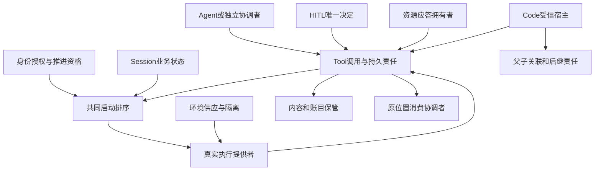
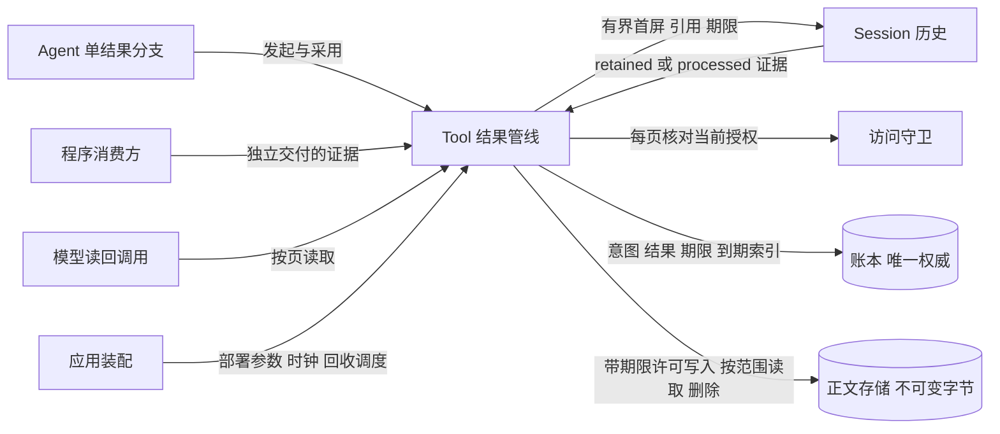

# 工具执行的角色与交接

本页在正式维护位置保存待审技术设计。领域分解已评审不等于成员技术接受、阶段选择或实现支持。契约包 `packages/tool/tool-contract` 与 `packages/tool/tool-cordis-contract` 已导出公开类型、契约函数、服务定义与端口一致性套件，见[支持范围](../../../packages/tool/README.md#支持范围)。实现成员位于 `packages/tool/tool` 与 `packages/tool/tool-host-local`，当前实现与组合验证范围仍以该支持表为准。

## 责任与依赖

Tool 组拥有工具专有定义、逻辑调用、真实执行、内部等待、控制实际结果、原结果、效果确定性及交付关系。契约包 `packages/tool/tool-contract` 定义这些契约，Cordis 定义归 `tool-cordis-contract`；`tool` 承担独立执行、账本与 runtime 的实现责任，`tool-host-local` 承担单机宿主适配的实现责任。具体支持与未交付部分见[组支持范围](../../../packages/tool/README.md#支持范围)。真实执行的提供者兑现共同契约，契约与实现分包，不合并二者版本和生命周期。

业务拥有者定义等待的请求/回应 schema 和工具输出性质；Schema 提供者负责通用形状检查。HITL 或资源响应拥有者在确认有效回应前完成校验，Tool 只接续原有效回应。成员的 [P12](../../../packages/tool/tool-contract/SPEC.md#p12-等待-schema-与响应提交)规定无效提交不消费等待，[P13](../../../packages/tool/tool-contract/SPEC.md#p13-双返回形态与程序输出契约)规定双返回归一化及程序数据校验。Code 和模型分别消费合法程序值与展示投影，不改变原结果与效果的拥有者。

Tool 通过公开能力访问被调用领域，不修改其私有状态或接管业务完成。包装工具的执行事实和被操作的业务对象分别有自己的身份和拥有者。

| 参与者 | 拥有的事实和责任 | Tool 的消费边界 |
| --- | --- | --- |
| assets、settings、permissions 及身份治理 | 持有、选择、设置、上界、主体和当前资格 | 使用合法求值结果及可解释依据，不从历史授权反推当前允许。 |
| 装配协调 | 已知身份、合法定义和实现选择、本次采用关系 | 已知不可用可用 dummy；从未合法取得不得猜造。装配只给候选，实现的装载、卸载与替换由 Tool 宿主的换代协调者执行。 |
| Agent 与独立发起协调者 | 可信调用方式与来源、生效参数、发起资格、准入及原用途 | 参数收齐后发起；脚本编排逐目标核对作者许可，独立入口不强制 Loop 或 Session。 |
| 执行环境提供者 | 隔离、设施、资源、可用性和真实故障域 | 准入后选择和准备环境，不能降级满足。 |
| Tool Execution 提供者 | 原调用、真实运行、等待、控制、收场、效果及执行账 | 前后台属于等待与交付关系，实际执行拥有者不变。 |
| HITL | 决策请求、卡片和一次有效决定 | Tool 保留原等待及处理位置，授权解释由身份与授权承担，答复处理异步接续。 |
| Session 与原消费者 | 业务取消、原消费位置、可靠承接、消息采用和后续处理；会话冻结状态与常驻工具的首次定义事实 | 不从通知取得推进资格，已终态工作只处理允许的迟到事实。Tool 只给冻结判定与原因 `tool-shape-lost`，状态转换由会话执行。 |
| Model 与 Request Context | 实际模型能力、模态投影、完整输入和请求组装 | 实际结果按可见内容校验，过程帧和执行账不塞模型上下文。 |
| Skill、MCP | 方法及脚本来源、端点身份、连接、发现和认证 | 脚本或远端动作通过 Tool 执行，方法读取或连接成功不等于执行获准。 |
| 账目及观测拥有者 | 财务事实、允许的明细和诊断投影 | 原调用及真实尝试可追溯，遥测估计不能替代账目。 |

领域接口和显式依赖允许独立消费。公开执行函数与 runtime 管理接口分别组织，纯函数或显式依赖闭包可不带 Session、租户和存储单独运行，运行时层承担持久与治理保证，系统集成承担托管资源资格。Cordis 集成入口负责装配、捕获、换代和生命周期适配，不能决定工具的业务含义。包的公开入口、依赖方向及同包集成沿[包组织](../../package-organization.md)和现行 IC；本设计不新增 Service key 或公开签名。

完整行为读[能力组](../../../packages/tool/README.md)，精确机制与流程随成员维护。

## 完整成员设计承接

以下说明成员设计在领域中的责任。公开形状由 [Tool public-api](../../../packages/tool/tool-contract/docs/public-api.md) 唯一维护，[对象模型](../../../packages/tool/tool-contract/docs/object-model.md)区分持久调用、实例协程与目录句柄，[操作协议](../../../packages/tool/tool-contract/SPEC.md#tool-操作协议)规定跨域提交和未知处理。领域层不复制类型。

| 协作边界 | Tool 的责任 | 邻接拥有者必须提供 |
| --- | --- | --- |
| 实际发起与失效排序 | 保存原启动意图和队列名额，执行边界消费具名许可 | 身份/授权、Session及推进资格的失效进入同一启动排序域后才确认新发起已被阻止 |
| 环境分配和清理 | 先存原操作，查询未知，保留释放任务 | 原分配可查询、受限能力可认回、延迟请求可排除、清理有具名回执 |
| HITL和资源答复 | 保存原wait、答复接手和后续处理，取消不填答案 | 唯一有效决定或资源回应的可信来源、当前资格及原请求查询；不强制外域采用同一数据库 |
| 原结果和消费 | 先原输出保管，再正式表示，精确版本独立delivery | 内容存储耐久；消费者提供retained或processed依据，Tool给生产侧解除回执 |
| 恢复和换代 | 协调权与执行连续性分开，无活体仍可查 | 原执行恢复路由、可靠连续性/排除依据、接手者对完整责任清单确认 |
| Code编排 | 先预留父子关系，每子调用仍走Tool；父退出后保管 | Code提供者固定语言/数据桥，环境拥有者证明隔离与限额；不新增runtime类别 |

成员逐能力覆盖与真实组合验收入口见 [coverage](../../../packages/tool/tool-contract/verification/README.md)。这些邻接提供者的实现与接受仍由各自拥有者负责。无法参与共同围栏或保管协议的组合不得声明满足该项保证；保留未知而不降低目标。

## 结果卸载

[结果卸载](../../../.meta_harness/design/ubiquitous_language/terms/execution-and-outcome.md#ul-result-offloading--结果卸载--result-offloading)只处理本来给模型阅读的正文。产品规则见[产品正文](../../../.meta_harness/design/product/tool-execution/design.md#结果保管卸载与模型采用)，系统约束见[工具运行时](../../architecture/runtime/tool-runtime.md#返回结果与执行账)与[模型 ACK 与副本清理](../../architecture/runtime/streaming-and-consumption.md#模型-ack-与副本清理)。本节规定 Tool 领域内的责任划分、跨域交接、性质的守护者和组合验证责任。能力组的工程分解见[结果卸载的工程分解](../../../packages/tool/docs/architecture.md#结果卸载的工程分解)。

本节是目标设计。成员 SPEC 和实现还没有按本节改写，本节不表示当前代码满足这些性质。

### 领域模型

一次调用的结果在 Tool 的账本中有唯一的结果记录。需要卸载时，结果记录带一个正文描述，指向一份正文。正文的事实分成两部分：

- 正文条目：保存在账本中这次调用的调用域里。它是正文是否存在、是否可读的唯一依据。
- 正文字节：保存在正文存储中。字节不可变，没有业务状态。存储不知道结果、期限和授权。

一份正文只属于一个结果。正文身份不复用，不在结果之间共享，也不去重。正文的期限在结果提交时固定，只由账本保存。读取、交付确认、重试、压缩、归档和重启都不延长期限。

程序值、附件和原生资源引用不属于正文。卸载不改变它们的值，原生目标不在 Tool 的删除范围内。

### 域内责任

| 承担者 | 承担的责任 | 不承担的责任 |
| --- | --- | --- |
| 契约 `tool-contract` | 返回声明中的正文格式、上限和预览方式；正文策略的语义；读回、账本端口、正文存储端口和时钟端口的契约；部署参数的有效域；端口一致性套件 | 存储技术、事务范围和调度方式 |
| 实现 `tool` | 判定是否卸载，形成有界首屏，提交结果；正文条目的生命周期；授权读回；按到期索引回收 | SQL 细节；宿主事实的放置 |
| 存储提供者 `tool-storage-sql` | 在 SQL 存储契约上兑现账本端口和正文存储端口，含按租户分区、条件提交和到期索引 | 正文期限、读取授权和是否卸载 |
| 宿主适配 `tool-host-local` | 把每次调用的宿主事实放进该调用的调用域；租户级域只保存跨调用状态；启动受理用条件提交断言租户级守卫的版本 | 正文保管与回收 |
| 应用装配（本域之外） | 给出系统上限、部署参数、许可签名密钥和时钟；启动时校验参数；按间隔调用回收入口 | 回收的判定逻辑；正文内容 |

每项决定只有一个拥有者。期限只由账本拥有。正文是否可读只由账本判定。授权只由访问守卫判定，Tool 在每次读回时消费访问守卫的当前判定。

### 跨域交接

Tool 不读取 Session 的私有状态。消费方用自己的证据完成交接，Tool 用自己的账本判定释放。

1. Agent 发起调用，并在执行动作之后的单结果分支采用 Tool 已提交的交付。该位置不可用时，Agent 按[不可用、报错与系统扩展](../../architecture/runtime/loop-extensions.md#不可用报错与系统扩展)记录不可用，不能伪造已卸载，也不另存正文。是否卸载、首屏内容和期限由 Tool 在结果提交时确定。
2. Session 耐久保存交付中的首屏、读回引用和期限，然后交回 retained 或 processed 证据。Tool 凭证据释放普通副本。Session 不另存卸载正文，也不为正文续期。
3. 程序消费方是独立的消费方。它有自己的交付和证据。Tool 在结果提交时，按固定请求中的发起方建立程序交付，不依赖程序事后登记。模型交付的释放不释放程序值。某个通道的值只在需要它的全部交付都释放后才被替换为摘要。
4. 模型通过读回工具按页读取正文。每次读回都是新的工具调用，不改原首屏，不重计原调用费用，不重做原效果。每页都重新核对当前授权、租户和结果版本。
5. 正文到期后，读回返回明确的不存在，不重新执行原工具。历史保留首屏、原引用和期限。

### 性质与守护点

| 性质 | 含义 | 守护者 |
| --- | --- | --- |
| 有界披露 | 未卸载时，首次给模型的正文不超过有效上限 L。卸载后，首屏由描述头和预览组成：描述头是元信息，大小有按声明算出的固定上限；预览不超过预览预算 P。两者都与正文大小无关。读回页不超过页预算 | `tool` 的结果采用 |
| 原文保真 | 按页读回能逐字节重建已封存的正文。页边界不切断字符或 JSON Lines 记录。每个非末页都推进位置 | `tool` 的读回 |
| 通道独立 | 卸载不改变程序值、附件和原生引用 | `tool` 的结果模型；`tool-contract` 的删除范围类型 |
| 读即授权 | 每次读回都核对当前授权、租户和结果版本。引用本身不授予权限 | `tool` 的读回与访问守卫 |
| 有限期限 | 正文可读，当且仅当它已封存、已关联到结果且未到期。期限在结果提交时固定，不续期。到期后答复不存在 | `tool` 的账本 |
| 不重执行 | 恢复、重投递和读回都不增加工具业务的执行次数 | `tool` 的账本 |
| 先耐久再发布 | 正文耐久封存并关联到结果后，Tool 才发布引用 | `tool` 的结果采用 |
| 交接释放 | 消费方耐久承接后，Tool 才释放普通副本。同一采用身份只追加一次 | Tool 与 Session 的交接协议 |
| 历史无关 | 每次 Tools 调用的 SQL 语句数、行数和逻辑字节与租户已结算的调用数无关 | `tool-host-local` 的放置 |
| 有界聚合 | 租户级状态只随存活调用、存活正文和守卫增长。已结算调用的簿记退休。正文回收后不留行 | `tool-host-local` 与 `tool` 的回收 |
| 退休等价 | 簿记退休后，原操作认回、排除和读回从调用域终态得到的答复与退休前相同 | `tool-host-local` |
| 租户隔离 | 引用、游标、许可、证据和回收都不跨租户生效 | 全部承担者 |

有限期限、先耐久再发布、有界聚合和退休等价必须在下列条件下成立：账本与正文存储是两个独立参与者，两步之间可能崩溃，参与者之间的时钟有偏差。到期时刻附近的时钟偏差窗口、部署参数与时钟前提见[部署无关原则](../../../packages/tool/docs/architecture.md#部署无关原则)。

已知风险：租户级启动守卫域随控制动作增长，增长上界由 Agent 契约裁定。

### 组合验证责任

成员测试不能证明下列组合性质。Tool 能力组承担这些验证，接受仍按[组合验证与符合性](../verification.md#组合性质与承担者)执行。

1. 历史无关关卡：在真实的 Agent、Tool 与 SQL 提供者组合中，分别在租户已结算 20 次和 2000 次调用后执行一次 Tools 调用。按拥有者统计 SQL 语句数、行数和逻辑字节，两组数字必须逐项相等。
2. 真实组合路径：同一组合完成卸载、Session 承接、按页读回、到期和到期后读回。重启不重设期限，到期后的读回不重新执行原工具。
3. 提供者一致性：账本端口和正文存储端口的一致性套件必须运行一个分步替身。替身把账本与正文存储分成两步，在两步之间注入崩溃，并让参与者的时钟在偏差上界内偏移。每个提供者都通过同一套件，包括把两步合进一个事务的本地提供者。
4. 双租户测试：引用、游标、许可、证据和回收都不能跨租户生效。
5. 有限模型：BodyLifecycle 覆盖有限期限、先耐久再发布和有界聚合，StartConsume 覆盖启动受理与守卫失效的顺序，Disclosure 与 Handoff 覆盖有界披露与交接释放。模型只证明所列的有限状态和假设，不证明实现。实现靠公开接缝上的反例测试与模型对应。

缺少真实存储、进程崩溃或真实组合时，报告无法验证，不用替身的通过声称满足上述性质。
