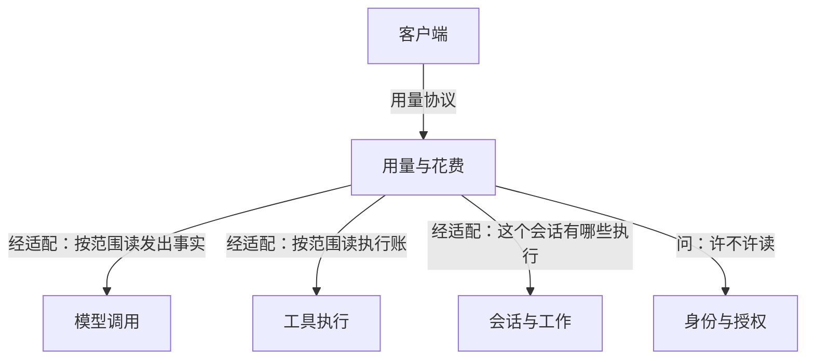

# 用量与花费

## 范围与边界

用量与花费把各个产生方的用量与费用合起来，按一个会话或一个租户、按时间段与维度统计，并给人看。它也给出一个会话的上下文占比。

它是接在核心系统上的插件。核心域的成员不依赖它；去掉它，会话、agent、模型与工具原有的流程不变，任何事实都不丢。

它不拥有事实。每一笔用量、费用与时刻归产生它的一方：

| 事实 | 归谁 |
| --- | --- |
| 一次模型发出的时刻、用量、费用，以及迟到费用的补录 | [模型调用](../model-invocation/README.md) |
| 一次工具执行的时长与执行账 | [工具执行](../tool-execution/README.md) |
| 一个会话有哪些执行 | [会话与工作](../sessions-and-work/README.md) |
| 谁能读哪个范围 | [身份与授权](../identity-and-authorization/README.md)，以及每个产生方自己的读取资格 |
| 账目的修订、小计与单位 | 共同包组的[调用账目](../../../packages/common/SPEC.md#调用账目) |

## 模块角色与事实归属

| 模块角色 | 责任 |
| --- | --- |
| 用量的共同形状 | 用量事实、查询、度量、覆盖说明的值，与折叠、切分、比率的规则 |
| 来源登记 | 现在有哪些用量来源；一份份登记，撤回只撤自己的 |
| 查询 | 一次查询的次序：资格、范围、读来源、折叠、合并 |
| 适配 | 把产生方与会话的公开读口接成用量的端口 |
| 开放 | 对客户端的协议与接入 |
| 展示 | 面板、卡片、呈现、布局 |

## 协作

依赖只从用量指向核心。产生方各自提供一个用自己的词说的读口，不知道谁来读。会话的范围按执行定：产生方的事实带着受理时冻结的消费者引用，会话给出自己的执行。

组合保证：一次查询只在资格放行、范围解析成功、每个登记着的来源都答了的时候成立；任何一处不成立，整次查询如实说出是哪一处。承担者是用量的查询。

精确规则见[包组规格](../../../packages/usage/SPEC.md)与[产品正文](../../../.meta_harness/design/product/usage-and-cost/design.md)。
