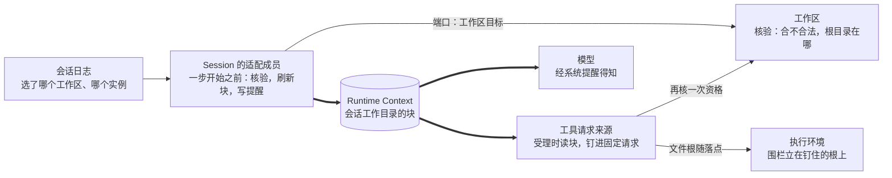

# 工作区领域交接设计

领域责任沿[已接受入口](README.md)；本页只拥有角色、事实归属与跨领域交接。

## 责任与协作

工作区维护逻辑身份、参与、实例与地址关联，并为获准消费者提供资源来源。完整长期行为位于 [工作区包组规格](../../../packages/workspace/SPEC.md#应然设计)。独立领域行为不依赖 Cordis 的业务含义；将来集成入口只承载真实依赖注入与生命周期，不把治理、授权或来源规则藏入内核。

| 事实拥有者 | 本次责任 | 交接与边界 |
| --- | --- | --- |
| 工作区治理 | 身份、托管治理归属、参与关系、按合法治理配置授撤的授权与关系有效性 | 消费身份与资源授权，不拥有登录或租户私有权利 |
| 实例与地址关联 | 指明实例属于哪个工作区、在哪个节点及有效入口；区分关联与实际可用性 | 环境拥有实际设施及资源寿命，不从路径造身份 |
| 工作区来源读取 | 根据明确候选选择、有效参与及实例条件和当前读取资格读取共享/local 及获准兼容来源，记录范围、版本与错误 | 读取不以装配完成为前提，也不代表已采用；资产拥有类别格式、资格求值和实现解析，Context 拥有目录指导 |
| 管理类型 | 认一个地址、判断能否接纳为实例、现看可用性与装载依据、指出来源根 | 只读，不执行物理资源里指定的程序。共同层不伪造底层能力，不统一跨地址合并或重做 Git；真实的读写与同步由人和 agent 用原生手段做 |
| Session | 当前工作区选择、变更、会话工作目录的发布与逻辑工作身份 | 工作区返回合法关联、根目录与装载依据，不替 Session 写选择历史，不认识会话 |
| 装配与交接 | 求值采用、必需依赖、候选校验及推进权交接 | 工作区不自行替换运行实例或迁移已发调用 |
| 执行环境与 Runtime Context | 实际落点、资源恢复事实；将真实变化供给 agent | 工作区关联不代表沙箱隔离、物理重建或原痕迹存在 |
| 人的交付面 | 收集明确选择，呈现目标、状态、失败与恢复入口 | 无权把排队显示为完成、把普通目录显示为有效附着 |

### workspace 三轴与承载者

`workspace` 分为身份、实例与版本三轴。下表列出各轴的拥有者与当前承载者。

| 对象 | 承载什么 | 拥有者或当前持有者 |
| --- | --- | --- |
| `WorkspaceId` 的含义 | 哪个工作区 | 工作区域 |
| `WorkspaceId` 的文本形式 | legal-identity 第六族文本，前缀 `wsp_` | [legal-identity](../../../packages/common/SPEC.md#合法身份) |
| 工作区附着 `WorkspaceAttachment` | 实例标识 `instance` 与装载依据 `basis` | 语义与形状归工作区域的契约成员；值由附着核验给出，[Session](../../../packages/session/SPEC.md#会话的固定事实与采用) 引用并记进会话日志 |
| Session 创建、`DeclarationChange` 的 `workspace` 分支、SE05 `session.workspace-changed` | 身份加附着 | [session-contract](../../../packages/session/SPEC.md#受理与输入) |
| Tool 的 `SourceLayer` | 只承载身份 | [tool-contract](../../../packages/tool/SPEC.md) |
| Tool 的 `FixedToolRequest` | 身份、实例与受理时钉住的工作目录 | [tool-contract](../../../packages/tool/SPEC.md) |
| `AssemblyContext.workspace` | 只承载文本，不解析 | [request-context-contract](../../../packages/context/SPEC.md#应然设计) |
| 一次调用的文件根 | 落点 | [执行环境域](../execution-environments/README.md)。取自固定请求里钉住的工作目录 |

## 两层：治理与物理资源

工作区的模型分两层，两层各自独立变化。

| 层 | 管什么 | 随管理类型变不变 |
| --- | --- | --- |
| 逻辑治理 | 身份、关系与授权、实例关联、原操作 | 不变 |
| 物理资源 | 这份资源是什么、在哪、处在什么版本、两次物化是不是同一份 | 变，由管理类型回答 |

类型的继承只发生在物理资源层：文件系统型是基础，Git 型拓展它，只加不减。治理层只经管理类型的接口问物理上的事。换一种治理策略不动物理层，加一种管理类型不动治理层。

## 会话工作目录

会话选定工作区的实例之后，这个会话的工具默认在实例的根目录里运行。这是五个拥有者合起来才成立的保证，组合承担者是服务端应用的装配与 Session 的适配成员。

| 拥有者 | 它守的那一段 |
| --- | --- |
| Session | 选择在会话日志里。块只在一步开始之前换值，所以更换从下一步起生效 |
| 工作区 | 核验的答复。不认识会话，不发布这个块 |
| Runtime Context | 把块供给工具请求来源与模型类读者。读不到是缺项，不是默认目录 |
| Tool | 一次调用从受理起钉住一个工作目录，重建之后的恢复仍用它 |
| 执行环境 | 文件根随落点，围栏按自己的规则立 |

知道目录不构成许可：块说的是目录在哪，许不许由每次调用受理时对工作区的再核验决定。

## 来源修订计数

装配入口用[比对代替求值](../../architecture/runtime/assembly-and-change.md#比对代替求值)，需要工作区来源读取按（工作区，租户）分别提供来源修订计数。某租户的可读材料变化（包括本地文件修改与来源同步），或参与关系变化使该租户可读的范围改变时，该租户对应的计数加一。参与关系变化不推进同一工作区其他租户的计数。会话选了哪个工作区是 Session 的事实，由装配入口直接比对，不计入本计数。参与关系变化由工作区治理在提交该变化的同一次提交里推进计数；经系统的来源同步由来源读取在同一次提交里推进。计数只增不减，进程重启后不倒退。

不经系统发生的本地文件修改也要计入：来源读取负责发现这类修改，发现时计数加一，并在进程重启后补查停机期间的修改。来源读取还要向装配入口报告发现是否已追平到入口时刻；没有追平时入口按同步求值读取来源，所以新 Run 仍读到当时的来源。发现修改的方式由工作区成员选择，代价是持续观察来源目录与重启补查。

变化提交后，来源读取通知订阅方，通知只带作用域、来源类别、新计数和变化原因，不带私有配值或凭据。计数变化只说明来源变了，不构成采用；文件修改与 Git 同步仍不触发重装。通知丢失不改变正确性，装配入口读当前计数比对。计数的存储与通知机制由工作区成员实现。

邻域采用范围只取存在的正式入口：[身份与授权](../identity-and-authorization/README.md)、[资产与规则](../assets-and-rules/README.md)、[Session 与工作](../sessions-and-work/README.md)、[装配与交接](../assembly-and-handoff/README.md)、[执行环境](../execution-environments/README.md)、[Runtime Context](../runtime-context/README.md)、[工具执行](../tool-execution/README.md)、[Skill](../skills/README.md)、[MCP](../mcp/README.md)和[Slash Command](../slash-commands/README.md)。
