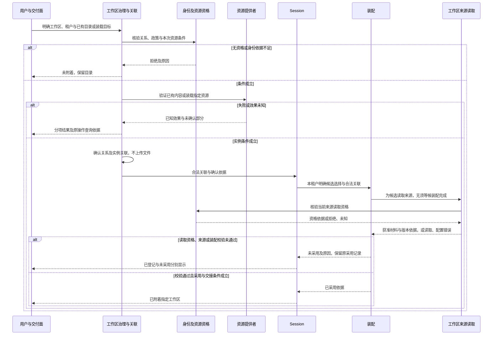
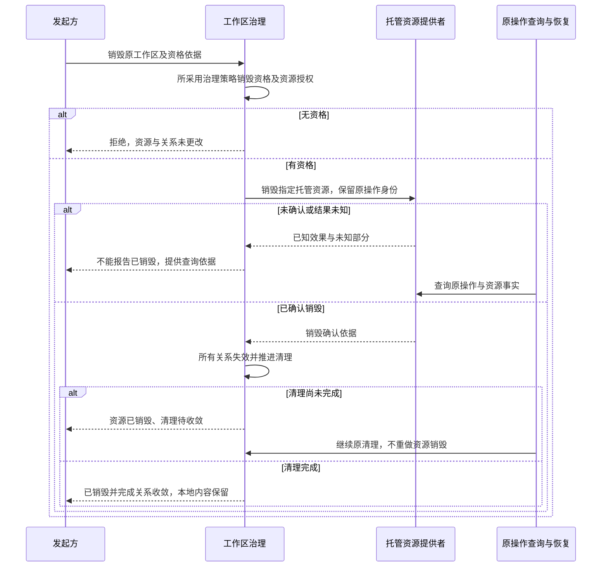

# 工作区跨领域关键流程

状态：技术协作草案。图表达责任，不表示进程或寿命共属。产品旅程见[产品正文](../../../.meta_harness/design/product/workspaces/design.md)，所有 INV 与验证义务归[完整 SPEC](../../../packages/workspace/workspace/SPEC.md)。

本页及成员机制流程共同守护 INV-WS18 的观测与披露边界。

## F-WS01 显式登记、关联与附着

对应 J-WS01；守护 INV-WS01、INV-WS02、INV-WS03、INV-WS04、INV-WS06、INV-WS07、INV-WS13、INV-WS14。

普通进入目录不触发此流程。已有内容不得覆盖，装载失败不得替换成空工作区。明确候选选择、有效参与与政策、实例条件及当前读取资格成立后，允许读取候选来源；候选校验及采用与交接条件成立前不得生效。首次接入没有原采用时，读取或校验失败后的工作区层仍为空，已经确认的登记与关联保持各自事实。中断后的恢复先查询关系及实例状态；登记已经确认时不重复创建，后续资格仍分别核验。

## F-WS02 跨会话、租户与节点继续

对应 J-WS02；守护 INV-WS01、INV-WS03、INV-WS05、INV-WS10、INV-WS12、INV-WS13。

新的 Session 明确选择逻辑工作区及获准实例，按自己的租户条件实际装配。实例可先存在，多租户共用时分别求值，私有材料不随实例流转。地址或实例失效时分别报告，选择其他合法入口仍保持工作区身份，已发调用仍归原工作。会话结束不卸载实例；新建 Git worktree 仅产生原生资源构造，显式关联后才成为可用 Omne 实例。

## F-WS03 原生资源操作及恢复

对应 J-WS03、J-WS04；守护 INV-WS01、INV-WS03、INV-WS10、INV-WS13、INV-WS14、INV-WS15。

发起方携带原工作、目标和权限依据，资源提供者核对管理类型能力，沿原生语义读写或同步。`.omne` 每次变更纳入所采用的共享同步范围，面向获准租户共享，不能因按需或异步而永久排除。Git 冲突保留可判断状态，由 agent 按授权处理；缺业务取舍或新授权时再请求协作。结果说明本地或具体远端目标，排队与完成不合并，多地址不自动传播。超限保留原件。超时/取消后查询原操作，区分已完成、未执行与未知；不能凭新选择或重连盲目重放。

## F-WS06 选择变化与显式 reload

对应 J-WS06；守护 INV-WS03、INV-WS05、INV-WS11、INV-WS12、INV-WS13、INV-WS14。

Session 记录请求选择，工作区提供合法关联和读取版本，装配准备并校验候选。校验失败保留旧合法采用状态；通过后按自身结构与数据变化的实际边界交接。新选择及取消阻止迟到候选覆盖当前事实。已发调用不换工作区、实现或环境，原结果仍可回写；旧建议未执行时核验当前约定。环境报告真实落点和痕迹，Context 供给变化，不以此重做原工具。临时读取资源结束后释放，实例生命周期保持独立。

## F-WS07 超管授撤与关系解除

对应 J-WS07；守护 INV-WS03、INV-WS04、INV-WS10、INV-WS13、INV-WS14、INV-WS16。

先区分托管或外部、所采用治理策略、调用资格及目标租户。授撤治理授权不移交所有权，撤权保留关系；删除参与关系一并解除关系附带授权。有效工作区不能未经合法归属变更就单独失去唯一治理所有者，无移除资格的参与者不能移除他人，外部首登者不能因登记获得托管治理特权。PF-020 的创建者/超管规则是具名策略候选，其他合法组织治理策略不得由本流程无依据排除。提交成功后后续装配不读取目标租户已解除工作区的来源，目录和其他租户关系保留。未知查询不返回退出成功；组织成员退出的私有保留规则交身份/资产。

## F-WS08 托管销毁、确认与关系收敛

对应 J-WS08；守护 INV-WS03、INV-WS04、INV-WS13、INV-WS14、INV-WS16、INV-WS17。

取消或重启不抹去确认依据。关系残留不得继续授权；本地残留既不证明中心可用，也不自动成为替代工作区。外部仓库退出不走此流程。实际跨拥有者协议尚须技术选择，但未知、确认和清理未完成的语义不得省略。
