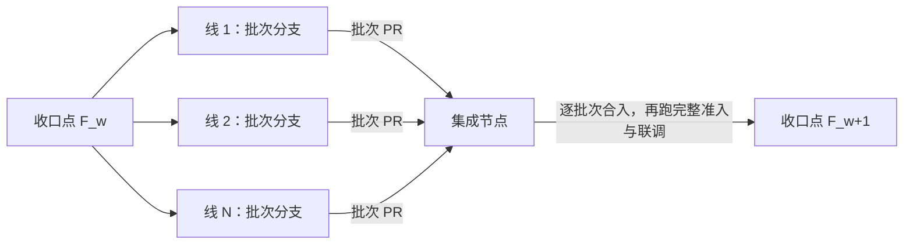

# 多层分支集成

本页拥有工程路线、双基线与权限规则。精确工具行为归[集成工具契约](../../tools/dev-flow/src/integration/SPEC.md)，命令归其[README](../../tools/dev-flow/src/integration/README.md)。任务仍归[现有交付协议](delivery.md)，不新增活动队列或自动接受规则。

## 分支与任务

自 2026-10-15 起，四条主干的进入按[现行准入](#现行准入)执行：`github-gate` 的流程构造合并并写记录标签。本机集成工具只负责任务开工、状态读取、基线、task-sync，以及为提升 PR 生成说明的「所含的卡」与「契约变化」两节（`ri-notes`，只读，只报告）。它不构造候选，也不验证或发布。

main 保存完整集成结果。任意数量的 integration/<track> 保存已登记责任轨道。stable 指向 main 中经过完整检查的既有 checkpoint。轨道和 stable 不加用户名；工作及临时分支遵守人的署名约定。

任务从真实 Issue 的 revision 和当前 attempt 开始。指定调度者记录并读回人的责任、分支、route、不可变 taskBase、写范围与条件定位。任务进入 route 中具名的那条轨道。在子轨道上做的卡，route 具名该子轨道。cross-track 或 global 完整单元先进入一条具名的顶层轨道，并具名受影响责任，再随它进入 main。目录不能自动决定路线。

## 轨道责任与保护

[policy registry](integration-policy.json) 登记轨道身份、owner、状态、上游和固定起点。下表是当前的轨道责任。`start` 读取当前 HEAD 提交中的 registry，只为状态为 active 的轨道开工，并核对它的上游链，见[轨道树与上游](#轨道树与上游)。

| 轨道                                | 责任与适用任务                                                                                                                           |
| ----------------------------------- | ---------------------------------------------------------------------------------------------------------------------------------------- |
| `integration/legacy-refactor`       | 联调轨道，见[交付线](#交付线)：各线轨道的上游，承接跨线集成、联合验收、破坏性契约改动与工程工具链的卡。原责任保留：将 0.0.1.legacy 已支持的功能迁入新的文档体系、架构和包结构；以已确认能力清单防止功能遗漏，不借重构扩大到全部 0.1.0 范围 |
| `integration/engineering-toolchain` | paused：不接受新任务。工程工具链线的卡进入联调轨道，见[交付线](#交付线)                                                                 |

新轨道由 `gate-track` 流程从上游的 first-parent 提交创建，起点记在 registry 的 `initialBase`，见[轨道树与上游](#轨道树与上游)。后续上游变化通过 FI 同步，不改写起点。任务 route 必须明确选择轨道，不设置隐含默认轨道。

GitHub 对 `integration/**/*` 分别实施三项保护：只有仓库管理员可删除，所有人禁止非快进更新，创建与更新只允许发布身份 `omne-harness-lite-publish`。删除权限不代替退役交接和具体动作授权。

main 与 stable 禁止删除和非快进更新，创建与更新只允许发布身份。adoption、unit、checkpoint 标签禁止修改和删除，无 bypass。其中采用标签（`omne/integration/adoption/*`）与旧 unit 标签作为历史保留，任何工具不再读取。平台保护不验证任务接受；管理员修改规则本身属于管理权限。

## 轨道树与上游

规则依据 [RFC-0011](../rfcs/RFC-0011-trunk-admission-and-track-tree.md) 第 4 至 6 节。

- 每条轨道只有一个上游，是 main 或另一条轨道。全部轨道组成一棵以 main 为根的树。上游为 main 的轨道是顶层轨道。层数不设上限。
- 轨道只与它的上游和它的直接子轨道交换提交。main 不直接同步给子轨道，子轨道不直接进入 main，兄弟轨道之间也不流动。兄弟轨道要共享成果，先提升到共同的上游，再从上游同步。
- 这条规则约束主干之间的 PR，不约束个人分支的内容。从 main 顶端开出的个人分支可以进入子轨道，把上游还没有的 main 提交带进子轨道。gate 不能识别这种情形，轨道的 owner 按约定拒绝这样的 PR，要求先逐层同步。

一条轨道的上游按下列顺序确定。`gate-publish`、`gate-track`、`gate-reconcile` 与 `start` 使用同一个顺序：

1. 有 `omne/gate/track/<名>` 起点标签时，取标签正文的 `parent`。标签没有 `parent` 字段时，上游为 main。
2. 否则在 `github-gate` 的 `gate/cutover.json` 中登记了切换点时，上游为 main。`integration/legacy-refactor` 与 `integration/engineering-toolchain` 属于这种情况。
3. 两者都没有时拒绝。

核对下限的读取顺序是切换点优先于起点标签：先取 `gate/cutover.json` 中的切换点，没有时取起点标签指向的提交，两者都没有就拒绝。所以 admin 为一条子轨道移动核对下限，不会改变它的上游。

轨道名符合 `^[a-z0-9][a-z0-9-]{1,40}$`，不能是 `main`、`stable`、`release` 或 `github-gate`，也不能是已在 `gate/cutover.json` 中登记的名称。子轨道同样命名为 `integration/<名>`，层级由记录表示，不由名称表示。轨道创建后不能更换上游；需要不同的上游时，删除原轨道，再创建一条名称不同的新轨道。

registry 的 `parent` 是投影，取值为 `main` 或上游轨道的名称。`initialBase` 是轨道在上游上的起点提交。

`gate-publish` 与 `gate-track` 不读 registry。`start` 为一条轨道开工时，核对它和它的上游链，任一不满足就拒绝，精确规则见[集成工具契约](../../tools/dev-flow/src/integration/SPEC.md#上游链核对)：

- 链上每一条轨道都已登记，分支都存在于远端。
- 目标轨道为 active，上游链上的其他轨道为 active 或 paused。
- registry 的 `parent` 与起点标签或切换点一致。

新建轨道时，派发 `gate-track` 并传入轨道名、`parent`、起点提交与接收决定评论的 Issue。流程核对下列条件，任一不满足就拒绝，不创建任何分支或标签：

- `parent` 为轨道时，这条上游能按上述顺序确定上游，分支存在。
- 新轨道的分支与起点标签都不存在。
- 起点在上游的 first-parent 历史上。上游为轨道时，起点还须是它的核对下限或之后的提交。

确认者核对上游在 registry 中为 active，写在说明中。轨道创建后，在 registry 登记 owner、责任与 `parent`，然后才能派发任务。

## 交付线

交付线是卡的路线与写入归属的单位。它把工作区成员和仓库中的其他路径分给各条交付线。本页不建线轨道：各交付线的卡都进入联调轨道，几条线并行时先合入所在线的批次分支，规则见[集成节点的清单](#集成节点的清单)。交付线不是领域、插件或部署单位。现行划分与理由见 #638 的[具名决定](https://github.com/nemori-ai/omne-harness-lite/issues/638#issuecomment-6338021284)。


图中 main 与联调轨道之间的实线是轨道的上游关系，同步沿它向下，提升沿它向上。联调轨道与批次分支之间的实线是一波的来回：批次分支从收口点切出，经批次 PR 回到联调轨道。虚线箭头是卡进入的分支。

### 线与归属

[线归属表](delivery-lines.json)是交付线及其归属的唯一源。

- 表列出每条线的 ID、名称、owner、线轨道、拥有的路径与契约成员，联调轨道拥有的路径，以及共享路径 `shared`。共享路径不计入归属：其中的路径仍按各线与联调轨道的路径判定归属，任何卡只可在其中写入由本卡其他改动生成或登记的变化，写法见[交付协议](delivery.md#卡属性与合法组合)。
- 路径按目录前缀匹配。每个工作区成员恰好属于一条线或联调轨道。表中没有列出的路径归联调轨道。
- 本线的目标轨道是本线的卡进入的轨道。本页不建线轨道，所以每条线的 `track` 都是 `null`，目标轨道都是联调轨道。表保留 `track` 字段：将来改变这一条时，改本页，并在同一个 PR 中把 `track` 改为 registry 中以联调轨道为上游的轨道 ID。registry 拥有轨道的状态、owner 与上游，本表只拥有归属，两者不重复。
- 改变线的划分或归属由负责人决定，改动经 PR 进入联调轨道。
- 契约成员由 `contracts` 列出。common 共享包按主要改动方归入各线，并列为契约成员，所以线内的卡对它们只做可加改动。

### 卡进入哪条轨道

联调轨道是 `integration/legacy-refactor`。所有交付线的卡的 route 都写联调轨道：

- 交付线为 `integration` 的卡和工程工具链线的卡直接进入联调轨道。工具链被所有线使用，放在共同上游，各线同步一次就能得到。
- 其他交付线的卡，在几条线并行推进时先合入所在线的批次分支，批次完成后一次进入联调轨道，规则见[集成节点的清单](#集成节点的清单)。批次分支是个人分支，卡的 route 仍写联调轨道。

卡的交付线、性质与合法组合由[交付协议](delivery.md#卡属性与合法组合)定义。

### 跨线依赖

本节的线指交付线。一条交付线的卡只依赖其他交付线的契约，不依赖其他交付线的实现。卡在交付条件中只引用本交付线的卡与交付线为 `integration` 的卡；依赖其他交付线的契约形状时，写一条 `capability` 条件，目标是开波时收口点上可读到的那个形状，见[不变量](#不变量)第 3 条。需要跨交付线的真实装配、集成点或联合验收时，调度者在联调轨道上建交付线为 `integration` 的卡，由它承接跨线条件。所以跨线的阻塞点只出现在联调轨道上。

### 线轨道的同步与提升

本页不建线轨道，线用批次分支代替。线与联调轨道之间按波交换提交：开波时线从收口点切批次分支，批次完成时经批次 PR 进入联调轨道，规则见[集成节点的清单](#集成节点的清单)。

线内的卡在波内不同步联调轨道。这是对[两条基线](#两条基线)与[同步与提升的节奏](#同步与提升的节奏)的例外：卡的目标分支是批次分支，taskBase 取批次分支头，开工与重新接活只合并批次分支。`start` 写入的 targetBase 仍取远端联调轨道头，它与批次分支分叉；线内的卡以批次分支头读影响面，targetBase 的这项差异归 dev-flow 的拥有者处理。批次进入联调轨道之后，其余节奏按[同步与提升的节奏](#同步与提升的节奏)。

## 里程碑与契约基线

里程碑是一段交付期，用 GitHub Milestone 表达。负责人创建 Milestone 并在描述中写明范围与结束标志，里程碑即开始；关闭 Milestone 即里程碑结束。卡所属的里程碑是 Issue 的 milestone 字段，由调度者设置。调度者可以把里程碑镜像到 Project 的 Iteration；镜像不改变 Milestone 的权威，也不取代[当前迭代](agent-delivery.md#2-建卡或修订卡)的节奏规则。契约成员由[线归属表](delivery-lines.json)的 `contracts` 列出。

### 可加改动

构造一个值的一方是写方，读取它的一方是读方。一个契约类型的写方包括它的每个提供者与替身。消费者传入的回调，参数由提供者写、消费者读，返回值由消费者写、提供者读。可加改动是不破坏任何已有写方或读方的改动，按下表判断：

| 改动 | 对写方 | 对读方 |
| --- | --- | --- |
| 加可选字段 | 不破坏 | 不破坏 |
| 加必填字段 | 破坏 | 不破坏 |
| 必填改为可选 | 不破坏 | 破坏 |
| 可选改为必填 | 破坏 | 不破坏 |
| 删除字段 | 破坏 | 破坏 |
| 给联合加成员 | 不破坏 | 破坏；契约事先声明该联合开放时不破坏 |
| 从联合删成员 | 破坏 | 不破坏 |
| 给由别人实现的接口加必填方法 | 破坏 | 不破坏 |

[人类协作者指南](../../.meta_harness/human/stable-contracts.md)解释这张表的由来和设计方法。它是说明材料，规则以本节为准。

### 里程碑内的规则

1. 里程碑开始后，联调轨道上一张性质为 `baseline` 的卡在卡的评论中登记本里程碑的基线，再派发本里程碑的其他卡：一个联调轨道上的基线提交，以及该提交上线归属表 `contracts` 列出的契约成员。契约成员有 API 快照时，基线同时登记快照摘要。可加与破坏按相对基线提交的改动判断。
2. 线内的卡对契约成员只做可加改动。
3. 破坏性改动由联调轨道上性质为 `integration` 的卡完成。这张卡在一次交付里修改提供者、同步全部消费者并删除旧形状，与[完整集成](#完整集成)的要求一致。改动完成后，这张卡在 baseline 卡上补登记受影响契约成员的新基线提交。
4. 消费者分布在多条并行的线、无法在一次交付里同步时，负责人可以在承接的 `integration` 卡上明确要求分步迁移：提供者所在的线先加新形状，各消费者所在的线分别迁移，最后由这张卡删除旧形状。这项明确要求就是[当前演进政策](publication.md#当前演进与消费者)允许新旧形状并存的依据。旧形状在里程碑结束前删除；没有删除时，承接卡不接受，负责人不关闭 Milestone。

## 进轨道 PR 的说明

个人分支进入轨道的 PR，以及提升 PR（子轨道进上游轨道、顶层轨道进 main），说明中必须包含下面两节。提升 PR 汇总自上一次提升以来进入来源轨道的全部 PR 的这两节。同步 PR（上游进轨道）与进入 stable 的 PR 不写。

```text
## 所含的卡
- #<Issue 编号> revision <交付修订> attempt `<attempt>`：<这张卡在上一层或 main 上要满足的条件，没有写“无”>

## 契约变化
- <契约成员在线归属表中的路径>：<none、additive 或 breaking>。additive 写新增的导出或字段；breaking 写承接它的卡
```

「所含的卡」的行格式照录 `github-gate` 分支 `gate/README.md` 的「提升 PR 的说明」，以它为准。PR 没有改动契约成员时，「契约变化」一节写「无」。第一阶段由确认者核对：「所含的卡」与 PR 实际带入的卡一致；「契约变化」中每一项的级别不超过所含卡的契约变更；breaking 只出现在进入联调轨道或 main 的 PR 中。

## 完整集成

工作分支经 PR 向轨道运输完整源前缀。FI 经上游进轨道的 PR，把上游的完整前缀带到轨道。RI 经轨道进上游的 PR，把轨道未被上游覆盖的完整单元提升到上游。顶层轨道的上游是 main。破坏性跨轨道修改同时交付定义、提供者、真实消费者与测试。选择性 cherry-pick 不构成正式 RI。

`gate-publish` 每次合并同时创建不可修改的 `omne/gate/unit` 记录标签。每次提升前，流程核对来源轨道的每个 first-parent 提交都有 unit 记录，所以缺口在每一层都被拦住。每卡的 revision、attempt 和 taskBase 仍由各自 Issue 的 binding 记录。运输层改变不自动新建卡或提高交付修订。

## 两条基线

每个任务工作树的 task context 保存两条基线。

- `targetBase`（目标基线）是最近一次同步进来的目标提交。开工时它是 `start` 读到的远端目标分支提交，之后只由 task-sync 更新。影响面计算与组合检查以它为准。
- `taskBase`（任务起点）在开工时固定，任何同步都不改变它。逐提交审计、验收锁与先改后改回的核对都从它开始，并照常检查合并进来的提交的全部父提交。

全局 main 趋势仍使用 main。

任务执行期间同步目标分支分两步。第一步，执行者在自己的工作分支上用普通的 `git merge` 合并远端目标分支的某个提交 T，自己解决冲突并提交。第二步，执行者运行 `task-sync`，命令核对后把本工作树 context 的 `targetBase` 原子更新为 T。`targetBase` 只能前进，不能后退或改到另一条历史。核对条件与调用方式见[工具指南](../../tools/dev-flow/src/integration/README.md#同步目标分支)。

`gate-publish` 构造合并时固定目标 B 和源 S（PR head），合并提交 C 的第一父为 B，第二父为 S。这一描述只适用于闸门构造的合并。stable 不产生合并，只快进到 main first-parent 历史上的已有提交。工作分支上的同步合并由执行者完成，第一父是工作分支自己。

## 权限、候选与恢复

四条主干的发布由 `github-gate` 的流程执行，确认权限见[现行准入](#现行准入)。本机集成工具不构造候选，也不验证或发布。确认不是任务接受。进入轨道、main、stable、交付接受与关闭分别记录。发布流程不修改 Stage、接受或关闭。

运行结果未知时，先读运行页面、目标分支和 `omne/gate/*` 标签，不盲目重新派发。Git 已发布而 Issue 投影失败时，由原正文单写者修复技术记录，不重放 Git。

流程失效时，按 [RFC-0009](../rfcs/RFC-0009-adoption-and-local-tool-retirement.md#流程失效时的恢复) 恢复：

- `github-gate` 上的流程出错：admin 修正 `github-gate` 后重新启动流程。流程会重新核对目标与 PR，重复启动不会重复发布。
- Actions 或发布身份不可用：admin 在一张 Issue 中写明原因，临时把自己加入相应规则集的例外，用普通的 Git 命令完成合并并推送，再恢复规则集并读回。推送产生的提交没有 unit 记录，`gate-reconcile` 会把它报告为缺口 Issue。admin 在缺口 Issue 中写具名决定，说明该提交的来源与处置。第一阶段的 `github-gate` 没有补建 unit 的流程，`gate-reconcile` 只报告、不创建标签。这类缺口按[现行准入](#现行准入)中“没有 unit 的主干提交”的两步闭合。

admin 修改规则集属于管理权限，定时核对与记录核对照常适用。

## 稳定点与轨道演进

stable 选择 main first-parent 历史上的已有提交，只要求旧 stable 是其祖先。完整检查的要求见[第二阶段目标](#第二阶段目标)。main 后续前进不改变选定 checkpoint。

轨道 registry 记录稳定 ID、分支、owner、来源、状态、`parent` 与 `initialBase`。状态取 active、paused、retiring 或 retired，只有 active 的轨道接受新任务。paused 只表示不派发新任务，paused 的轨道仍可同步与提升。新轨道的分支与起点标签由 `gate-track` 创建。owner 更换先交接未提升 prefix 与活动任务。

删除轨道就是退役轨道，由 admin 删除轨道分支。

- 唯一的硬条件：没有其他轨道以它为上游时，才能删除。删除前以起点标签为准确认：所有现存 `integration/*` 分支的起点标签 `parent` 都不指向它。registry 只作参考。子轨道先删除，退役沿子树自下而上进行。
- 轨道上的记录标签保留，不删除，分支删除后这些提交仍可经标签找到。
- 尚未提升的成果由删除的人负责处理，例如先提升、经个人分支转入其他轨道，或确认放弃。不要求固定格式的记录。
- registry 条目事后整理：删除条目或修改状态，按普通改动经任意轨道进入。retiring 为可选标记，owner 想在删除前停止派发时可以标记；标记随同步到达目标轨道后才对该轨道的开工生效。
- 删除 ref、工作树或唯一临时材料仍按[工作约定](workflow.md#责任与协作交接)和[发布边界](publication.md)取得明确授权。Git revert 不撤销外部副作用。

平台不能按上游关系阻止删除。误删仍有子轨道的轨道时，`start` 拒绝为上游链断开的轨道开工，`gate-publish` 拒绝进入这样的轨道，`gate-reconcile` 为它们开缺口 Issue。

## 现行准入

现行准入依据 [RFC-0011 revision 1](../rfcs/RFC-0011-trunk-admission-and-track-tree.md#决定范围)。它取代 RFC-0004 中仍然有效的范围，并部分取代 RFC-0009 的三处条款与 RFC-0002 的准入缓存策略。RFC-0008 与 RFC-0009 的其余准入条款仍由原提案拥有，RFC-0011 第 16 至 18 节只作复述。第一阶段自 2026-10-15 起执行，切换记录见 [Issue #208](https://github.com/nemori-ai/omne-harness-lite/issues/208#issuecomment-6184302633)。多层轨道自 2026-10-20 起执行，见 [#497](https://github.com/nemori-ai/omne-harness-lite/issues/497)。

四条主干是 `integration/<track>`、`main`、`stable` 和 `release`。代码沿轨道树逐层提升。上游向直接子轨道的同步是唯一反向流动。`release` 只定对外发布的位置，还没有创建。

第一阶段的规则如下。

- 四条主干只经 PR 进入，个人工作分支不受限制。轨道 T 接受个人分支、T 的上游和 T 的直接子轨道的 PR。main 只接受顶层轨道的 PR。stable 只接受 main 的 PR，并且只快进到 main 的 first-parent 历史上的提交。base 为轨道时，它的上游链上每一条轨道都必须能确定上游，分支都必须存在。其他组合一律拒绝，包括跨层、兄弟轨道之间和个人分支进 main。head 为 `stable`、`release` 或 `github-gate` 时一律拒绝。`release` 创建之前，以它为 base 的 PR 一律拒绝。
- 派发 `github-gate` 分支上的 `gate-publish` 流程，传入 PR 号和 PR head 的完整提交号。合入 stable 时还要传 checkpoint 名称。命令见 `github-gate` 分支的 `gate/README.md`。
- 任务卡的派发评论由 `publish` environment 的 reviewer 发出，`start` 据此核对开工准入并写入 task context。没有 task context 的检出也能运行本地检查，基线退回 `origin/main`；收工钩子例外，它在 `origin/main` 与活跃轨道中取离 HEAD 最近的合并点，见[收工钩子](../../tools/repo-toolchain/README_ZH.md#收工钩子)。
- 一位 admin 在 Actions 的 `publish` environment 中确认，必须填写说明。admin 可以确认自己的 PR。agent 可以用 admin 的凭据代为确认，说明中注明代为确认的人。
- 个人分支进入任何一层轨道的 PR 如果改动仓库工具链，确认前多一道审批。流程用 `git merge-tree` 算出合并结果，把结果相对目标改动的文件与 `github-gate` 上的 `gate/toolchain-paths.txt` 比对。命中时，先由 `repo-toolchain-review` environment 的确认者确认，再进入 `publish` 的确认。工具链确认也必须填写说明，说明原文写进发布决定评论。未命中的 PR 不经这道审批。同步（上游进轨道）、提升（轨道进上游）和 main 进 stable 不经这道审批，它们搬运的提交都已经从个人分支进入过某条轨道。路径清单由卡 [#332](https://github.com/nemori-ai/omne-harness-lite/issues/332) 建立，只在 `github-gate` 上维护。
- 确认后，发布身份 `omne-harness-lite-publish` 构造合并提交。第一父为目标，第二父为 PR head，有冲突就停止，冲突先在来源分支解决。它在一次原子推送中更新目标并创建记录标签，推送比较派发时读到的目标。合并写 `omne/gate/unit/<结果提交号>`。stable 写 `omne/gate/stable/<提交号>` 和 `omne/gate/checkpoint/<名称>`，同一提交只能进入 stable 一次：另一次发布已把 stable 推进到同一提交时，记录已存在，整次推送失败。标签正文是 `omne-gate-record:v1` JSON。
- 提升前，即 head 是 base 的直接子轨道或 base 为 main 时，流程核对来源轨道在核对下限之后的每个 first-parent 提交都有目标为该轨道的 unit。同步不做这项核对，上游的记录由上游自己的提升负责。发布 stable 前，对 main 在切换点之后的 first-parent 历史做同样的核对。有缺口就停止。
- 提升 PR 由该轨道的 owner 提出。PR 说明列出自上一次提升以来进入该轨道的卡，以及这些卡在上一层或 main 上要满足的条件，每张卡写 Issue 编号、revision 与 attempt。格式见 `github-gate` 分支 `gate/README.md` 的「提升 PR 的说明」。确认者据此核对条件。个人分支进轨道的 PR 与提升 PR 还要写「契约变化」，见[进轨道 PR 的说明](#进轨道-pr-的说明)。
- 已知限制：admin 停用规则集后直接推送主干，平台不能阻止，只能事后发现，依据是组织审计日志和定时核对。其中一种情形流程也无法区分：admin 在流程最后读取目标与推送之间，把 stable 直接推到本次要发布的同一提交。这时流程仍会写入记录。
- 流程不运行测试。自动检查具备之前，确认暂代轨道的自动检查，说明中写明本地运行了哪些检查及结果。确认不等于交付接受。
- `gate-reconcile` 每小时从 main 触发一次，只开缺口 Issue，不创建标签。它报告核对下限之后没有记录的主干提交、没有对应 stable 记录的 stable 尖端，以及上游链上有分支不存在的轨道。缺口不设处理时限。缺口存在时，相应主干的提升被拦住。三类缺口的闭合方式不同：
  - 没有 unit 的主干提交，两步都完成后缺口才闭合。移动下限只改变核对范围，不改变上游。
    1. 该轨道的 owner 或任一 admin 在缺口 Issue 中写具名决定。决定说明缺口提交的来源和处置，并列出该提交带来的卡（Issue 编号、revision 与 attempt）。
    2. admin 在 `gate/cutover.json` 中把该分支的切换点改为缺口中最后一个没有 unit 的 first-parent 提交，并在缺口 Issue 中注明这次修改的提交。
  - stable 的尖端没有记录：admin 在缺口 Issue 中写具名决定，stable 下一次经流程发布后闭合。
  - 上游链上有分支不存在：上游不能更换，被删除的名称不能重建，所以上游链断开的各轨道只能自下而上删除，全部删除后闭合。
- 2026-10-15 登记的原切换点之前的历史，按 #208 的决定整体认可，不补记录。下限移动后跳过的提交，以缺口 Issue 中的具名决定为依据。
- 新轨道由 `gate-track` 流程在 admin 确认后从上游的 first-parent 提交创建，并写带 `parent` 的 `omne/gate/track/<轨道名>` 起点标签，规则见[轨道树与上游](#轨道树与上游)。
- `@omne-harness/repo-toolchain` 与 `@omne-harness/repo-config` 由 `gate-release` 流程发到 npm。要发布的提交必须已有 unit 记录，并在 main 或某条轨道的 first-parent 历史上；版本号取自该提交的 `package.json`，npm 上已有的版本不再发布。确认走 `npm-release` environment，必须填写说明。发布用 npm 可信发布（GitHub OIDC，不存长期 token），附来源证明；流程把结果写进指定 Issue 的决定评论。命令见 `github-gate` 分支的 `gate/README.md`。首个版本 0.0.1 由 AIEPhoenix 手动发布，记录见 [#332](https://github.com/nemori-ai/omne-harness-lite/issues/332#issuecomment-6209941107)。仓库检查运行哪个版本由 `pnpm-workspace.yaml` 的 catalog 钉住，升级先发版本、再改钉子，见[仓库工具链的版本](../development.md#仓库工具链的版本)。

平台配置如下。main、轨道和 stable 的创建与更新只允许发布身份。`github-gate` 只有 admin 能创建和更新，禁止删除和非快进。`omne/gate/*` 标签只有发布身份能创建，任何人不能修改或删除。仓库只允许 merge commit。`publish` environment 的确认者为 admin，关闭管理员跳过，只接受 `github-gate` 上的运行。`repo-toolchain-review` 与 `npm-release` 两个 environment 的确认者与 `publish` 相同，同样关闭管理员跳过、只接受 `github-gate` 上的运行，不存放密钥。调整 `publish` 的确认者时同步调整它们。切换点记在 `github-gate` 的 `gate/cutover.json`。历史记录的认可范围见上文 `gate-reconcile` 一条的末项。

发布身份的 App 归组织所有，密钥只放在 `publish` environment，不放仓库级 secrets。审计日志、`github-gate` 的改动和密钥轮换由组织和项目的管理者按需要处理，不设固定周期。流程使用 GitHub 托管 runner。

交付身份是另一个组织所有的 App `omne-harness-lite-delivery`，决定见 [#546](https://github.com/nemori-ai/omne-harness-lite/issues/546)。它只写交付元数据、读权限事实：仓库 Issues 读写、Environments 只读、组织级 Projects 读写，不能写代码或主干。它只安装在本仓库。

交付身份的密钥只放在 `delivery` environment。该 environment 只接受 `github-gate` 上的运行，所以只有 admin 写入 `github-gate` 的流程能使用这把密钥。该 environment 不设确认者，流程运行时不等人确认。

`github-gate` 上的 `delivery-facts` 与 `delivery-stage` 用交付身份为 Claude Code 云端会话读取开工事实、修改 Project Stage，用法见 `github-gate` 的 `gate/README.md`。本地会话直接读取并修改 Stage，不经过这两个流程。所以「Stage 只能由有资格的人修改」只在云端路径上由流程强制；本地路径与 Project 成员的写权限按现行约定执行。`delivery-stage` 只核对触发者是 `publish` 的 reviewer，不核对他是不是这张卡的调度者，单一调度者在云端同样是约定。两个流程写死了 Project ID 与 Stage 字段 ID；修改[交付配置](github-delivery.json)的 `project` 时，同时修改 `github-gate` 上的这两个流程。交付配置的 `project` 还登记看板字段与选项的 ID。修改 Project ID、Stage 字段 ID 或 Stage 选项时，同步这两个流程；只改其他看板字段时不需要。`delivery-stage` 现在不接受 Integrating，见[交付操作](agent-delivery.md#4-推进和更新状态)。

已知风险：交付身份的密钥外泄时，持有者能修改组织内全部 Project，能编辑或关闭本仓库的 Issue（包括卡正文与 binding），也能发出伪造的开工事实评论，使云端会话的 `start` 接受没有派发资格的作者。这把密钥按与 admin 权限同等的级别保管和轮换。

### 第二阶段目标

turbo 构建体系建立后进入第二阶段。轨道改为自动检查通过后经合并队列自动合并，取消轨道的确认。增加报告身份和按改动范围的必需检查。受信检查器的版本由仓库的钉子承载，不在 `github-gate` 上另存版本文件；升级按[仓库工具链的版本](../development.md#仓库工具链的版本)先发版本、再开改钉子的 PR，新旧版本各跑一遍。集成条件评论的格式随之确定。

影响面的成员选择、构建、类型检查与成员测试由 turbo 调度。`tools/test-runner` 算出计划并调用 turbo（`turbo.ts`），可执行验收仍由它逐成员运行。[RFC-0002 revision 2](../rfcs/RFC-0002-engineering-toolchain.md#影响面选择) 要求的四条约束已在测试运行器中实现：未识别文件转全量，`turbo.json` 一类选择配置是全局文件，基线显式传入，准入检查不读 turbo 任务缓存。实现方式见[迭代中的受影响测试](../development.md#迭代中的受影响测试)。

stable 的完整检查即 `OMNE_ADMISSION=1 FULL=1 pnpm run check`，由目标分支钉住的检查器版本运行，不再从 policy 读取检查清单。

## 同步与提升的节奏

以事件触发为主。开工或重新接活时，owner 比较工作任务、来源轨道和它的上游的实际 SHA；RI 前及上游有破坏性变更后，再核是否需要 FI 或任务同步。main 的变化逐层同步：先同步进顶层轨道，再从它同步进下一层。任务同步按[两条基线](#两条基线)先合并、再运行 task-sync。活跃轨道以完整小批量及时提升，避免长时间累积漂移。空闲轨道在恢复活动时同步，不按日历给所有轨道增加全量构建或付费模型预算。

RI 后，来源轨道若还要继续工作，先检查上游是否包含新的组合修正或其他轨道前缀；需要这些变化时执行 FI。轨道已包含同一上游内容时不为流程制造空同步。其他活跃轨道按受影响契约同步；破坏性公共变更由集成 owner 协调相关 owner，在继续依赖工作前闭合。空闲轨道保留已知漂移，恢复时处理。

`gate-publish` 遇到冲突就停止，冲突先在来源分支解决，涉及含义的取舍交相应语义 owner。worker 提供来源和测试，不直接修改共享目标来解决冲突。解决冲突后的合并结果需要实际组合验证；各源单独通过不能代替它。

## 集成节点的清单

几条线可以在同一个里程碑内并行推进。本节规定这时工作怎样分波、怎样合入联调轨道。下列术语只在本节使用：

- **收口点**：联调轨道上的一个提交。它是一波的输入，也是上一波的输出。里程碑开始时的轨道头是第一个收口点。
- **线**：一个会话加一个写范围。它独立推进，不与其他线通信。线不是[交付线](#交付线)：交付线是路径归属的单位，线是并行的单位。一条线可以只做一条交付线的卡，也可以做几条交付线的卡。集成节点自己的卡也算一条线，它的批次就是这些卡。
- **线父卡**：代表一条线的交付卡。调度者在里程碑卡里为每条线建一张。它的 attempt 承载批次，它的评论承载线包、批次报告与 `line-delta`。
- **线包**：调度者开波前写给线的输入：收口点、本线队列、本线写范围，以及线内登记 attempt 的授权。模板归[信息包](../../.meta_harness/human/map-reduce-delivery/templates/line-pack.md)。
- **line-delta**：波收口后调度者写在线父卡上的增量：新收口点、本线下一波的队列与写范围、退回的批次。模板归[信息包](../../.meta_harness/human/map-reduce-delivery/templates/line-delta.md)。
- **卡**：线的最小工作项。一张卡一个 attempt、一个分支、一个写范围。
- **批次**：一条线在一波里交出的全部卡。它们合在一条批次分支上，一次进入联调轨道。批次由线父卡的一个 attempt 承载。批次进入联调轨道的 PR 叫批次 PR。它是个人分支进入轨道的 PR，按[现行准入](#现行准入)走 `work` 类别，不是提升 PR。
- **波**：从一个收口点到下一个收口点之间的一轮。每条有工作的线在一波里交出恰好一个批次。
- **集成节点**：唯一的集成负责人，由调度者在里程碑卡里具名。它把各批次合入联调轨道，建立下一个收口点。它不与线会话对话，只读批次分支、批次报告与各卡的交接报告；给线父卡写 `line-delta` 和退回记录时，它以调度者身份写在卡上。它无权修改批次的代码，唯一的例外是按[冲突即退回分解](#冲突即退回分解)解决只落在共享路径上的冲突。



一波的数据流只有一条：收口点进各线，各线交出批次，集成节点合入，得到下一个收口点。线与线之间没有别的通道。

### 不变量

下面五条是本节的不变量，步骤、冲突规则与失败处理都为它们服务。每条写明由什么保证。

1. **波内独立。** 一条线在一波里只读本波的收口点和已定的决定，读不到另一条线尚未合入的产出。保证：批次分支从收口点切出，只合入本线的卡。
2. **写范围跨线不相交。** 同一波里，不同线的两张卡的写范围没有交集。一张卡的写范围也不落进另一条线的卡读集中的产品语义正文，分类见[读写交叉的两类](#读写交叉的两类)。同一条线里顺序推进的卡可以重叠，后一张从前一张的结果开工。共享路径只允许写由本卡其他改动生成或登记的变化。保证：开波前按线求交，写范围相交或有产品语义读写交叉时不开波。
3. **跨线依赖只跨波。** 一张卡只能依赖已经在本波收口点里的另一条线的结果。保证：依赖写成 `issue-result` 或 `capability` 开工条件，`issue-result` 投影为原生 blocked-by；开波前核对被依赖的卡已接受，并且它的合入提交是收口点的祖先。同一条线里的依赖由线包的队列顺序保证，不写成开工条件。
4. **破坏性改动不与它的消费者同波。** 一张卡破坏性地改契约成员 M 时，本波其他线的卡不写入依赖 M 的成员。写入 M 的消费者属于这张卡自己的写范围，见[里程碑内的规则](#里程碑内的规则)第 3 条。保证：开波前按依赖图核对。
5. **集成次数等于有产出的线数。** 集成节点在一波里的合入次数等于本波有产出的线数。保证：卡在线内合入批次分支，批次完成后才进入联调轨道。

推论：破坏性卡的写范围含它改动的成员的全部消费者。两张破坏性卡有共同消费者时写范围相交，按第 2 条不能同波。当前每个契约成员都被 `apps/m2-contract-skeleton` 消费，所以不同线的破坏性卡不能同波。

### 读写交叉的两类

读写交叉指一张卡计入的写范围路径与另一张卡读集中的路径相同，或一条在另一条下面。卡的读集是它写入的成员、这些成员按 `workspace:` 依赖传递到的成员，以及任务信息包引用的正文页。求法见[交付观察说明](../../tools/dev-flow/src/delivery/README.md#写范围求交)。

每个交叉按两条路径中较长的那条归类。较长的路径是两张卡实际共同涉及的范围。

| 类 | 路径 | 处置 |
| --- | --- | --- |
| 工程方法与验证正文 | `.meta_harness/agents/**`、`docs/engineering/**`、`docs/development.md`、`docs/verification.md`，以及 `tools/**` 与 `scripts/**` 下的 `*.md` 说明页 | 记录，不停止。读方按本波收口点的版本消费这些正文。按[不变量](#不变量)第 1 条，读方读不到写方在本波的改动，也不需要读到 |
| 产品语义正文 | 上一行以外的全部路径。例如产品正文 `.meta_harness/design/**`、契约成员、`docs/architecture/**`、`docs/domains/**`、`packages/**` 与 `apps/**` 的源码与随包文档，以及 `tools/**` 与 `scripts/**` 的源码与配置 | 停止。两张卡不在同一波，调度者改分解 |

不在第一行中的路径都归第二类。写范围交集不分类，交集落在任何路径上都停止。`scope-cli.ts` 对第一类输出 `read-overlap-frozen`，对第二类输出 `read-overlap`。只有写范围交集与第二类交叉使命令退出 1。

### 线怎样工作

线在一波里的全部步骤。线会话自己做，不与集成节点通信。线内的卡由线会话受托担任调度写者与正文单写者，记在卡的「调度者」一栏，授权来自线包。Stage 中 In progress 与 delivered 由线会话写，Integrating 与 Accepted 由集成节点写。

1. 从收口点切批次分支 `<用户名>/w<波号>-<线>`。它是个人分支，不受 `integration/**` 保护，不经 gate。
2. 按线包给出的顺序逐张做卡：
   - 登记 attempt：按 dispatch 技能写 spec、`post`、`bind`、建分支、写地图与任务信息包。分支从批次分支头切出，taskBase 取批次分支头。登记评论由线会话按线包的授权发出。
   - 实施、线内评审、修复，再自准入：`OMNE_ADMISSION=1 pnpm run check`。
   - 以批次分支为 base 开卡的 PR。卡的 integration 阶段条件在这里由线会话核对，通过后自己合入，把 Stage 改为 delivered。卡的 PR 与交接报告保留。波内不合并联调轨道，见[线轨道的同步与提升](#线轨道的同步与提升)。
3. 队列做完后开批次 PR：base 为联调轨道，head 为批次分支。它由线父卡本波的 attempt 承载，binding 的分支是批次分支，taskBase 是收口点，写范围是各卡写范围之并。正文按[进轨道 PR 的说明](#进轨道-pr-的说明)写「所含的卡」与「契约变化」。线父卡上发批次报告：卡号、每卡的 PR、批次头、自准入证据。
4. 等下一个收口点。线父卡收到 `line-delta` 后回到第 1 步。

线交出批次后可以提前开工：下一波队列里开工条件已被本波收口点满足的卡，可以从本波收口点再切一条批次分支先做。下一个收口点出现后，先把它合进这条分支，再登记后面的卡。提前开工的卡在下一波开波时一并参加波准入。


图中卡 B 从卡 A 合入后的批次头切出，所以同一条线的后一张卡读得到前一张的结果；批次分支在波内不合并联调轨道上「别的批次」那个提交。

### 集成节点怎样工作

集成节点在一波里的全部步骤。

1. **开波。** 调度者对本波全部卡做波准入，提前开工的卡也算在内。四项核对对应[不变量](#不变量)第 1 至 4 条：
   - 每张卡的 `issue-result` 与 `capability` 开工条件的目标已接受，决定格式见[交付协议](delivery.md#4-接受取消与重开)，并且它的合入提交是收口点的祖先。
   - 不同线的卡写范围两两不相交，也没有产品语义读写交叉。命令从仓库根运行，参数是本波的卡号，未发 binding 的卡用文件传入，每张卡的读集文件也作为参数传入。命令对给出的卡两两求交，所以同一条线里写范围重叠的卡，把它们的写范围之并作为一张卡用文件传入：

     ```sh
     node --experimental-strip-types tools/dev-flow/src/delivery/scope-cli.ts <卡号或 binding 文件> <读集文件>...
     ```

     命令退出 1 表示有写范围交集或产品语义读写交叉，这一项不过。命令退出 0 时，标准错误中的 `read-overlap-frozen:` 行是工程方法与验证正文的交叉。调度者把这些行写进线包的交叉检查结果，不改分解。

   - 每个契约成员的源码至多在一条线的写范围里。
   - 每张破坏性卡改动的契约成员，不被其他线的卡的写范围成员依赖。依赖图是 `pnpm run lint:deps` 在收口点生成的那一张。
   任一项不过，改分解，不开波。四项都过，调度者给每条线的线父卡发线包；不是第一波时发 `line-delta`。
2. **收批次。** 批次 PR 转为 ready 即收到。按到达先后处理。几个批次同时到时，影响面大的先合，使它被退回时能尽早返工。影响面按批次改动的成员数判断。
3. **合一个批次。** 先核对越界：`git diff --name-only <收口点>...<批次头>` 列出的文件都在进批次各卡的写范围之并内；批次报告写明某张卡未进批次时，批次分支上没有那张卡的提交。有越界文件时整个批次退回。然后在本机检出批次分支，合并联调轨道的当前头：
   - 没有冲突时进下一步。
   - 冲突只落在共享路径上时，按[冲突即退回分解](#冲突即退回分解)第 1 条解决，提交到批次分支。
   - 其余冲突按第 2 条退回。

   然后重生成投影，运行 `OMNE_ADMISSION=1 pnpm run check`。通过时推送批次分支，运行 `node --experimental-strip-types tools/dev-flow/src/delivery/board-cli.ts integrating --issue <线父卡号>`，按[现行准入](#现行准入)派发 `gate-publish` 并确认，再读回。不通过时退回该线，准入输出就是退回理由。同一台机器上的准入一次只跑一个。
4. **建收口点。** 本波全部批次合入后，在联调轨道头运行 `OMNE_ADMISSION=1 FULL=1 pnpm run check` 与联调命令。联调命令由里程碑卡给出，用各线的替身走完整路径，不用真实的外部服务；里程碑卡没有给出联调命令时本波不跑联调，集成报告写明。两者都通过时，这个提交是下一个收口点。任一项不通过时，按批次顺序定位到负责的线，该线下一波的第一张卡是修复；收口点仍取当前头，集成报告标红。收口点上构建失败，或失败落在其他线的写范围里时，集成节点回退那个批次的合并，回退提交照常经 gate。
5. **接受与通知。** 按各卡的交接报告与交付边界评审的结论逐卡接受、关卡；须由负责人本人接受的卡交负责人。在里程碑卡发集成报告，以调度者身份给各线父卡发 `line-delta`。

集成报告写明批次的合入顺序与到达时刻、每个批次每一步的结果、退回的批次与原因、共享路径冲突、分解错误清单和收口点。进入 stable 仍按[稳定点与轨道演进](#稳定点与轨道演进)执行。

### 冲突即退回分解

合并出现冲突时，集成节点先看冲突落在哪些文件上：

1. 冲突只落在[线归属表](delivery-lines.json)`shared` 列出的路径上时，集成节点在批次分支上解决，然后照常运行准入。这一步只解决冲突，不改批次的其他内容。集成报告把它记为共享路径冲突，写明文件。按文件的类别解决：
   - 锁文件：运行 `pnpm install --lockfile-only`。
   - 契约成员的 `api/` 快照：先构建冲突的成员 `pnpm turbo run build --filter=<包名>`，再运行 `pnpm run contract:api --write`。命令只改写有 `dist/` 的成员，其余成员没有 `dist/`，所以命令退出 1。退出 1 时核对冲突成员的快照已经写成、文件里没有冲突标记。没写成时按第 2 条处理。冲突成员以外被改写的快照用 `git checkout -- <路径>` 还原，集成报告写明。命令的行为见[契约 API 快照](../../tools/repo-toolchain/README_ZH.md#契约-api-快照)。
   - `.meta_harness/design/views`：在仓库根运行 `uv run --locked python .meta_harness/tooling/src/domain_objects.py --root .meta_harness/design --write`。
   - `shared` 中其余的路径是手写的登记文件。保留两边各自新增的条目。两边改了同一个条目时，按第 2 条处理。
2. 其余冲突说明开波时的写范围算错了。集成节点不解决。它记录冲突的两条线和文件，把后到的批次退回它的线。退回的线在本波内修复后可以重新开批次 PR。调度者按这条记录改下一波的分解。

### 失败处理

退回的单位是批次，不是卡。一条线交出的东西整体进入，或整体退回。

| 情形 | 处理 |
| --- | --- |
| 线内一张卡自准入不过，或线内评审两轮未闭合 | 线自己处理。这张卡不进批次，批次报告写明，卡进入下一波队列 |
| 线失联，没有交出批次 | 集成节点不等它。本波收口点不含该线，它的队列顺延一波，下一波从新收口点重切批次分支 |
| 批次改了进批次各卡写范围之并以外的文件 | 整个批次退回该线，集成报告写明文件 |
| 批次合并冲突不只落在共享路径上 | 分解错误。后到的批次退回它的线，集成节点记录冲突文件与两条线 |
| 批次准入不过 | 退回该线。线修复后重新开批次 PR，沿用线父卡的同一个 attempt |
| 收口点不通过 | 见[集成节点怎样工作](#集成节点怎样工作)第 4 步 |
| 线报告共享物需要修改 | 本波不改。登记为下一波的一张卡，依赖它的卡把它写成开工条件 |

## Issue 与 Project 的配合

每卡声明 completionTarget，并按同一条件表记录 start、integration、acceptance。completionTarget 为 `track` 时，指 route 中的那条轨道；之后随该轨道逐层进入上游与 main 属于运输。integration 可限定目标层或实际 ref；未声明为 all。限定为 track 层的条件，只在进入 route 中的那条轨道时适用；要在上一层轨道或 main 之前满足的条件，写明实际 ref。只要求进入 main 前满足的条件，不阻 work→track。最终“main/stable 已包含本结果”属于 acceptance，不作为自身运输前置。

完成 track 即可接受的卡，后续仍可能随完整 prefix 进入 main/stable。卡的历史 revision 与 attempt 保留在 Issue 记录中，后续运输由确认者核对当前输入与适用条件。接受或关闭既不拒绝、也不自动许可未来的运输。

Project 可由原单投影写者维护可选 Integration target 与 Integration progress 视图，来源为 Issue 的声明和实际 Git unit/checkpoint。视图只报告 declared/observed 及 unknown/inconsistent，不能作第二可编辑队列、改变 Stage 或产生 Accepted/Closes。未配置真实字段时不造字段 ID。

dev-flow 对平台的写入限于下面四项：

- 标签同步：只增删一张卡的 `line:`、`nature:`、`contract:` 三族标签。
- 看板日期与 Line 字段：`start` 新建 task context 后尽力写 Dispatched at 与 Line。写入失败只向标准错误报告，不改变 `start` 的输出、context 与退出码。云端会话不写，只报告一行。Delivered at、Accepted at 与 Cycle days 由 `board-cli.ts` 写入。
- Stage：`board-cli.ts` 的 `delivered`、`integrating`、`accepted` 按本地路径把 Stage 改为 In review、Integrating、Accepted。运行者见[交付操作](agent-delivery.md#4-推进和更新状态)。
- 里程碑流转：`milestone-cli.ts` 建里程碑，改卡的里程碑并发流转评论。

此外，云端会话开工时，`start` 派发 `delivery-facts`。字段 ID 与选项 ID 登记在[交付配置](github-delivery.json)。用法见[交付观察说明](../../tools/dev-flow/src/delivery/README.md#看板字段写入)。

## 清理与 policy registry

清理前先核 Git 已发布、各卡剩余接受与投影责任已交接、唯一 tmp 有去向，再按现有权限清理。ref 状态未知或分裂时保留证据，不盲目重建或重试。

[policy registry](integration-policy.json) 只含 `schemaVersion`、`revision`、`repository`、`deliveryConfig`、`tracks`、`transport` 与 `timeouts`。`timeouts` 只含网络读取时限 `networkMs`。其他字段由工具拒绝。registry 属于仓库工具链路径，改动经仓库工具链变更闸门确认，见 [RFC-0008](../rfcs/RFC-0008-repo-toolchain-trust.md)。工具读取当前 HEAD 提交中的 registry，改动进入某个工作树的 HEAD 后即对该树生效。

## 检查责任

第一阶段的检查责任按[现行准入](#现行准入)执行：提交 PR 的人在有 task context 的任务工作树中运行检查，确认者在说明中写明实际命令和结果。没有 task context 的检出，基线退回 `origin/main`（收工钩子的基线例外，见现行准入）；不伪造 Issue 绑定，也不手写 context。没有任务 context 的 main 本身，例如进入 stable 的 PR，第一阶段没有正式检查入口；确认者写明实际运行的命令及其限制，不写成正式检查结论。第二阶段由报告身份在候选上运行必需检查。

进入任何一条主干（轨道、main、stable、release）之前的检查都是准入检查，不读 turbo 任务缓存（本地与远程），只写本地缓存。缓存命中时任务不会真正运行，检查会显示通过而实际没有运行。合并前的检查带 `OMNE_ADMISSION=1` 运行，进入 stable 时由确认者带这个变量运行；确认说明写明实际命令，没有带这个变量的运行不作为准入检查结论。准入检查是否写远程缓存仍归 [RFC-0002](../rfcs/RFC-0002-engineering-toolchain.md) 的未决项。其他缓存（例如 pnpm 按锁文件完整性校验取包的 store）不在这条规则内。本地缓存 `.turbo/` 不进入 Git。

`packages.0.0.1.legacy/` 与 `apps.0.0.1.legacy/` 不进入工程静态扫描，也不执行封存产品的全量构建、类型、测试或验收。工具自身的安装、构建和测试也不得依赖这两个旧目录。新 packages/apps 仍是产品骨架，产品传感器没有输入时如实报告无数据，工程检查通过不代替产品质量结论。新版产品的 startup、数据迁移及严格产品传感器门槛须由未来真实成员提供证据。
