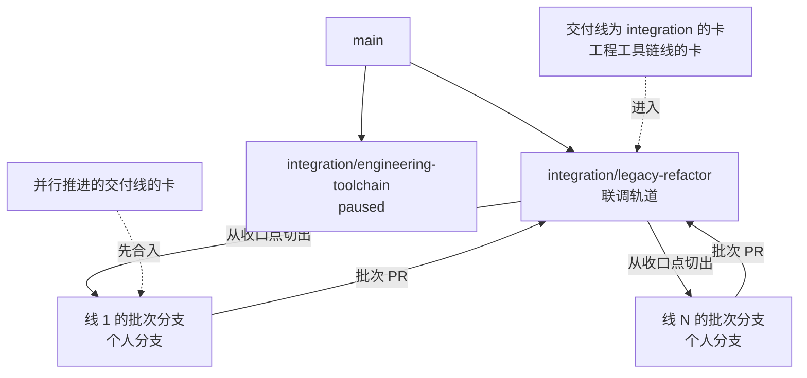
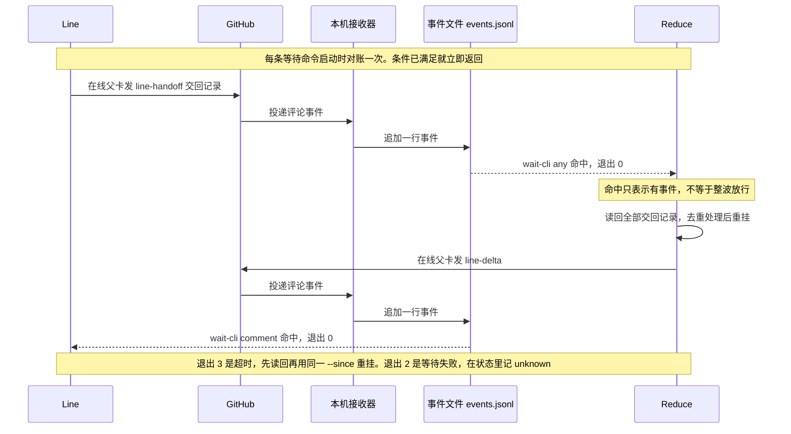

# 多层分支集成

本页拥有工程路线、双基线与权限规则。精确工具行为归[集成工具契约](../../tools/dev-flow/src/integration/SPEC.md)，命令归其[README](../../tools/dev-flow/src/integration/README.md)。任务仍归[现有交付协议](delivery.md)，不新增活动队列或自动接受规则。

## 分支与任务

自 2026-10-15 起，四条主干的进入按[现行准入](#现行准入)执行：`github-gate` 的流程构造合并并写记录标签。本机集成工具只负责任务开工、状态读取、基线、task-sync，为提升 PR 生成说明的「所含的卡」与「契约变化」两节（`ri-notes`，只读；契约发现让它退出 1），以及在 `pnpm run check` 中核对契约快照与 dist（`contract-check`）。它不构造候选，不验证候选，也不发布。

main 保存完整集成结果。任意数量的 integration/<track> 保存已登记责任轨道。stable 指向 main 中经过完整检查的既有 checkpoint。轨道和 stable 不加用户名；工作及临时分支遵守人的署名约定。

任务从真实 Issue 的 revision 和当前 attempt 开始。指定调度者记录并读回人的责任、分支、route、不可变 taskBase、写范围与条件定位。任务进入 route 中具名的那条轨道。在子轨道上做的卡，route 具名该子轨道。cross-track 或 global 完整单元先进入一条具名的顶层轨道，并具名受影响责任，再随它进入 main。目录不能自动决定路线。

## 轨道责任与保护

[policy registry](integration-policy.json) 登记轨道身份、owner、状态、上游和固定起点。下表是当前的轨道责任。`start` 读取当前 HEAD 提交中的 registry，只为状态为 active 的轨道开工，并核对它的上游链，见[轨道树与上游](#轨道树与上游)。

| 轨道                                | 责任与适用任务                                                                                                                           |
| ----------------------------------- | ---------------------------------------------------------------------------------------------------------------------------------------- |
| `integration/legacy-refactor`       | 联调轨道，见[交付线](#交付线)：各线轨道的上游，承接跨线集成、联合验收、破坏性契约改动与工程工具链的卡。原责任保留：将 0.0.1.legacy 已支持的功能迁入新的文档体系、架构和包结构；以已确认能力清单防止功能遗漏，不借重构扩大到全部 0.1.0 范围 |
| `integration/engineering-toolchain` | paused：不接受新任务。工程工具链线的卡进入联调轨道，见[交付线](#交付线)                                                                 |

新轨道由 `gate-track` 流程从上游的 first-parent 提交创建，起点记在 registry 的 `initialBase`，见[轨道树与上游](#轨道树与上游)。后续上游变化通过 FI 同步，不改写起点。任务 route 必须明确选择轨道，不设置隐含默认轨道。

GitHub 对 `integration/**/*` 分别实施三项保护：只有仓库管理员可删除，所有人禁止非快进更新，创建与更新只允许发布身份 `omne-harness-lite-publish`。删除权限不代替退役交接和具体动作授权。

main 与 stable 禁止删除和非快进更新，创建与更新只允许发布身份。adoption、unit、checkpoint 标签禁止修改和删除，无 bypass。其中采用标签（`omne/integration/adoption/*`）与旧 unit 标签作为历史保留，任何工具不再读取。平台保护不验证任务接受；管理员修改规则本身属于管理权限。

## 轨道树与上游

规则依据 [RFC-0011](../rfcs/RFC-0011-trunk-admission-and-track-tree.md) 第 4 至 6 节。

- 每条轨道只有一个上游，是 main 或另一条轨道。全部轨道组成一棵以 main 为根的树。上游为 main 的轨道是顶层轨道。层数不设上限。
- 轨道只与它的上游和它的直接子轨道交换提交。main 不直接同步给子轨道，子轨道不直接进入 main，兄弟轨道之间也不流动。兄弟轨道要共享成果，先提升到共同的上游，再从上游同步。
- 这条规则约束主干之间的 PR，不约束个人分支的内容。从 main 顶端开出的个人分支可以进入子轨道，把上游还没有的 main 提交带进子轨道。gate 不能识别这种情形，轨道的 owner 按约定拒绝这样的 PR，要求先逐层同步。

一条轨道的上游按下列顺序确定。`gate-publish`、`gate-track`、`gate-reconcile` 与 `start` 使用同一个顺序：

1. 有 `omne/gate/track/<名>` 起点标签时，取标签正文的 `parent`。标签没有 `parent` 字段时，上游为 main。
2. 否则在 `github-gate` 的 `gate/cutover.json` 中登记了切换点时，上游为 main。`integration/legacy-refactor` 与 `integration/engineering-toolchain` 属于这种情况。
3. 两者都没有时拒绝。

核对下限的读取顺序是切换点优先于起点标签：先取 `gate/cutover.json` 中的切换点，没有时取起点标签指向的提交，两者都没有就拒绝。所以 admin 为一条子轨道移动核对下限，不会改变它的上游。

轨道名符合 `^[a-z0-9][a-z0-9-]{1,40}$`，不能是 `main`、`stable`、`release` 或 `github-gate`，也不能是已在 `gate/cutover.json` 中登记的名称。子轨道同样命名为 `integration/<名>`，层级由记录表示，不由名称表示。轨道创建后不能更换上游；需要不同的上游时，删除原轨道，再创建一条名称不同的新轨道。

registry 的 `parent` 是投影，取值为 `main` 或上游轨道的名称。`initialBase` 是轨道在上游上的起点提交。

`gate-publish` 与 `gate-track` 不读 registry。`start` 为一条轨道开工时，核对它和它的上游链，任一不满足就拒绝，精确规则见[集成工具契约](../../tools/dev-flow/src/integration/SPEC.md#上游链核对)：

- 链上每一条轨道都已登记，分支都存在于远端。
- 目标轨道为 active，上游链上的其他轨道为 active 或 paused。
- registry 的 `parent` 与起点标签或切换点一致。

新建轨道时，派发 `gate-track` 并传入轨道名、`parent`、起点提交与接收决定评论的 Issue。流程核对下列条件，任一不满足就拒绝，不创建任何分支或标签：

- `parent` 为轨道时，这条上游能按上述顺序确定上游，分支存在。
- 新轨道的分支与起点标签都不存在。
- 起点在上游的 first-parent 历史上。上游为轨道时，起点还须是它的核对下限或之后的提交。

确认者核对上游在 registry 中为 active，写在说明中。轨道创建后，在 registry 登记 owner、责任与 `parent`，然后才能派发任务。

## 交付线

交付线是卡的路线与写入归属的单位。它把工作区成员和仓库中的其他路径分给各条交付线。本页不建线轨道：各交付线的卡都进入联调轨道，几条线并行时先合入所在线的批次分支，规则见[集成节点的清单](#集成节点的清单)。交付线不是领域、插件或部署单位。现行划分与理由见 #638 的[具名决定](https://github.com/nemori-ai/omne-harness-lite/issues/638#issuecomment-6338021284)。



图中 main 与联调轨道之间的实线是轨道的上游关系，同步沿它向下，提升沿它向上。联调轨道与批次分支之间的实线是一波的来回：批次分支从收口点切出，经批次 PR 回到联调轨道。收口点 F(w) 是第 w 波收口时实际读回的联调轨道提交，术语见[负责人状态](map-reduce-states.md#术语)。虚线箭头是卡进入的分支。

### 线与归属

[线归属表](delivery-lines.json)是交付线及其归属的唯一源。

- 表列出每条线的 ID、名称、owner、线轨道、拥有的路径与契约成员，联调轨道拥有的路径，以及共享路径 `shared`。共享路径不计入归属：其中的路径仍按各线与联调轨道的路径判定归属，任何卡只可在其中写入由本卡其他改动生成或登记的变化，写法见[交付协议](delivery.md#卡属性与合法组合)。
- 路径按目录前缀匹配。每个工作区成员恰好属于一条线或联调轨道。表中没有列出的路径归联调轨道。
- 本线的目标轨道是本线的卡进入的轨道。本页不建线轨道，所以每条线的 `track` 都是 `null`，目标轨道都是联调轨道。表保留 `track` 字段：将来改变这一条时，改本页，并在同一个 PR 中把 `track` 改为 registry 中以联调轨道为上游的轨道 ID。registry 登记轨道的状态、轨道负责人（`tracks[].owner`）与上游；线归属表登记交付线负责人（`lines[].owner`）、路径与契约成员归属。两类 owner 属于不同对象，不能因负责人相同而合并。
- 改变线的划分或归属由负责人决定，改动经 PR 进入联调轨道。
- 契约成员由 `contracts` 列出。common 共享包按主要改动方归入各线，并列为契约成员，所以线内的卡对它们只做可加改动。

### 卡进入哪条轨道

联调轨道是 `integration/legacy-refactor`。所有交付线的卡的 route 都写联调轨道：

- 交付线为 `integration` 的卡和工程工具链线的卡直接进入联调轨道。工具链被所有线使用，放在共同上游，各线同步一次就能得到。
- 其他交付线的卡，在几条线并行推进时先合入所在线的批次分支，批次完成后一次进入联调轨道，规则见[集成节点的清单](#集成节点的清单)。批次分支是个人分支，卡的 route 仍写联调轨道。

「直接进入联调轨道」这一条有一个例外。例外只适用于直接进入联调轨道的卡，即交付线为 `integration` 的卡和工程工具链线的卡。Reduce 是几张连续的这类卡的唯一写者时，这几张卡不逐张进入联调轨道：

- Reduce 把它们叠在一条个人批次分支上，在本地合并并解决冲突。
- 在批次头上只跑一次准入，只走一次 gate 进入联调轨道。PR 说明按[进轨道 PR 的说明](#进轨道-pr-的说明)逐张列出这几张卡。
- 每张卡的判据证据仍贴在各自的卡上，接受仍逐卡进行。

「直接进入」的目的是让别的线只同步一次。批次同样一次进入联调轨道，所以这个例外不改变这个目的。动作顺序见 `integrate` 技能「处理一条交回」中的[几张连续的卡合成一个批次](../../.meta_harness/agents/skills/integrate/canonical/SKILL.md#几张连续的卡合成一个批次)。

卡的交付线、性质与合法组合由[交付协议](delivery.md#卡属性与合法组合)定义。

### 跨线依赖

本节的线指交付线。一条交付线的卡只依赖其他交付线的契约，不依赖其他交付线的实现。卡在交付条件中只引用本交付线的卡与交付线为 `integration` 的卡；依赖其他交付线的契约形状时，写一条 `capability` 条件，目标是开波时收口点上可读到的那个形状，见[不变量](#不变量)第 3 条。需要跨交付线的真实装配、集成点或联合验收时，调度者在联调轨道上建交付线为 `integration` 的卡，由它承接跨线条件。所以跨线的阻塞点只出现在联调轨道上。

### 线轨道的同步与提升

本页不建线轨道，线用批次分支代替。线与联调轨道之间按波交换提交：开波时线从收口点切批次分支，批次完成时经批次 PR 进入联调轨道，规则见[集成节点的清单](#集成节点的清单)。

线内的卡在波内不同步联调轨道。这是对[两条基线](#两条基线)与[同步与提升的节奏](#同步与提升的节奏)的例外：卡的目标分支是批次分支，taskBase 取批次分支头，开工与重新接活只合并批次分支。线内的卡以批次分支头为影响面基线，忽略 `start` 写入的 targetBase。dev-flow 尚未支持批次分支基线（未决，拥有者 dev-flow）。批次进入联调轨道之后，其余节奏按[同步与提升的节奏](#同步与提升的节奏)。

## 里程碑与契约基线

里程碑是一段交付期，用 GitHub Milestone 表达。负责人创建 Milestone 并在描述中写明范围与结束标志，里程碑即开始；关闭 Milestone 即里程碑结束。卡所属的里程碑是 Issue 的 milestone 字段，由调度者设置。Project 的 Wave 字段记录卡所属的波，不镜像里程碑。Milestone 仍由 Issue 字段拥有，Wave 的节奏沿[当前迭代](agent-delivery.md#2-建卡或修订卡)。契约成员由[线归属表](delivery-lines.json)的 `contracts` 列出。

### 可加改动

构造一个值的一方是写方，读取它的一方是读方。一个契约类型的写方包括它的每个提供者与替身。消费者传入的回调，参数由提供者写、消费者读，返回值由消费者写、提供者读。可加改动是不破坏任何已有写方或读方的改动。卡级按本卡 `taskBase` 到候选 head 的改动判断；里程碑级按[已登记基线](#里程碑内的规则)到候选 head 的累计改动核对。

下表列出常见形状，不穷举。未列出的改动也按是否破坏任一既有写方或读方判断：

| 改动 | 对写方 | 对读方 |
| --- | --- | --- |
| 加可选字段 | 不破坏 | 不破坏 |
| 加必填字段 | 破坏 | 不破坏 |
| 必填改为可选 | 不破坏 | 破坏 |
| 可选改为必填 | 破坏 | 不破坏 |
| 删除字段 | 破坏 | 破坏 |
| 给联合加成员 | 不破坏 | 破坏；契约事先声明该联合开放时不破坏 |
| 从联合删成员 | 破坏 | 不破坏 |
| 给由别人实现的接口加必填方法 | 破坏 | 不破坏 |

[人类协作者指南](../../.meta_harness/human/stable-contracts.md)解释这张表的由来和设计方法。它是说明材料，规则以本节为准。

### 里程碑内的规则

1. 里程碑起点，联调轨道上一张性质为 `baseline` 的卡在评论中登记本里程碑的基线，再派发其他卡。登记包括联调轨道上的基线提交，以及该提交上线归属表 `contracts` 列出的契约成员；成员有 API 快照时，同时登记快照摘要。每次收口与 reduce 只推进代码收口点，不重建契约基线。之后的破坏性改动只补登记受影响成员，其他成员继续沿用原基线。集成节点以各成员已登记的基线提交为参照，用 `contract:api` 快照核对累计变化；累计为 breaking 的改动必须对应一张已登记的 `integration` 卡。API 快照反映公开形状，不能替代完整行为兼容性的核对。
2. 线内的卡对契约成员只做可加改动，卡级比较范围是本卡 `taskBase` 到候选 head。自 M2 起，非重构型里程碑内只允许可加改动。里程碑类型取 Milestone 描述，唯一源见[交付协议第 4 条](delivery.md#契约变更与里程碑类型)。
3. 不得不做破坏性改动时，执行者先停止依赖该改动的工作，调度者置 Needs decision，由人拍板，具体责任见[交付协议](delivery.md#契约变更与里程碑类型)。裁定同意后分两阶段执行：
   - 原线内卡只做兼容开发，新旧形状共存，契约变更仍为 `none` 或 `additive`。这项裁定是[当前演进政策](publication.md#当前演进与消费者)允许新旧形状暂时共存的依据。
   - reduce 时，由联调轨道上一张性质为 `integration` 的卡一次切换提供者、同步全部消费者并删除旧形状，见[完整集成](#完整集成)。完成后在 baseline 卡上只补登记受影响成员的新基线提交。旧形状未删除时，承接卡不接受，负责人不关闭 Milestone。
4. 基线登记后才加入的契约成员，首次入轨的卡将它申报为 `additive`；baseline 卡补登记该成员的首份 API 快照。
5. 没设里程碑的卡由 `start` 拒绝，沿用[字段总表后的开工规则](delivery.md#字段总表)，不另设例外。
6. 本规则登记前已派发的在途卡，仍按本卡 `taskBase` 到候选 head 申报卡级「契约变化」，不追溯修改派发。

登记的格式与核对：

1. 登记评论带一个 `json omne-contract-baseline:v1` 机读区块，由 `omne-contract-api --baseline-write <基线提交> --milestone <里程碑名>` 生成，原样贴进评论。区块对每个成员记基线提交、快照文件的 `sha256` 与 `api` 目录的树号 `apiTree`，不记几个成员拼接的摘要。基线文件不入库。
2. 补登记只写受影响的成员，生成时加 `--member <成员目录>`。较晚的登记覆盖同一成员较早的登记。
3. `breakingCards` 列出承接破坏性改动的 `integration` 卡。调度者在破坏性裁定读回后补登记它。
4. 只有登记者发的区块算登记。登记者是 publish 环境的审批者，即能派发的人。别人发的区块不改基线，也不加 `breakingCards`，读取结果列出这些评论。
5. 集成节点用 dev-flow 的 `baseline-cli.ts read <baseline 卡号> --out <文件>` 读出并合并全部登记，再用 `omne-contract-api --baseline <文件>` 核对累计变化。`--baseline` 与 `--baseline-write` 从 repo-toolchain 0.0.16 起提供。仓库钉住的版本早于 0.0.16 时，从源码运行：`node --experimental-strip-types tools/repo-toolchain/src/declarations/api-cli.ts --baseline <文件>`。命令见 [dev-flow 交付观察说明](../../tools/dev-flow/src/delivery/README.md#契约基线的读取)。
6. 核对在下列情况失败：
   - 有成员判不了：登记的成员在它的基线提交上不是契约成员或没有快照；或者成员在基线点（全部登记提交的共同祖先）上已是契约成员，却没有登记。`breakingCards` 不能放行这些成员。
   - 累计为 review 而登记没有 `breakingCards`。

   基线点之后才加入的成员按上面里程碑内的规则第 4 条，整份算新增。有 `breakingCards` 时核对通过，只说明登记了承接卡；每个 review 成员由哪张卡承接，由集成节点核对。

## 进轨道 PR 的说明

个人分支进入轨道的 PR，以及提升 PR（子轨道进上游轨道、顶层轨道进 main），说明中必须包含下面两节。提升 PR 汇总自上一次提升以来进入来源轨道的全部 PR 的这两节。同步 PR（上游进轨道）与进入 stable 的 PR 不写。

```text
## 所含的卡
- #<Issue 编号> revision <交付修订> attempt `<attempt>`：<这张卡在上一层或 main 上要满足的条件，没有写“无”>

## 契约变化
- <契约成员在线归属表中的路径>：<none、additive 或 breaking>。additive 写新增的导出或字段；breaking 写承接它的卡
```

「所含的卡」的行格式照录 `github-gate` 分支 `gate/README.md` 的「提升 PR 的说明」，以它为准。PR 没有改动契约成员时，「契约变化」一节写「无」。第一阶段由确认者核对：「所含的卡」与 PR 实际带入的卡一致；每张卡的契约变化按本卡 `taskBase` 到候选 head 判断。

本地核对分两处：

1. 卡级：已绑定的工作树上，`pnpm run check` 比较本卡改到的契约成员自 `taskBase` 的快照差异与 binding 的契约变更。差异为 additive 而申报 `none`，或差异为 review 而申报不是 `breaking`，检查失败。只比较本卡自己改了 `api` 目录的成员，合并进来的别的卡对其他成员的快照变化不计入。对本卡改到的成员，比较从 `taskBase` 到工作树，合并进来的别的卡对同一成员的变化也计入。命令见[交付观察说明](../../tools/dev-flow/src/delivery/README.md#改动的写范围与线归属)。
2. 提升：`pnpm run ri-notes --track <轨道 ID> --format markdown` 生成两节。PR 申报的级别高于所含卡的契约变更、联调轨道以外出现 breaking，或申报与快照差异不符时，命令退出 1。先改申报或停下交裁定，再提出 PR。快照差异不可得时只报告，退出 0。

提升 PR 的确认者在 gate 说明里贴本地 `ri-notes` 的退出码与标准错误最后一行的汇总。所含的卡、快照差异与申报是否一致，以这两项为机器结果。个人分支（含批次分支）进轨道的 PR 不运行 `ri-notes`：两节手写，逐张列本次带入的卡。确认者按本节开头「第一阶段由确认者核对」一句人工核对；卡级核对的输出在各卡交接报告第 1 节，批次 head 的准入输出在准入证据评论。该轨道下一次提升时，`ri-notes` 对汇总后的申报与快照差异做核对，不逐批次核对。gate 一侧对说明格式与卡身份的核对归 `github-gate` 的拥有者。

多卡 PR 按每个契约成员汇总所含卡对它的变化，按 `none < additive < breaking` 取最高级别，不相互抵消；每张卡对成员的级别仍不超过这张卡的契约变更。breaking 只出现在进入联调轨道或 main 的 PR 中。

里程碑累计核对仍以各成员已登记的基线提交为参照，见[里程碑内的规则](#里程碑内的规则)，不以 PR 的卡级申报代替。

## 完整集成

工作分支经 PR 向轨道运输完整源前缀。FI 经上游进轨道的 PR，把上游的完整前缀带到轨道。RI 经轨道进上游的 PR，把轨道未被上游覆盖的完整单元提升到上游。顶层轨道的上游是 main。破坏性跨轨道修改同时交付定义、提供者、真实消费者与测试。选择性 cherry-pick 不构成正式 RI。

`gate-publish` 每次合并同时创建不可修改的 `omne/gate/unit` 记录标签。每次提升前，流程核对来源轨道的每个 first-parent 提交都有 unit 记录，所以缺口在每一层都被拦住。每卡的 revision、attempt 和 taskBase 仍由各自 Issue 的 binding 记录。运输层改变不自动新建卡或提高交付修订。

## 两条基线

每个任务工作树的 task context 保存两条基线。

- `targetBase`（目标基线）是最近一次同步进来的目标提交。开工时它是 `start` 读到的远端目标分支提交，之后只由 task-sync 更新。影响面计算与组合检查以它为准。
- `taskBase`（任务起点）在开工时固定，任何同步都不改变它。逐提交审计、验收锁与先改后改回的核对都从它开始，并照常检查合并进来的提交的全部父提交。

全局 main 趋势仍使用 main。

任务执行期间同步目标分支分两步。第一步，执行者在自己的工作分支上用普通的 `git merge` 合并远端目标分支的某个提交 T，自己解决冲突并提交。第二步，执行者运行 `task-sync`，命令核对后把本工作树 context 的 `targetBase` 原子更新为 T。`targetBase` 只能前进，不能后退或改到另一条历史。核对条件与调用方式见[工具指南](../../tools/dev-flow/src/integration/README.md#同步目标分支)。

`gate-publish` 构造合并时固定目标 B 和源 S（PR head），合并提交 C 的第一父为 B，第二父为 S。这一描述只适用于闸门构造的合并。stable 不产生合并，只快进到 main first-parent 历史上的已有提交。工作分支上的同步合并由执行者完成，第一父是工作分支自己。

## 权限、候选与恢复

四条主干的发布由 `github-gate` 的流程执行，确认权限见[现行准入](#现行准入)。本机集成工具不构造候选，也不验证或发布。确认不是任务接受。进入轨道、main、stable、交付接受与关闭分别记录。发布流程不修改 Stage、接受或关闭。

运行结果未知时，先读运行页面、目标分支和 `omne/gate/*` 标签，不盲目重新派发。Git 已发布而 Issue 投影失败时，由原正文单写者修复技术记录，不重放 Git。

流程失效时，按 [RFC-0009](../rfcs/RFC-0009-adoption-and-local-tool-retirement.md#流程失效时的恢复) 恢复：

- `github-gate` 上的流程出错：admin 修正 `github-gate` 后重新启动流程。流程会重新核对目标与 PR，重复启动不会重复发布。
- Actions 或发布身份不可用：admin 在一张 Issue 中写明原因，临时把自己加入相应规则集的例外，用普通的 Git 命令完成合并并推送，再恢复规则集并读回。推送产生的提交没有 unit 记录，`gate-reconcile` 会把它报告为缺口 Issue。admin 在缺口 Issue 中写具名决定，说明该提交的来源与处置。第一阶段的 `github-gate` 没有补建 unit 的流程，`gate-reconcile` 只报告、不创建标签。这类缺口按[现行准入](#现行准入)中“没有 unit 的主干提交”的两步闭合。

admin 修改规则集属于管理权限，定时核对与记录核对照常适用。

## 稳定点与轨道演进

stable 选择 main first-parent 历史上的已有提交，只要求旧 stable 是其祖先。完整检查的要求见[第二阶段目标](#第二阶段目标)。main 后续前进不改变选定 checkpoint。

轨道 registry 记录稳定 ID、分支、owner、来源、状态、`parent` 与 `initialBase`。状态取 active、paused、retiring 或 retired，只有 active 的轨道接受新任务。paused 只表示不派发新任务，paused 的轨道仍可同步与提升。新轨道的分支与起点标签由 `gate-track` 创建。owner 更换先交接未提升 prefix 与活动任务。

删除轨道就是退役轨道，由 admin 删除轨道分支。

- 唯一的硬条件：没有其他轨道以它为上游时，才能删除。删除前以起点标签为准确认：所有现存 `integration/*` 分支的起点标签 `parent` 都不指向它。registry 只作参考。子轨道先删除，退役沿子树自下而上进行。
- 轨道上的记录标签保留，不删除，分支删除后这些提交仍可经标签找到。
- 尚未提升的成果由删除的人负责处理，例如先提升、经个人分支转入其他轨道，或确认放弃。不要求固定格式的记录。
- registry 条目事后整理：删除条目或修改状态，按普通改动经任意轨道进入。retiring 为可选标记，owner 想在删除前停止派发时可以标记；标记随同步到达目标轨道后才对该轨道的开工生效。
- 删除 ref、工作树或唯一临时材料仍按[工作约定](workflow.md#责任与协作交接)和[发布边界](publication.md)取得明确授权。Git revert 不撤销外部副作用。

平台不能按上游关系阻止删除。误删仍有子轨道的轨道时，`start` 拒绝为上游链断开的轨道开工，`gate-publish` 拒绝进入这样的轨道，`gate-reconcile` 为它们开缺口 Issue。

## 现行准入

现行准入依据 [RFC-0011 revision 1](../rfcs/RFC-0011-trunk-admission-and-track-tree.md#决定范围)。它取代 RFC-0004 中仍然有效的范围，并部分取代 RFC-0009 的三处条款与 RFC-0002 的准入缓存策略。RFC-0008 与 RFC-0009 的其余准入条款仍由原提案拥有，RFC-0011 第 16 至 18 节只作复述。第一阶段自 2026-10-15 起执行，切换记录见 [Issue #208](https://github.com/nemori-ai/omne-harness-lite/issues/208#issuecomment-6184302633)。多层轨道自 2026-10-20 起执行，见 [#497](https://github.com/nemori-ai/omne-harness-lite/issues/497)。

四条主干是 `integration/<track>`、`main`、`stable` 和 `release`。代码沿轨道树逐层提升。上游向直接子轨道的同步是唯一反向流动。`release` 只定对外发布的位置，还没有创建。

第一阶段的规则如下。

- 四条主干只经 PR 进入，个人工作分支不受限制。轨道 T 接受个人分支、T 的上游和 T 的直接子轨道的 PR。main 只接受顶层轨道的 PR。stable 只接受 main 的 PR，并且只快进到 main 的 first-parent 历史上的提交。base 为轨道时，它的上游链上每一条轨道都必须能确定上游，分支都必须存在。其他组合一律拒绝，包括跨层、兄弟轨道之间和个人分支进 main。head 为 `stable`、`release` 或 `github-gate` 时一律拒绝。`release` 创建之前，以它为 base 的 PR 一律拒绝。
- 派发 `github-gate` 分支上的 `gate-publish` 流程，传入 PR 号和 PR head 的完整提交号。合入 stable 时还要传 checkpoint 名称。命令见 `github-gate` 分支的 `gate/README.md`。
- 任务卡的派发评论由 `publish` environment 的 reviewer 发出，`start` 据此核对开工准入并写入 task context。没有 task context 的检出也能运行本地检查，基线退回 `origin/main`；收工钩子例外，它在 `origin/main` 与活跃轨道中取离 HEAD 最近的合并点，见[收工钩子](../../tools/repo-toolchain/README_ZH.md#收工钩子)。
- 一位 admin 在 Actions 的 `publish` environment 中确认，必须填写说明。admin 可以确认自己的 PR。agent 可以用 admin 的凭据代为确认，说明中注明代为确认的人。
- 个人分支进入任何一层轨道的 PR 如果改动仓库工具链，确认前多一道审批。流程用 `git merge-tree` 算出合并结果，把结果相对目标改动的文件与 `github-gate` 上的 `gate/toolchain-paths.txt` 比对。命中时，先由 `repo-toolchain-review` environment 的确认者确认，再进入 `publish` 的确认。工具链确认也必须填写说明，说明原文写进发布决定评论。未命中的 PR 不经这道审批。同步（上游进轨道）、提升（轨道进上游）和 main 进 stable 不经这道审批，它们搬运的提交都已经从个人分支进入过某条轨道。路径清单由卡 [#332](https://github.com/nemori-ai/omne-harness-lite/issues/332) 建立，只在 `github-gate` 上维护。
- 确认后，发布身份 `omne-harness-lite-publish` 构造合并提交。第一父为目标，第二父为 PR head，有冲突就停止，冲突先在来源分支解决。它在一次原子推送中更新目标并创建记录标签，推送比较派发时读到的目标。合并写 `omne/gate/unit/<结果提交号>`。stable 写 `omne/gate/stable/<提交号>` 和 `omne/gate/checkpoint/<名称>`，同一提交只能进入 stable 一次：另一次发布已把 stable 推进到同一提交时，记录已存在，整次推送失败。标签正文是 `omne-gate-record:v1` JSON。
- 提升前，即 head 是 base 的直接子轨道或 base 为 main 时，流程核对来源轨道在核对下限之后的每个 first-parent 提交都有目标为该轨道的 unit。同步不做这项核对，上游的记录由上游自己的提升负责。发布 stable 前，对 main 在切换点之后的 first-parent 历史做同样的核对。有缺口就停止。
- 提升 PR 由该轨道的 owner 提出。PR 说明列出自上一次提升以来进入该轨道的卡，以及这些卡在上一层或 main 上要满足的条件，每张卡写 Issue 编号、revision 与 attempt。格式见 `github-gate` 分支 `gate/README.md` 的「提升 PR 的说明」。确认者据此核对条件。个人分支进轨道的 PR 与提升 PR 还要写「契约变化」，见[进轨道 PR 的说明](#进轨道-pr-的说明)。
- 已知限制：admin 停用规则集后直接推送主干，平台不能阻止，只能事后发现，依据是组织审计日志和定时核对。其中一种情形流程也无法区分：admin 在流程最后读取目标与推送之间，把 stable 直接推到本次要发布的同一提交。这时流程仍会写入记录。
- 流程不运行测试。自动检查具备之前，确认暂代轨道的自动检查，说明中写明本地运行了哪些检查及结果。确认不等于交付接受。
- `gate-reconcile` 每小时从 main 触发一次，只开缺口 Issue，不创建标签。它报告核对下限之后没有记录的主干提交、没有对应 stable 记录的 stable 尖端，以及上游链上有分支不存在的轨道。缺口不设处理时限。缺口存在时，相应主干的提升被拦住。三类缺口的闭合方式不同：
  - 没有 unit 的主干提交，两步都完成后缺口才闭合。移动下限只改变核对范围，不改变上游。
    1. 该轨道的 owner 或任一 admin 在缺口 Issue 中写具名决定。决定说明缺口提交的来源和处置，并列出该提交带来的卡（Issue 编号、revision 与 attempt）。
    2. admin 在 `gate/cutover.json` 中把该分支的切换点改为缺口中最后一个没有 unit 的 first-parent 提交，并在缺口 Issue 中注明这次修改的提交。
  - stable 的尖端没有记录：admin 在缺口 Issue 中写具名决定，stable 下一次经流程发布后闭合。
  - 上游链上有分支不存在：上游不能更换，被删除的名称不能重建，所以上游链断开的各轨道只能自下而上删除，全部删除后闭合。
- 2026-10-15 登记的原切换点之前的历史，按 #208 的决定整体认可，不补记录。下限移动后跳过的提交，以缺口 Issue 中的具名决定为依据。
- 新轨道由 `gate-track` 流程在 admin 确认后从上游的 first-parent 提交创建，并写带 `parent` 的 `omne/gate/track/<轨道名>` 起点标签，规则见[轨道树与上游](#轨道树与上游)。
- `@omne-harness/repo-toolchain` 与 `@omne-harness/repo-config` 由 `gate-release` 流程发到 npm。要发布的提交必须已有 unit 记录，并在 main 或某条轨道的 first-parent 历史上；版本号取自该提交的 `package.json`，npm 上已有的版本不再发布。确认走 `npm-release` environment，必须填写说明。发布用 npm 可信发布（GitHub OIDC，不存长期 token），附来源证明；流程把结果写进指定 Issue 的决定评论。命令见 `github-gate` 分支的 `gate/README.md`。首个版本 0.0.1 由 AIEPhoenix 手动发布，记录见 [#332](https://github.com/nemori-ai/omne-harness-lite/issues/332#issuecomment-6209941107)。仓库检查运行哪个版本由 `pnpm-workspace.yaml` 的 catalog 钉住，升级先发版本、再改钉子，见[仓库工具链的版本](../development.md#仓库工具链的版本)。

平台配置如下。main、轨道和 stable 的创建与更新只允许发布身份。`github-gate` 只有 admin 能创建和更新，禁止删除和非快进。`omne/gate/*` 标签只有发布身份能创建，任何人不能修改或删除。仓库只允许 merge commit。`publish` environment 的确认者为 admin，关闭管理员跳过，只接受 `github-gate` 上的运行。`repo-toolchain-review` 与 `npm-release` 两个 environment 的确认者与 `publish` 相同，同样关闭管理员跳过、只接受 `github-gate` 上的运行，不存放密钥。调整 `publish` 的确认者时同步调整它们。切换点记在 `github-gate` 的 `gate/cutover.json`。历史记录的认可范围见上文 `gate-reconcile` 一条的末项。

发布身份的 App 归组织所有，密钥只放在 `publish` environment，不放仓库级 secrets。审计日志、`github-gate` 的改动和密钥轮换由组织和项目的管理者按需要处理，不设固定周期。流程使用 GitHub 托管 runner。

交付身份是另一个组织所有的 App `omne-harness-lite-delivery`，决定见 [#546](https://github.com/nemori-ai/omne-harness-lite/issues/546)。它只写交付元数据、读权限事实：仓库 Issues 读写、Environments 只读、组织级 Projects 读写，不能写代码或主干。它只安装在本仓库。

交付身份的密钥只放在 `delivery` environment。该 environment 只接受 `github-gate` 上的运行，所以只有 admin 写入 `github-gate` 的流程能使用这把密钥。该 environment 不设确认者，流程运行时不等人确认。

`github-gate` 上的 `delivery-facts` 与 `delivery-stage` 用交付身份为 Claude Code 云端会话读取开工事实、修改 Project Stage，用法见 `github-gate` 的 `gate/README.md`。本地会话直接读取并修改 Stage，不经过这两个流程。所以「Stage 只能由有资格的人修改」只在云端路径上由流程强制；本地路径与 Project 成员的写权限按现行约定执行。`delivery-stage` 只核对触发者是 `publish` 的 reviewer，不核对他是不是这张卡的调度者，单一调度者在云端同样是约定。两个流程写死了 Project ID 与 Stage 字段 ID；修改[交付配置](github-delivery.json)的 `project` 时，同时修改 `github-gate` 上的这两个流程。交付配置的 `project` 还登记看板字段与选项的 ID。修改 Project ID、Stage 字段 ID 或 Stage 选项时，同步这两个流程；只改其他看板字段时不需要。

已知风险：交付身份的密钥外泄时，持有者能修改组织内全部 Project，能编辑或关闭本仓库的 Issue（包括卡正文与 binding），也能发出伪造的开工事实评论，使云端会话的 `start` 接受没有派发资格的作者。这把密钥按与 admin 权限同等的级别保管和轮换。

### 第二阶段目标

turbo 构建体系建立后进入第二阶段。轨道改为自动检查通过后经合并队列自动合并，取消轨道的确认。增加报告身份和按改动范围的必需检查。受信检查器的版本由仓库的钉子承载，不在 `github-gate` 上另存版本文件；升级按[仓库工具链的版本](../development.md#仓库工具链的版本)先发版本、再开改钉子的 PR，新旧版本各跑一遍。集成条件评论的格式随之确定。

影响面的成员选择、构建、类型检查与成员测试由 turbo 调度。`tools/test-runner` 算出计划并调用 turbo（`turbo.ts`），可执行验收仍由它逐成员运行。[RFC-0002 revision 2](../rfcs/RFC-0002-engineering-toolchain.md#影响面选择) 要求的四条约束已在测试运行器中实现：未识别文件转全量，`turbo.json` 一类选择配置是全局文件，基线显式传入，准入检查不读 turbo 任务缓存。实现方式见[迭代中的受影响测试](../development.md#迭代中的受影响测试)。

stable 的完整检查即 `OMNE_ADMISSION=1 FULL=1 pnpm run check`，由目标分支钉住的检查器版本运行，不再从 policy 读取检查清单。

## 同步与提升的节奏

以事件触发为主。开工或重新接活时，owner 比较工作任务、来源轨道和它的上游的实际 SHA；RI 前及上游有破坏性变更后，再核是否需要 FI 或任务同步。main 的变化逐层同步：先同步进顶层轨道，再从它同步进下一层。任务同步按[两条基线](#两条基线)先合并、再运行 task-sync。活跃轨道以完整小批量及时提升，避免长时间累积漂移。空闲轨道在恢复活动时同步，不按日历给所有轨道增加全量构建或付费模型预算。

RI 后，来源轨道若还要继续工作，先检查上游是否包含新的组合修正或其他轨道前缀；需要这些变化时执行 FI。轨道已包含同一上游内容时不为流程制造空同步。其他活跃轨道按受影响契约同步；破坏性公共变更由集成 owner 协调相关 owner，在继续依赖工作前闭合。空闲轨道保留已知漂移，恢复时处理。

`gate-publish` 遇到冲突就停止，冲突先在来源分支解决，涉及含义的取舍交相应语义 owner。worker 提供来源和测试，不直接修改共享目标来解决冲突。解决冲突后的合并结果需要实际组合验证；各源单独通过不能代替它。

## 集成节点的清单

本节拥有常驻 Reduce 与 Line 的协作规则：组织前提、线会话记录的格式、不变量、读写交叉、失败处理、等待命令与平台写入。Reduce 与 Line 的阶段、恢复、收口顺序和 redo 与接管处置归[负责人状态](map-reduce-states.md)，术语也在那里定义。波段编排的判断方法归 `dispatch` 技能的[波段编排](../../.meta_harness/agents/skills/dispatch/canonical/references/wave-planning.md)。工具编码与可执行接口归[交付工具](../../tools/dev-flow/src/delivery/README.md)。技能负责动作顺序，模板只填写本次事实与引用。首次开工和恢复先读本节与状态正文，不只凭图或上一条会话记忆继续。

本节的协作规则依据下列组织前提：

- 一个负责人。
- 全部会话使用同一个 GitHub 账号。
- 人负责在会话之间转发消息。

等待命令只认评论首行的标记，不按作者过滤。这个做法依据上述前提。出现跨组织、多个账号或互不信任的参与方时，前提失效，须重新设计信任边界。

同一里程碑由同一个 reduce 会话负责，且它是人唯一的设计联系点。Reduce 负责全局设计、跨线的消费者迁移、跨线的实现与联调、集成冲突及交回后的问题。Line 是跨波持续的线会话，负责获准本线本波的细化、实现和验证。一个 Line 负责的范围可以覆盖一个或几个领域，其中跨领域的集成与联调归这个 Line，在交回前完成。Line 不是路径归属表里的交付线。线会话为单张卡派出子代理时，该子代理只持有这一次任务，不替代常驻 Line。轨道写入单写，Reduce 的等待持续挂起。

- 收口点 F(w) 见[术语](map-reduce-states.md#术语)。波以当前收口卡 R(w) 为界。
- 线父卡承载线包、delta 和交回记录。线包引用 binding，branch、taskBase 与写范围不得手抄成第二份权威。
- 卡在线内顺序合入批次，批次承载本线本波结果。ready、blocked、failed 都必须交回明确结果。零差异不造空 PR。
- 交回、实际合入和整波放行分别核对。PR ready、单卡接受和队列暂空都不能代替其中任何一步。

### 线会话记录

线父卡上有两种协作记录。Reduce 发布 delta，Line 发布交回记录。两种记录都是人读评论。评论第一行是标记：delta 用 `<!-- line-delta -->`，交回记录用 `<!-- line-handoff -->`。等待命令按这个标记发现评论。普通评论和没有标记的评论不授予开工或放行。

两种记录的正文都写下列固定项：

| 项 | delta | 交回记录 |
| --- | --- | --- |
| 波 | 本条 delta 指向的波 | 本次交回的波 |
| F | 下一次开工的收口点 | 本次执行所基于的收口点 |
| assignment 或结果 | active、idle、redo 或 terminal，及其依据 | ready、blocked 或 failed |
| 任务与 binding 链接 | 任务卡及卡上的 binding。idle 与 terminal 写「无」 | 任务卡、卡上的交接报告评论、批次 PR 或「无 PR」 |
| 变化 | 原候选到最终候选的变化与原因、本波变化、外域变化、消费者迁移、工具与技能版本变化。停止、取消、限定接受和完成分别写明 | 已完成部分、未完成部分及原因 |
| 等待 | Line 下一步等待的对象 | 本线交回后挂起的等待命令 |

assignment 的含义：

- active：下一波有任务。Line 从 F 建新批次分支，按任务卡开工。
- idle：下一波轮空。delta 写明原因。Line 不建任务分支，不交空 PR，继续等待下一条 delta。
- redo：同一波重做。Reduce 已更正输入，并在任务卡上登记了新 attempt。Line 按新 binding 重新开工。redo 不推进波号。
- terminal：本线结束。Line 交最终报告后停止。只有 terminal 结束本线。

delta 传达已核对的事实，不改写在途卡的 taskBase。新 attempt 由派发命令登记在任务卡上，delta 只引用它。Line 按发布顺序逐条读取 delta，不跳过 idle delta，不按未来参与预案跳波。Line 不在波内逐卡吸收新的输入。技能与信息包消费本节的记录格式，不另立格式。

Line 交回时交下列三样。零差异时没有批次 PR，只有报告与交回记录。

- 批次 PR：从本线批次分支进入联调轨道。说明按[进轨道 PR 的说明](#进轨道-pr-的说明)手写「所含的卡」与「契约变化」两节，逐张列本批次的卡。`ri-notes` 只汇总已登记轨道上尚未提升的提交，批次分支不是轨道，所以不用它。
- 交接报告：每张卡一条卡评论，写 PR 链接与 head 提交号。报告只陈述事实，固定五节：
  1. 做了什么：逐条对照验收，写达到或未达到，并给出证据。
  2. 没做什么及原因。
  3. 发现的冲突，带文件与行。实际做法与卡或技能要求的流程不一致时，也写在这里，并写明补救。
  4. 给集成节点的提示：合并顺序、依赖、已知的脆弱点。
  5. 评审闭合：逐轮结论、修复、复验、返工原因与证据。没有评审或返工时明确说明。
- 交回记录：线父卡上的一条评论，固定项见上表。

不在线内的卡交回时也用这五节交接报告。

### 不变量

1. 波内输入冻结。Line 不读取别线未集成产出，不主动升级工具、技能或策略。
2. 跨线写集不相交。一张卡的写集也不落进另一条线的卡读集中的产品语义正文，分类见[读写交叉的两类](#读写交叉的两类)。共享路径有具名单写者，不因生成文件而允许并发写。
3. 跨线依赖由已接受输入及 F 承接。本波不能依赖另一条线尚未交出的结果。
4. 破坏性变更必须同步真实消费者。分解、跨线的迁移及跨线差异由 reduce 负责；一个 Line 负责范围内跨领域的迁移与差异由这个 Line 负责。契约成员的破坏性切换仍按[里程碑内的规则](#里程碑内的规则)第 3 条，由联调轨道上的 `integration` 卡完成。
5. 交回开始即冻结候选。Line 与 reduce 不能同时持有该候选的代码写权。
6. Line 只在开工读取输入、结束执行交结果两个边界协调。波中不问人，不通过普通评论向 reduce 求方案。

### 读写交叉的两类

读写交叉指一张卡计入的写范围路径与另一张卡读集中的路径相同，或一条在另一条下面。卡的读集是它写入的成员、这些成员按 `workspace:` 依赖传递到的成员，以及任务信息包引用的正文页。求法见[交付观察说明](../../tools/dev-flow/src/delivery/README.md#写范围求交)。

每个交叉按两条路径中较长的那条归类。较长的路径是两张卡实际共同涉及的范围。两类按路径、扩展名与读者登记划分，不读文件内容。本节的「正文」也包括源码与配置。

| 类 | 路径 | 处置 |
| --- | --- | --- |
| 工程方法与验证正文 | 给人和 agent 读的说明页，按下面的三项与目录规则判定 | 记录，不停止。读方按本波收口点的版本消费这些说明页 |
| 产品语义正文 | 上一行以外的全部路径。例如产品正文 `.meta_harness/design/**`、契约成员、`docs/architecture/**`、`docs/domains/**`、`packages/**` 与 `apps/**` 的源码与随包文档，`tools/**` 与 `scripts/**` 的源码与配置，以及被代码读取的配置、数据与程序 | 停止。两张卡不在同一波，调度者改分解 |

一个文件是工程方法与验证正文，必须同时满足下面三项：

1. 文件在 `.meta_harness/agents/**`、`docs/engineering/**`、`docs/development.md`、`docs/verification.md`、`tools/**` 或 `scripts/**` 中。
2. 文件的扩展名是 `.md`，或者文件是技能包装 `.meta_harness/agents/skills/*/adapters/**/strategy.yaml`。技能包装只决定技能怎样投影给宿主，各线按收口点的投影消费。
3. `tools/test-runner/test-runs.config.json` 的读者规则（`affected.readers[].paths`）与全局路径（`affected.globalPaths`）都不登记这个文件。这两项登记的文件被代码读取。Python 路径（`affected.pythonPaths`）只表示改动要运行 pytest，不算登记。

较长的路径在收口点上是目录时，目录下每个被跟踪的文件都按这三项判定。全部满足时这个交叉才是第一类。有一个文件不满足时这个交叉是第二类，输出写明这个文件。命令读不到登记或文件清单时，全部交叉都是第二类，输出写明原因。其他文件的交叉都是第二类，例如 `.json`、`.ts`、`.mjs`、`.py` 与其他位置的 `.yaml`。

第一类只覆盖上面三项认得的说明页。代码读取一份 `.md` 文件，而读者规则没有登记它时，命令把它的交叉判为第一类，这个交叉就被漏判。这是已知的剩余风险。所以 `read-overlap-frozen:` 行逐条列出每个第一类交叉，调度者逐条复核。

写范围交集不分类，交集落在任何路径上都停止。`scope-cli.ts` 对第一类输出 `read-overlap-frozen`，对第二类输出 `read-overlap`。只有写范围交集与第二类交叉使命令退出 1。

调度者在收口点的检出上运行求交。每张卡的读集文件列出它的任务信息包引用的正文页。任务 tmp 与线归属表的 `shared` 路径不计入写范围。

```sh
node --experimental-strip-types tools/dev-flow/src/delivery/scope-cli.ts <卡号或 binding 文件> <读集文件>...
```

退出 1 时不派发这组卡，先改分解。退出 0 时逐条复核标准错误中的 `read-overlap-frozen:` 行，把结果写进线包的交叉检查结果。

### 线怎样工作

Line 的五个阶段、遇阻交回、redo 与接管处置及恢复归[负责人状态的 Line 状态空间](map-reduce-states.md#4-line-状态空间)。交回物的格式见[线会话记录](#线会话记录)，等待命令见[等待监督](#等待监督)。

### 失败处理

| 情形 | 处置与禁止动作 |
| --- | --- |
| Line 硬阻塞或失败 | Line 交回 blocked 或 failed 后停写。Reduce 发 redo delta 或接管，不等普通问答 |
| 分解错误造成的集成冲突 | 不走常规的退回 Line 修复路径。Reduce 接管后负责全部集成冲突、跨域修改、消费者迁移及改后验证，不能只处理 shared 冲突。记录冲突文件、责任和对下一波分解的影响。确需 Line 同波再执行时，Reduce 登记新 attempt 并发 redo delta |
| 候选冲突、越界、准入失败 | Reduce 冻结发布并修复或获得范围决定，验证当前候选。不自动退回旧 attempt |
| 未到约定期限或远机沉默 | 保留 pending 或 unknown，不能推断失联或跳过结果 |
| 期限届满 | 核对事实，由 reduce 决定等待、重排或取消。范围变化具名，不伪装成功 |
| 写入、合并或发布的响应丢失 | 保存原操作输入，先读回实际结果再决定。结果未知时不重复 POST 或 merge |
| 等待命令、权限或事件文件故障 | 明确诊断并恢复。Line 记录状态后等人转告。Reduce 恢复后先对账，不报告空队列成功 |

### 接受与逐收口续接

收口顺序与放行守卫归[负责人状态的收口顺序](map-reduce-states.md#收口顺序)。

### 等待监督

命令用法归[交付工具](../../tools/dev-flow/src/delivery/README.md#事件等待)。

Line 在交回后、交 blocked 后和轮空时挂一条等待，作为前台阻塞的命令运行：

- delta：`wait-cli.ts comment --issue <线父卡> --marker line-delta --since <交回时间>`。超时与失败的处置见 [Line 状态空间](map-reduce-states.md#4-line-状态空间)的「等待」一行。

Reduce 在波内挂两条等待：

- 批次 PR：`wait-cli.ts pr-ready --base <联调轨道> [--ignore <pr>@<head> ...] --since <起点>`。
- 交回记录：`wait-cli.ts any --comment <线父卡>:line-handoff ...`。每条参加线写一个 `--comment`。

等待命中只是唤醒，命中的那一条不代表全部待处理事件。Line 与 Reduce 每次被唤醒都这样处理，Line 读到 idle delta 后再等也一样：

1. 读回相关父卡上的全部带标记记录：Line 读本线父卡的 `line-delta`，Reduce 读每条参加线父卡的 `line-handoff`。读法是 `gh api repos/<repo>/issues/<父卡>/comments --paginate`，按首行标记过滤。读回不带时间起点。
2. 与已处理集合比对，按发布顺序逐条处理尚未处理的记录，不跳过 idle delta。全部处理完才回到等待：Line 只有在最后一条是 idle 时才再等，不能处理完一条 idle 就重挂。已处理集合记评论 id：Line 记在本线状态文件，Reduce 记在波段队列的「等待」一项。
3. 重挂的 `--since` 只用来避免立即再次唤醒，不负责不漏事件，不漏由第 1、2 步保证。命中输出的 `delivery` 不为 null 时用这个 delivery id；为 null 时用命中评论的创建时间，读法是 `gh api repos/<repo>/issues/comments/<id> --jq .created_at`，id 是输出 `html_url` 中 `#issuecomment-` 之后的数字。不要用 `receivedAt`，也不要自己加减时间余量。重挂后可能对已处理的记录多唤醒有限的几次，例如 legacy 模式下对账先找到的评论其投递随后到达，或多条线时对账返回另一条线上已处理的记录。读回没有新记录时，按这次命中再取起点重挂即可。
4. `pr-ready` 的对账不受 `--since` 约束，防止立即再唤醒的只有 `--ignore`。唤醒后读回联调轨道上全部开着的 PR，处理待处理的批次 PR；重挂时对当前开着、本次不处理的每个 PR 都写一条 `--ignore <pr>@<当前 head>`，包括 Reduce 推进后换了 head 的批次 PR 和等 gate 的同步 PR。命中来自事件文件时，`--since` 用这次的 delivery id；来自对账时，`--since` 不变。
5. 每条等待都带 `--timeout`。超时后先做一次读回（交回记录与 delta 按第 1 步，`pr-ready` 按第 4 步），处理新记录，再用同一起点重跑。

已知限制：与命中记录同一秒创建且晚于第 1 步读回的记录、本机与 GitHub 的时钟差、读回时 GitHub 尚未返回刚创建的记录，都可能让一条记录不唤醒等待。用同一起点重跑补不回它，只靠第 5 步超时后的读回发现；这条记录是一波最后一条时，最长要等一个超时。工具改进见 [#931](https://github.com/nemori-ai/omne-harness-lite/issues/931)。

处理一项时，另一条等待保持挂起。宿主不能同时挂两条等待时，Reduce 按 `integrate` 技能让两条等待轮流前台阻塞。这时 [I03](map-reduce-states.md#5-两个负责人的组合不变式) 指轮换中没有遗漏事件。

下图是一次交回与下一条 delta 的事件路径。本机接收器把 GitHub 投递写进事件文件，等待命令读这个文件。



Reduce 自己启动的对象由 Reduce 自己观察，包括 gate 运行与审批、子代理与检查进程，以及约定期限。审批交有权者，Reduce 不自动批准。期限到达时，Reduce 核对事实并决定等待、重排或取消。

等待命令只发现事件。Issue 关闭或评论命中不代表整波已放行。GitHub 变化以事件驱动，等待命令在启动时对账一次。Reduce 不周期扫描所有 Issue、PR、评论或 Line 进度。普通问答评论与波中 Line 心跳不属于依赖。远机未暴露的进程保持未知。

## Issue 与 Project 的配合

每卡声明 completionTarget，并按同一条件表记录 start、integration、acceptance。completionTarget 为 `track` 时，指 route 中的那条轨道；之后随该轨道逐层进入上游与 main 属于运输。integration 可限定目标层或实际 ref；未声明为 all。限定为 track 层的条件，只在进入 route 中的那条轨道时适用；要在上一层轨道或 main 之前满足的条件，写明实际 ref。只要求进入 main 前满足的条件，不阻 work→track。最终“main/stable 已包含本结果”属于 acceptance，不作为自身运输前置。

完成 track 即可接受的卡，后续仍可能随完整 prefix 进入 main/stable。卡的历史 revision 与 attempt 保留在 Issue 记录中，后续运输由确认者核对当前输入与适用条件。接受或关闭既不拒绝、也不自动许可未来的运输。

可选的 Integration target 与 Integration progress 视图归[交付协议的多层集成交接](delivery.md#多层集成的交接)。

dev-flow 对平台的写入限于下列范围：

- 派发记录：`dispatch-cli` 写派发评论与卡正文中的 binding。
- 标签同步：只增删一张卡的 `kind:`、`line:`、`nature:`、`contract:` 四族标签。
- 看板日期与属性字段：`start` 新建 task context 后尽力写 Dispatched at、Line、Kind 与 Wave。写入失败只向标准错误报告，不改变 `start` 的输出、context 与退出码。云端会话不写，只报告一行。Delivered at、Accepted at 与 Cycle days 由 `board-cli.ts` 写入。
- Stage：`board-cli.ts` 的 `delivered`、`integrating`、`accepted` 按本地路径把 Stage 改为 In review、Integrating、Accepted。运行者见[交付操作](agent-delivery.md#4-推进和更新状态)。
- 里程碑流转：`milestone-cli.ts` 建里程碑，改卡的里程碑并发流转评论。
- 整波放行：Reduce 按[收口顺序](map-reduce-states.md#收口顺序)关闭本波收口卡。命令不授予接受权。
- 事件接入：显式管理事件接收所需的仓库 hook。创建、恢复及清理由[事件等待合同](../../tools/dev-flow/src/delivery/SPEC.md#事件等待)约束，不从普通等待推断管理权。
- 包发布：`release-run` 按[包发布运行合同](../../tools/dev-flow/src/integration/SPEC.md#包发布运行命令)触发 `gate-release.yml` 的 `github-gate` 运行，写前保存意图并读回精确运行。默认只观察；只有显式 `--approve --note FILE`、平台允许当前账号审批且本次授权有效时，才能批准 `npm-release`，不批准其他环境。包发布不构成整波 reduce 放行。
- 部署批准：`gate-cli wait` 按运行者已有权限与本次授权批准 gate 的部署，命令不授予确认资格。

此外，云端会话开工时，`start` 派发 `delivery-facts`。字段 ID 与选项 ID 登记在[交付配置](github-delivery.json)。用法见[交付观察说明](../../tools/dev-flow/src/delivery/README.md#看板字段写入)。

## 清理与 policy registry

清理前先核 Git 已发布、各卡剩余接受与投影责任已交接、唯一 tmp 有去向，再按现有权限清理。ref 状态未知或分裂时保留证据，不盲目重建或重试。

[policy registry](integration-policy.json) 只含 `schemaVersion`、`revision`、`repository`、`deliveryConfig`、`tracks`、`transport` 与 `timeouts`。`timeouts` 只含网络读取时限 `networkMs`。其他字段由工具拒绝。registry 属于仓库工具链路径，改动经仓库工具链变更闸门确认，见 [RFC-0008](../rfcs/RFC-0008-repo-toolchain-trust.md)。工具读取当前 HEAD 提交中的 registry，改动进入某个工作树的 HEAD 后即对该树生效。

## 检查责任

第一阶段的检查责任按[现行准入](#现行准入)执行：提交 PR 的人在有 task context 的任务工作树中运行检查，确认者在说明中写明实际命令和结果。没有 task context 的检出，基线退回 `origin/main`（收工钩子的基线例外，见现行准入）；不伪造 Issue 绑定，也不手写 context。没有任务 context 的 main 本身，例如进入 stable 的 PR，第一阶段没有正式检查入口；确认者写明实际运行的命令及其限制，不写成正式检查结论。第二阶段由报告身份在候选上运行必需检查。

进入任何一条主干（轨道、main、stable、release）之前的检查都是准入检查，不读 turbo 任务缓存（本地与远程），只写本地缓存。缓存命中时任务不会真正运行，检查会显示通过而实际没有运行。合并前的检查带 `OMNE_ADMISSION=1` 运行，进入 stable 时由确认者带这个变量运行；确认说明写明实际命令，没有带这个变量的运行不作为准入检查结论。准入只有一步失败时，按[增量准入](#增量准入)提供证据。准入检查是否写远程缓存仍归 [RFC-0002](../rfcs/RFC-0002-engineering-toolchain.md) 的未决项。其他缓存（例如 pnpm 按锁文件完整性校验取包的 store）不在这条规则内。本地缓存 `.turbo/` 不进入 Git。

`packages.0.0.1.legacy/` 与 `apps.0.0.1.legacy/` 不进入工程静态扫描，也不执行封存产品的全量构建、类型、测试或验收。工具自身的安装、构建和测试也不得依赖这两个旧目录。新 packages/apps 仍是产品骨架，产品传感器没有输入时如实报告无数据，工程检查通过不代替产品质量结论。新版产品的 startup、数据迁移及严格产品传感器门槛须由未来真实成员提供证据。

下面两节依据负责人 2026-10-30 在 [#945](https://github.com/nemori-ai/omne-harness-lite/issues/945) 的裁定。卡或负责人要求整次重跑时照办。

### 增量准入

准入只有一步失败时，修复后做增量准入，不整次重跑。增量准入是影响面准入的一种，它的基线是上一个已准入的头。

前提，三项都成立才适用：

1. 头 H1 上整次运行了一次准入，带 `OMNE_ADMISSION=1`，范围按本次要求（影响面，或 `FULL=1`）。整次运行指一次 `pnpm run check`，不是逐步组合。它在步骤 X 快速失败，其他跑完的步骤都通过。
2. 修复后得到最终头 H2，H1 是 H2 的祖先。
3. H1..H2 的差异不碰全局路径。全局路径以 `tools/test-runner/test-runs.config.json` 的 `affected.globalPaths` 为准，例如锁文件与工具链配置。碰到全局路径时不适用本节，在 H2 上整次重跑。

在 H2 上带 `OMNE_ADMISSION=1` 运行下面的步骤。步骤的轻重以 [check 的步骤图](../../scripts/README.md#check-的步骤图)为准。

1. 失败步 X。
2. H1 上因快速失败没有跑完的全部步骤，包括被终止的与没有启动的。
3. 全部轻步骤。
4. 在 H1 上已通过的重步骤（构建、类型检查、成员测试与验收），只对 H1..H2 的差异影响到的成员运行。

第 1 至 3 项的范围与 H2 上整次运行的范围相同，基线不变。只有第 4 项以 H1 为基线收窄。

证据写成「H1 上的整次准入（失败于步骤 X）＋ H2 上的增量准入（基线 H1）」，并附 H1..H2 的差异。

用 `node --experimental-strip-types tools/test-runner/src/testing/cli.ts` 的三个子命令手工组合上面的步骤，运行时带 `OMNE_ADMISSION=1`：

- `check --list` 打印步骤表：步骤名、前置步骤、轻重和命令。按它与 [check 的步骤图](../../scripts/README.md#check-的步骤图)找出第 1 至 3 项的步骤。
- `plan --json <路径>` 写出计划文件。第 1 至 3 项用默认基线的计划，第 4 项用 `plan --base <H1> --json <路径>` 的计划。
- `step <步骤> --plan <计划文件>` 按计划执行 `python`、`build`、`typecheck`、`test`、`acceptance` 中的一步。其他步骤按步骤表里的命令运行。

### 树相同时复用准入

波末收口要在 F 上做全量准入，即 `OMNE_ADMISSION=1 FULL=1 pnpm run check`，见[负责人状态](map-reduce-states.md#阶段内的核对)的 VERIFY_WAVE 第 1 步。F 的树与一个已通过全量准入的头的树相同时，那次准入就是 F 上的全量准入，不重跑。

- 比对方法：对两个提交分别运行 `git rev-parse <提交>^{tree}`。两个输出相同，两棵树就相同。
- 准入证据写明两个提交与同一个树哈希。
- 那次准入可以是一次整次运行，也可以是按[增量准入](#增量准入)组成的证据。用增量准入的证据复用时，H1 上的那次整次运行必须带 `FULL=1`。H1 上只按影响面运行时，组成的证据不是全量准入，不能按本条复用。
- 本条只替代全量准入。里程碑联调命令照常在 F 上运行。
