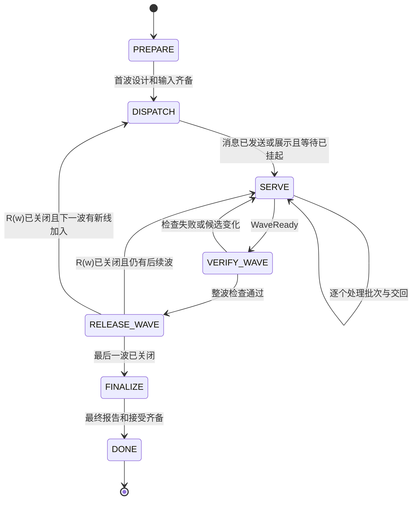
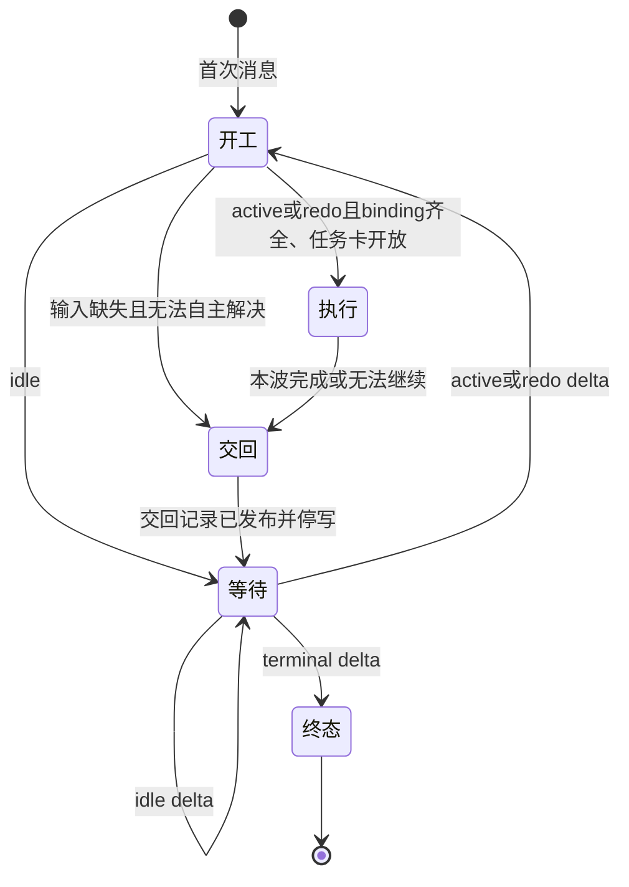

# Map-Reduce 负责人状态与恢复

本页拥有 Reduce 与 Line 的阶段、恢复、收口顺序、redo 与接管处置、两个协调边界和组合不变式。协作规则、记录格式、读写交叉、失败处理、等待命令与平台写入归[集成清单](integration.md#集成节点的清单)，精确命令和编码归 [dev-flow](../../tools/dev-flow/src/delivery/README.md)。本页定义外部里程碑的常驻 Reduce 与 Line。线会话为单张卡派出子代理时，该子代理只持有这一次任务，不因此成为常驻线。规则是规范，不表示运行验证已经完成。本页的公式是人工核对清单，没有工具计算。

## 术语

- 交付线：卡的路线与写入归属的单位，由[线归属表](delivery-lines.json)登记，见[交付线](integration.md#交付线)。
- 线会话（Line）：推进一条交付线的常驻会话，跨波不换。交付线是归属，线会话是执行者。一个线会话负责的范围可以覆盖一个或几个领域，其中跨领域的集成与联调归这个线会话，见[集成节点的清单](integration.md#集成节点的清单)。
- Reduce（集成节点）：同一里程碑唯一的 reduce 会话，兼调度者。它建卡、派发、集成并收口每一波。
- 收口点 F(w)：第 w 波收口时实际读回的联调轨道提交。R(w) 是第 w 波的收口卡。下一波先把 F(w) FI 到各参加线的轨道，工作卡从实际同步后的线轨道头开工。
- 递归：负责人认可的方向是递归的分形结构。同一个会话对上一级是 Line，对它派出的常驻下级线是 Reduce，在线内再做一次 map-reduce。对上一级它仍只在开工与交回两个边界协调，人仍只与最上一级的 Reduce 讨论设计。具体映射尚未设计。设计之前，本页其余各处的 Reduce 都指最上一级、同一里程碑唯一的 reduce 会话，线会话不设常驻下级线。设计由最上一级 Reduce 提出、交人接受，至少要定：嵌套层「唯一」的含义；嵌套 Reduce 原本向人提问或暂停的出口怎样改为向上一级交回；下级线的建卡、binding、attempt 与写范围（下级线不在线归属表里）；下级会话由谁创建、首次消息怎样转发；嵌套波与上一级波的对应，包括嵌套收口先于向上交回、上一级发 idle 或 terminal 时下级线收到什么。

## 1 事实与副作用

负责人发出命令与外部事实成立是两件不同的事。没有读回成功的合并、关闭或评论，不写成成功。结果未知时，负责人先读回实际结果，再决定继续或重做。同一操作不因结果未知而重发第二次。

可信事件是线父卡上带标记的记录、提升 PR 的状态、gate 运行结果和人的有效决定。普通评论只是提示，不授予开工、放行或返工。提示和状态图不提供文件级权限隔离。写范围、工作树隔离和单写检查仍要执行。

## 2 滚动规划与逐收口等待

R(w) 是当前波 w 的收口卡，F(w) 是它的最终基线。总波数不必预先固定。当前波及 R(w) 已建卡。后一波只保留可调整预案，不预建交付卡或 R(w+1)。本波成果收齐并验证后，Reduce 按实际结果调整预案，建下一波卡与 R(w+1)，为全部存续线发布 delta。然后 R(w) 按自身交付条件接受并读回，Reduce 再关闭 R(w)。关闭 R(w) 是放行动作，只观察到 closed 事件不等于放行。更远路线图不授予开工权限。

```text
assignment(l) ∈ {active, idle, redo, terminal}
Line 的等待目标 = 线父卡上的下一条 line-delta    若 Line 未到终态
               = 无                             仅当读到 terminal delta
redo 不推进波号。active、idle、terminal 各对应一次收口。
```

| 逐条 delta 示例 | Line 的动作 | 读取顺序 |
| --- | --- | --- |
| active → active → terminal | 两波都交回成果，第三条 delta 是终态 | 三条逐条读取，读到终态后停止 |
| active → idle → active → terminal | 波 2 只读 delta 并继续等待，波 3 恢复工作 | 逐条读取，不跳过波 2 的 delta |
| idle → idle → active → terminal | 前两波不建任务分支、不交空 PR | 逐条读取，每条之后继续等待 |
| active → redo → active | 波内遇阻交回。Reduce 更正输入后发 redo，Line 按新 attempt 同波重做 | redo 之后仍在同一波 |

轮空只取消本波实施，不取消订阅。轮空线的 delta 也写到线父卡，至少有 idle 原因和变化摘要。空任务列表、未建后续卡或预案中的最后一次参与都不能当作终态。

## 3 Reduce 状态空间

Reduce 的阶段与控制状态正交。处理一个批次时，Reduce 仍保持等待其他交回。

```text
phase ∈ {PREPARE, DISPATCH, SERVE, VERIFY_WAVE, RELEASE_WAVE, FINALIZE, DONE}
control ∈ {RUN, RECOVER, STOPPING, STOPPED}
```



| 阶段 | Reduce 的动作 | 离开条件 |
| --- | --- | --- |
| PREPARE | 备齐目标、设计、边界和首波输入，核对项见[阶段内的核对](#阶段内的核对)。用 `scope-cli` 求交，写集相交或产品语义读写交叉时改分解。经[提问前三问](#提问前三问)处理必要分歧 | 首波任务、R1 与 F0 已建并读回，写集求交通过，进入 DISPATCH。必要输入缺失且不能自主决定时留在 PREPARE，只把真实决定交人 |
| DISPATCH | 按第 6 节依次生成、演练、校验首次消息，再按授权直接发送或打开供人转发。挂起[等待](integration.md#等待监督) | 消息已发送或已展示且等待已挂起，进入 SERVE。发送、收到和认领分别读回，不能由前一项推断后一项 |
| SERVE | 逐个处理提升 PR 与交回记录，见[阶段内的核对](#阶段内的核对)。blocked 或 failed 交回时按 [4.1](#41-遇阻交回与处置) 发 redo delta 或接管 | WaveReady 成立且没有进行中的轨道写入，进入 VERIFY_WAVE |
| VERIFY_WAVE | 在联调轨道头运行整波检查与里程碑联调命令，见[阶段内的核对](#阶段内的核对) | 通过后进入 RELEASE_WAVE。检查失败或候选变化时回 SERVE，旧证据失效 |
| RELEASE_WAVE | 按[收口顺序](#收口顺序)建下一波卡与 R(w+1)，发布全部存续线 delta，接受并读回 R(w)，关闭 R(w) | R(w) 已关闭且有后续波时回 SERVE，w 加 1，F 取 F(w)。下一波有新线加入时进入 DISPATCH，为新线生成首次消息。最后一波关闭后进入 FINALIZE |
| FINALIZE | 收各线最终报告，核对里程碑结束条件 | 齐备后进入 DONE。仍有未交项时继续等待既定期限，不伪造完成 |
| DONE | 只对账和诊断 | 新的里程碑另建工作实例，不复活旧写权 |

```text
resolved(l,w) = 本线本波结果已合入且证据适用
                OR 有权移出本波并写明剩余责任

WaveReady = (∀l ∈ 本波参加线: resolved(l,w))
            ∧ Reduce 自有工作完成 ∧ 无未决集成缺陷 ∧ 无未知写入

ReleaseReady = WaveReady ∧ 整波检查通过 ∧ R(w) 的接受决定已读回
               ∧ ((下一波卡与 R(w+1) 已建 ∧ 每条存续线已有 delta)
                  OR (有权终态 ∧ 每条存续线已有 terminal delta))
```

「移出本波」必须显式改变范围，并在报告中区分缩范围和完成原目标。PR ready、空队列或截止时间已过都不能单独使 WaveReady 成立。

同一轨道的候选准备、push 和发布一次只有一个。等待、检查和无副作用工作持续运行。基线变化后，Reduce 用最新 targetBase 重新验证，不复用过期的检查结果。合入以 PR 实际合入且合并提交在目标轨道可达为准。合入被回退时，WaveReady 重新不成立。

control 的转移如下：

- 结果未知、写权冲突或恢复启动时，control 进入 RECOVER。Reduce 暂停受影响写入，读回事实后回 RUN。
- 人请求暂停或取消时，control 进入 STOPPING。Reduce 停止新派发与写入，确认实际停写后进入 STOPPED。STOPPED 不等于 DONE。
- 等待人的决定时，Reduce 只冻结依赖该决定的动作，继续处理其他事项。人的决定只改变下一波输入，当前波 Line 的冻结输入不变。

### 阶段内的核对

PREPARE：

1. 建卡范围见[第 2 节](#2-滚动规划与逐收口等待)。
2. 核对已接受依据、基线、消费者影响、参加交付的线与全部存续线清单、期限，以及 Claude Code 与 Codex 两种宿主的角色模型分配（见 `line` 技能的工作范式）。
3. 核对线轨道登记与远端分支齐备、上游链有效，完成开波 FI 并记录固定同步点。线父卡不建立每波 Git binding；实际工作卡分别 binding 与 start。
4. 在收口点的检出上做写集求交与读写交叉核对。命令、退出码与复核方法归[读写交叉的两类](integration.md#读写交叉的两类)。

SERVE 一次接管一个提升 PR：

1. 核对线已停写及工作卡进入线轨道的准入、gate 证据。保留来源原始 head、候选 head、目标 head、targetBase 和 merge 链。
2. 在 reduce 隔离候选上处理同步、冲突、迁移和修复，同时继续收件。
3. 同步后先用 `node --experimental-strip-types tools/dev-flow/src/integration/worktree-cli.ts projections --tree <树>` 生成宿主投影，它最后运行 `pnpm run check:agents`；再运行 `pnpm run admission`（等于 `OMNE_ADMISSION=1 pnpm run check`，另写准入日志）。同一台机器上的准入一次只跑一个。
4. 候选或基线变动后，重做受影响的验证与独立评审。
5. 按既有权限发 gate，绑定精确的 workflow、ref、head、runId 与 runAttempt。需要审批时交有权者，Reduce 不自动批准。
6. 以实际 PR 与轨道的读回记录 merged。合入被回退时，原结果重新未解决。

VERIFY_WAVE：

1. 全部预期项有效解决后，在联调轨道头运行 `OMNE_ADMISSION=1 FULL=1 pnpm run check` 及里程碑联调命令，验证整体成果并确定最终 F。没有里程碑联调命令时明确报告未运行。F 的树与一个已通过这项检查的头的树相同时，按[树相同时复用准入](integration.md#树相同时复用准入)复用那次结果，不重跑这项检查。准入部分在那次全量准入所在的工作树里用 `admission-evidence --for <F>` 核对，用法见 `tools/test-runner/README_ZH.md`「准入：运行记录、接续与证据核对」。
2. 任一 pending、未知副作用、未解决失败或失效证据都阻止收口。
3. 检查失败由 Reduce 处置。不把失败标红后仍当成功放行。

### 收口顺序

收口顺序固定：

1. 在联调轨道头完成整波检查，见[阶段内的核对](#阶段内的核对)的 VERIFY_WAVE。
2. 按真实结果调整后一波预案。继续推进时，建下一波任务卡与收口卡 R(w+1)。里程碑终态时不建虚构后继，先读回有权者的终态决定，再为每条存续线发布 terminal delta。
3. 为每条存续线在线父卡发布 delta，包括 idle 线。delta 的格式归[线会话记录](integration.md#线会话记录)。
4. R(w) 按自身交付条件接受。Reduce 读回接受决定。
5. 关闭本波收口卡 R(w)，并读回关闭状态。关闭 R(w) 是放行动作。

任一存续线缺 delta，非终态时缺后继收口卡，或 R(w) 的接受决定没有读回，Reduce 都不能关闭 R(w)。同一次收口的各 delta 中的 F 必须一致。只观察到 R(w) 的 closed 事件不等于放行。放行以前面各步都已读回为前提。轨道提升和 stable 权限仍沿[多层分支集成](integration.md)的原规则。

### 提问前三问

Reduce 向人提设计或方案问题前，先检查三问：

1. 是否当前里程碑所必需。
2. 方案是否增加不必要的复杂度。
3. 能否依据现有授权、系统品味、顶层架构、领域责任、当前需求和相邻已接受机制自主决定。

先删除过度设计、简化方案、完成可自行查证的判断。只有真实目标冲突、授权不足、必要信息不可获得或缺少选择依据的实质问题才向人提出。提出时给出证据、最小选项、推荐及后果，说明三问为何未消除问题。Line 不因此获得波中提问例外。

凡是可能交回待定项的子代理简报（整理待定项、实施、评审都算），简报要求子代理给每一项分类：能自己定的写出依据，只有人能定的写出理由。简报不设「交给人决定」的清单：有这样一栏，子代理就会往里放，三问的筛选就落到人身上。子代理交回的「只有人能定」各项，Reduce 仍逐项检查三问，再决定是否向人提出。

核对第 3 问时，Reduce 分清应然与实然。越顶层的设计，越是在描述系统应当怎样工作，往往不是系统当下实际的样子。按当前研发阶段与里程碑的目标，实现常常要在两者之间取舍。上层正文要求的内容在当前里程碑内不能全部实现时，Reduce 可以按 [ub-mode 研发品味](skills.md#ub-mode-研发品味)思考和设计实现做法。

取舍只在已确认的里程碑范围与卡的要求之内进行。Reduce 选实现做法，不改写上层正文，并按[顶层设计表达应然](documentation.md#顶层设计表达应然)记录偏离及其位置与内容。需要缩减已确认的范围或已接受的承诺时，按下面「偏离上层正文的候选」一项向人提出。

第 3 问的核对包括下面几项：

- 自上而下核对：认为某个实现还没有定、需要人拍板时，先沿约束方向逐层确认它是否真的没有设计过：项目要求与产品正文（同为最上层，产品正文在 `.meta_harness/design/product/`，没有访问资格时读负责人提供的约束投影）→ 架构 → 领域 → 成员规格。再查相关卡评论中已采用的具名决定，按下一项处理。线会话只核对冻结输入中已有的正文与决定。读到答案时，它不是未决项，按该层的拥有者与采用状态处理。
- 人的口头答复：人在对话中给出的回答，通常指已有的设计，不是新规则。Reduce 把它写进卡或规格之前，先在产品正文或成员正文中找到出处，并分清它是产品规则还是实现缺口。找不到出处时，不把其中任何部分写成「以后的能力」或「还没有设计」，先向人确认出处。
- 已采用的决定：决定已经采用、只是正文或代码没有跟上时，第 3 问已有答案。Reduce 安排写回，不把它作为问题交给人。
- 偏离上层正文的候选：候选偏离已接受的上层正文时，先找同时满足卡的要求与上层正文的做法。找到时按它修正候选，并在卡评论中写明依据。找不到时，这是真实的冲突，按本节向人提出。
- 技术缺口：产品负责人不能读懂并判断对错的缺口，不作为产品问题提出。Reduce 依据架构、领域与成员规格决定；这些正文都没有覆盖时，按下一项处理。
- 看似未决的实现何时向人提出：逐层核对后各层都没有答案，并且第 1、2 问也没有消除它时，才按本节向人提出，并写明核对过哪几层。真实冲突、授权不足等其他情形仍按本节前文处理。

## 4 Line 状态空间

```text
phase ∈ {开工, 执行, 交回, 等待, 终态}
```



| 阶段 | Line 的动作 | 离开条件 |
| --- | --- | --- |
| 开工 | 从首次消息取得身份、长程目标、方法地图与分工，从 delta 取得 F 与本波 assignment。核对任务卡上的 binding | active 或 redo：binding 齐全且任务卡开放，进入执行。事件接收器的健康状态和自检结果不阻止开工。idle：进入等待。输入缺失且无法自主解决：进入交回，结果为 blocked |
| 执行 | 逐卡按 `claim` 技能推进，在冻结输入内自主实现、验证与评审。线负责人组织卡级准入，经 gate 入线轨道；同机整次准入互斥。局部细节在授权内决定，不吸收新评论或新设计 | 本波完成，或无工作可继续，进入交回 |
| 交回 | 开提升 PR（零差异时没有），在每张卡发五节交接报告，在线父卡发交回记录。三样交回物的格式归[线会话记录](integration.md#线会话记录) | 交回记录已发布，Line 停写，进入等待 |
| 等待 | 用低层等待命令等线父卡上的下一条 `line-delta`，不结束会话回合。命令归[等待监督](integration.md#等待监督) | 按 delta 的 assignment 转移。每次唤醒与超时后的读回、去重与重挂按[等待监督](integration.md#等待监督)。等待命令失败时，Line 记录状态，等人转告 |
| 终态 | 交最终报告 | 停止。只清理自己的资源 |

```text
MayWriteLine = phase = 执行 ∧ 持有本线写范围
frozenInput 在执行阶段不变
HumanQuestionEffects(Line) = ∅
ReduceQuestionCommentEffects(Line) = ∅
```

开工阶段只做工作树、认领和环境准备，不提前改产品文件。交回阶段只写报告、PR 元数据和交回记录，不继续实现。波中看到的评论和提前返回的等待结果只保存，Line 不跳过交回直接进入下一波。

没有远端通路时，Line 在本机保存交回记录，并打开供人带回。Line 不声称交回记录已发布。

恢复时，Line 读线父卡上最后一条 delta 和自己最后一条交回记录，判断所处阶段。已交回的 Line 回到等待，不重开代码写入。恢复不跳过未读的 idle delta。重复进程不得同时持有同一 Line 执行。

### 4.1 遇阻交回与处置

Line 在授权内可修复的问题自行修复。必要的外部输入或全局决定缺失时，Line 停止依赖项并继续无依赖工作。无工作可继续时，Line 交 blocked 或 failed，然后停写。交回入口与成功交回相同。Line 不能一边等方案一边继续当前执行。

Reduce 收到 blocked 或 failed 后，核对事实和剩余责任，继续处理其他批次。处置有两种：

- redo：Reduce 更正输入，在任务卡上登记新 attempt，再发 redo delta。Line 读到后回开工，按新 binding 同波重做。波号不变。
- 接管：Reduce 完成剩余工作。Line 继续等待下一条 delta。

处置不需要另写认领、替代或处置记录。Line 不恢复旧执行，也不凭普通评论返工。处置本身不等于 resolved，WaveReady 仍须满足合入或有效范围调整。普通评论、超时和旧 attempt 都不能触发重做。

例：A 在波 2 缺少跨线契约，交回 blocked。Reduce 补齐契约。如果 Reduce 自己完成，A 继续等待下一条 delta。如果 Reduce 发 redo，A 同波按新 attempt 重做。此时 R2 仍未关闭，必须等新结果合入后才能收口。任何路径都不能让 Reduce 等 A 完成，同时 A 只等 R2 关闭。

`line` 技能按本页 Line 阶段给出动作顺序，`dispatch` 与 `integrate` 技能按本页 Reduce 阶段给出动作顺序。技能在首次进入和恢复时要求读本页。验收检查实际行为，不以链接存在代替。

## 5 两个负责人的组合不变式

| ID | 不变式 | 反例必须被拒绝 |
| --- | --- | --- |
| I01 | 人只与唯一 reduce 会话讨论设计。Line 只在开工与交回两个边界协调 | Line 波中向人提问，或发评论向 reduce 求方案 |
| I02 | 写权在交回时转移。Line 发布交回记录后停写，Reduce 才接管候选 | Line 交回后继续推送，或 Reduce 与 Line 同时写同一候选 |
| I03 | Reduce 的等待不中断，轨道写入单写 | 处理 A 时丢 B，或两个候选同时写轨道 |
| I04 | 交回、合入和整波放行分开 | 交回即开下一波，或 PR ready 即记合入 |
| I05 | 下一波卡、全部存续线 delta 和 R(w) 的接受读回先于关闭 R(w) | 先关闭后补 delta，漏发 idle 线，或未接受就关闭 R(w) |
| I06 | idle 线继续订阅 | 因本波没有任务而停止等待 |
| I07 | 只有明确的 terminal delta 结束本线 | 因空队列、未建后继卡或等待超时而停止 |
| I08 | 原候选、reduce 候选、验证基线和合入提交可追溯 | 修改 head 后复用不适用的旧证据 |
| I09 | 重复输入不增加执行或写权 | 重发首次消息产生两个 Line，或同一 redo 被执行两次 |
| I10 | 不可靠观测保持未知 | pid 存在即断言接收器健康，或沉默即判 Line 失联 |
| I11 | 成功与失败交回都能被 reduce 收到 | 阻断线只能等答复，或 failed 被当作完成 |
| I12 | 首次消息只负责引导和身份引用，不另造任务事实 | 手工抄出的写范围与 binding 不同仍继续执行 |

全局活性是条件命题。权限、网络和执行资源可用，等待结果可被宿主消费，必要的人类决定最终给出，且可处理事项公平排队时，未终止工作才应最终前进。事件静默丢失、机器彻底掉线或人未转发不满足前提。模型不声称无条件完成。

## 6 初始派发消息的生成与人工转发

初始消息模板见 [Line 首次派发消息](../../.meta_harness/human/map-reduce-delivery/templates/line-initial-dispatch.md)。它面向新 Line 会话，不是线会话给子代理的简报。已有 Line 下一波读取 delta，不重新创建人类会话或重发首次消息。

```text
renderInitial(m,l,dispatchRevision,hostProfile,machineBinding) → temporaryFile

DispatchReady = authorizedAndBound ∧ prerequisitesKnown
                ∧ immutablePointersAccessibleFromTarget
                ∧ everyCommandRehearsedOnSameLayout
                ∧ allRequiredFieldsFilled ∧ noSecrets ∧ noContradictoryCopies

GENERATED → REHEARSED → STRUCTURE_CHECKED → VALIDATED
直接通信：VALIDATED → SENT → RECEIVED → CLAIMED
人工回退：VALIDATED → OPENED_FOR_HUMAN → FORWARDED_REPORTED
```

`everyCommandRehearsedOnSameLayout` 指消息里的每条命令都已在本机按目标机的同一布局运行，输出已附进校验记录。

生成器从有效 binding、线包、里程碑计划和宿主策略读取字段，为每条线写一个文件。路径采用 `tmp/milestone-<id>/dispatch/<line>-r<revision>.md`。这是执行时的实际产物规则，模板文件名本身不是已派发结果。

| 派发状态 | 成立条件 | 不能声称的事实 |
| --- | --- | --- |
| GENERATED | render 写出临时文件并返回 sha256 | 内容已就绪或已给人看 |
| REHEARSED | 消息里的每条命令已在本机同布局运行，演练证据针对这份消息的 sha256 | 命令输出正确 |
| STRUCTURE_CHECKED | validate 带演练证据通过 | 剩余 guard 已核对 |
| VALIDATED | DispatchReady 全部成立，Reduce 已逐项核对剩余 guard，版本和摘要固定 | 已发送或已转发 |
| SENT | 通信工具返回发送成功，保存会话与消息标识 | Line 已收到或已认领 |
| RECEIVED | 从目标会话读回该修订消息 | Line 已认领 |
| CLAIMED | 目标会话明确认领本线责任，Reduce 读回该事实；工作卡 start 另行读回 | 工作卡已开工、工作已完成或已接受 |
| OPENED_FOR_HUMAN | 侧边栏或 IDE 打开操作成功。queued 单列为等待展示 | 人已读或已转发 |
| FORWARDED_REPORTED | 人在 reduce 会话说已转发 | Line 已开工 |

直接通信路径分别保存发送、收到和认领的回执。人工回退的 FORWARDED_REPORTED 只说明人报告已转发，不证明 Line 开工。后续进展继续由工作卡、交回记录与提升 PR 体现。

已授权本机直接协作时，Reduce 通过 mirasim 创建或定位唯一 Line 会话，发送校验后的正文并读回；创建和通信只由 Reduce 执行。没有直接通信授权或能力时，由人将文件正文原样复制到目标 Line 会话。需要改内容时，Reduce 重新生成新修订，不让接收者补缺字段或现场设计。公开材料使用目标机器可访问的精确提交链接。本机路径只用于该机器的运行绑定，不能伪装成跨机可读资料。频道 URL 和令牌只引用本机配置位置。

Line 开工前，Reduce 可以用新修订替代旧修订，直接发送或通知转发者只使用新修订。Line 开工后，重复转发只接续同一执行。消息正文不授予 binding 未包含的权限。

## 7 转移验收场景

1. A 先交回、B 未交回。Reduce 处理 A 时仍等待 B，随后处理 B。收口前所有参加线都有有效结果。
2. 新 head 到达后旧检查失效。gate 成功但未合入不记合入。合入被回退时，本波重新不可收口。
3. delta 发布后关闭 R(w) 的响应丢失。Reduce 先读回，再决定下一步，不重复发布 delta。
4. 连续工作、连续轮空、轮空后恢复和中途加入都逐条读取 delta。R(w) 关闭前，包括 idle 线在内的所有 delta 已发布。终态不靠空列表推断。
5. Line 波中看见普通评论、新架构建议和提前返回的等待结果，仍保持冻结输入与当前波，交回前不开下一波。
6. Line 遇阻提前交回 blocked 或 failed。零差异交回只有报告。没有通信能力时，Line 保存交回记录，不谎称已发布。分别运行 redo 与接管两种处置。验证 R(w) 未关闭时 redo 可以前进，旧 attempt 不能重开。
7. 人反复转发同一首次消息，只产生一个执行。过期消息保持隔离。
8. Reduce 用三问消除过度设计、过繁方案和可自主决定的问题，真实权限问题才到人。
9. 暂停、恢复与取消分别保留 STOPPED、RECOVER、DONE 的不同含义。未知事件无业务副作用。

每个场景记录初态、事件、动作、外部结果和终态。路径表与公式定义规格，不是已经通过形式验证的证明。实现期用真实入口与故障测试核对对应关系。
