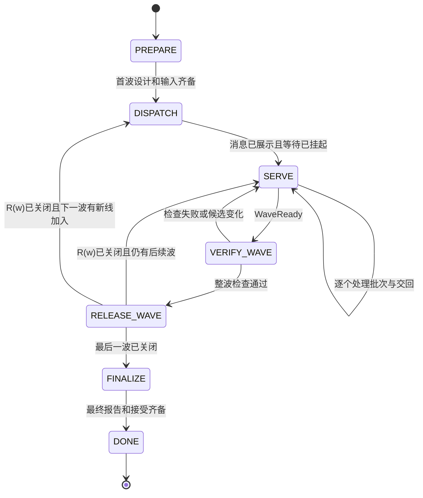
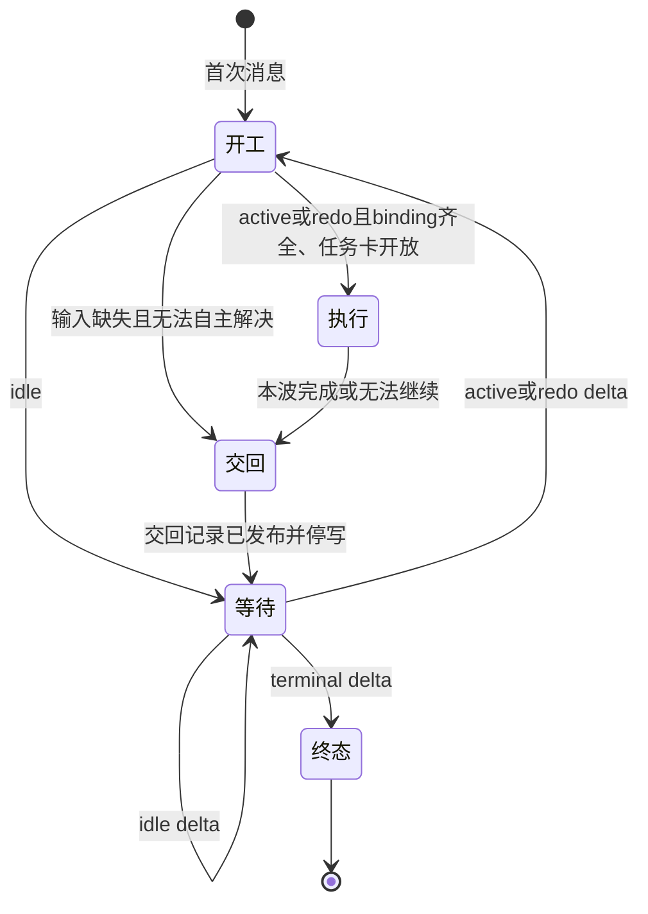

# Map-Reduce 负责人状态与恢复

本页拥有 Reduce 与 Line 的阶段、两个协调边界和组合不变式。工程责任与记录格式归[集成清单](integration.md#集成节点的清单)，精确命令和编码归 [dev-flow](../../tools/dev-flow/src/delivery/README.md)。本页定义外部里程碑的常驻 Reduce 与 Line。内部 map 节点只持有本次任务，不因此成为常驻线。规则是规范，不表示运行验证已经完成。

## 1 事实与副作用

负责人发出命令与外部事实成立是两件不同的事。没有读回成功的合并、关闭或评论，不写成成功。结果未知时，负责人先读回实际结果，再决定继续或重做。同一操作不因结果未知而重发第二次。

可信事件是线父卡上带标记的记录、批次 PR 的状态、gate 运行结果和人的有效决定。普通评论只是提示，不授予开工、放行或返工。提示和状态图不提供文件级权限隔离。写范围、工作树隔离和单写检查仍要执行。

## 2 滚动规划与逐收口等待

R(w) 是当前波 w 的收口卡，F(w) 是它的最终基线。总波数不必预先固定。当前波及 R(w) 已建卡。后一波只保留可调整预案，不预建交付卡或 R(w+1)。本波成果收齐并验证后，Reduce 按实际结果调整预案，建下一波卡与 R(w+1)，为全部存续线发布 delta。然后 R(w) 按自身交付条件接受并读回，Reduce 再关闭 R(w)。关闭 R(w) 是放行动作，只观察到 closed 事件不等于放行。更远路线图不授予开工权限。

```text
assignment(l) ∈ {active, idle, redo, terminal}
Line 的等待目标 = 线父卡上的下一条 line-delta    若 Line 未到终态
               = 无                             仅当读到 terminal delta
redo 不推进波号。active、idle、terminal 各对应一次收口。
```

| 逐条 delta 示例 | Line 的动作 | 读取顺序 |
| --- | --- | --- |
| active → active → terminal | 两波都交回成果，第三条 delta 是终态 | 三条逐条读取，读到终态后停止 |
| active → idle → active → terminal | 波 2 只读 delta 并继续等待，波 3 恢复工作 | 逐条读取，不跳过波 2 的 delta |
| idle → idle → active → terminal | 前两波不建任务分支、不交空 PR | 逐条读取，每条之后继续等待 |
| active → redo → active | 波内遇阻交回。Reduce 更正输入后发 redo，Line 按新 attempt 同波重做 | redo 之后仍在同一波 |

轮空只取消本波实施，不取消订阅。轮空线的 delta 也写到线父卡，至少有 idle 原因和变化摘要。空任务列表、未建后续卡或预案中的最后一次参与都不能当作终态。

## 3 Reduce 状态空间

Reduce 的阶段与控制状态正交。处理一个批次时，Reduce 仍保持等待其他交回。

```text
phase ∈ {PREPARE, DISPATCH, SERVE, VERIFY_WAVE, RELEASE_WAVE, FINALIZE, DONE}
control ∈ {RUN, RECOVER, STOPPING, STOPPED}
```



| 阶段 | Reduce 的动作 | 离开条件 |
| --- | --- | --- |
| PREPARE | 备齐目标、设计、边界和首波输入。用 `scope-cli` 求交，写集相交或产品语义读写交叉时改分解。经[提问前三问](integration.md#提问前三问)处理必要分歧 | 首波任务、R1 与 F0 已建并读回，写集求交通过，进入 DISPATCH。必要输入缺失且不能自主决定时留在 PREPARE，只把真实决定交人 |
| DISPATCH | 按第 6 节依次生成、演练、校验首次消息，再打开供人转发。挂起[等待](integration.md#等待监督) | 消息已展示且等待已挂起，进入 SERVE。「已展示」不是「人已转发」，更不是「Line 已开工」 |
| SERVE | 逐个处理批次 PR 与交回记录。blocked 或 failed 交回时发 redo delta 或接管 | WaveReady 成立且没有进行中的轨道写入，进入 VERIFY_WAVE |
| VERIFY_WAVE | 在联调轨道头运行整波检查与里程碑联调命令 | 通过后进入 RELEASE_WAVE。检查失败或候选变化时回 SERVE，旧证据失效 |
| RELEASE_WAVE | 按[收口顺序](integration.md#接受与逐收口续接)建下一波卡与 R(w+1)，发布全部存续线 delta，接受并读回 R(w)，关闭 R(w) | R(w) 已关闭且有后续波时回 SERVE，w 加 1，F 取 F(w)。下一波有新线加入时进入 DISPATCH，为新线生成首次消息。最后一波关闭后进入 FINALIZE |
| FINALIZE | 收各线最终报告，核对里程碑结束条件 | 齐备后进入 DONE。仍有未交项时继续等待既定期限，不伪造完成 |
| DONE | 只对账和诊断 | 新的里程碑另建工作实例，不复活旧写权 |

```text
resolved(l,w) = 本线本波结果已合入且证据适用
                OR 有权移出本波并写明剩余责任

WaveReady = (∀l ∈ 本波参加线: resolved(l,w))
            ∧ Reduce 自有工作完成 ∧ 无未决集成缺陷 ∧ 无未知写入

ReleaseReady = WaveReady ∧ 整波检查通过 ∧ R(w) 的接受决定已读回
               ∧ ((下一波卡与 R(w+1) 已建 ∧ 每条存续线已有 delta)
                  OR (有权终态 ∧ 每条存续线已有 terminal delta))
```

「移出本波」必须显式改变范围，并在报告中区分缩范围和完成原目标。PR ready、空队列或截止时间已过都不能单独使 WaveReady 成立。

同一轨道的候选准备、push 和发布一次只有一个。等待、检查和无副作用工作持续运行。基线变化后，Reduce 用最新 targetBase 重新验证，不复用过期的检查结果。合入以 PR 实际合入且合并提交在目标轨道可达为准。合入被回退时，WaveReady 重新不成立。

control 的转移如下：

- 结果未知、写权冲突或恢复启动时，control 进入 RECOVER。Reduce 暂停受影响写入，读回事实后回 RUN。
- 人请求暂停或取消时，control 进入 STOPPING。Reduce 停止新派发与写入，确认实际停写后进入 STOPPED。STOPPED 不等于 DONE。
- 等待人的决定时，Reduce 只冻结依赖该决定的动作，继续处理其他事项。人的决定只改变下一波输入，当前波 Line 的冻结输入不变。

## 4 Line 状态空间

```text
phase ∈ {开工, 执行, 交回, 等待, 终态}
```



| 阶段 | Line 的动作 | 离开条件 |
| --- | --- | --- |
| 开工 | 从首次消息取得身份、长程目标、方法地图与分工，从 delta 取得 F 与本波 assignment。核对任务卡上的 binding | active 或 redo：binding 齐全且任务卡开放，进入执行。事件接收器的健康状态和自检结果不阻止开工。idle：进入等待。输入缺失且无法自主解决：进入交回，结果为 blocked |
| 执行 | 逐卡按 `claim` 技能推进，在冻结输入内自主实现、验证与评审 | 本波完成，或无工作可继续，进入交回 |
| 交回 | 开 PR（零差异时没有），在每张卡发五节交接报告，在线父卡发交回记录 | 交回记录已发布，Line 停写，进入等待 |
| 等待 | 用低层等待命令等线父卡上的下一条 `line-delta`，不结束会话回合 | 按 delta 的 assignment 转移。超时后用同一起点重跑。等待命令失败时，Line 记录状态，等人转告 |
| 终态 | 交最终报告 | 停止。只清理自己的资源 |

```text
MayWriteLine = phase = 执行 ∧ 持有本线写范围
frozenInput 在执行阶段不变
HumanQuestionEffects(Line) = ∅
ReduceQuestionCommentEffects(Line) = ∅
```

开工阶段只做工作树、认领和环境准备，不提前改产品文件。交回阶段只写报告、PR 元数据和交回记录，不继续实现。波中看到的评论和提前返回的等待结果只保存，Line 不跳过交回直接进入下一波。

恢复时，Line 读线父卡上最后一条 delta 和自己最后一条交回记录，判断所处阶段。已交回的 Line 回到等待，不重开代码写入。恢复不跳过未读的 idle delta。重复进程不得同时持有同一 Line 执行。

### 4.1 遇阻交回与处置

Line 在授权内可修复的问题自行修复。必要的外部输入或全局决定缺失时，Line 停止依赖项并继续无依赖工作。无工作可继续时，Line 交 blocked 或 failed，然后停写。交回入口与成功交回相同。Line 不能一边等方案一边继续当前执行。

Reduce 收到 blocked 或 failed 后，核对事实和剩余责任，继续处理其他批次。处置有两种：

- redo：Reduce 更正输入，在任务卡上登记新 attempt，再发 redo delta。Line 读到后回开工，按新 binding 同波重做。波号不变。
- 接管：Reduce 完成剩余工作。Line 继续等待下一条 delta。

处置不需要另写认领、替代或处置记录。处置本身不等于 resolved，WaveReady 仍须满足合入或有效范围调整。普通评论、超时和旧 attempt 都不能触发重做。

例：A 在波 2 缺少跨域契约，交回 blocked。Reduce 补齐契约。如果 Reduce 自己完成，A 继续等待下一条 delta。如果 Reduce 发 redo，A 同波按新 attempt 重做。此时 R2 仍未关闭，必须等新结果合入后才能收口。任何路径都不能让 Reduce 等 A 完成，同时 A 只等 R2 关闭。

`line` 技能按本页 Line 阶段给出动作顺序，`dispatch` 与 `integrate` 技能按本页 Reduce 阶段给出动作顺序。技能在首次进入和恢复时要求读本页。验收检查实际行为，不以链接存在代替。

## 5 两个负责人的组合不变式

| ID | 不变式 | 反例必须被拒绝 |
| --- | --- | --- |
| I01 | 人只与唯一 reduce 会话讨论设计。Line 只在开工与交回两个边界协调 | Line 波中向人提问，或发评论向 reduce 求方案 |
| I02 | 写权在交回时转移。Line 发布交回记录后停写，Reduce 才接管候选 | Line 交回后继续推送，或 Reduce 与 Line 同时写同一候选 |
| I03 | Reduce 的等待不中断，轨道写入单写 | 处理 A 时丢 B，或两个候选同时写轨道 |
| I04 | 交回、合入和整波放行分开 | 交回即开下一波，或 PR ready 即记合入 |
| I05 | 下一波卡、全部存续线 delta 和 R(w) 的接受读回先于关闭 R(w) | 先关闭后补 delta，漏发 idle 线，或未接受就关闭 R(w) |
| I06 | idle 线继续订阅 | 因本波没有任务而停止等待 |
| I07 | 只有明确的 terminal delta 结束本线 | 因空队列、未建后继卡或等待超时而停止 |
| I08 | 原候选、reduce 候选、验证基线和合入提交可追溯 | 修改 head 后复用不适用的旧证据 |
| I09 | 重复输入不增加执行或写权 | 重发首次消息产生两个 Line，或同一 redo 被执行两次 |
| I10 | 不可靠观测保持未知 | pid 存在即断言接收器健康，或沉默即判 Line 失联 |
| I11 | 成功与失败交回都能被 reduce 收到 | 阻断线只能等答复，或 failed 被当作完成 |
| I12 | 首次消息只负责引导和身份引用，不另造任务事实 | 手工抄出的写范围与 binding 不同仍继续执行 |

全局活性是条件命题。权限、网络和执行资源可用，等待结果可被宿主消费，必要的人类决定最终给出，且可处理事项公平排队时，未终止工作才应最终前进。事件静默丢失、机器彻底掉线或人未转发不满足前提。模型不声称无条件完成。

## 6 初始派发消息的生成与人工转发

初始消息模板见 [Line 首次派发消息](../../.meta_harness/human/map-reduce-delivery/templates/line-initial-dispatch.md)。它面向新 Line 会话，不是本卡内部 map 节点 brief。已有 Line 下一波读取 delta，不重新创建人类会话或重发首次消息。

```text
renderInitial(m,l,dispatchRevision,hostProfile,machineBinding) → temporaryFile

DispatchReady = authorizedAndBound ∧ prerequisitesKnown
                ∧ immutablePointersAccessibleFromTarget
                ∧ everyCommandRehearsedOnSameLayout
                ∧ allRequiredFieldsFilled ∧ noSecrets ∧ noContradictoryCopies

GENERATED → REHEARSED → STRUCTURE_CHECKED → VALIDATED → OPENED_FOR_HUMAN → FORWARDED_REPORTED
```

`everyCommandRehearsedOnSameLayout` 指消息里的每条命令都已在本机按目标机的同一布局运行，输出已附进校验记录。

生成器从有效 binding、线包、里程碑计划和宿主策略读取字段，为每条线写一个文件。路径采用 `tmp/milestone-<id>/dispatch/<line>-r<revision>.md`。这是执行时的实际产物规则，模板文件名本身不是已派发结果。

| 派发状态 | 成立条件 | 不能声称的事实 |
| --- | --- | --- |
| GENERATED | render 写出临时文件并返回 sha256 | 内容已就绪或已给人看 |
| REHEARSED | 消息里的每条命令已在本机同布局运行，演练证据针对这份消息的 sha256 | 命令输出正确 |
| STRUCTURE_CHECKED | validate 带演练证据通过 | 剩余 guard 已核对 |
| VALIDATED | DispatchReady 全部成立，Reduce 已逐项核对剩余 guard，版本和摘要固定 | 已转发 |
| OPENED_FOR_HUMAN | 侧边栏或 IDE 打开操作成功。queued 单列为等待展示 | 人已读或已转发 |
| FORWARDED_REPORTED | 人在 reduce 会话说已转发 | Line 已开工 |

FORWARDED_REPORTED 是派发链的最后一个状态。Line 开工后的进展由交回记录与批次 PR 体现，Reduce 不另读回认领。

人将文件正文原样复制到目标 Line 会话。Reduce 不自动给其他会话发消息，也不替人创建新的目标会话。需要改内容时，Reduce 重新生成新修订，不让转发者补缺字段或现场设计。公开材料使用目标机器可访问的精确提交链接。本机路径只用于该机器的运行绑定，不能伪装成跨机可读资料。频道 URL 和令牌只引用本机配置位置。

Line 开工前，Reduce 可以用新修订替代旧修订，并告诉人只转发新修订。Line 开工后，重复转发只接续同一执行。消息正文不授予 binding 未包含的权限。

## 7 转移验收场景

1. A 先交回、B 未交回。Reduce 处理 A 时仍等待 B，随后处理 B。收口前所有参加线都有有效结果。
2. 新 head 到达后旧检查失效。gate 成功但未合入不记合入。合入被回退时，本波重新不可收口。
3. delta 发布后关闭 R(w) 的响应丢失。Reduce 先读回，再决定下一步，不重复发布 delta。
4. 连续工作、连续轮空、轮空后恢复和中途加入都逐条读取 delta。R(w) 关闭前，包括 idle 线在内的所有 delta 已发布。终态不靠空列表推断。
5. Line 波中看见普通评论、新架构建议和提前返回的等待结果，仍保持冻结输入与当前波，交回前不开下一波。
6. Line 遇阻提前交回 blocked 或 failed。零差异交回只有报告。没有通信能力时，Line 保存交回记录，不谎称已发布。分别运行 redo 与接管两种处置。验证 R(w) 未关闭时 redo 可以前进，旧 attempt 不能重开。
7. 人反复转发同一首次消息，只产生一个执行。过期消息保持隔离。
8. Reduce 用三问消除过度设计、过繁方案和可自主决定的问题，真实权限问题才到人。
9. 暂停、恢复与取消分别保留 STOPPED、RECOVER、DONE 的不同含义。未知事件无业务副作用。

每个场景记录初态、事件、动作、外部结果和终态。路径表与公式定义规格，不是已经通过形式验证的证明。实现期用真实入口与故障测试核对对应关系。
