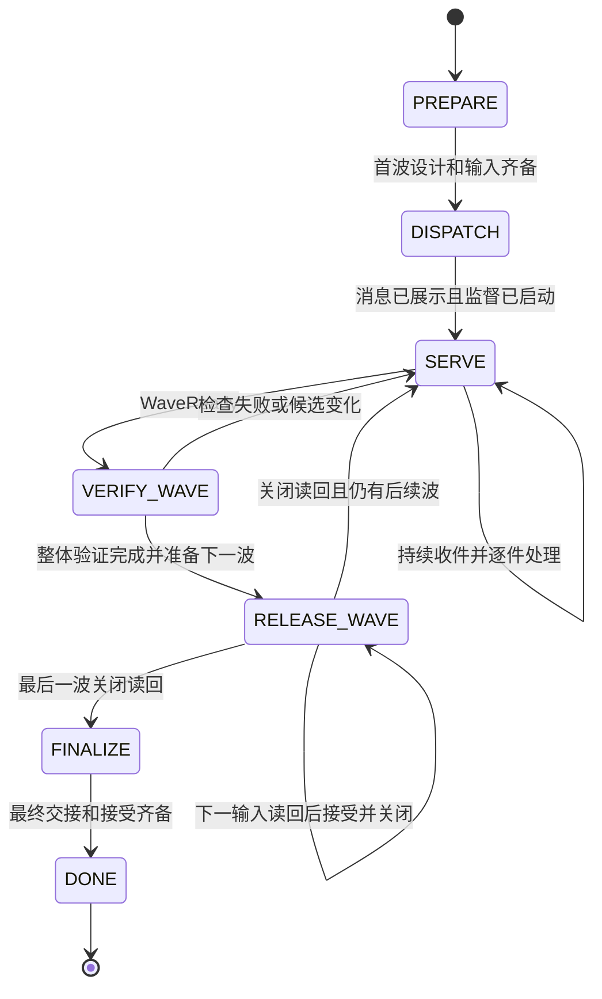
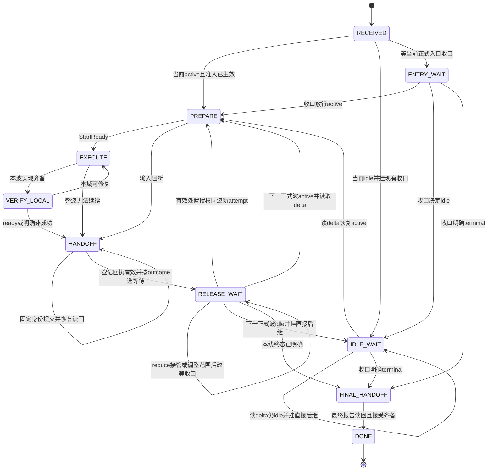

# Map-Reduce 负责人状态与恢复

本页拥有 Reduce 与 Line 的状态、guard、effect 和组合不变量，依据 #820 已冻结规格 D17–D19。工程责任归 [integration](integration.md#集成节点的清单)，精确命令和编码归 [dev-flow](../../tools/dev-flow/src/delivery/README.md)。本页定义外部里程碑常驻 Reduce 与 Line；内部 map 节点只持有本次任务，不因此成为常驻线。规则是规范，不表示运行验证已经完成。

## 1 模型、事实与副作用

负责人状态由阶段、工作数据和未完成操作组成。收到事件后，先核对来源、身份和修订，再计算转移及拟执行命令。命令发出和外部事实成立是两次不同转移。

```text
T_X : S_X × E_X → S_X × List(Command)       X ∈ {R, L}
(S[t+1], commands[t]) = T_X(S[t], normalize(event[t]))
external_ack(command.operationId, observedFacts) → 后续输入事件
```

normalize 将 webhook、Action、工具结果和人的有效决定变为有身份的事实。未经核对的评论只是提示，不是事件授权。事件身份包含 repo、milestone、wave、requestId、head、run/attempt 等适用字段。

转移总函数按以下顺序求值。合法状态必须满足本文件不变式；命中更高优先级后，不执行较低优先级的副作用。

| 优先级 | 条件 | 转移与动作 |
| --- | --- | --- |
| G00 | phase=DONE，或 control=STOPPED 且无有效恢复授权 | 状态不变，最多只读对账和诊断，不重新授予写权 |
| G01 | 明确的停止指令或已确认的执行终止 | 进入停止流程，冻结新写入；不自动变成完成 |
| G02 | 来源不可信、身份不匹配、非法修订或未知事件类型 | 状态不变，拒绝并记录诊断，无业务副作用 |
| G03 | 重复事件或同 operationId 的已完成回执 | 状态不变，返回已有结果；重复 ID 内容矛盾进入恢复隔离 |
| G04 | 实际副作用结果未知、写权冲突、基础设施失效、恢复启动 | 进入 RECOVER，保存返回点和未完成操作；冻结受影响写入 |
| G05 | 当前状态表中有事件且 guard 成立 | 按对应规则更新状态，最多发出本规则允许的命令 |
| G06 | 可信事件暂不适用于当前阶段 | 可处理信号持久排队，失效信号记录忽略依据；状态不变，不丢未知完成结果 |

命令有稳定 operationId、前置状态修订、作用对象和预期 head。恢复先读回事实，再决定继续或重试。同键不同内容拒绝。没有确认成功的 merge、登记、关闭或派发，不得写成对应成功状态。提示和状态图不能提供文件级权限隔离；实际写范围、进程隔离和单写检查仍必须执行。

## 2 滚动规划与逐收口等待

R(w) 是当前正式波 w 的收口卡，F(w) 是其最终基线。总波数不必预先固定。当前波及 R(w) 已建卡，后续一波只保留可调整预案，不预建交付卡或 R(w+1)。本波成果收齐并验证后，reduce 按实际结果调整预案，物化下一波卡、R(w+1) 与所有存续线的 delta，再接受并关闭 R(w)。更远路线图不授予开工或订阅权限。

```text
assignment(l,w) ∈ {active, idle, terminal}
currentWatch(l,w) = R(w)                 if assignment ∈ {active,idle}
continuation(l,Release(w)) = active(w+1,tasks,F(w),R(w+1))
                          | idle(w+1,reason,R(w+1))
                          | terminal(reason,finalHandoff)

nextWatch(l,Release(w)) = R(w+1)          if continuation ∈ {active,idle}
                       = null           only if continuation=terminal

b = 最后已完整消费的有效 release 波号
consume Release(w) requires w=b+1
首次加入使用已授权基线设定 b；恢复逐条补齐未消费 release，不跳过轮空。
```

| 逐波决定示例 | Line 的动作 | 实际监听顺序 |
| --- | --- | --- |
| active → active → terminal | 两波均交出成果，第三个决定是终态 | R1 → R2，读取终态后停止 |
| active → idle → active → terminal | 波 2 只读 delta 并重挂，波 3 恢复工作 | R1 → R2 → R3，不跳过 R2 |
| idle → idle → active → terminal | 前两波不建任务分支、不交空 PR | R1 → R2 → R3，逐次取得下一目标 |
| 在波 3 期间加入且当前 idle | 从有效加入基线读取当前包，先挂现有 R3 | R3 起逐节点推进，不等待尚未建卡的未来波 |

提交 watch 时只需当前已经存在的 R(w)。可选 nextHint 仅能引用实际存在且同里程碑的直接后继；预案还没建卡时省略该参数，这是 unknown，不是 terminal。命令成功返回时以有效 Release(w) 中的 continuation 为准，非终态必须返回真实 R(w+1)，终态必须显式标记。不存在后继且没有终态决定属于不完整发布，不能成功放行。旧 hint 与新权威 release 不同则返回变更诊断并采用有效 release，不挂旧卡。

轮空只取消本波实施，不取消收口订阅。Line 每次醒来先核对并保存本线 delta、计划修订、基线及当前决定，再持久保存下一等待并挂脚本。轮空线的 delta 也写到线父卡，至少有 idle 原因、变化摘要、真实下一 reduce 和恢复所需引用。空任务列表、未建后续卡或预案中的最后一次参与都不能当作终态。

## 3 Reduce 状态空间

Reduce 使用阶段机与请求处理机的组合，避免把“正在处理 A”和“仍要接收 B”写成互斥状态。

```text
S_R = (m, w, phase, control, F, roster, requests, signalQueue,
       activeWrite, pendingOps, release, decisions, dispatches, epoch)

phase ∈ {PREPARE, DISPATCH, SERVE, VERIFY_WAVE, RELEASE_WAVE, FINALIZE, DONE}
control ∈ {RUN, RECOVER, STOPPING, STOPPED}
```

| 字段 | 含义与约束 |
| --- | --- |
| m、w、F | 唯一里程碑、当前波、最近有效收口基线 |
| roster | 本波实际交付清单及各线 active/idle/terminal 决定；另存所有存续线的 delta 收件清单。idle 不等待 PR，但不能漏发 delta；缺应交结果仍为 pending |
| requests | requestId 到该交接的状态、outcome、头链、验证及处置；包含非成功交接 |
| signalQueue | [八类监督信号](integration.md#等待监督)，来源可追溯；持久接收位置与业务处置位置分开 |
| activeWrite | 当前向该联调轨道写入的请求或 reduce 自有工作，最多一个 |
| pendingOps | 已发出或拟重试的操作及精确输入；未读回时不能删记录 |
| release | 未发布/已发布已读回/关闭未知/已关闭已读回，以及 delta 和接受引用 |
| decisions | 必要性、复杂度和自主决定三问后的简短结论；待人决定项及其冻结范围 |
| dispatches | 初始消息的生成、校验、打开、转发陈述、机器认领回执；五种事实分别保存 |
| epoch | 当前唯一 reduce 执行身份；切换前需确认旧写者终止 |

监督在 PREPARE 至 FINALIZE 全程按活动对象启用。等待人决定时，只冻结依赖该决定的动作，仍接收其他信号并处理无依赖工作。后台脚本不替人审批，也不自行合入。



图展示正常阶段。逐件请求、监督、恢复和停止由下面的正交状态控制，不能因图中只有一条主线而停止后台收件。

### 3.1 Reduce 阶段转移

下面的 effect 是待发命令或负责人动作；带“读回”的事件才确立外部成功。

| ID | 当前阶段 | 事件与 guard | 下一阶段 | effect 与完成证据 |
| --- | --- | --- | --- | --- |
| R01 | PREPARE | 已有完整目标、设计、边界、首波输入及权限；三问已处理必要分歧 | DISPATCH | 建首波任务与 R1，固定 F0 和逐线 active/idle 决定；只预规划下一波；生成首次消息并打开 |
| R02 | PREPARE | 必要输入仍缺，且不能自主决定 | PREPARE | 经三问后仅把真实决定交人；不生成可执行派发 |
| R03 | DISPATCH | 消息已验证并展示给人，监督已启动 | SERVE | 等待人工转发和机器认领；未认领者保持 roster pending，不要求所有线同时到位 |
| R04 | SERVE | 新交接或已知积压可处理 | SERVE | 排队并立即启动合适请求处理，不等待全部线交齐 |
| R05 | SERVE | 收到本波初始认领/重复转发导致的读回 | SERVE | 核对唯一 attempt/owner；重复只返回已有事实，冲突隔离 |
| R06 | SERVE | WaveReady=true，且 activeWrite=null | VERIFY_WAVE | 固定候选快照，运行整体验证、迁移核对和适用评审 |
| R07 | VERIFY_WAVE | 全部整体检查通过，base/head/范围修订仍匹配，交付证据齐备 | RELEASE_WAVE | 按真实结果调整下一波预案，建下一波 active 任务卡与真实 R(w+1)，为全部存续线准备 delta；此时不接受 R(w) |
| R08 | VERIFY_WAVE | 检查失败、新交接改变候选、scope/base/head 改变或原处置失效 | SERVE | 失效旧证据，reduce 处置和重验；新事件不丢弃 |
| R09 | RELEASE_WAVE | 当前交付证据有效且下一输入尚未全部发布读回且无明确失败待恢复；下一波卡及逐线决定已准入，或有权终态决定 | RELEASE_WAVE | 幂等发布并读回所有线父卡的 delta 和待接受清单；未知建卡或发布结果先恢复；缺项不能接受 |
| R10 | RELEASE_WAVE | AcceptReady=true，下一输入/全部 delta 已读回且版本一致，关闭尚未确认且无明确失败待恢复 | RELEASE_WAVE | 按持久子阶段只执行下一未完成操作：有权接受并读回、最终 ReleaseRecord 发布读回、关闭并读回。稳定 operationId 防止重放；不提前推进 w |
| R11 | RELEASE_WAVE | R(w) 接受及关闭读回且记录有效，里程碑 continuation=advance | SERVE | F←F(w)，w←w+1，启用已物化的 roster；存续线消费已发布 delta，新线使用已准备的首次消息；再预规划后续一波但不建卡 |
| R12 | RELEASE_WAVE | 同上且里程碑 continuation=terminal | FINALIZE | 不建虚构后继卡；收集各线最终交接，核对里程碑结束条件 |
| R13 | RELEASE_WAVE | 发布/关闭明确失败且无未知副作用 | RELEASE_WAVE | 同操作幂等重试；未知结果由 G04 优先进入 RECOVER；已发布后变化不能抹掉历史 |
| R14 | FINALIZE | 全部最终交接、遗留责任、有权接受和资源归属核对完成 | DONE | 记录完整/限定接受结论，按权限关闭里程碑并清理独占资源 |
| R15 | FINALIZE | 仍有未交/未处置项 | FINALIZE | 监督该项和既定期限，不因等待时间长而伪造完成 |
| R16 | DONE | 重放或迟到事件 | DONE | 只对账和诊断；新的里程碑另建工作实例，不能复活旧写权 |

R03 的“已展示”不是“人已转发”，更不是“Line 已开工”。提前建立的晚参加线按当前正式波的 idle 决定监听现有 R(w)，不能订阅预案中的远期卡。需要下一波才加入的新线，其首次消息在本波接受前准备好，由人辅助转发；R11 不再补发本应先发布的 delta。存续 Line 保持同一会话。

### 3.2 逐件请求处理机

每个请求有持久业务 status 和处理 step。outcome=blocked/failed 是 Line 交出结果，不能与 reduce 处理过程中的 status=blocked 混为一谈。

| step | 对外 status | 正常转移与约束 |
| --- | --- | --- |
| QUEUED | registered | ready 且前置齐备可发 claim；非成功交接进入 BLOCKED，由 reduce 处置剩余责任 |
| CLAIMING | registered，接管读回前 | claim 回执有效后到 PREPARING；未知到 RECOVER；不能提前写候选 |
| PREPARING | claimed/integrating | 持有写权且基于最新轨道形成候选，修冲突、做迁移，记录新 candidateHead 后到 VALIDATING |
| VALIDATING | integrating | 所有必要证据绑定 candidateHead/targetBase；失败回 PREPARING；通过才可发 gate |
| WAIT_GATE | integrating | run 已精确登记，含待审批。成功到 READBACK；失败/取消由 root 处理，修改代码则回 PREPARING；无新候选的重跑仍绑定同一请求 |
| READBACK | integrating | PR 已合并、mergeCommit 在目标轨道可达且头链吻合才到 MERGED；已确定未合入则 BLOCKED，读回未知由 G04 进入 RECOVER |
| MERGED | merged | 保留回执。合入被回退或事实失效时到 REVERTED，并使 WaveReady=false |
| BLOCKED | blocked | 记录原因和冻结对象，可处理其他请求。解除原因并有新有效输入时回合适 step；不能无理由跳 MERGED |
| SUPERSEDED | superseded | 有明确取消/替代决定和剩余责任；不能以该状态伪装成功 |
| REVERTED | reverted | 重新处置、形成新候选后回 PREPARING；保留原 merge 历史 |

PREPARING 的接管读回时 status=claimed，第一次记录实际候选准备操作后变为 integrating，不根据时钟自行改变。

同一轨道的 PREPARING、候选 push 和实际发布受 activeWrite 独占。保守首版可以让该锁一直持有至 READBACK；收件、健康检查和无副作用工作持续运行。受阻时安全释放写入槽，后续重入必须以最新 targetBase 重验，不能继续复用过期绿灯。

```text
resolved(l,w) = 已合入且证据与接受适用
                OR 有权移出本波并明确剩余责任和消费者影响

WaveReady = (∀l ∈ deliveryRoster[w], resolved(l,w))
            ∧ reduceOwnWorkDone ∧ noUnresolvedIntegrationDefect
            ∧ noUnknownWrite ∧ candidateStable

NextReady = (nextReduceExistsAndReadBack ∧ activeTaskCardsReady
             ∧ everyLiveLineHasValidDeltaOnParent ∧ allPointersReadBack
             ∧ nextInputsAdmitted)
            OR (authorizedMilestoneTerminal ∧ everyLiveLineHasTerminalDelta
                ∧ allPointersReadBack)

AcceptReady = WaveReady ∧ wholeWaveChecksPass ∧ NextReady
Closed(w) = AcceptReady ∧ acceptanceReadBack ∧ releaseReadback
            ∧ issueClosedReadback ∧ sameRevisionAndFinalHead
```

“移出本波”必须显式改变有效范围，并在报告中区分缩范围和完成原目标。registered、Action 成功、空队列、superseded 或已过截止时间，都不能单独使 WaveReady 成立。

### 3.3 Reduce 控制、提问与监督转移

| ID | 事件与 guard | 控制和数据更新 | 允许的行为 |
| --- | --- | --- | --- |
| RC01 | 启动恢复、操作结果未知、head/owner 冲突 | control←RECOVER，记录 resumePoint 和受影响对象 | 暂停相关写入，继续记录可安全接收的信号 |
| RC02 | 权威事实完整读回，写权唯一，pendingOps 可判定 | control←RUN，恢复到事实对应的阶段/step | 只重试尚未发生的操作；不按旧内存假定成功 |
| RC03 | 无法恢复必要事实 | 保持 RECOVER，受影响对象 blocked | 继续其他独立事实处理；确需人时先三问 |
| RC04 | 人请求暂停/取消 | control←STOPPING | 禁止新派发/写入，停止本会话可控进程，确认实际停止；不能靠发评论假定 Line 停了 |
| RC05 | 所有受影响写者均确认停写 | control←STOPPED | 保存 handoff；不得标记 DONE |
| RC06 | 人明确恢复且授权有效 | control←RECOVER | 先恢复核对，再回 RUN；过期 epoch 不复用 |
| RC07 | 新需求或设计问题 | 写入 decisions，运行三问 | 可自主决定则记依据并推进；当前波 Line 的冻结输入不变 |
| RC08 | 三问后仍需人拍板 | 为该决定建立 holdSet | 在唯一 reduce 会话提最小问题，继续处理不依赖它的信号 |
| RC09 | 人的有效决定到达 | 修订决定与依赖，清除可解除的 holdSet | 下一线输入按决定更新，波中影响由 reduce 承担 |

```text
askHuman(q) = necessaryThisMilestone(q)
              ∧ simplestAdequateOptionsChecked(q)
              ∧ ¬decidableFromKnownEvidenceWithinAuthority(q)

enabled(operation) = control=RUN
                     ∧ guards(operation)
                     ∧ dependencies(operation) ∩ holdSet = ∅
                     ∧ ownsRequiredWriteSlot(operation)

Q' = durableDedup(Q ∪ trustedSignals)
supervise returns ⇔ actionable(Q) ≠ ∅ OR infrastructureFault OR configuredDeadlineReached
```

八类监督对象沿 [等待监督](integration.md#等待监督)。普通评论问方案不是 trustedSignals。 有效非成功交接和结构化处置是 trustedSignals，分别由 reduce 收件和 Line 的 disposition 等待消费。人的消息由宿主交付。未知远端活性不由这个方程推断；deadline 只触发处置，不证明失联。

## 4 Line 状态空间

```text
S_L = (m, l, wL, b, assignment, phase, control, frozenInput, attempt, localHead,
       outcome, requestId, handoffReceipt, waitPlan, lastDelta, pendingOps)

phase ∈ {RECEIVED, ENTRY_WAIT, IDLE_WAIT, PREPARE, EXECUTE, VERIFY_LOCAL,
         HANDOFF, RELEASE_WAIT, FINAL_HANDOFF, DONE}
control ∈ {RUN, RECOVER, STOPPING, STOPPED}
```

| 字段 | 含义与约束 |
| --- | --- |
| frozenInput | 当前波的设计/任务/验收/F/写范围/工具/策略版本，只在 PREPARE 边界接受新版本 |
| attempt | 有效登记的执行身份；复制消息不创建新 attempt |
| outcome | 未定、ready、blocked 或 failed；VERIFY_LOCAL 通过才能得到 ready |
| handoffReceipt | 稳定申请身份及是否读回；未知登记时也保持候选冻结 |
| waitPlan | purpose 为 entry、disposition、wave；disposition 绑定 requestId/旧 attempt，其余只绑定当前实际存在的 R(wL)。nextHint 可未知，成功 continuation 不可未知 |
| lastDelta | 最后已完整消费的输入版本。wL 为当前正式全局波，b 为已消费收口游标；assignment 区分 active、idle、terminal，不能按远期参与序列跳步 |



图中的循环均在两个协调边界内推进。波中没有“向人或 reduce 等答复”这个状态。未知操作、暂停及恢复按控制规则处理，不在图上隐式走成功边。

### 4.1 Line 阶段转移

| ID | 当前阶段 | 事件与 guard | 下一阶段 | effect 与出口证据 |
| --- | --- | --- | --- | --- |
| L01 | RECEIVED | 首次消息、绑定和修订有效，当前正式波 active 且基线准入有效 | PREPARE | 固定 wL/b，读取当前线包和 skill，读回唯一执行；不依赖未来参与预案 |
| L02 | RECEIVED | 输入有效，入口为 WAIT_REDUCE 且目标是当前已存在的正式收口 | ENTRY_WAIT | 从授权入口设 wL 为被等波号、b=wL−1，挂当前入口收口；不挂未建卡或远期预案，不提前改产品代码 |
| L03 | RECEIVED | 重复消息且同一有效 owner/attempt 已存在 | 已保存的事实状态，经必要恢复核对 | 返回原执行，不重建分支或并发认领 |
| L04 | RECEIVED | 已确认输入缺失/过期/矛盾或无执行权限 | HANDOFF | outcome←blocked，交开工结果；认领冲突和未知结果由 G04 隔离，不向人问方案 |
| L05 | ENTRY_WAIT | 按序有效 release/delta，continuation=active，输入可读 | PREPARE | b←被消费波号，wL←b+1，读取输入并保存 R(wL) 等待计划；不能只凭 closed 开始 |
| L06 | PREPARE | StartReady=true 且 assignment=active | EXECUTE | 固定 frozenInput，从获准 F 建批次；保存并挂当前 R(wL)，不订阅更远节点；模型/环境完成自检 |
| L07 | PREPARE | 必要输入不齐或校验失败且自主无法解决 | HANDOFF | outcome←blocked，交出本次开工失败事实，不猜全局设计 |
| L08 | EXECUTE | 本域工作仍有可执行项 | EXECUTE | 在冻结范围内自主细化、实现和测试；局部可决事项自行处理 |
| L09 | EXECUTE | 本波实现齐备 | VERIFY_LOCAL | 固定验证候选，运行本线全部必要检查和评审 |
| L10 | EXECUTE | 硬阻塞且没有可继续的无依赖工作，或确定失败 | HANDOFF | outcome←blocked/failed，提前结束本次执行，保存已有成果与剩余责任 |
| L11 | VERIFY_LOCAL | 检查失败但可在本域修复 | EXECUTE | 修复后重验；旧 head 结果不迁移给新 head |
| L12 | VERIFY_LOCAL | LocalReady=true | HANDOFF | outcome←ready，先备齐报告再发布 PR/申请 |
| L13 | VERIFY_LOCAL | 自主无法消解的全局缺口或环境失败 | HANDOFF | outcome←blocked/failed，报告实际未完成，不把跳过写成通过 |
| L14 | HANDOFF | 材料及 outcome 合法，尚未发登记 | HANDOFF | 固定 requestId 和 head，冻结新代码写入，调用统一 submit |
| L15 | HANDOFF | 有效登记回执读回且身份/head 相符 | RELEASE_WAIT | handoffReceipt←确认，写权交出。ready 等当前 R(wL)；blocked/failed 先等本请求有效处置；不同时保留两个冲突等待 |
| L16 | HANDOFF | 登记明确失败且已确认没有成功副作用 | HANDOFF | 同键重试；未知由 G04 先恢复。不能另造 ID 或恢复代码写入 |
| L17 | RELEASE_WAIT | purpose=wave，按序有效 release/delta，continuation=active | PREPARE | b←被消费波号，wL←b+1，读输入并保存真实 R(wL) 等待计划；不跳到远期参与波 |
| L18 | RELEASE_WAIT | purpose=wave，按序有效 release/delta，continuation=terminal | FINAL_HANDOFF | b←被消费波号，核对最终交接及剩余责任，停止监听；没有任务不等于 terminal |
| L19 | RELEASE_WAIT | 仅本线 PR 合入、评论、检查全绿或普通消息 | RELEASE_WAIT | 不放行、不返工、不消费新方案；必要事实只保存待边界核对 |
| L20 | FINAL_HANDOFF | 最终线报告登记并读回，所需接受齐备 | DONE | 保存终态为完成、限定接受或取消，明确区别；仅清理自己的资源 |
| L21 | FINAL_HANDOFF | 最终报告写入明确失败或接受未齐 | FINAL_HANDOFF | 同键重试或等既定终态信号；未知由 G04 处理，不自行宣告接受 |
| L22 | DONE | 重放旧消息或旧事件 | DONE | 只读回既有终态；新任务须新输入/授权，不隐式重开 |
| L23 | RELEASE_WAIT | purpose=disposition，匹配本请求的 redispatch 读回且 RedispatchReady=true | PREPARE | 同一波和同一 Line 会话，wL/b 不变，采用新 attempt/requestId 和完整输入；旧执行保持终止，重新通过 StartReady |
| L24 | RELEASE_WAIT | purpose=disposition，匹配本请求的 takeover/rescope 有效处置读回 | RELEASE_WAIT | 保存处置修订与责任，purpose←wave，仍等当前 R(wL)；不得跳过它或仅凭处置结束订阅 |
| L25 | RECEIVED | 输入有效，当前正式波 assignment=idle 且入口无需等待前置 | IDLE_WAIT | 固定 wL/b，读取 idle 原因和 delta，保存并挂真实 R(wL)；不建任务分支、不交空 PR |
| L26 | RELEASE_WAIT | purpose=wave，按序有效 release/delta，continuation=idle | IDLE_WAIT | b←被消费波号，wL←b+1，保存 idle 决定和直接后继 R(wL)，立即重挂 |
| L27 | IDLE_WAIT | 按序有效 release/delta，continuation=active | PREPARE | b←被消费波号，wL←b+1，读新任务和基线，保存当前 R(wL)；通过准入才开工 |
| L28 | IDLE_WAIT | 按序有效 release/delta，continuation=idle | IDLE_WAIT | b←被消费波号，wL←b+1，保存 delta 并重挂 R(wL)；无产品写入和交付 PR |
| L29 | IDLE_WAIT | 按序有效 release/delta，continuation=terminal | FINAL_HANDOFF | b←被消费波号，保存明确终态，进入最终交接 |
| L30 | ENTRY_WAIT | 按序有效 release/delta，continuation=idle | IDLE_WAIT | b←被消费波号，wL←b+1，保存 delta 并挂直接后继 R(wL) |
| L31 | ENTRY_WAIT | 按序有效 release/delta，continuation=terminal | FINAL_HANDOFF | b←被消费波号，保存明确终态，不制造任务或新的等待 |

若初始输入失效且远端交接通路也不可用，Line 在本机保存非成功结果并打开供人带回 reduce 的临时文件，保持停写。它不借此向人问设计问题。这是失败的结束交接，不能宣称机器登记成功。Reduce 依既定期限和收到的事实处置，不假装它一定能自动感知网络完全中断的机器。

### 4.2 Line 控制和边界规则

LC01 为任何阶段的启动恢复、网络未知、事件文件损坏或宿主工具结果丢失进入 RECOVER。保存 purpose、watch target、requestId、pendingOps 和 resumePoint。只做本地环境恢复和权威状态核对，不将其变成波中设计问答。

LC02 在证据恢复、写权和当前 head 均可确认后回 RUN，并进入事实对应阶段。已登记则进入 RELEASE_WAIT，按 outcome 和已读回处置恢复 purpose；只有 L23 可授权同波新执行，不能直接回 EXECUTE；未登记但已开始交接仍停留 HANDOFF，不重开代码写入。重复进程不得同时持有同一 Line 执行。

LC03 为明确执行停止进入 STOPPING，安全停写并保存非成功结果后到 STOPPED。LC04 只有显式恢复/重派和有效输入才从 STOPPED 进入 RECOVER。普通 Issue 评论不能触发 LC03/LC04。

```text
StartReady = authorized ∧ uniqueAttempt ∧ validEntryGate
             ∧ packAndDeltaComplete ∧ acceptedDesignReferences ∧ currentAssignmentStillAuthorized
             ∧ scopeAndLocalDiscretionClear ∧ environmentReady
             ∧ policyResolved ∧ waitPlanValid

LocalReady = localCommitmentsDone ∧ allRequiredLocalEvidencePass
             ∧ evidenceBoundToCurrentHead ∧ reportComplete

MayWriteLine = control=RUN ∧ phase ∈ {EXECUTE, VERIFY_LOCAL}
               ∧ ownsLineScope ∧ notFrozenForHandoff

RedispatchReady = validDisposition(requestId, oldAttempt, revision)
                  ∧ action=redispatch ∧ oldExecutionStopped
                  ∧ writeHandoffReadBack ∧ blockerResolvedOrNewTaskExecutable
                  ∧ newAttemptAuthorized ∧ completeNewInputs

NextStart = phase ∈ {RELEASE_WAIT,ENTRY_WAIT,IDLE_WAIT}
            ∧ purpose≠disposition ∧ validRelease(R(b+1))
            ∧ deltaConsumed ∧ continuation=active ∧ nextReduceExists

frozenInput[t+1] = frozenInput[t]  during EXECUTE or VERIFY_LOCAL
HumanQuestionEffects(Line) = ∅
ReduceQuestionCommentEffects(Line) = ∅
```

每次 release 消费同时更新 assignment、lastDelta、b 和 waitPlan。下一等待按 owner/目标幂等挂载，已有相同有效等待则复用，不新开第二个进程。恢复需先补读过期节点，并核对任务当前授权；不得因历史 release 中曾为 active 就重做已被取消或替代的任务。

PREPARE 仅允许获准工作树、认领、环境和状态准备，不能提前修改产品文件。HANDOFF 允许写报告、PR 元数据和登记，不允许继续实现。波中收到无关评论或变化时不修改 frozenInput。已在后台返回的 wait 结果只能保存，不能跳过本波 HANDOFF 直接进入下一波。

### 4.3 硬阻塞交接和处置

Line 在授权内可修复的问题自行修复。必要的外部输入或全局决定缺失时，停止依赖项并继续无依赖工作。无工作可继续或达到约定结束条件时，经 L10/L13 结束执行，提交 blocked/failed，再由 L15 进入处置等待。早结束仍是波末交接，不能一边等待方案一边继续当前执行。

Reduce 的 R04 将非成功交接送入请求 BLOCKED，立即核对事实和剩余责任，继续处理其他独立请求。D14 的处置记录沿 requestId 和旧 attempt 发布、读回。takeover 由 reduce 负责完成；redispatch 先解除阻塞并交出完整新输入；rescope 需有权决定并明确后续责任。只是发布处置不等于 resolved，WaveReady 仍须满足合入或有效范围调整。

Line 以同一 shell 结果通路等待处置。L23 仅在 RedispatchReady 成立时开启同波新 attempt，wL/b 不增加；L24 在 reduce 接管或调整范围后改等有效 release。普通评论、登记成功、超时、未经读回的决定、旧 attempt 的回执都不能触发重开。已收到但未消费的处置在恢复时读回，不需要 reduce 通过 CLI 发消息。

例：A 在波 2 缺少跨域契约，结束 attempt a1 并交 request q1。Reduce 收到 q1 后补齐契约。如果选择自己完成，Line 继续等正常收口；如果显式重派，reduce 发布 q1 的 redispatch 处置及新输入，Line 同波开启 a2/q2。此时 R2 仍未关闭，必须等 q2 真正完成并集成后才能收口。任何路径都不能让 reduce 等 A 完成、A 同时只等 R2 关闭。

本页是正式状态源。Line skill 必须指导 L01–L31、LC01–LC04；dispatch/integrate 必须指导 R01–R16、请求处理机及 RC01–RC09。技能按阶段列输入、动作、完成事实、失败去向和应挂等待，并要求首次进入和恢复时读取状态源。验收验证实际行为，不以链接存在代替。

## 5 两个负责人的组合不变式

| ID | 不变式 | 反例必须被拒绝 |
| --- | --- | --- |
| I01 | 人只与唯一 reduce 会话讨论设计；Line 只在两边界协调 | Line 波中向人提问或发评论向 reduce 求方案 |
| I02 | Reduce 提问先过三问；授权不能被自主判断替代 | 已有依据可决定仍转问人，或擅自扩大权限 |
| I03 | Reduce 收件与监督不中断，轨道写入单写 | 处理 A 时丢 B，或两个候选同时写轨道 |
| I04 | 交出、合入、整波放行分离 | submit 成功即开下一波，Action 成功即记 merged |
| I05 | 下一波卡和全部存续线 delta 先于本波接受，接受与最终记录先于 close；轮空逐节点续接 | 先接受后补卡/delta；漏发 idle 线；因无任务或 nextHint 未知而停监听 |
| I06 | 原候选、reduce 候选、验证基线、合入提交可追溯 | 修改 head 后复用不适用的旧证据 |
| I07 | 重复输入不增加实际交付或写权 | 重发首次消息导致两个 Line；重跑 Action 导致重复集成 |
| I08 | 不可靠观测保持未知 | pid 存在就断言接收健康；沉默就判 Line 失联 |
| I09 | 成功与失败交接都可被 reduce 接收 | 阻断线只能求答复，或者 failed 被当作完成 |
| I10 | 初始消息只负责引导和身份引用，不另造任务事实 | 手工抄出的 scope 与 binding 不同仍继续执行 |

全局活性是条件命题。权限、网络、执行资源可用，等待结果可被宿主消费，必要的人类决定最终给出，且可处理事项公平排队时，未终止工作才应最终前进。免费 relay 静默丢包、机器彻底掉线或人未转发不满足前提；模型不声称无条件完成。

## 5A 转移方程的确定性展开

规则表是转移函数的定义，行中的状态更新以外的字段保持不变。下式将阶段更新单独展开；gR01 等表示对应规则的事件和 guard 均满足。G00 至 G04 先处理，随后下表规则互斥。类型不匹配或 guard 为假时不执行对应 effect。

```text
phase_R' = DISPATCH       if gR01
         = SERVE          if gR03 ∨ gR08 ∨ gR11
         = VERIFY_WAVE    if gR06
         = RELEASE_WAVE   if gR07
         = FINALIZE       if gR12
         = DONE           if gR14
         = phase_R        otherwise

(w',F') = (w+1,F(w))      if gR11
        = (w,F(w))        if gR12
        = (w,F)           otherwise

phase_L' = PREPARE       if gL01 ∨ gL05 ∨ gL17 ∨ gL23 ∨ gL27
         = IDLE_WAIT      if gL25 ∨ gL26 ∨ gL28 ∨ gL30
         = ENTRY_WAIT     if gL02
         = EXECUTE        if gL06 ∨ gL11
         = VERIFY_LOCAL   if gL09
         = HANDOFF        if gL04 ∨ gL07 ∨ gL10 ∨ gL12 ∨ gL13
         = RELEASE_WAIT   if gL15 ∨ gL24
         = FINAL_HANDOFF  if gL18 ∨ gL29 ∨ gL31
         = DONE           if gL20
         = recoveredPhase if gL03
         = phase_L        otherwise

b' = receivedRelease.wave  if gL05 ∨ gL17 ∨ gL18 ∨ gL26 ∨ gL27 ∨ gL28 ∨ gL29 ∨ gL30 ∨ gL31
   = b                     otherwise
wL' = b'+1                 if continuation ∈ {active,idle} and a release was consumed
    = wL                   otherwise
assignment' = continuation.kind     when a release is consumed
waitPlan' = wave(R(wL'))            for active/idle after consumption
          = none                     for terminal after consumption
Redispatch leaves b and wL unchanged.

Commands' = effects(matchingRule) if a state rule matches
          = []                   otherwise
```

LC/RC 与全局规则更新 control 或恢复阶段，优先于上述正常方程。恢复所得 phase 必须由已读回事实判定，不是保存时的 phase 原样覆盖。单步只消费一个已排序输入；同类队列按登记顺序选择最早可处理项，安全/停止信号优先。线程并发收件只增加持久队列，状态推进仍由唯一负责人串行决定。

```text
∀(l,w): ¬(MayWriteLine(l,w) ∧ MayWriteReduceCandidate(l,w))
∀targetTrack: count(activeMutatingOperations(targetTrack)) ≤ 1
∀w: LineStartsNextAfter(w) ⇒ Closed(requiredReduce) ∧ deltaConsumed
∀requestId: mergeSideEffectCountWithoutExplicitNewDecision ≤ 1
```

最后一式约束重复请求的无意重放。回退后经明确决定重新集成会形成新的候选/操作记录，不能删除先前历史来满足计数。

## 6 初始派发消息的生成与人工转发

初始消息模板见 [Line 首次派发消息](../../.meta_harness/human/map-reduce-delivery/templates/line-initial-dispatch.md)。它面向新 Line 会话，不是本卡内部 map 节点 brief。已有 Line 下一波消费 delta，不重新创建人类会话或重发“首次认领”。

```text
renderInitial(m,l,dispatchRevision,hostProfile,machineBinding) → temporaryFile

DispatchReady = authorizedAndBound ∧ prerequisitesKnown
                ∧ immutablePointersAccessibleFromTarget
                ∧ exactRuntimeCommandsValidated
                ∧ allRequiredFieldsFilled ∧ currentWatchExists ∧ rollingContinuationConsistent
                ∧ noSecrets ∧ noContradictoryCopies

GENERATED → VALIDATED → OPENED_FOR_HUMAN → FORWARDED_REPORTED → CLAIMED_READBACK
```

生成器从有效 binding、线包、里程碑计划和宿主策略读取字段，拼出一个每线独立的文件。路径采用 `tmp/milestone-<id>/dispatch/<line>-r<revision>.md`。这是执行时的实际产物规则，模板文件名本身不是已派发结果。

| 派发状态 | 成立条件 | 不能声称的事实 |
| --- | --- | --- |
| GENERATED | 临时文件写入成功 | 内容已就绪或已给人看 |
| VALIDATED | DispatchReady 全部成立，版本和摘要固定 | 已转发 |
| OPENED_FOR_HUMAN | 侧边栏/IDE 打开操作成功；queued 单列等待展示 | 人已读或已转发 |
| FORWARDED_REPORTED | 人在 reduce 会话说已转发，或有可信投递记录 | Line 已认领或开工 |
| CLAIMED_READBACK | Line 在开工边界的唯一认领/启动记录已读回 | 任意任务已完成 |

人将文件正文原样复制到目标 Line 会话。Reduce 不自动给其他会话发消息，也不替人创建新的目标会话。需要改内容时由 reduce 重新生成新修订，不让转发者补缺字段或现场设计。公开材料必须用目标机器可访问的精确提交链接；本机路径只用于该机器运行绑定，不能伪装跨机可读资料。频道 URL 和令牌只引用本机配置位置。

旧修订在唯一认领前可被新修订替代，接收端必须核对有效版本。已认领后的重复转发只接续同一执行；新 owner 或更高修订不得绕过既有执行取消和写权交接。消息的 prose 不单独授予 binding 未包含的权限。

## 7 转移验收场景

1. A 先交、B 未交；reduce 处理 A 时接收 B，随后处理 B，收口前仍等待所有预期项有效处置。

2. 接管成功但响应丢失，恢复读回不重复取得写权；candidate push 和 merge 后崩溃同样按事实恢复。

3. 新 head 到达后旧检查失效；gate 成功但未合入不记 merged；合入被回退令波重新不可收口。

4. delta 发布后 close 响应丢失，恢复读回决定下一步，不重复发布另一版 release。

5. 连续工作、连续轮空、轮空后重排恢复和中途加入均逐个消费 release。省略未知 nextHint 仍能等待；非终态 release 缺后继卡拒绝放行。R(w) 接受前必须读回下一波卡及包括 idle 线在内的所有 delta，终态不得靠空列表推断。

6. Line 波中看见普通评论、新架构建议和提前完成的 wait 结果，仍保持 frozenInput 与当前波，交接前不开下一波。

7. Line 硬阻塞提前结束，交 blocked/failed；零差异交报告；没有通信能力时保存结束结果，不谎称登记成功。分别运行 reduce 接管、同波新 attempt 重派和有效缩范围三种处置；验证 R(w) 未关闭时重派可前进，旧回执/未知写权不能重开，发布处置不能假装完成。

8. 人反复转发同一初始消息，只产生一个执行；过期消息、不同 owner 和未知登记结果保持隔离。

9. Reduce 三问消除过度设计、过繁方案和可自主决定的问题，真实权限问题才到人。

10. 暂停、恢复与取消分别保留 STOPPED、RECOVER、DONE 的不同含义；任何未知事件无业务副作用。

每个场景记录初态、事件、guard、命令、外部回执和终态。路径表与公式定义规格，不是已经通过形式验证的证明。实现期用真实入口与故障测试核对对应关系，有限模型检查也必须说明范围，不能替代运行证据。
