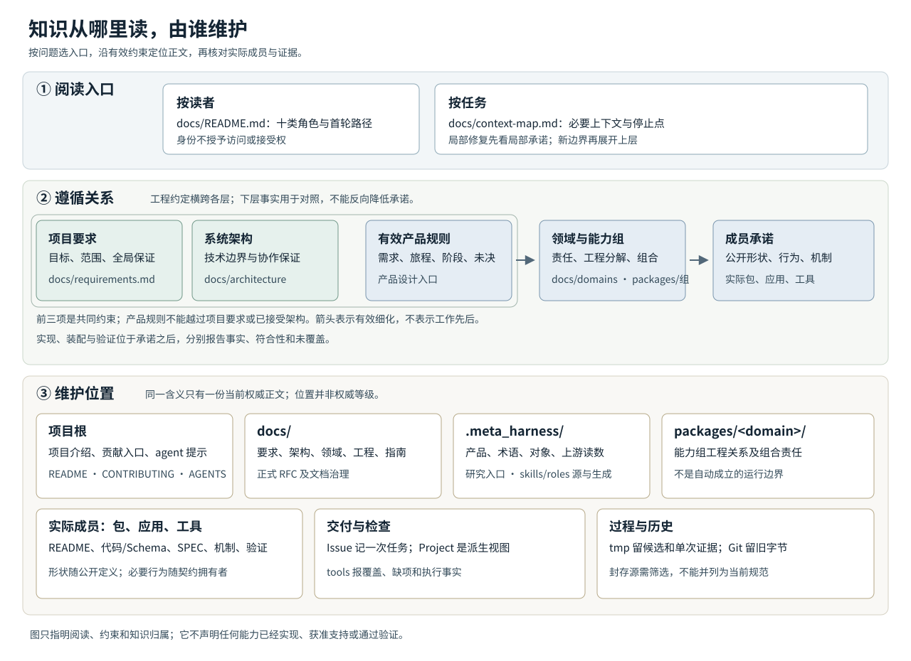

# 项目知识地图

这张地图帮助你从一个问题找到应读的正文、必须遵循的约束，以及修改后要维护的位置。图中的位置表示知识归属，不表示软件拓扑、目录排序的权威、产品支持范围或完成度。图下的表格提供等价文字说明。需要按具体身份选首轮材料时，进入[十类读者路径](README.md#选择阅读路径)；需要按任务收窄上下文时，进入[任务地图](context-map.md)。Agent一次加载的文字版见[体系上下文](knowledge-map-agent.md)。

## 整体地图

窄屏可[单独打开原图](assets/knowledge-map.svg)缩放。阅读时先确定本次问题，再沿约束找到负责的正文，最后到实际成员或工具核对当前行为。人和 agent 使用同一套正文；角色名称不授予内部材料的访问权、操作权或接受权。

## 知识归属

| 你要确定什么 | 当前正文在哪里 | 修改或核对时注意什么 |
| --- | --- | --- |
| 项目要达成什么、阶段承诺及全局保证 | [项目要求](requirements.md)；根[README](../README.md)负责介绍，[AGENTS](../AGENTS.md)负责 agent 心智与触发 | 目标及未决验收条件由要求正文拥有。项目入口只导航，不另立要求。 |
| 产品为何需要某能力、用户旅程、能力观察、阶段支持及有效未决 | 有内部访问资格时进入[产品设计](../.meta_harness/design/product/README.md)的对应 topic | 产品正文按需求、能力定义与实现状态、阶段与版本支持、未决事项四块维护。它服从有效项目要求、系统架构和工程约定；实现观察须有绑定范围的证据。公共读者只取获准的约束投影。 |
| 开工前先看哪些责任、核心四项怎样定方向、服务端怎样分层 | [开工定向](orientation.md) | 定向页是出处的解释投影，只导航和画图，每张图标出状态与出处。事实归出处正文，出处改变时同步图与状态表。 |
| 全系统如何协作、领域责任由谁承担 | [系统架构](architecture/README.md)、[领域设计](domains/README.md)及其责任页 | 架构拥有本项目已接受的系统技术正文。领域页说明事实归属、协作及组合验证责任，不凭目录推定包、插件或进程。 |
| 如何开展和交付研发，以及需要什么文档 | [工程规范](engineering/README.md)、[文档治理](engineering/documentation.md)和[维护指南](maintenance.md) | 工程约定横跨各层。指南给操作路径，规范拥有持续要求；变更时检查唯一源、入向链接、登记和真实消费者。 |
| 能力怎样分组、单个成员承诺什么 | [能力组与成员文档要求](member-documentation.md)、[产品包组织](package-organization.md)、实际[能力组](../packages/README.md)及成员 README | 能力组 `packages/<domain>/` 解释工程分解、依赖和组合责任。实际 `packages/<domain>/<package>/`、应用和工具成员拥有公开使用、精确行为、机制、运行限制与验证资源。目标目录或文档登记不证明成员已实现。 |
| 形状与行为分别从哪里读 | 实际成员的公开代码与 Schema，以及其长期 SPEC 或相应协调者契约 | 类型、字段和校验拥有可表达的形状；SPEC 说明类型不能完整表达的条件、失败、状态、生命周期和资源责任。完整成员文档还可包含指南、内部设计、理由及验证，不能用薄 SPEC 代替。 |
| 术语、对象、上游机制与研究从哪里查 | 内部[统一语言](../.meta_harness/design/ubiquitous_language/README.md)、[领域对象](../.meta_harness/design/domain_objects/README.md)、[机制读数](../.meta_harness/design/basis/README.md)；[研究入口](../.meta_harness/research/README.md) | 术语与对象各有当前依据；上游读数须按采用版本核对，不自动成为本项目规则。根研究区的职责与结构待负责人确定，现有专题沿其入口读取；[agent研究](../.meta_harness/agents/research/README.md)按自己的范围维护。旧技术材料从[保留入口](../.meta_harness/design/architecture/README.md)核对，冲突内容不能迁成并列架构权威。 |
| 项目独有 agent 能力、生成和检查在哪里 | 内部[agents 源](../.meta_harness/agents/README.md)、[tooling](../.meta_harness/tooling/README.md)；仓库[tools](../tools/README.md) | Skills 和 roles 在 canonical 源维护，由工具生成宿主入口。生成、宿主加载、检查通过和实际行为分别取证；不要手改生成物。 |
| 一次任务、证据和历史放哪里 | 本次工作树 `tmp/<task>/`；正式成果按下文保留；被取代正文留 Git 历史 | 候选、逐轮评审、原始输出及单次执行证据留 tmp。可复跑的测试、模型和夹具随实际消费者维护；历史文件与封存包只说明来源，不自动授予当前支持或兼容。 |

meta的[独立目标入口](../.meta_harness/design/foundation/README.md)保留设计工作区的导航，本项目现行目标仍只读docs/requirements.md。研究、候选与已采用要求分别判断，不因进入设计目录自动取得权威。

## 遵循与状态

先读本次适用的[项目要求](requirements.md)和内部产品规则，再沿已接受的[架构](architecture/README.md)与[领域责任](domains/README.md)找到实际成员。适用的[工程约定](engineering/README.md)约束整个过程。成员的实现和验证用来检查承诺是否兑现，不能反过来降低目标。产品规则也不能越过项目要求或已接受的系统架构。若两处说法冲突，核对精确版本、范围和接受依据，将受影响部分交语义拥有者裁定。

[文档治理](engineering/documentation.md#四类长期成果与普通任务)区分四类长期成果。产品设计维护持续的产品规则；[RFC](rfcs/README.md)保留正式审议的方案、最小决定范围及写回关系；长期规格维护当前必要行为；技术设计说明如何兑现及必要理由。RFC条目在真实审议发生后建立，不从旧PF补造提案历史。正式 Issue 是一次交付的任务源，记录范围、条件与具名决定；Project 是派生调度视图。日常操作先从[交付入口](engineering/agent-delivery.md)核对配置的实际启用范围，未启用时只形成获准任务草稿。普通局部修复已有承诺可用时，无须先写 RFC。

一份正文存在、结构检查通过、技术决定接受、实现完成、装配可用、验证通过、产品支持和交付接受是不同事实。[验证说明](verification.md)解释各类证据能支持的结论。缺材料、未执行、无法判定和已证偏离应分别记录；只暂停依赖缺口的工作。正式源改动后，同步其真实消费者，并让被取代的权威正文退出。旧字节留在 Git 历史，不成为第二份当前规范。

## 阅读和维护

[读者入口](README.md#选择阅读路径)列出十类完整路径。终端使用者、租户管理者和部署运维者先读实际应用及其操作说明，分别核对命令、权限和部署前提。集成扩展者先找公开包入口与成员契约。实现维护者从源码归属、成员约定和受影响检查开始；验证评审者从承诺修订、覆盖与实际证据开始。工具文档维护者从唯一源、消费者和登记开始。系统架构负责人从项目要求、架构及领域关系开始；产品负责人在具备资格时从产品 topic 开始；项目交付负责人从交付条件、证据和具名接受责任开始。各路径在本次责任、适用范围和下一步清楚时停止展开。

例如，一条组织权限需求由产品拥有者说明使用者规则与阶段范围，并核对[项目要求](requirements.md)中的全局限制。需要改变系统保证时，由[架构](architecture/README.md)确定边界，[领域](domains/README.md)分配责任，再由能力组和实际成员维护公开形状、行为与机制。实现者更新代码及相称验证，产品正文的实现状态只依据相应版本和覆盖证据更新；需求正文、设计接受与运行支持仍分别判断。

修一个工具的局部缺陷则直接从[开发指南](development.md)、[工具入口](../tools/README.md)、该工具的局部约定和受影响检查开始。已有承诺足够时，无须先读所有产品 topic。若修复提出新的公开保证，再回到该保证的拥有者和适用上层约束。

地图维护者在知识位置、文种、约束或入口改变时，同步本页、SVG和agent文字版；具体业务细节未改变整体地图时不必重复更新。三者是对现行源的解释，维护步骤归[维护指南](maintenance.md)，必要结构与来源归[文档治理](engineering/documentation.md#整体知识体系说明)。
