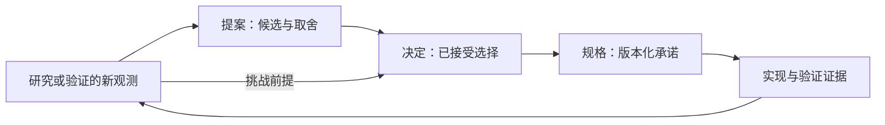

# 研究、提案、决定与规格的流转

本规范落实 [D-002](../decisions/D-002-decision-authority.md)。四类材料回答不同问题：研究记录可核对的观察及其局限；提案组织候选和待决取舍；决定记录已经接受的选择及范围；规格定义特定版本必须兑现的对象、行为和组合承诺。它们互相引用，但不能相互冒充。

图表达可追溯关系，不要求每项小改动经过固定流水线。用户已明确的选择可直接成为决定，但每份决定仍至少关联一份提案或研究。一个提案可产生多个决定；部分接受时，入口逐项写明已接受、拒绝或待决部分及其目标。接受决定不表示已实现、已验证或普遍适用。

在既有契约内实施，先读精确的当前采用版本；需要变更职责、保证、边界或前提时，读关联决定及其取舍；形成候选方案时，读相关提案并沿 evidence 核对研究。资料冲突或前提不确定时展开原始证据，区分事实变化与政策选择。候选、archive 和上游约定都不能作为已接受项目规则。

在适用范围内，缺少新观测时有效决定优先于研究或提案。新研究发现不会自行改变政策；它应标明受影响决定，说明被挑战的前提，并形成提案或取代决定。取代要求见[版本规范](versioning.md)：新观测、因果解释、可复现步骤和可验证证据缺一不可。审阅记录应说明沿用的决定/契约、证据支持的事实、本次提出的变化和仍待决定的部分。

每项研究至少标明来源和版本、实际观察、推断、适用范围和未覆盖范围。研究过时后保留原观察的版本范围，追加勘误或新的核对，不让旧证据代表新环境。决定应保持简短而可解释，提案和研究保留完整讨论及证据；这使当前默认阅读不累积历史材料，同时保持历史可检索。

## 接受与交付怎样闭合

接受提案时，决定链接来源提案或研究并记录选择、理由、适用范围、接受依据和未决项；
提案入口反向链接所产生的决定，部分接受逐项列明。正文不靠改名从“候选”变成“规格”。
需要可复现实现的具体承诺另发布精确契约版本，登记接受依据和冻结文件，更新当前架构投影。
只接受组织方向时不需要顺带创造业务契约。

后续实现与验证记录绑定所采用的规格版本。观察到偏差时先区分实现不符合契约、规格遗漏、
事实前提变化或新需求；修复实现不必重新选择架构，改变承诺则回到其来源和决定。
研究保存观测与局限，提案解释候选及代价，决定记录这次究竟接受什么；各自只维护自己的事实。
资料齐全且不存在新的取舍时结束展开，不将这套关系当作每次小修改的固定审批流程。
