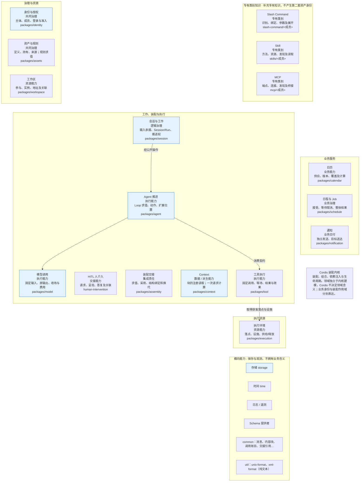
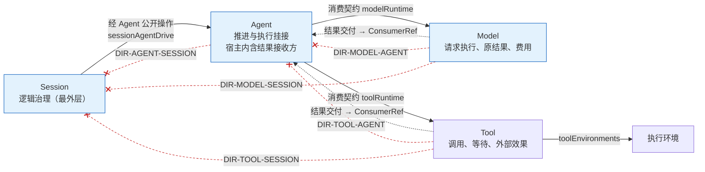
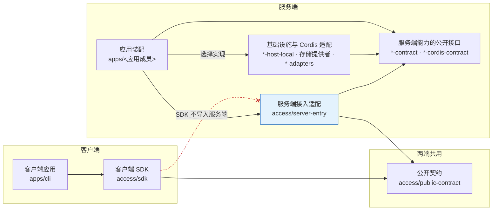
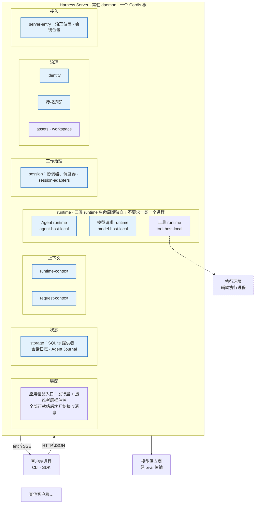

# 开工定向

人和 agent 开工前先读本页。本页给出同一个起点，回答三个问题。系统有哪些责任？核心四项与执行环境之间允许哪些方向？服务端怎样分层，又怎样装进一个单机进程？

本页只做导航和画图，不拥有任何结论。每张图的事实归图下列出的出处。本页与出处不一致时，以出处为准，并把差异交给出处的拥有者。读完本页后，按角色进入[读者入口](README.md#选择阅读路径)，或按任务进入[任务地图](context-map.md)。

## 状态怎样读

每张图下有一张状态表和一份出处清单。状态只取下面三种值。整张图默认是「已接受正文」，与默认不同的元素在状态表里逐个列出。

| 状态 | 含义 |
| --- | --- |
| 已接受正文 | 元素来自已接受的架构、领域或成员正文。它约束后续工作，不表示已经实现。 |
| 首条路径已装载 | 元素出现在[应用装配](architecture/runtime/application-assembly.md#插件树)的首条租户路径插件树里。插件树是装配设计，不表示成员已经实现或验证。实际支持范围以成员 README 为准。 |
| 已知冲突待裁 | 两处现行条款互相矛盾，拥有者还没有裁定。本页不把它画成现行关系，只标出冲突和承接卡。 |

## 领域地图

[领域入口](domains/README.md#责任入口)把 17 项责任分成五个阅读组。横向能力和 Cordis 内核不属于任何一组。每个框写四项内容：责任名、性质、拥有的事实、目标能力组。框只表示责任，不表示包、插件、服务或进程。图中四条箭头是核心四项与执行环境之间已接受的单向组合。

图中箭头的读法如下。Session 经 Agent 的公开操作产生 Model 或 Tool 的效果。Agent 消费 Model 与 Tool 的公开契约。执行环境为工具提供获准的落点与设施。分解轴怎样交叉、哪些概念必须分开，读[三条分解轴](architecture/structure.md#三条分解轴)。

| 状态 | 元素 |
| --- | --- |
| 已接受正文 | 除下一行以外的全部元素与关系 |
| 首条路径已装载（图中蓝底） | 身份与授权、会话与工作、Agent 推进、模型调用、Context、存储 |
| 已知冲突待裁 | 无 |

出处如下。

- 五个阅读组：[领域与能力责任](domains/README.md#责任入口)「责任入口」。
- 性质与拥有的事实：[责任边界与协作](domains/boundaries.md#责任地图)「责任地图」。
- 目标能力组：[产品包组织](package-organization.md#责任与能力组)「责任与能力组」。横向能力的成员见同页[目标目录](package-organization.md#目标目录)。
- 核心四项的单向组合：[产品包组织](package-organization.md#依赖方向与cordis集成)「依赖方向与Cordis集成」。
- 横向能力与 Cordis 的边界：[责任边界与协作](domains/boundaries.md#横向能力与阶段范围)「横向能力与阶段范围」；[总体结构与责任](architecture/structure.md#cordis-集成与作用域)「Cordis 集成与作用域」。
- 装载状态：[应用装配](architecture/runtime/application-assembly.md#插件树)「插件树」。

## 协作

### 怎样读总体协作图

全系统的协作图只有一份，在[总体结构与责任](architecture/structure.md#总体协作关系)「总体协作关系」，本页不重画。读那张图时，把每个框看作一组责任，不看作一个服务。「领域能力与业务工作治理」指各领域自己的责任，「可直接调用的计算与机械能力」也不是第四类 runtime。箭头表示主要交接，不规定调用时序、源码依赖或物理部署。虚线「独立调用」表示不经会话直接使用执行能力，它仍要满足动作准入与数据保护。HITL 的答复回到原等待位置，等待、恢复和继续推进仍归原拥有者。要看源码依赖的方向，读下一张图。

### 核心四项的方向

这张图只回答一个问题：Session、Agent、Model、Tool 与执行环境之间，源码可以依赖哪个方向，运行时结果送到哪里，哪些反向耦合被禁止。

三种线的含义不同。

- 实线是允许的源码依赖。外层认识内层，并且只用内层公开的契约。
- 虚线是运行时交付。Model 和 Tool 把结果推给受理时冻结的 `ConsumerRef`。这个端口由接收方以通用形状声明，所以运行时有箭头，源码上没有 Model 到 Agent 的依赖。
- 末端带叉、标着 `DIR-*` 的线是被禁止的反向依赖。契约层不得认识外层的状态、生命周期或治理。

Session 与 Model、Tool 之间只画了禁止线。按[应用装配](architecture/runtime/application-assembly.md#插件树)的现行写法，两者之间只剩恢复对账时的查询与内容读取，结果、账目与交付解除走 Agent 宿主的接收方。[会话与工作](domains/sessions-and-work/README.md#协作与依赖)另写了一条资格参加关系，即 Tool 启动围栏的资格版本，见下文 K-04。

| 状态 | 元素 |
| --- | --- |
| 已接受正文 | 除下两行以外的全部元素与关系，包括 Tool、执行环境、`toolRuntime` 与 `toolEnvironments`。首条路径的发行层不含工具与执行环境的行。 |
| 首条路径已装载（图中蓝底） | Session、Agent、Model；`sessionAgentDrive`（`session-ad14` 行）；`modelRuntime`（`agent-host` 行的 `inject`） |
| 已知冲突待裁 | Session 与启动围栏的关系（K-04）；Session 与 Model 的关系（K-05）；Tool 的服务键 `toolStartFence`（K-11） |

三项冲突都收在 [#759](https://github.com/nemori-ai/omne-harness-lite/issues/759) 的冲突清单里。本页只标出，不替拥有者裁定。

- K-04：[会话与工作](domains/sessions-and-work/README.md#协作与依赖)仍写 Session 是「Tool 启动围栏的资格版本拥有者」。[应用装配](architecture/runtime/application-assembly.md#插件树)写启动围栏是 Agent 日志的 `start-fence` 条目，`ToolStartFencePort` 已被替代。[Session 契约](../packages/session/session-contract/SPEC.md)仍按两个被替代的端口写操作步骤。承接 [#680](https://github.com/nemori-ai/omne-harness-lite/issues/680)、[#756](https://github.com/nemori-ai/omne-harness-lite/issues/756)。
- K-05：应用装配装载 `session-ad05`（AD-05）。这一行 `inject` 了 `modelRuntime`，让 Session 一侧作 Model 消费者拥有者并读取账目。[产品包组织](package-organization.md#依赖方向与cordis集成)的来源职责表写 Session 的邻域适配不直接依赖 Model 操作契约。[会话与工作](domains/sessions-and-work/README.md#协作与依赖)写结果、账目与交付解除经 Agent 宿主的结果接收方完成。[#680](https://github.com/nemori-ai/omne-harness-lite/issues/680) 承接一部分，其余待裁。
- K-11：[Tool 契约](../packages/tool/tool-contract/SPEC.md)与 [Tool 的 Cordis 说明](../packages/tool/tool-cordis-contract/docs/cordis.md)声明服务键 `toolStartFence`，该成员源码的服务声明没有这个键。Session 契约写启动围栏是 Agent 日志的 `start-fence` 条目。现行正文没有写明两者的关系。待裁。

出处如下。

- 来源职责与禁止的反向耦合：[产品包组织](package-organization.md#依赖方向与cordis集成)「依赖方向与Cordis集成」。
- 五条方向约束：[constraints.json](architecture/constraints.json) 的 `directions`。
- 集成方认识被集成方：[系统分层](architecture/layers-and-dependencies.md#领域语义依赖与模型边界)「领域语义依赖与模型边界」。
- Session 与 Model、Tool 的关系：[会话与工作](domains/sessions-and-work/README.md#协作与依赖)「协作与依赖」。
- 服务键名：[应用装配](architecture/runtime/application-assembly.md#插件树)「插件树」；`toolEnvironments` 见 [Tool 的 Cordis 说明](../packages/tool/tool-cordis-contract/docs/cordis.md)。
- `ConsumerRef`：[Model 契约](../packages/model/model-contract/SPEC.md)、[Tool 契约](../packages/tool/tool-contract/SPEC.md)。

## 顶层架构

### 依赖分层

这张图回答客户端、两端共用的契约和服务端怎样分层。箭头表示依赖某个公开定义或接口，不表示消息流、线程或进程。

SDK 只依赖公开契约，不带服务端存储、runtime 实例或 Cordis 装配树。服务端能力不反向读取装配入口，由装配选择实现。框里第二行是目标能力组里承担这个角色的成员，不是一一对应。

| 状态 | 元素 |
| --- | --- |
| 已接受正文 | 除下一行以外的全部元素与关系 |
| 首条路径已装载（图中蓝底） | 服务端接入适配（`server-entry` 行） |
| 已知冲突待裁 | 无 |

出处如下。

- 分层与约束表：[系统分层](architecture/layers-and-dependencies.md#依赖关系与禁止方向)「依赖关系与禁止方向」。基础图在那里，本图只加了目标能力组的标注和「SDK 不导入服务端」一条禁止边。
- 成员标注与禁止边：[产品包组织](package-organization.md#sdk与系统接入)「SDK与系统接入」「[最小 CLI 的接入边界](package-organization.md#最小-cli-的接入边界)」。

### 单机进程

这张图回答第一版单机部署怎样组织进程。客户端进程加一个常驻服务进程已经是多进程部署。服务内部的三类 runtime 不必拆成独立进程。

| 状态 | 元素 |
| --- | --- |
| 已接受正文 | 除下两行以外的全部元素与关系。工具 runtime 与执行环境不在首条路径的发行层里（图中虚线框）。 |
| 首条路径已装载（图中蓝底） | server-entry、identity、授权适配、session 与 session-adapters、Agent runtime、模型请求 runtime、runtime-context、request-context、storage |
| 已知冲突待裁 | session-adapters 中装载的 `session-ad05` 行（K-05，见[核心四项的方向](#核心四项的方向)）。它在插件树里已装载，与方向表的冲突尚未裁定。 |

出处如下。

- 部署范围与进程组织：[部署与运行拓扑](architecture/deployment/README.md#部署环境与进程组织)「部署环境与进程组织」。
- HTTP JSON 与 fetch SSE：[系统技术基础](architecture/technical-foundations.md#共同技术选择)「共同技术选择」。
- 装配入口、插件树行与供应商适配：[应用装配](architecture/runtime/application-assembly.md#进程与装配入口)「进程与装配入口」「[插件树](architecture/runtime/application-assembly.md#插件树)」。

## 维护本页

本页的拥有者是 docs 读者入口与知识地图的拥有者。下列事件发生时，更新对应的图和状态表。

1. 出处正文改变了图中的责任、关系或标签。
2. 首条路径的插件树增加、删除或替换了行。
3. 拥有者裁定了一项冲突并写回正文。这时删除对应的待裁标注。

转换或修改图时，不增加出处里没有的框或边。新的协作关系先写进出处正文，再进本页。
