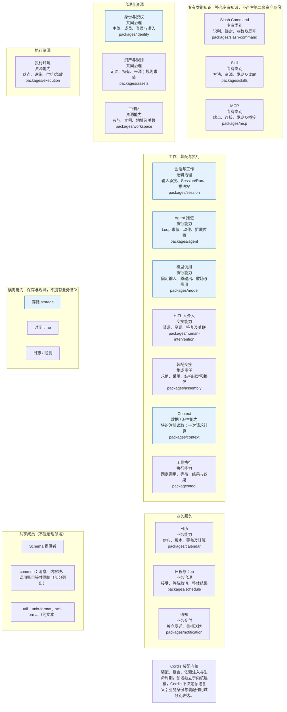
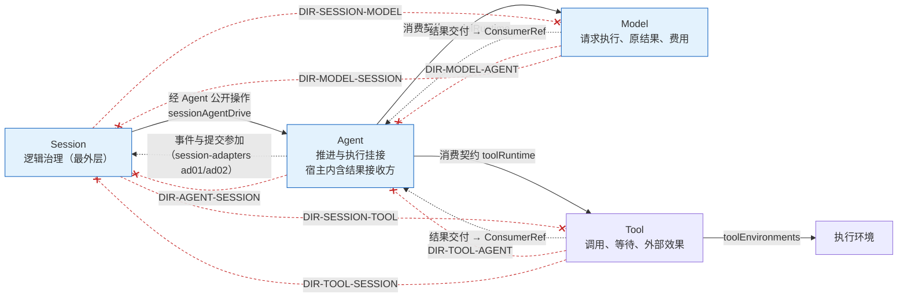
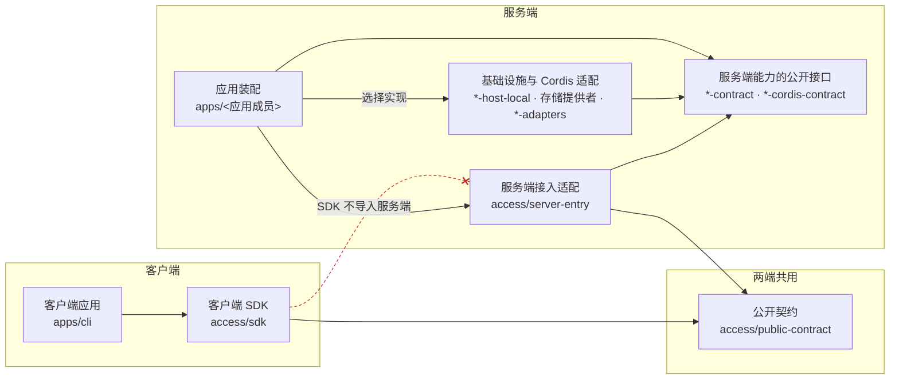
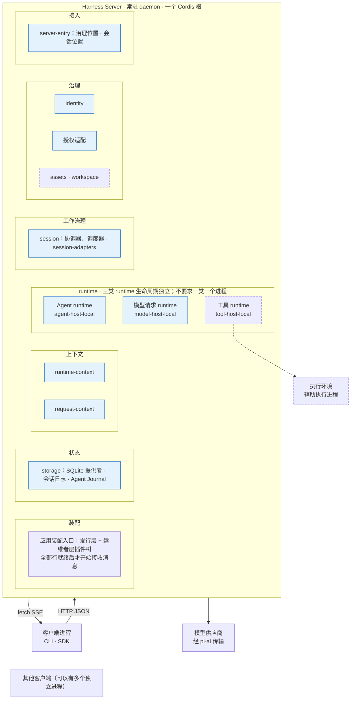

# 开工定向

本页给相关的人和 agent 一个相同的开工起点，回答三个问题。系统有哪些责任？核心四项与执行环境之间允许哪些方向？服务端怎样分层，又怎样装进一个单机进程？

## 本页是什么、谁来读

本页是所列出处的解释投影，不是任何事实的唯一源。图画的是已接受正文，即系统应当怎样。每张图下的状态表转述实际情况：首条路径已装载、已知冲突待裁、已裁定待写回。图与出处不一致时，以出处为准，并把差异交给出处的拥有者。

做架构、领域建模、契约、装配、实现切片或设计评审的人和 agent，开工前读一次本页。局部修复、工具链、取证和验收不要求先读本页，按根 [AGENTS.md](../AGENTS.md)「按任务展开」表进入各自的入口。

到达本页的入口有四个：根 AGENTS.md 的「按任务展开」表、[docs/README.md](README.md#顶层入口分工) 的入口分工表、专责角色的[项目框架](../.meta_harness/agents/roles/project-frame.md)，以及 `claim` 给出的开工地图第一项。读完本页后，按角色进入[读者入口](README.md#选择阅读路径)，或按任务进入[任务地图](context-map.md)。

## 状态怎样读

每张图下有一张状态表和一份出处清单。状态取下面四种值。整张图默认是「已接受正文」，与默认不同的元素在状态表里逐个列出。出处所列章节有改动、本页还没有核对时，状态表另加一行「待核对」，写明哪一节变了，见[维护](#维护)。

| 状态 | 含义 |
| --- | --- |
| 已接受正文 | 元素来自已接受的架构、领域或成员正文。它约束后续工作，不表示已经实现。 |
| 首条路径已装载 | 元素出现在[应用装配](architecture/runtime/application-assembly.md#插件树)的首条租户路径插件树里。插件树是装配设计，不表示成员已经实现或验证。实际支持范围以成员 README 为准。 |
| 已知冲突待裁 | 两处现行条款互相矛盾，拥有者还没有裁定。本页不把它画成现行关系，只标出冲突和承接卡。 |
| 已裁定待写回 | 拥有者已经裁定，正文还要等承接卡写回。本页不把待写回的旧条款画成现行关系，只标出裁定与承接卡。 |

## 领域地图

[领域入口](domains/README.md#责任入口)把 17 项责任分成五个阅读组。横向能力、共享成员和 Cordis 内核不属于任何一组。17 项责任的框各写四项内容：责任名、性质、拥有的事实、目标能力组。框只表示责任，不表示包、插件、服务或进程。责任之间的方向见[核心四项的方向](#核心四项的方向)。

分解轴怎样交叉、哪些概念必须分开，读[三条分解轴](architecture/structure.md#三条分解轴)。common 的完整成员清单见[产品包组织的目标目录](package-organization.md#目标目录)。

| 状态 | 元素 |
| --- | --- |
| 已接受正文 | 除下一行以外的全部元素 |
| 首条路径已装载（图中蓝底） | 身份与授权、会话与工作、Agent 推进、模型调用、Context、存储 |
| 已知冲突待裁 | 无 |
| 已裁定待写回 | 无 |

出处如下。

- 五个阅读组：[领域与能力责任](domains/README.md#责任入口)「责任入口」。
- 性质与拥有的事实：[责任边界与协作](domains/boundaries.md#责任地图)「责任地图」。
- 目标能力组：[产品包组织](package-organization.md#责任与能力组)「责任与能力组」。
- 横向能力：[责任边界与协作](domains/boundaries.md#横向能力与阶段范围)「横向能力与阶段范围」。
- 共享成员：[产品包组织](package-organization.md#目标目录)「目标目录」中 `schema` 只放 Schema 提供者、不是 `util` 或 `common` 的一段，以及同段对 `common`、`util` 的说明。
- Cordis 内核：[总体结构与责任](architecture/structure.md#cordis-集成与作用域)「Cordis 集成与作用域」。
- 装载状态：[应用装配](architecture/runtime/application-assembly.md#插件树)「插件树」。
- 核对于 `115bd78b`（integration/legacy-refactor）。

## 协作

### 怎样读总体协作图

全系统的协作图只有一份，在[总体结构与责任](architecture/structure.md#总体协作关系)「总体协作关系」，本页不重画。读那张图时，把每个框看作一组责任，不看作一个服务。「领域能力与业务工作治理」指各领域自己的责任，「可直接调用的计算与机械能力」也不是第四类 runtime。箭头表示主要交接，不规定调用时序、源码依赖或物理部署。虚线「独立调用」表示不经会话直接使用执行能力，它仍要满足动作准入与数据保护。HITL 的答复回到原等待位置，等待、恢复和继续推进仍归原拥有者。要看源码依赖的方向，读下一张图。

### 核心四项的方向

这张图只回答一个问题：Session、Agent、Model、Tool 与执行环境之间，源码可以依赖哪个方向，运行时结果送到哪里，哪些源码依赖被禁止。

三种线的含义不同。

- 实线是允许的源码依赖。外层认识内层，并且只用内层公开的契约。
- 虚线是运行时交付。Model 和 Tool 按受理时保存的 `ConsumerRef` 交付结果。`ConsumerRef` 是消费者拥有者登记的稳定引用，不是执行许可。Model 原样保存它，不解释它的业务含义。所以运行时有箭头，源码上没有 Model 到 Agent 的依赖。Agent 到 Session 的虚线是 session-adapters 的两个插件在运行时接收 Agent 的事件与提交参加。
- 末端带叉、标着 `DIR-*` 的线是被禁止的源码依赖。前五条是反向依赖：契约层不得认识外层的状态、生命周期或治理。后两条（`DIR-SESSION-MODEL`、`DIR-SESSION-TOOL`）禁止 Session 的两个契约成员导入 Model 或 Tool 的契约成员，类型导入也算；session-adapters 与 session-cordis 不在其中，两者对 Model、Tool 的限制仍靠评审，见[现有成员与工具适配](package-organization.md#现有成员与工具适配)。

Session 与 Model、Tool 之间只画了禁止线，没有源码依赖线。结果、账目与生产者解除经 Agent 宿主结果接收方完成；Session 读取同日志并提交本域后果。Tool 启动围栏归 Agent J03 的 start-fence 条目，在 Tool 排序域生效。

| 状态 | 元素 |
| --- | --- |
| 已接受正文 | 除下表具名状态以外的全部元素与关系，包括 Tool、执行环境、`toolRuntime` 与 `toolEnvironments`。首条路径的发行层不含工具与执行环境的行。 |
| 首条路径已装载（图中蓝底） | Session、Agent、Model；`sessionAgentDrive`（`session-ad14` 行）；`modelRuntime`（`agent-host` 行的 `inject`）；Agent 到 Session 的事件与提交参加（`session-ad01`、`session-ad02` 行） |
| 已写回，仍有具名缺口 | Session 只读同日志结果与账目（K-05）；应用装配页与 Model ACK 到达路径仍待其拥有者处理 |
| 已写回 | Session 契约与本卡范围内消费者的旧步骤（K-04）；范围外指南仍待同步，见下文 |
| 已裁定待写回 | 三条流表中 Agent `stream` 事件一行 |

冲突的家是承接卡与拥有者正文。本页只转述，并给出承接卡，不替拥有者裁定。

- K-04，已写回。[Session 契约](../packages/session/session-contract/SPEC.md#被替代的协议)与本卡范围内消费者已移除旧端口步骤。启动围栏归 Agent 日志 `start-fence`，在 Tool 排序域生效；生产者解除归 Agent 宿主结果接收方，Session 依 [JC-Release](../packages/session/session-contract/SPEC.md#jc-release) 读取原确认。session-adapters README 仍有过期插件/驻留说明，绑定范围外，未在本卡同步；应用装配归 [#789](https://github.com/nemori-ai/omne-harness-lite/issues/789)。新访问检查源码及生产运行尚未交付，不能把本次正文同步当作运行完成。
- 三条流表中 Agent `stream` 事件一行，已裁定待写回。[流式交付与结果消费](architecture/runtime/streaming-and-consumption.md#三条流不逐块进会话日志)表中这一行写 Agent 的 `stream` 事件转发生产者已保管的批次，给观察者统一入口。[Agent 契约](../packages/agent/agent-contract/SPEC.md#流引用与自身事件)的 J04 写观察者经观察端口直接观察生产者，Agent 只写 `stream-reference` 条目，收窄 `stream` 分支归 [#673](https://github.com/nemori-ai/omne-harness-lite/issues/673)。
- K-05，日志消费责任已写回。[AD-05](../packages/session/session-adapters/SPEC.md#ad-05) 现按 #756 只读同日志，AD-06 按 #680 同样只读 Tool 日志。Tool release 确认仍由 AD-05 按 JC-Release 投影。尚未闭合的是 [应用装配页](architecture/runtime/application-assembly.md#插件树) 的 `session-ad05` 旧依赖，以及 MODEL-ACK-ARRIVAL 的合法到达路径；Model 未确认时保持 pending，扫描只报告。应用装配改写归 #789，ACK 由原拥有者裁定。

出处如下。

- 来源职责与禁止的反向耦合：[产品包组织](package-organization.md#依赖方向与cordis集成)「依赖方向与Cordis集成」。
- 九条方向约束：[constraints.json](architecture/constraints.json) 的 `directions`，范围与未覆盖见[现有成员与工具适配](package-organization.md#现有成员与工具适配)。本图只画核心四项之间的七条；public-contract、sdk 与公共流契约到 Model、Tool 的两条（`DIR-ACCESS-MODEL`、`DIR-ACCESS-TOOL`）不在本图。
- 集成方认识被集成方：[系统分层](architecture/layers-and-dependencies.md#领域语义依赖与模型边界)「领域语义依赖与模型边界」。
- Session 与 Model、Tool 的关系：[会话与工作](domains/sessions-and-work/README.md#协作与依赖)「协作与依赖」。
- 服务键名与 Agent 到 Session 的运行时关系：[应用装配](architecture/runtime/application-assembly.md#插件树)「插件树」；`toolEnvironments` 见 [Tool 的 Cordis 说明](../packages/tool/tool-cordis-contract/docs/cordis.md)。
- `ConsumerRef`：[Model 契约](../packages/model/model-contract/SPEC.md)中 `ConsumerRef` 是消费者拥有者登记的稳定引用的一段；[Tool 契约](../packages/tool/tool-contract/SPEC.md)。
- K-04：[Session 契约的被替代的协议](../packages/session/session-contract/SPEC.md#被替代的协议)。
- 三条流表一行：[流式交付与结果消费](architecture/runtime/streaming-and-consumption.md#三条流不逐块进会话日志)「三条流不逐块进会话日志」；[Agent 契约](../packages/agent/agent-contract/SPEC.md#流引用与自身事件)「流引用与自身事件」。
- K-05：[session-adapters 规格](../packages/session/session-adapters/SPEC.md#ad-05)「AD-05 Model 消费适配」及其插件表中的 AD-05 行。
- 核对于 `115bd78b`（integration/legacy-refactor）；「九条方向约束」一项核对于 `eebb3cc77`。

## 顶层架构

### 依赖分层

这张图回答客户端、两端共用的契约和服务端怎样分层。箭头表示依赖某个公开定义或接口，不表示消息流、线程或进程。

SDK 只依赖公开契约，不带服务端存储、runtime 实例或 Cordis 装配树。服务端能力不反向读取装配入口，由装配选择实现。框里第二行是目标能力组里承担这个角色的成员，不是一一对应。

| 状态 | 元素 |
| --- | --- |
| 已接受正文 | 图中全部元素与关系 |
| 首条路径已装载 | 图中不标。插件树装载的成员是：服务端接入适配中的 `server-entry`；基础设施与 Cordis 适配中由 `agent-host`、`model-host`、`storage`、`session-storage` 与 `session-ad*` 各行装载的成员；服务端能力的公开接口中这些行所依赖的各契约成员 |
| 已知冲突待裁 | 无 |
| 已裁定待写回 | 无 |

出处如下。

- 分层与约束表：[系统分层](architecture/layers-and-dependencies.md#依赖关系与禁止方向)「依赖关系与禁止方向」。
- 成员标注与禁止边：[产品包组织](package-organization.md#sdk与系统接入)「SDK与系统接入」「[最小 CLI 的接入边界](package-organization.md#最小-cli-的接入边界)」。
- 已装载的成员：[应用装配](architecture/runtime/application-assembly.md#插件树)「插件树」。
- 核对于 `115bd78b`（integration/legacy-refactor）。

### 单机进程

这张图回答第一版单机部署怎样组织进程。客户端进程加一个常驻服务进程已经是多进程部署。服务内部的三类 runtime 不必拆成独立进程。

| 状态 | 元素 |
| --- | --- |
| 已接受正文 | 除下两行以外的全部元素与关系。assets · workspace、工具 runtime 与执行环境不在首条路径的发行层里（图中虚线框）。 |
| 首条路径已装载（图中蓝底） | server-entry、identity、授权适配、session 与 session-adapters、Agent runtime、模型请求 runtime、runtime-context、request-context、storage |
| 已写回，装配页待同步 | K-05 的 AD-05/06 日志消费责任已写回；`session-ad05` 装配行及 Model ACK 缺口见[核心四项的方向](#核心四项的方向)，不能据本图声称运行接线完成 |
| 已裁定待写回 | 无 |

出处如下。

- 部署范围与进程组织：[部署与运行拓扑](architecture/deployment/README.md#部署环境与进程组织)「部署环境与进程组织」。
- HTTP JSON 与 fetch SSE：[系统技术基础](architecture/technical-foundations.md#共同技术选择)「共同技术选择」。
- 装配入口、插件树行与供应商适配：[应用装配](architecture/runtime/application-assembly.md#进程与装配入口)「进程与装配入口」「[插件树](architecture/runtime/application-assembly.md#插件树)」。
- 核对于 `115bd78b`（integration/legacy-refactor）。

## 维护

本页的拥有者是 docs 集成线。出处清单所列章节有改动时，改动所在的卡同步本页对应的图与状态表。来不及同步时，在对应状态表加一行「待核对」，写明哪一节变了。核对完成后，把该图出处清单末尾「核对于」的提交号改为核对时的提交号。

`pnpm run check:docs` 只检查链接与锚点，不检查图与出处的内容是否一致。内容漂移靠上面的规则发现，本页不承诺机器检查。
