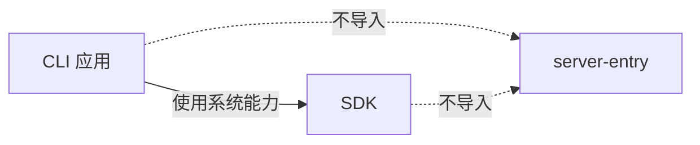
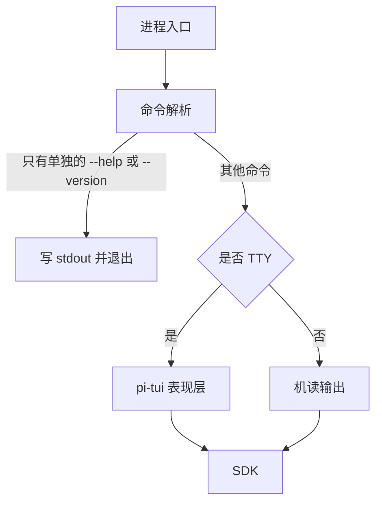

# 产品包组织

本页维护产品包的目标分组、包边界和扩展规则，供人和agent选择维护位置。顶层源码归属及开发环境由[workspace](workspace.md)维护，业务责任由[领域地图](domains/boundaries.md)维护，系统分层与依赖由[架构](architecture/layers-and-dependencies.md)约束。

这些规则用于后续建包与迁移设计。初始目录树中写明叶子名的位置已经初始化为 RFC-0003 草稿。草稿不接受该成员的精确接口或运行机制。已初始化成员的源码状态，以及后续候选包的初始化状态，在各自登记节另列；模型组成员以「模型组的成员与采用范围」一节为准。`<成员>` 和「具名」占位仍不建包。新树从[包入口](../packages/README.md)读取目标组及缺项；旧成员从[legacy入口](../packages.0.0.1.legacy/README.md)查源。新成员准入与工具适配仍须明确任务。

## 组织原则

产品包按 `packages/<能力组>/<成员>/` 两层组织。能力组聚合同一责任的相关知识和维护任务；成员拥有package.json、源码、依赖、公开入口与验证。第一层不是workspace成员，也不自动成为DDD上下文、插件、服务、进程或发布单元。

一条能力的契约、业务实现、专属提供者、Cordis适配和验证就近维护。先判断这些内容能否在一个成员内清楚表达，再按真实消费和依赖边界拆为兄弟成员。目录不按全仓definitions、providers、coordinators等技术角色分割，也不要求每组具有相同数量的包。

相关知识集中不转移事实权威。共同存储机制归存储能力，专属数据映射归使用它的能力；组合保证归实际协调者。Session、模型、工具继续各自拥有事实和生命周期。

能力组允许增长。当前责任和下列目录不是未来能力的白名单，新增按[扩展指导](domains/extending-the-system.md)判断。

## 成员的必选结构

本节依据 [RFC-0007 revision 1](rfcs/RFC-0007-source-packages-and-templates.md#决定范围)，它在 2026-10-16 取代 [RFC-0003 revision 1](rfcs/RFC-0003-source-packages.md) 除「测试」一行以外的采用范围。下面是新成员的目标形状。应用不使用这套结构。生成和扫描仍用 [包模板](../tools/dev-flow/templates/package/README_ZH.md)。该生成器已经写出先删除 `dist` 的 build、不先构建的 typecheck、`erasableSyntaxOnly`，以及写在 `types` 前面的 `source` 条件。

每个新成员必须有这些文件。缺任何一个，模板生成不合格。

```text
packages/<能力组>/<成员>/
├── package.json
├── README.md
├── README_ZH.md
├── documentation.json
├── src/index.ts
├── tests/<行为>.spec.ts
├── tsconfig.build.json
├── tsconfig.test.json
└── vitest.config.ts
```

`cordis-module`、`service-contract` 和 `service-provider` 再加 `src/cordis.ts`。`module` 不加这个文件。`src/index.ts` 不导入 `@deepseek-ai/cordis`。Cordis 绑定只从 `src/cordis.ts` 导出。

`package.json` 把 `source` 写在 `types` 前面，指向 `./src/index.ts`。仓库类型检查通过根 `tsconfig.base.json` 的 `customConditions` 打开它。`files` 只发布 `dist`。发布时去掉 `source`，外部只保留指向 `dist` 的 `types` 和 `import`。`build` 先删除 `dist`，再编译。`tsconfig.build.json` 只包含 `src`，并打开 `erasableSyntaxOnly`。`tsconfig.test.json` 只包含 `tests`。`typecheck` 只运行 `tsc -p tsconfig.test.json`，不先构建，被测试导入的源码经 `source` 条件一并检查。测试导入本包时使用包名。谁写哪一类测试，见[包级测试责任与边界](verification.md#包级测试责任与边界)。

### 完整生成树

[RFC-0007](rfcs/RFC-0007-source-packages-and-templates.md) 规定，新成员在创建时就生成下面的完整骨架。模板版本是 `typescript-package@3.0.0`。除标注“仅绑定变体”的两项外，四个变体生成同一棵树。树中每个节点都是必需节点：缺任何一个，结构扫描判失败。`README.md + index.md` 表示该目录同时有这两个文件。

```text
packages/<能力组>/<成员>/
├── README.md
├── README_ZH.md
├── index.md
├── SPEC.md
├── documentation.json
├── package.json
├── docs/                         README.md + index.md
│   ├── architecture.md
│   ├── flows.md
│   ├── object-model.md
│   ├── public-api.md
│   ├── context.md
│   └── cordis.md
├── src/                          README.md + index.md
│   ├── index.ts
│   └── cordis.ts                 仅绑定变体
├── tests/                        README.md + index.md
│   ├── public-entry.spec.ts
│   ├── cordis-entry.spec.ts      仅绑定变体
│   └── fixtures/                 README.md + index.md
├── schema/                       README.md + index.md
├── verification/                 README.md + index.md
│   ├── models/                   README.md + index.md
│   └── proofs/                   README.md + index.md
├── adr/                          README.md + index.md
├── examples/                     README.md + index.md
├── resources/                    README.md + index.md
├── acceptance/                   README.md + index.md
│   └── fixtures/                 README.md + index.md
├── tsconfig.build.json
├── tsconfig.test.json
└── vitest.config.ts
```

`SPEC.md` 对 `module` 变体也是必需节点。没有非类型行为的包在 `SPEC.md` 中写明理由。`docs/cordis.md` 在所有变体都生成；`module` 在其中写明不适用的理由，这个文件不导致生成 `src/cordis.ts` 或引入 Cordis 依赖。

`docs/` 下的每个专题可以是 `docs/<topic>.md`，也可以升级为带 `README.md` 与 `index.md` 的 `docs/<topic>/`，二者只能存在一个。`acceptance/` 下（不含 `acceptance/fixtures/`）有 `*.acceptance.ts` 场景时，成员必须有 `vitest.acceptance.config.ts` 与 `package.json` 的 `acceptance` 脚本；有配置时必须有场景。只有入口文件时，不要求配置。

代表未来任意模块的通配槽（如 `src/**/*.ts`）不实例化。`dist/`、`node_modules/`、`generated/`、`coverage/` 和 `tmp/` 不属于源码模板，不预建。各文件与目录承担什么，见[成员文档](member-documentation.md#固定骨架)。创建文档不改变运行导出、安装依赖或发布文件集合。

完整骨架只用于新建的包。现有成员不自动迁移：先清点差异，再另行给出迁移范围与时点，补文件时不覆盖真实正文。未迁移的成员继续只要求上面的必选文件，`docs/`、`SPEC.md`、`schema/`、`verification/`、`adr/`、`examples/` 和 `resources/` 在里面有真实内容时才建立。

## 目标目录

以下是初始落点。写明叶子名的目录已初始化为 workspace 草稿，公开行为仍未实现。`execution/image` 是例外。技术设计已接受，它已经是 workspace 成员。模型组成员的初始化与源码状态以「[模型组的成员与采用范围](#模型组的成员与采用范围)」一节为准，该节不改其他组的规则。公开入口包含预算、打开、编码和关闭。准备模型图片输入的[推荐配置](../packages/execution/image/docs/budget-profile.md)已于 2026-10-17 获接受，仍由调用方显式传入。`<成员>`、`<具名时间能力>`、`<具名观测能力>` 和 `<具名纯表示>` 不是叶子名，这些位置不建包。叶子若还要拆分，仍须在具名消费者和精确承诺明确后确定。

```text
packages/
├── access/
│   ├── public-contract/        客户端与服务端共同的系统公开契约
│   ├── sdk/                    公共Harness SDK
│   └── server-entry/           系统协议接入与能力路由
├── identity/
│   ├── identity/               主体、成员、登录与组织关系
│   ├── authorization/          授权及共同动作准入
│   └── scrypt/                 有界 scrypt 派生与校验
├── assets/
│   ├── assets/                 共同定义、版本、持有与来源
│   ├── settings/               设置配值与求值
│   └── permissions/            权限配值与求值
├── workspace/workspace/        工作区身份与资源关联
├── session/session/            Session、Run与逻辑治理
├── assembly/
│   ├── assembly/               求值、采用和装配交接
│   └── kernel-basis/           Cordis 插件辅助和测试装配
├── agent/
│   ├── agent-contract/         Agent 声明校验与推进纯契约
│   ├── agent-cordis-contract/  唯一 Cordis 定义及实例目录协议
│   ├── agent/                  无 Cordis 的推进实现
│   └── agent-host-local/       单机实例宿主与 Cordis 插件
├── model/
│   ├── model-contract/         模型纯契约：档案、请求准备、调用与提供者协议
│   ├── model-cordis-contract/  模型的 Cordis 服务定义
│   ├── model/                  不含 Cordis 的模型执行实现
│   └── model-host-local/       单机宿主：本地凭据保管与 Cordis 插件
├── tool/
│   ├── tool-contract/          工具纯契约：类型、判定与投影
│   ├── tool-cordis-contract/   工具的 Cordis 服务定义
│   ├── tool/                   不含 Cordis 的工具执行实现
│   └── tool-host-local/        单机宿主与 Cordis 插件
├── context/
│   ├── runtime-context/        数据注册、供给与读取
│   └── request-context/        请求投影与上下文组装
├── human-intervention/human-intervention/
├── execution/
│   ├── execution-environment/  执行设施、落点与资源条件
│   └── image/                  图像字节的预算、打开、编码与关闭。技术设计已接受，已是 workspace 成员
├── calendar/calendar/          日历版本依据与日期计算
├── schedule/schedule/          日程、Job与整体结果
├── notification/notification/  通知及送达
├── slash-command/<成员>/       命令定义、识别与展开
├── skills/<成员>/              方法、资源、发现与读取
├── mcp/<成员>/                 端点、连接、发现与动作桥接
├── storage/<成员>/             存储契约、机制与提供者
├── time/<具名时间能力>/        有独立消费者的时间能力
├── telemetry/<具名观测能力>/   有真实共同需要的观测能力
├── common/
│   ├── json-text/              严格 JSON 文本读取、值树判定与原样写出
│   ├── legal-identity/         合法身份文本
│   ├── utc-instant/            UTC 时间点与 SI 时长
│   ├── content-block/          已封闭的文本、思考、语音、图、文件
│   ├── message/                事实记录中的消息字段
│   ├── stream-arrival/         流式交付的开块、填充、封块、削减、结束
│   ├── call-account/           一次模型调用或工具执行的调用账目
│   ├── modality/               四种模态与媒体类型到模态的识别
│   └── operation-result/       带值成功、无值确认与失败两种操作结果
├── util/
│   ├── unix-format/          按码位排版的终端文本
│   └── xml-format/           按字段声明渲染的 XML 文本
└── schema/
    └── schema-provider/      形状校验、首次编译和有界缓存
apps/<应用成员>/               客户端表现、个人设备daemon或云节点装配
tools/<开发工具>/              检查与开发工具
scripts/                       仓库自动化
```

同一能力组内可以增加具名提供者或独立适配成员，前提是包边界有依据。单成员组仍提供稳定知识位置，不为目录对称增加转发层。time、telemetry和common须有实际共同语义及消费者，不能成为收纳未归属代码的目录。`util` 只放纯文本格式化。`unix-format` 和 `xml-format` 从封存的 `packages.0.0.1.legacy/util` 迁入，输出由迁来的测试锁定。它们不进入 `common`，因为还没有两个已确认的共同消费者。

`schema` 只放 Schema 提供者。成员是 `packages/schema/schema-provider`。它做准入、首次编译、租约和槽位缓存。各业务形状仍由各自的拥有者持有。该组不是治理领域，也不是 `util` 或 `common`。提供者持有缓存和租约，不是纯表示。

装配组有两个目标成员。`assembly` 维护求值、采用和交接。`kernel-basis` 维护 Cordis 插件辅助和测试装配。业务成员可以依赖 `kernel-basis` 的公开入口。业务成员不读取 `assembly` 来取得全局服务或隐式依赖。

`kernel-basis` 不声明服务键。它不收回其他能力的 Service 定义。根入口为空导出，并且不导入 `@deepseek-ai/cordis`。操作结果归 `packages/common/operation-result`。插件辅助从同包 `./cordis` 导出。测试装配从同包 `./testing` 导出。本页登记成员位置 `packages/assembly/kernel-basis`，具体实现范围见下段。

`packages/assembly/kernel-basis` 已是 workspace 成员。根入口为空导出，`./cordis` 导出 `definePlugin` 与 `resolveOptional`，`./testing` 导出 `startTestAssembly`。封存实现 `packages.0.0.1.legacy/core/kernel-basis` 已退出 workspace，只供来源核对，新成员不依赖旧源码或探针。检查器在查看公开根之前跳过 `packages/core/kernel-basis`。说明见[符合性报告](../tools/repo-toolchain/src/arch/CONFORMANCE.md)。目标成员不使用该跳过。

<a id="模型组的成员与采用范围"></a>
### 模型组的成员与采用范围

`0.0.0 → 0.1.0` 的模型适配和请求沿用项目维护的 pi-ai 技术栈。model-contract、model-cordis-contract、model 与 model-host-local 已是 workspace 成员，非 pi-ai 设计已接受，并按下表职责拥有文档。各成员的源码状态见下表「初始化状态」。`pi-ai-*` 传输与厂商家族成员及 tokenizer 成员尚未初始化。不保留聚合全部实现的安装门面。

| 成员，位于 packages/model 下 | 包边界 | 设计状态 | 初始化状态 |
| --- | --- | --- | --- |
| model-contract | 纯领域值、操作、必要纯函数与提供者协议；普通消费者和 adapter 作者不安装运行实现 | 已接受 | workspace 成员；已发布全部声明并有测试 |
| model-cordis-contract | 唯一 Cordis 服务定义、键、增补及定义自有登记表；不安装 Model 运行提供者 | 已接受 | workspace 成员；已发布全部声明并有测试 |
| model | 可复用领域执行与实际工厂，按契约注入依赖，不安装 Cordis | 已接受 | workspace 成员；托管运行与工厂未实现，已实现部分见[成员入口](../packages/model/model/README_ZH.md) |
| model-host-local | 本地凭据保管、实例调度、时钟、目录装载及 Cordis 插件，复用 model | 已接受 | workspace 成员；实例调度、时钟、目录装载未实现，已实现部分见[成员入口](../packages/model/model-host-local/README_ZH.md) |
| pi-ai-transport | 共享 pi 请求机制、HTTP/SSE、连接资源及取消 | 成员划分与家族贡献取得协议已接受；其余细化沿组架构标注 | 未初始化 |
| pi-ai-openai、pi-ai-anthropic、pi-ai-google、pi-ai-deepseek、pi-ai-xai、pi-ai-qwen、pi-ai-moonshot、pi-ai-zai | 按厂商家族内聚型号定义、请求与响应适配、完整计量、模板、资源和验证 | 成员划分、家族贡献取得及计量分工已接受；其余细化沿组架构标注 | 未初始化 |
| tokenizer-tiktoken、tokenizer-huggingface | 封装分词引擎的初始化与文本计数；具体词表、配置和模型模板归家族成员 | 成员划分与资源、计量分工已接受 | 未初始化 |

具体型号默认作为家族内的精确绑定，不按型号逐一建包。依赖方向、拆分依据、装配责任和实际建包条件由[模型组架构](../packages/model/docs/architecture.md#成员与新增条件)维护。本页登记成员位置及初始化状态，不复制接口或支持型号清单。model-host-local 的本地凭据保管已实现；实例调度、时钟与目录装载的设计已接受，尚未实现。pi-ai 相关设计的采用范围及 OpenAI 实现线的延期条件沿组架构执行；后续运行成员随实际实现及验证切片建立。

## 责任与能力组

领域页拥有责任及协作，下面只维护责任到目标能力组的导航，不把责任数量当作包数量。

| 责任入口 | 目标组 | 就近维护的知识 |
| --- | --- | --- |
| [身份与授权](domains/identity-and-authorization/README.md) | identity | 主体关系、登录、授权与共同准入 |
| [资产与规则](domains/assets-and-rules/README.md) | assets | 共同持有、来源、设置与权限求值 |
| [工作区](domains/workspaces/README.md) | workspace | 工作区身份及资源关系 |
| [会话与工作](domains/sessions-and-work/README.md) | session | 逻辑工作、输入受理及消费协调 |
| [装配交接](domains/assembly-and-handoff/README.md) | assembly | 定义采用、绑定、交接和内核辅助 |
| [Agent推进](domains/agent-progression/README.md) | agent | Loop与扩展推进 |
| [模型调用](domains/model-invocation/README.md) | model | 请求、原执行、结果与费用 |
| [工具执行](domains/tool-execution/README.md) | tool | 调用、执行与外部效果 |
| [Runtime Context](domains/runtime-context/README.md) | context | 数据供给、注册与请求投影 |
| [人工介入](domains/human-intervention/README.md) | human-intervention | 决策请求及有效答复 |
| [执行环境](domains/execution-environments/README.md) | execution | 环境、设施与资源 |
| [日历](domains/calendars/README.md) | calendar | 版本、日期依据及计算 |
| [日程与Job](domains/schedules-and-jobs/README.md) | schedule | 接受、执行协调及整体完成 |
| [通知](domains/notifications/README.md) | notification | 发送、尝试与送达 |
| [Slash Command](domains/slash-commands/README.md) | slash-command | 名称、绑定、识别与展开 |
| [Skill](domains/skills/README.md) | skills | 方法取用、正文及资源 |
| [MCP](domains/mcp/README.md) | mcp | 端点、连接、发现与桥接 |

assets维护共同治理，具体类别维护专有定义与业务。共同治理不反向导入全部类别实现，Tool不接管被调用类别的业务状态。命令受理、Skill读取与脚本执行、MCP连接与实际调用的分责继续沿对应领域页。

## 包边界与公开入口

独立包须说明具名消费者，以及独立安装、平台或依赖隔离、公开消费、替换、发布或验证的具体收益。比较内部模块与兄弟成员对维护路径、依赖闭包和行为完整性的影响。存在接口、文件变大或能够做成插件，不能单独决定拆包。

公开入口应让消费者完整使用能力，隐藏内部队列、存储步骤、资源管理和恢复细节。消费者通过exports使用其他包，禁止穿透兄弟成员的src。构造与普通操作的调用资格分别由实际契约明确。

成员根入口提供可独立消费的类型、必要校验、纯函数或显式依赖的工厂。Cordis绑定在集成入口维护，默认沿[IC-4](architecture/cordis-integration-conventions.md#ic-4)使用同包 `./cordis`。契约与提供者共置时，服务定义可以通过独立公开子入口消费；具体插件仍由 `./cordis` 发布，避免定义消费引入业务提供者实现。独立适配成员须在实际设计中说明包边界、入口与集成责任，不凭目录自行改变现行绑定要求。

源码无Cordis边、生成声明无Cordis类型、独立运行不启动Cordis、安装不引入Cordis，是不同检查。exports分开不证明全部闭包隔离；支持平台、打包和安装须由实际消费验证。

## SDK与系统接入

access把完整Harness的接入知识就近组织。public-contract拥有系统公开操作、数据、事件及边界行为；SDK和server-entry共同消费它。业务含义仍由原能力维护，系统内部接口不自动成为公开操作。

SDK是客户端统一编程入口，承接调用、观察、订阅及明确属于客户端的资源责任。它可以依赖客户端平台和传输适配，管理由客户端拥有的连接与句柄。它不能导入服务端接入实现、服务端提供者、服务端业务存储、runtime实例或Cordis装配树。server-entry按共同契约调用能力公开接口，不能导入SDK或穿透业务私有实现。

完整Harness客户端通过SDK使用系统；独立能力消费者可以直接使用所需能力及所选实现，不强制经过SDK。同组不要求共同安装或发布。首批SDK操作、传输、认证、兼容、缓存、订阅恢复及拥有式daemon启动沿[分层后续设计](architecture/layers-and-dependencies.md#待细化范围)明确，本页不补默认协议。

## 最小 CLI 的接入边界

最小 CLI 放在 `apps/`。它拥有进程入口、命令解析、人读呈现、机读呈现和本地状态目录。它通过 SDK 使用系统能力。它不导入 server-entry、服务端提供者、服务端业务存储、runtime 实例或服务端 Cordis 装配树。



命令解析模块不导入 `@deepseek-ai/cordis`，也不导入 Cordis 绑定。IC-4 仍允许 `apps/` 的包根出口引入 Cordis。检查器不会因为这类导入失败。若该应用要装配自己的进程，把 Cordis 绑定放在同包 `./cordis`。命令解析不调用这个入口。

调用方只给出 `--help`，或只给出 `--version` 时，进程把结果写到 stdout，然后以 0 退出。再带上其他选项或位置参数，则这条短路不成立。这两条路径不打开、也不创建 `OMNE_HOME`、`--home` 或业务存储。版本文本来自构建产物旁的身份文件。TTY 上的交互呈现使用 pi-tui，并且只用于表现层。非 TTY 输出机器可读结果，不加载 TUI。实现命令循环时，只参考 pi、DeepSeek Harness CLI 和 kimi-code CLI 的分流。不采用它们的存储、登录或服务端装配。



`tools/artifact-builder` 不依赖 CLI。`apps.0.0.1.legacy/cli` 把 artifact-builder 列为 devDependency。`tools/product-checks` 从 `@omne-harness/legal-identity` 读取身份类型名单。`tools/core-verification` 已删除（#332）。`scripts/build-fixed-schemas.mjs` 已删除；它只解析 `@omne-harness-lite/content-blocks`。参考树里的旧 `build` 脚本仍写着这个文件名，运行会失败。`scripts/package-cli.sh` 构建 `@omne-harness/cli`，并把 `apps/cli/dist` 打成新的 `.tar.gz`。它不安装、不上传。

发布到仓库之外时，CLI 包提供 `bin`、构建后的启动模块、构建身份文件，以及指向 SDK 包的依赖声明。启动不要求当前目录是本仓库。服务端包不进入这个安装闭包。包模板没有应用变体。缺少该变体并不阻止建包。建包前要同时满足两件事。[apps 入口](../apps/README.md#建立与维护)要求应用规格和公开依赖已经写明。[workspace](workspace.md)要求没有实现代码的承诺不建空成员。`help` 与 `version` 的测试归 `apps/cli`。在有真实 SDK 调用之前，这个最小入口不声明 SDK 依赖。SDK 调用的测试归 SDK。服务端接入的测试归 server-entry 和对应能力。模板与架构规则的测试归 `tools/repo-toolchain`。

## 依赖方向与Cordis集成

依赖按角色和公开契约判断，不按core、infra或util目录名取得许可。共同纯定义不依赖领域状态和提供者；能力契约不依赖实现它的提供者、SDK或应用；业务实现通过公开契约和显式依赖组合，产品装配负责选择提供者。

服务定义随能力契约的唯一拥有者就近维护，消费者和提供者引用同一定义，通用assembly不收回全部Service和key。Service形状、键、依赖换代、isolate及撤除的精确规则继续归[Cordis集成约定](architecture/cordis-integration-conventions.md)。

同组或同包不豁免依赖方向。类型引用、源码值边、声明和实际产物分别核对，事件或回调不为反向代码依赖提供默认许可。SDK和独立入口的安装闭包按目标平台验证。

共同提交仍须满足实际存储与协调协议；相邻目录、同库路径或相同租户不证明原子性。[IC-5](architecture/cordis-integration-conventions.md#ic-5)的精确事务读例外保持原范围，不能借组织更新扩大提供者互引或装配豁免。

## 新增与扩展

先明确新增行为的要求、采用范围、身份与事实拥有者、调用方、结果、副作用和验证责任。普通既有承诺扩展就近处理，新增产品含义或公开保证由其拥有者决定。

| 新增内容 | 放置判断 |
| --- | --- |
| 内部行为或计算函数 | 留实际拥有者的内部模块 |
| 原契约的新提供者 | 放所属能力组，平台依赖和验证就近维护 |
| 新资产类别 | 复用共同治理，专有知识由类别拥有者维护；不自动建包 |
| 稳定新业务责任 | 确认责任和承诺后增加领域入口及能力组 |
| 新应用或部署角色 | 装配和表现归apps，可复用业务归能力 |
| 新Harness公开操作 | 原能力维护业务，access维护系统投影、SDK及接入 |

新组不必先修改固定类别白名单，也不必同时增加SDK操作。运行时注册、扩展API、角色声明和测量载体由实际拥有者另行设计。实施顺序沿[Feature场景](engineering/scenarios/feature.md)及[领域扩展指导](domains/extending-the-system.md)。

## 文档归属与维护路径

领域页解释模块关系、协作和组合责任，本文维护目录及包边界。精确类型、失败、状态转移、事务、取消、恢复和验证资源随实际成员或协调者，跨包协议也随其拥有者。

能力组与成员包各自维护完整的文档体系，具体要求归[两层成员文档](member-documentation.md)。新成员从创建时的固定骨架开始，每类知识有固定位置；骨架以外的专题按实际阅读任务增加。组入口拥有组内工程关系及共同维护，成员入口展开公开使用、行为、内部设计与验证；必要专题就近拆分。SPEC完整表达非类型行为，不作为整套成员文档的厚度限制。不复制产品规则或创建中央模块SPEC，未实现目标不造空成员。

agent从[任务地图](context-map.md#领域设计与新增模块)定位责任，再沿本页选择目标组，读取实际契约、实现及相称验证。涉及其他能力时进入它的拥有者，涉及系统公开投影时进入access，涉及发行装配时进入apps。责任足够就停止扩大阅读。

拆页、登记和迁移正文沿[维护指南](maintenance.md)，当前成员位置由实际workspace与成员入口发现，不手工维护另一份永久成员账本。

## 现有成员与工具适配

目标规则替代“所有Service定义集中core”和“仅以core/util目录判断跨包许可”的目录治理。现有成员仍保留真实路径、接口和行为，迁移须同步消费者、公开入口、构建、发布、资源读取及验证；路径变化不改变Schema身份或接受范围。

当前 typescript-package@3.0.0 的 service-contract 创建与结构扫描不再限制 core。IC-1 与 IC-5 按已采用责任和公开入口判断，不按 core 或 util 目录名许可。具体范围见[模板](../tools/dev-flow/templates/package/README_ZH.md)及[符合性报告](../tools/repo-toolchain/src/arch/CONFORMANCE.md)。

分组方向已由工具适配：旧的三层路径表退役，本节与[系统分层](architecture/layers-and-dependencies.md#依赖关系与禁止方向)中能按成员路径表达的规则写在根 `.dependency-cruiser.cjs`，由 `pnpm run lint:deps` 检查，clean loop 的硬线读同一张依赖图，见[依赖规则](../tools/repo-toolchain/README_ZH.md#依赖图与依赖规则)。已表达的有：SDK 与 server-entry 互不导入、公开契约不依赖两端实现、业务成员不依赖 SDK 与装配入口、common 与 util 不依赖领域成员、产品包不依赖应用与工具，以及成员和组之间不成环。契约不依赖其提供者、提供者经接口接入这类按角色判断的规则，仓库还没有机读的角色标记，暂未表达，仍靠评审。不能手写骨架或伪造采用标识绕过现行检查。

当前成员重组、工具适配、SDK安装闭包及真实维护成本尚需各自实施和验证任务。报告区分目标要求、现状、偏离、口径变化与未覆盖，沿[领域符合性](domains/verification.md)和[项目验证](verification.md)选择证据。

## Agent 的安装边界

Agent 按纯契约、Cordis 定义、通用实现和具体装配分为四个 workspace 成员。Agent 声明类型与两个校验入口已有实现，唯一源码归 agent-contract；资产与装配消费者直接依赖它。其余运行入口与 Service 均尚未实现。各成员的技术设计已由[技术接受与产品采用决定](https://github.com/nemori-ai/omne-harness-lite/issues/384#issuecomment-6258475204)采用，接受范围沿各成员 SPEC。初始化不授予模板采用或业务支持。

工厂的 Dependencies、Configuration 与构造入口归通用实现；可替换端口与领域操作归纯契约。框架定义从 agent-cordis-contract 的 `./cordis` 提供，定义包不依赖通用实现或具体提供者。agent-host-local 负责 Agent 实例宿主。

详细成员关系见 [Agent 组](../packages/agent/README.md)。
