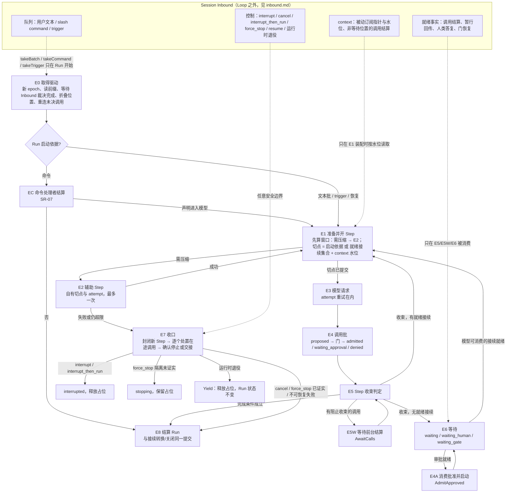

# Run 驱动器：定义、拓扑与推进规则

[提案索引](README.md) · [Inbound](inbound.md) · [不变式](invariants.md) · [评审 r1](review.md)

## 定义

Agent Loop 是 **Run 驱动器**：一个可重建、不持有私有状态权威的推进过程。它在
Session/Run 的已提交事实上做决策，只在 SR-08 规定的安全边界推进驱动位置，每次
推进经共同准入（CC-01/03）提交。它不是 DSH 那种自己拥有 inbox、turn 计数和
AbortController 的内存循环。

由此推出三条设计原则：

- **事实在权威处，位置是投影。** Run、Step、调用、请求的状态由各自能力拥有；
  驱动位置 `{RunRef, epoch, currentStep, phase}` 从这些事实确定性 fold 出来（U-2），
  以 SR-13 的 projection 贡献实现 SR-08 所列的"驱动位置"字段，恢复时重算而不读
  任何"循环状态文件"。
- **决策是纯函数。** `decide(view) → intent`：相同的已提交事实前缀必得相同意图。
  这是恢复不重复派发的根据（I-18）。
- **推进只在安全边界。** 耐久输入批次、模型结果或未知处理、工具接纳或结果关联、
  等待结算。模型正在流式输出时到达的任何事实都要等到 Step 收束才被看见。

## 三层拆分

| 层 | 内容 | 拥有者 |
|---|---|---|
| 事实层 | Session 与队列（SR-01～07）、Run 与 Step（SR-08）、调用/attempt（TL-07/08）、请求与接续（HD-03/08）、模型请求（MC-03/04/06）、驱动占位（SR-08/09，U-1） | 各能力权威 |
| 驱动层 | 本提案：`decide`、节点拓扑、收束与收口协议 | Run 驱动器 |
| 投影层 | runtime-context 快照、assistant-stream 帧（已 fork）、工具帧（TL-12） | 装配与披露 |

## 拓扑

三条硬规则：新输入永远不进入运行中的 Loop（U-6）；事实只在 E5、E5W、E6 被消费；
所有停止类操作共用 E7 的收口协议，只是处置表与终点不同。

## 各节点的义务

**E0 取得驱动。** 新 Run 的 E0 被 `takeBatch`/`takeCommand`/`takeTrigger` 吸收：
SR-06/07 的取批与 Run 建立、占位、epoch 在同一提交。恢复与 resume 走完整 E0，
按固定顺序完成，缺一步都不能进入 `decide`：

1. 取新 epoch，使旧执行者失去提交权（I-3）；resume 只对 interrupted 或可解除阻塞的
   waiting 生效（SR-10），interrupted Run 的 resume 从这里进入，不是 E6 唤醒。
2. 读完整已提交前缀（DR-03/04）：撕裂尾部截回；完整但未回执的批次按 CC-03 用
   `lookupOperation` 确认是否已提交。
3. 等待 Inbound 的 Session 级裁决者把所有已受理但未裁决的 arrival 裁决完（见
   [Inbound](inbound.md)）；裁决不是 Loop 的职责，Loop 只在此处等待其完成。
4. 折叠驱动位置（U-2），对状态为 dispatched/executing/unknown 的模型请求与调用按原
   attemptId 向原执行 owner `inspect`/`subscribe`（TL-11、MC-06）；核实不了的记
   unknown，不自动重发。折叠出的位置决定进入哪个节点：E3 内继续 dispatch 已准入
   attempt、E4 重新过门、E5W 重连、E6 重订阅、E7 继续收口。

前提是"无全 Run/Session 控制阻塞"，不是"阻塞集合为空"：resume 到仍有 q2 pending
的 Run 是合法的（HD-04）。

**EC 命令处理者。** slash command 的 Run 由 SR-07 的命令处理者结算，不走 E1～E6。
声明为"进入模型"的命令（PF-009.C6 的上下文装载型）由处理者产出该 Run 的模型输入
切点后进入 E1；其余命令结算后直接 E8。

**E1 准备并开 Step。** 准备阶段在短提交之外完成（CC-02）：读取就绪接续集合与 context
水位，按 MC-10 估算窗口。需要压缩则先进入 E2，回来后重新准备；随后在一次共同提交
内冻结切点并把被消费的接续标为 `consumed`（I-4）。切点来自且只来自：Run 的启动
依据（一批连续用户文本、一项 trigger、命令处理者产出的模型输入）、就绪接续集合、
context 水位内的指针；三者互斥地作为启动依据，接续与 context 可叠加于任一 Step。
context 水位由 Inbound 拥有（见 inbound.md），Step 切点记录读取时的水位值。

**E2 辅助 Step。** 压缩、标题等具名辅助工作作为独立 Step（U-4）：自有切点（压缩的
输入区间）与 attempt，不消费 arrival。每次 E1 准备最多进入 E2 一次；辅助失败、
unknown 核实不了、或压缩后仍超限，按 MC-10 不重复压缩，以 `failed(context_overflow)`
进入 E7。P-4 对辅助 Step 豁免。

**E3 模型请求。** MC-03 prepare → 共同准入（attempt、预算、epoch）→ 发网前耐久
dispatched 记录 → dispatch → 帧投影 → settle。出边封闭：

| 结算 | 去向 |
|---|---|
| `success` | E4 |
| `partial`（MC-06：流中途错误） | 已完整的内容块进入历史；被截断的 tool_call 不 propose；作为 `failed` 按重试政策处理 |
| `failed` 且政策允许 | 同一 Step 新 attempt，切点不变（I-8） |
| `failed` 且政策不允许 | E7，Run 以 `failed` 结算 |
| `unknown` 且可核实 | 按核实结果走 success/failed |
| `unknown` 且核实不了 | 记 unknown 与费用暴露；政策允许则新 attempt，否则 E7 以 `failed(unknown)` 结算 |
| `cancelled` | E7 |

**E4 调用批。** 每个调用按 TL-07：proposed 耐久登记 → 门（allow/ask/deny）→ allow
者在联合提交取得预算预留、精确使用与执行许可后由独立执行 owner `start`；ask 者建
HD 请求；deny 者直接结算。缺省串行时后续调用停在 `proposed_pending_gate`，前一个
结算后再过门。并行资格由工具声明；结果写回顺序规则见 I-11。子代理派发是普通工具
调用（U-15）：前后台关系、detach、晚到结算全部沿 TL-10/11。

**E5 Step 收束判定。** 对批内每个调用取结算视图（封闭词表见下）。存在阻止收束者
进入 E5W；否则收束，再按是否存在模型可消费的就绪接续、是否满足完成条件决定去向。
"就绪接续"显式包含本批的结算结果；只有 `deferred_receipt` 而没有任何可喂给模型的
新内容时进入 E6 而不是 E1（P-4）。

**E5W 等待前台结算。** 意图 `AwaitCalls`：Run 保持 running 与占位，订阅前台调用
的结算；这是 SR-08"等待结算"这一安全边界的显式节点，与 E6 的区别是不释放模型/
工具驱动。收到结算后回到 E5。

**E6 等待。** Run 进入 `waiting`（等调用或门）或 `waiting_human`（HD-03），释放
模型/工具驱动但保留占位（SR-08）。订阅就绪事实（封闭来源见下）；没有就绪接续就
休眠，不做模型轮询（P-4）。q1 就绪不等 q2（HD-03）。三类出边：模型可消费的接续就绪
→ E1；审批就绪 → E4A；请求无答复而关闭（HD-06 approved_but_not_admitted、HD-07 模式
切换、TL-06 绑定撤回取代待办）→ 该位置解除，重评 E5 的完成条件。预算耗尽与依赖
缺失都在这里等待（U-13）：Run 进入 `waiting_gate`，由预算/依赖能力发出的恢复事实
（Inbound 来源 `gate_restored`）唤醒，不需要用户 resume。

**E4A 消费批准并启动。** 意图 `AdmitApproved(calls)`：HD-06 再次核对当前规则、原
精确绑定、待执行位置与决定，在共同准入中把决定标记被原调用消费、取得执行许可，
由执行 owner `start`。该调用的 Step 已收束时不开新 Step：Run 在 E6 以"等待该调用
结算"作为接续位置（U-12），调用结算即接续就绪；不引入 TL-10 之外的第三种关系。

**E7 收口。** 共用协议：封闭新 Step → 按处置表逐个处理在途调用（PF-013.C4：
interrupt 一律中断并留下真实结局；interrupt_then_run 可转后台者转、不可转者中断、
已后台者继续；cancel/force_stop 沿 SR-10/12）→ 取得每个调用的真实停止/交接/未知
结果 → 按原因走终点：

| 原因 | 终点 | 占位 | 依据 |
|---|---|---|---|
| interrupt | `interrupted`（非终态） | 释放 | SR-10 |
| interrupt_then_run | `interrupted` + `supersededByInput` | 释放 | SR-11 |
| cancel | E8 → `cancelled` | 与终态同一提交释放 | SR-10、HD-04 |
| force_stop 隔离已证实 | E8 → `cancelled(force_stopped)` | 同上 | SR-12 |
| force_stop 隔离未证实 | `stopping`，长期可见 | 保留 | SR-12、P-3 |
| 不可恢复失败（模型 failed 不可重试、辅助 Step 失败、unknown 不可继续） | E8 → `failed` | 同上 | MC-06/10 |
| 运行时退役（AR-11/12、热宽限到期） | `Yield`：在安全边界释放占位，Run 状态不变，位置由投影保留 | 释放 | live-agent v1 |

unknown 允许长期存在但必须可见（P-3）。

**E8 结算 Run。** 完成条件沿 SR-09。结算与 Inbound 接续的处理在**同一提交**（I-14）：
终态为 `completed` 或 `failed` 时，指向本 Run 的未消费 `continuation` 转为 `queue`
（trigger）；终态为 `cancelled`（含 force_stopped）或因 Session 归档/删除级联关闭时，
一律 `closed` 并记录，不复活（U-11）。占位释放与终态同一提交（SR-06 要求无活动
占位才能开新 Run）。结算后由 Session 级调度（Inbound 拥有）在无占位且队列有合格
项时启动下一 Run（P-2）。

## Step 收束的封闭词表

| 视图值 | 来源状态 | 进入下一 Step 的块（CD-03） | 阻止收束 |
|---|---|---|---|
| `settled(succeeded / failed / denied_before_execution / cancelled_before_execution / interrupted / unknown)` | TL-07 终态 | `tool_result`；unknown 标明未知 | 否 |
| `staged_provisional` | HD-11 产物已 staging、请求待决（优先于 settled 视图） | `tool_result`（含暂行产物引用）+ `deferred_receipt` | 否 |
| `detached_background` | executing 且 detach 已确认，或启动即后台（TL-10） | `deferred_receipt` | 否 |
| `detach_in_flight` | 已请求 detach、owner 未确认 | 无 | **是** |
| `waiting_approval` | HD-03 待人类决定 | `deferred_receipt` | 否 |
| `proposed_pending_gate` | 缺省串行下尚未过门 | 无 | **是** |
| `executing_foreground` | 前台且未 detach | 无 | **是** |
| `admitted_pending_start` | 已准入但 start 回执或耐久确认未到（CC-03、TL-08） | 无 | **是** |

`settled(unknown)` 与 SR-14 的关系：unknown 以标明未知的 `tool_result` 进入下一次
模型决策，供模型与人判断；系统侧依赖该结果的决定（批准消费、预算结算、暂行
finalize）保持阻塞直到核实或人工解除，二者并不冲突。

## 接续就绪的封闭来源

调用结算（含子代理派发调用、后台调用、E4A 启动的调用；TL-11）、暂行回传声明为
"一次接续"（HD-12）、人类答复（HD-08）、门恢复（预算或依赖，Inbound 来源
`gate_restored`）、显式 `resume`（仅对 waiting；interrupted 走 E0）。

## decide 的输入与输出

输入 `view`：Run 状态与 epoch、当前 Step 与其调用批的结算视图、Inbound 中指向本
Run 的已裁决 arrival（只读 `classified`，I-21）、pending 请求集合、阻塞集合、预算
立场、当前资格摘要。全部来自已提交前缀（DR-03），带水位。

输出 `intent` 是封闭联合：`OpenStep(basis | continuations)`、`AuxiliaryStep(kind)`、
`RequestModel(step)`、`ProposeCalls(step, calls)`、`AwaitCalls(step)`、
`AwaitContinuation(positions)`、`AdmitApproved(calls)`、`Reattach(calls)`、
`Yield(reason)`、`CloseOut(reason)`、`Settle(run, reason)`。

**意图到提交的映射与 operationId。** 一个意图可以对应一段固定的提交序列；每次提交
的 operationId 从事实前缀确定地派生：`f(RunRef, stepId, commitKind, ordinal)`，
commitKind 是提交种类（如 `open_step`、`admit_attempt`、`dispatch_attempt`、
`settle_attempt`、`propose_call`、`admit_call`、`settle_step`、`settle_run`），ordinal 是
该 Step 内同类提交的序号。恢复重跑 `decide` 得到相同的序列与相同的 operationId，
由 CC-03/DR-02 去重认回崩溃前可能已成功的提交；同 operationId 异输入返回 conflict
时，Loop 重读前缀重算而不覆盖（I-20）。Inbound 裁决提交的 operationId 从 arrivalId
派生，不在此列。

## 非预期退出后的恢复

非预期退出指进程崩溃、OOM 被杀、宿主重启、断电、与执行 owner 的网络分区、存储
writer 被隔离（DR-04）；共同特征是 Loop 的内存状态消失且不知道最后一次动作走到
哪一步。预期退出（重试耗尽、cancel、预算耗尽）以已提交事实结束，不在此列。

恢复不是重放日志重新执行，而是 E0 的四步，然后用同一个 `decide` 算出下一步。
成立的前提是每个外部效果之前都有耐久意图（CC-04、TL-08、MC-03/04），因此事实
前缀落后于世界至多一个在途尝试。两条外部前提须作为提供者验收义务：模型执行
提供者在发网前提交 dispatched 记录（MC-04）；工具执行 owner 以同一 attemptId 幂等
接纳 start 且重启先恢复账本（TL-08）。

| 崩溃窗口 | 已耐久 | 恢复判定 | 依据 |
|---|---|---|---|
| E0 占位后、开 Step 前 | Run running、占位 | 重新 `OpenStep`，启动依据认回同一批 | SR-06 |
| E1 切点提交前 | 上一 Step 已收束 | 重算切点；结果由重同步后的前缀决定 | I-4、I-18 |
| E2 辅助 Step 中途 | 辅助 Step 切点、attempt 状态 | 同 E3 的窗口规则；压缩结果未提交则视为未压缩 | MC-10 |
| E3 准入后、dispatch 记录前 | attempt admitted、预算预留 | 判定未发出：旧 attempt 结算 cancelled，同 Step 新 attempt | MC-04 |
| E3 dispatch 记录后、settle 前 | dispatched 记录 | 记 unknown/partial；有供应方 ID 则查询原请求，否则按政策新 attempt 并保留费用暴露；**已流给用户的前缀不可恢复** | MC-06 |
| E3/E5/E8 提交时 | 可能已提交 | `lookupOperation` 认回或重做 | CC-03、I-20 |
| E4 proposed 后、准入前 | call proposed | 重新过门，按当前授权/预算判定 | TL-07 |
| E4 准入后、owner 确认 start 前 | admitted、许可、attemptId | 同一 attemptId `inspect`；owner 无此 attempt 且许可有效则同 ID 重发 start；owner 与 Loop 同进程死亡且账本不耐久则 unknown | TL-08 |
| E4/E5W executing 中 | start 回执、帧 | 独立 owner 存活则 `subscribe` 重连同一 attempt；owner 随进程死亡则 unknown | TL-11、SR-14 |
| Loop 存活但与执行 owner 分区 | 同上 | 不换 epoch；按 TL-11 标 unknown/lost，Run 进入 waiting 等待重连或人工处置 | TL-11 |
| E6 等待中 | waiting、pending 请求、接续就绪意图 | 重新订阅；答复期间崩溃按 HD-08/CC-05 回执补交付 | HD-04 |
| E4A 消费批准后、start 前 | 决定已消费、许可 | 同 E4 的 start 窗口 | HD-06、TL-08 |
| E7 收口中途 | stopping/interrupted 意图、取消墓碑 | 逐个 inspect 继续收口；墓碑拒绝迟到 start | TL-08、SR-12 |
| takeTrigger 提交后 | Run、占位、epoch 已同一提交 | 无中间窗口 | SR-06 |
| Inbound 受理后、裁决前 | arrival accepted | Session 级裁决者在当前 Run 状态下裁决 | I-13、I-21 |
| writer 隔离 | 已确认水位前的一切 | Loop 停在水位处，不推进 | DR-04、CC-03 |

三条明确接受的局限：模型流式前缀不可恢复；同进程前台工具随进程死亡的外部效果
只能 unknown；多进程部署下"旧 epoch 持有者是否真的死了"没有判定机制，属后续设计。

## 对 DSH agent-loop 源码的取舍

| 源机制 | 处置 | 理由 |
|---|---|---|
| step 内 attempt 重试（`agent/request-error`） | 保留思想，改为 MC-06 的 attempt 账本 | 切点不变、重试不换 Step 与 SR-08 一致 |
| `tool-calls.ts` 有序 pre、并发 execute、有序 post；未派发调用的合成结果 | 保留思想 | 对应 I-11、I-12 |
| `interruptedTurnClosers` 恢复补齐 | 保留"恢复先补齐边界"的思想，改为 SR-14 向原 owner 询问 | 本地合成终态会冒充真实结局 |
| runtime-context、assistant-stream | 已 fork，沿源基线 | 投影层 |
| inbox（next-step / next-turn / inject） | 放弃，换 Inbound 与 SR 队列 | U-6/U-7；热注入破坏 I-4 |
| turn 计数与 turn 边界 | 放弃，换 Run/Step | SR-08 |
| 每 turn 一个 AbortController 作为取消权威 | 放弃，换 epoch + 墓碑（TL-08） | "仅发送 AbortSignal 不足" |
| `agent/pre-step` reject | 放弃 | 准入在 takeBatch/takeCommand/takeTrigger |
| `agent/turn-stopping` 的 steer 续跑 | 放弃，不提供"阻止停止"的 hook | 续跑只能来自队列或就绪接续 |
| 进程内 approval waterfall | 放弃，换 HD 耐久请求 | HD-03/04 |

## 可改写与可阻断的站点

| 站点 | 归属 | 允许 |
|---|---|---|
| 输入准入 | Inbound 与 SR 队列 | 插件只能作"到达行为求值"提供者 |
| 装配 | runtime-context + MC-03 manifest | prompt section、skill 贡献可改写，不可阻断 |
| 模型请求 | MC-03/04 | 不开放请求改写 hook；模型归 Run 固定 |
| 工具前 | TL-07 门 + TL-13 守卫 | 守卫只能收紧；参数不可改写（TL-01 冻结参数） |
| 工具后 | TL-12 投影选择 | 选择进入模型的投影，不改耐久结果 |
| 停止边界 | SR-09 完成条件 | 无"阻止停止"hook |
| 压缩 | MC-10 辅助 Step | 独立 attempt 与 unknown |
