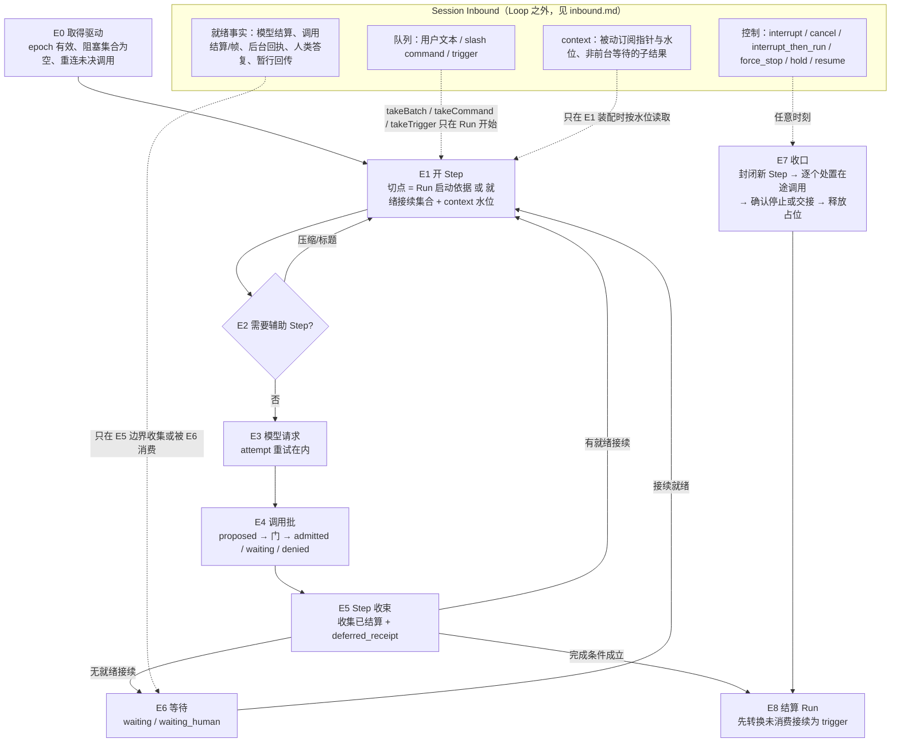

# Run 驱动器：定义、拓扑与推进规则

[提案索引](README.md) · [Inbound](inbound.md) · [不变式](invariants.md)

## 定义

Agent Loop 是 **Run 驱动器**：一个可重建、不持有私有状态权威的推进过程。它在
Session/Run 的已提交事实上做决策，只在 SR-08 规定的安全边界推进驱动位置，每次
推进经共同准入（CC-01/03）提交。它不是 DSH 那种自己拥有 inbox、turn 计数和
AbortController 的内存循环。

由此推出三条设计原则：

- **事实在权威处，位置是投影。** Run、Step、调用、请求的状态由各自能力拥有；
  驱动位置 `{RunRef, epoch, currentStep, phase}` 从这些事实确定性 fold 出来（U-2），
  恢复时重算而不读任何"循环状态文件"。
- **决策是纯函数。** `decide(view) → intent`：相同的已提交事实前缀必得相同意图。
  这是恢复不重复派发的根据（invariants I-18）。
- **推进只在安全边界。** 耐久输入批次、模型结果或未知处理、工具接纳或结果关联、
  等待结算。模型正在流式输出时到达的任何事实都要等到 Step 收束才被看见。

## 三层拆分

| 层 | 内容 | 拥有者 |
|---|---|---|
| 事实层 | Session 与队列（SR-01～07）、Run 与 Step（SR-08）、调用/attempt（TL-07/08）、请求与接续（HD-03/08）、模型请求（MC-03/04/06）、驱动占位（SR-08/09，U-1） | 各能力权威 |
| 驱动层 | 本提案：`decide`、节点拓扑、收束与收口协议 | Run 驱动器 |
| 投影层 | runtime-context 快照、assistant-stream 帧（已 fork）、工具帧（TL-12） | 装配与披露 |

## 拓扑

三条硬规则：新输入永远不进入运行中的 Loop（U-6）；事实只在 E5/E6 被消费；
所有停止类操作共用 E7 的收口协议，只是处置表不同。

## 各节点的义务

**E0 取得驱动。** 以当前 AgentRef 向 session-run 能力申请占位（U-1）：核对 Run 非终态、
无全 Run/Session 控制阻塞、当前资格与预算门。恢复路径（SR-14、CC-06）在这里
先对状态为 executing/unknown 的调用向原执行 owner `inspect`/`subscribe`（TL-11），
再进入 `decide`；不自动重发任何模型或工具请求。

**E1 开 Step。** 一个 Step 的输入切点来自且只来自：Run 的启动依据（一批连续
用户文本、一条 slash command、一项 trigger，三者互斥，U-7）、上一 Step 结束后的
就绪接续集合、context 通道当前水位内的指针。切点在共同提交内冻结（I-4）。

**E2 辅助 Step。** 按 MC-10 判定需要压缩，或按配置需要标题等具名辅助工作时，
以 Step 身份执行（U-4），有独立 attempt 与 unknown 处理；完成后回到 E1 重新装配。

**E3 模型请求。** MC-03 prepare → 共同准入（attempt、预算、epoch）→ dispatch →
帧投影 → settle。`success/partial` 进入 E4；`failed` 且政策允许在同一 Step 内开
新 attempt，切点不变（I-8）；`unknown` 先按 MC-06 核实原 attempt；`cancelled` 进 E7。

**E4 调用批。** 每个调用按 TL-07：proposed 耐久登记 → 门（allow/ask/deny）→
allow 者在联合提交取得预算预留、精确使用与执行许可后由独立执行 owner `start`；
ask 者建 HD 请求；deny 者直接结算。Run 只持有前台等待关系。并行资格由工具声明，
缺省串行；结果写回顺序等于模型发出顺序（I-11）。

**E5 Step 收束。** 对批内每个调用取结算视图（封闭词表见下），无阻止收束者即
收束；随后按是否存在就绪接续、是否满足完成条件决定去向。

**E6 等待。** Run 进入 waiting 或 waiting_human，释放模型/工具驱动但保留占位
（SR-08）。订阅就绪事实（封闭来源见下）；没有就绪接续就休眠，不做模型轮询（P-4）。
q1 就绪不等 q2（HD-03）。

**E7 收口。** interrupt、cancel、interrupt_then_run、force_stop、预算耗尽、不可
恢复失败共用同一协议：封闭新 Step → 按处置表逐个处理在途调用（PF-013.C4 表：
interrupt 一律中断并留下真实结局；interrupt_then_run 可转后台者转、不可转者中断、
已后台者继续）→ 取得每个调用的真实停止/交接/未知结果 → 确认安全后释放占位。
force_stop 走隔离分支，进入 stopping 直到全部执行者确认停止或隔离可证实（SR-12）。
unknown 允许长期存在但必须可见（P-3）。

**E8 结算 Run。** 完成条件沿 SR-09：所有本 Run 接续已结算、无 pending 阻塞请求、
无未处理就绪接续、剩余后台责任均已确认独立持有。结算前必须先把 Inbound 中指向本
Run 的未消费 `continuation` 转换为 `trigger` 并记录（I-14）。

## Step 收束的封闭词表

| 视图值 | 来源状态 | 进入下一 Step 的块（CD-03） | 阻止收束 |
|---|---|---|---|
| `settled(succeeded / failed / denied_before_execution / cancelled_before_execution / interrupted / unknown)` | TL-07 终态 | `tool_result`；unknown 标明未知 | 否 |
| `detached_background` | executing 且 detach 已确认（TL-10） | `deferred_receipt` | 否 |
| `staged_provisional` | HD-11 产物已 staging、请求待决 | `tool_result`（含暂行产物引用）+ `deferred_receipt` | 否 |
| `waiting_approval` | HD-03 待人类决定 | `deferred_receipt` | 否 |
| `executing_foreground` | 前台且未 detach | 无 | **是** |
| `admitted_pending_start` | 已准入但 start 回执或耐久确认未到（CC-03、TL-08） | 无 | **是** |

后两种之外均不阻止收束（U-3）。批全为 `settled`、模型无新调用、Inbound 无指向
本 Run 的 `continuation`、无 pending 请求，才满足 E8 的完成条件。

## 接续就绪的封闭来源

后台调用结算（TL-11）、暂行回传声明为"一次接续"（HD-12）、人类答复（HD-08）、
delegate/spawn 前台等待的结果（PF-004.C3）、依赖恢复使 waiting 位置前提重新满足
（PF-020.C5）、预算恢复解除预算阻塞（PF-019）、显式 `resume`（SR-10）。其中依赖
与预算恢复不是 arrival，是门的输入变化，但同样只在 E6 被感知。

## decide 的输入与输出

输入 `view`：Run 状态与 epoch、当前 Step 与其调用批的结算视图、Inbound 中指向本
Run 的已裁决 arrival、pending 请求集合、阻塞集合、预算立场、当前资格摘要。全部
来自已提交前缀（DR-03），带水位。

输出 `intent` 是封闭联合：`OpenStep(basis | continuations)`、`AuxiliaryStep(kind)`、
`RequestModel(step)`、`ProposeCalls(step, calls)`、`AwaitContinuation(positions)`、
`Reattach(calls)`、`Yield(reason)`、`Settle(run)`。每个意图对应一次共同提交或一次
无副作用的等待；没有"边推进边决定"的中间态。

## 对 DSH agent-loop 源码的取舍

| 源机制 | 处置 | 理由 |
|---|---|---|
| step 内 attempt 重试（`agent/request-error`） | 保留思想，改为 MC-06 的 attempt 账本 | 切点不变、重试不换 Step 与 SR-08 一致 |
| `tool-calls.ts` 有序 pre、并发 execute、有序 post；未派发调用的合成结果 | 保留思想 | 对应 I-11、I-12 |
| `interruptedTurnClosers` 恢复补齐 | 保留"恢复先补齐边界"的思想，改为 SR-14 向原 owner 询问 | 本地合成终态会冒充真实结局 |
| runtime-context、assistant-stream | 已 fork，沿源基线 | 投影层 |
| inbox（next-step / next-turn / inject） | 放弃，换 Inbound 与 SR 队列 | U-6/U-7；热注入破坏 I-4 |
| turn 计数与 turn 边界 | 放弃，换 Run/Step | SR-08 |
| 每 turn 一个 AbortController 作为取消权威 | 放弃，换 epoch + 墓碑（TL-08） | "仅发送 AbortSignal 不足" |
| `agent/pre-step` reject | 放弃 | 准入在 takeBatch/takeCommand/takeTrigger |
| `agent/turn-stopping` 的 steer 续跑 | 放弃，不提供"阻止停止"的 hook | 续跑只能来自队列或就绪接续，"数据决定" |
| 进程内 approval waterfall | 放弃，换 HD 耐久请求 | HD-03/04 |

## 可改写与可阻断的站点

| 站点 | 归属 | 允许 |
|---|---|---|
| 输入准入 | Inbound 与 SR 队列 | 插件只能作"到达行为求值"提供者 |
| 装配 | runtime-context + MC-03 manifest | prompt section、skill 贡献可改写，不可阻断 |
| 模型请求 | MC-03/04 | 不开放请求改写 hook；模型归 Run 固定 |
| 工具前 | TL-07 门 + TL-13 守卫 | 守卫只能收紧；参数不可改写（TL-01 冻结参数） |
| 工具后 | TL-12 投影选择 | 选择进入模型的投影，不改耐久结果 |
| 停止边界 | SR-09 完成条件 | 无"阻止停止"hook |
| 压缩 | MC-10 辅助 Step | 独立 attempt 与 unknown |
