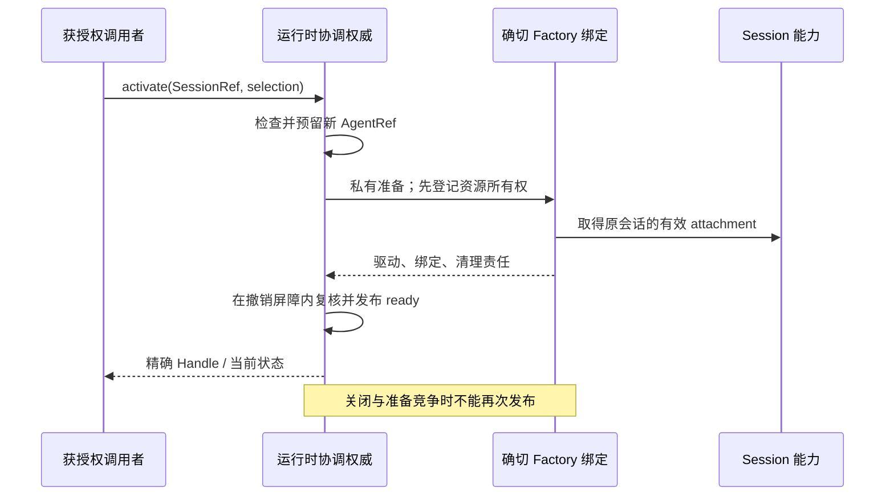

# Agent 运行时的设计选择

本页保留候选的取舍依据；精确含义由目标规格拥有，不重复定义协议。

## 从 Cordis 视角确定责任

运行时提供活体实例和受管使用关系；可替换实现作为服务/插件贡献进入装配。
Registry 不是所有业务状态的中心，Factory 不是一套固定应用 preset。
可构造的结构、可观察行为与合法结构变化分别由注册/绑定、工作/退出及替换协议
解释。Context 是装配介质，具体权限在真正读写与控制入口执行。

分离长期身份与运行代际，是恢复接续、动态换驱动和旧句柄安全的共同基础。
一个 Session 可以多次装配，同一时刻受一个逻辑协调权威管理一份激活记录；
准备和清理都占位。Runtime 不拥有原 Session 的长期历史或授权资产。

## 选择及替代方案

| 问题 | 本轮选择 | 替代方案与取舍 |
|---|---|---|
| 租户隔离放在哪里 | 运行时的查找、激活、控制、事件及解析入口直接保护租户和对象授权 | 只过滤 Session 存储会留下控制引用旁路；在 fork 外包空壳会保留危险公开入口 |
| 身份表示 | SessionRef 与带新 incarnationId 的 AgentRef | 只用 Session ID 不能区分同会话新旧实例；把 Runtime ID 当 Definition ID 会错用定义级授权 |
| 激活并发 | 异步准备前独占预留，失败仍清理原尝试 | 准备完成后才去重，会重复占资源并使准备与退出竞争失控 |
| 发布失败语义 | 私有校验，提交后事实通知不再否决 | 保留上游同步 created 否决会产生已经被观察却声称未发布的混合语义 |
| 生命周期完成 | 停止新接纳、排空/合法移交、释放资源、最后撤登记 | 先删 Map 会让旧资源未收口就启动新实例；直接 fiber.dispose 不足以表达业务结局 |
| 清理失败 | 保留退出阶段、残留和占位，独立清理继续 | 无条件 finally 删除条目会产生假成功；预建强杀/接管框架超出本阶段 |
| 自卸载等待 | 可请求关闭，不能等待包括自己的退出；显式 self-wait | 上游 initiator 排除自身只适合其归因服务，不宜扩大成整个 Agent 已排空 |
| Factory 替换 | 精确作用域贡献，停止其新使用，受影响实例退出后撤提供者 | 每个实例直接追随可变 factory 会混用代际；全系统统一停机扩大了影响面 |
| 活体所有者 | 稳定 Session 运行宿主持有资源；业务 master/parent 分别表达 | 直接把 child 挂在临时 master fiber 下，会违反父运行时重建时 child 继续的要求 |
| 动态配置 | 能力按工作边界求值，驱动/必要服务换代通过重建实例 | 永久冻结 Session 装配违背动态方向；任意在途热迁移缺少状态与移交契约 |

不添加通用事务管理器、租约平台、跨层事件总线或万能生命周期框架。一个短串行
状态提交器、受约束的实例表和每个实例的受管 scope 可以是 TS 实现起点；真正的
Cordis API 和内存布局在源码阶段映射，不成为本轮语言无关契约。

## 三个关键交互

运行中的 close 先使新工作准入失败，等待本实例拥有的工作收口；之后撤依赖与
附着，最后释放 Session 占位。业务上“归档 Session”“中断 Run”“退役运行实例”
是不同入口，不能从其中一个猜另一个的副作用。

提供者切换只影响实际使用它的实例。旧提供者仍须支撑已有工作收口，之后同名
新贡献才能接管解析；新实例关联原 Session 并获得新代际。意外依赖丢失的情形
只能如实报告失败/未知，不能虚构优雅排空。

## 最小边界及后续实施

源 fork 的第一步应先固定官方 Cordis 发布版本与来源保留方式，再形成可重复构建
和原语符合性证据；允许先在可信测试装配中使用简化的 Session/访问/驱动提供者。
这种测试装配不是产品最小闭环，也不证明耐久恢复或完整租户权限管理已经实现。

产品接入前要分别接受 Session、执行驱动和访问验证的实际契约，并证明它们兑现
运行时端口义务。Session 准入屏障、独立工作接管、业务执行权隔离的实现是组合
交付责任，不能留给调用者“注意顺序”。运行时先限定合法行为，后续规格再细化
各自的产品语义；新增承诺不能静默改写已发布版本。
