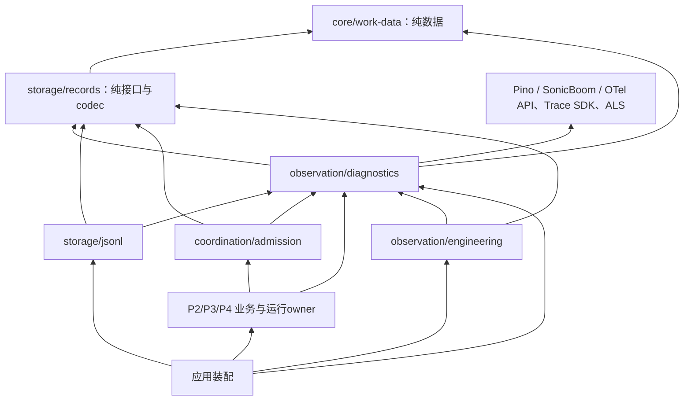

# 共享诊断、日志与 trace 施工候选

本稿消费 [scope](scope.md)、[acceptance](acceptance.md)、
[implementation-spec](implementation-spec.md)、[plan](plan.md) 的 `d95052c`，以及
[共享实施接口](shared-interfaces.md) 的已接受 `8f4cfa9` 子集。P1 施工选择已由
[D-010](../../../decisions/D-010-shared-diagnostics.md)接受，依据见[接受与验证](#接受与验证)。
本页固定实施输入，不宣称产品实现或 A28 完成；P2 桥和 P3 查询仍沿各自验证门推进。
2026-09-14 的新增输入要求生产、研发、debug 共享 log/trace 基础，并优先交出
其它设计会话所需的最小 Agent/Session/工具运行闭环。

沿用 [OB v1](../../../../spec/capabilities/engineering-observation/v1/contract.md)、
[CD v1](../../../../spec/data/core-work/v1/contract.md)、
[CC v1](../../../../spec/compositions/core-work-coordination/v1/contract.md) 及
[SYS-OBSERVABILITY.C1–C7](../../../requirements/system/observability-and-logging.md)。
本次不改变冻结规格、业务授权/状态/审计语义或 M1/M2 的 A01–A32 范围。
选型事实和实际探针归[研究记录](../../../research/harness-observability.md)。

## 目标、范围与沿用边界

P1 的消费者能用同一注入接口留下 writer/准入的阶段、关联和失败证据，诊断
输出失效不覆盖原业务结果，也不被隐藏。此时不要求先完成 collector、OTLP
网络、仪表盘或工程查询平台。P1 的范围是共享公共面、一个本地有界日志提供者、
真实 writer/admission 的异常路径接入及组合反例；P3 仍完成 OB 查询/导出/保留。

| 责任 | 唯一拥有者与本次处理 |
|---|---|
| 受理/拒绝/等待/决定/控制/终态/unknown 的业务事实 | 原业务 owner 在自己的提交边界生成，关键记录随同一耐久提交或可核实 outbox 保存。不能改成调用 logger 后视为已保存 |
| 规范记录、operation/commit/水位 | records/业务协调域；诊断可以引用，不另造 EventLog 或提交协议 |
| 普通结构化 log、运行时 span、裁剪、诊断输出资源与失效状态 | 候选新增 `packages/observation/diagnostics`，承载下面明确的保护边界 |
| 采集 cursor、处理版本、来源水位、索引、当前权限 query/export、gaps 和保留策略 | 既定 `packages/observation/engineering`，P3 实现；diagnostics 提供底层来源事实，不能替它授予读取权或宣称完整覆盖 |
| 工具过程帧、Session 历史、预算/费用真相 | 仍由 TL/SR/BG 等 owner 负责，日志及 span 不替代它们 |

`diagnosticId` 只是定位一次诊断的标识。分配、返回或在内存看见该 ID 均不是
保存回执；其日志可能被丢弃，查询必须结合缺口。业务 unknown/cleanup owner
即使日志丢失也保留原责任，不能依赖诊断文件重建执行权。

## 依赖、复用与配置

采用一个自有包 `@omne-harness-lite/diagnostics`，不再拆 logger/tracer/
context/exporter 包。它隔离真实的敏感信息、被动调用、有限资源与生命周期责任，
不是只为重命名第三方方法。箭头含类型依赖，表示消费公开入口：



records 不 import diagnostics，纯 work-data 不 import Cordis、logger、ALS 或
业务服务。diagnostics 的 records 类型依赖只复用 Principal/Causality/Position/
Watermark；不取得 writer/admission 服务，不调用 records 提交，不产生循环。
未来从 records 抽离这些投影需要独立真实需求，本次不迁移已接受共享数据。

| 已选精确依赖 | 使用范围及选择理由 |
|---|---|
| `pino@10.3.1` | 结构化 JSON、等级、固定 redaction 配置；不用 worker transport、pretty 输出或自动错误全文 serializer |
| `sonic-boom@4.2.1` | 显式直接依赖，复用异步文件流的 maxLength/drop/write/error/end/close；不自行再写缓冲队列 |
| `@opentelemetry/api@1.9.1` | 标准 span/context 类型与关联；不自造 span ID、span 树或传播协议 |
| `@opentelemetry/sdk-trace@2.11.0` | `TracerProvider` 创建 span、时间/状态/限制；本地 `SpanProcessor` 只将已结束 span 投影为安全日志 |
| `@opentelemetry/context-async-hooks@2.11.0` | 每个诊断运行实例显式拥有 ALS manager；不用进程全局 current span |

实际安装/入口/异步探针已通过；SDK `sdk-trace-base@2.11.0` 是包装该 Trace SDK
并读取环境默认值的兼容入口，本候选直接使用 `sdk-trace`。这不是引入全部 DSH、
Effect 或 pi telemetry。OTel Logs API/SDK 仍为 Development，本批已有具体本地
日志需要，不再叠加第二个 logs SDK。以后接外部 OTLP 可用官方 exporter/Batch
processor，但必须另验交付、权限及缺口，不能在 P1 预造 exporter 插件框架。

应用装配显式创建 diagnostics runtime，再注入实际消费者。创建者独占配置、
close 和状态查询；业务只拿记录面。没有隐藏单例、从环境自动发现 endpoint、
为缺失依赖自动装一个静默 no-op，或把每条日志交给任意 listener。测试的可控
提供者必须明确标识，实际装配必须使用真实本地提供者。

生产/研发/debug 使用同一记录结构和裁剪：默认等级 info，debug 只增加具名
阶段细节；console pretty 只允许离线展示已裁剪记录，不产生第二份全文。配置
由受信装配解析为冻结值，非法配置在发布前具名失败，不部分生效。P1 固定初始
值：单条编码上限 8 KiB；最多 256 个活动 span；span 最多 32 属性、每字符串
256 字符、8 事件、4 links；SonicBoom `sync:false,minLength:0,maxLength:1048576,
maxWrite:16384,fsync:false,retryEAGAIN:()=>false`。这些是保守容量预算，不是性能
测量结论；测试使用更小值触发边界。公共记录面不开放任意 OTel 属性/事件写入，
最后 UTF-8 字节检查仍有效，不能只依赖 SDK 的字符裁剪。

本地目录由宿主管理，0700 目录/0600 文件，使用部署生成的 source generation
命名，路径不取 tenant ID 或调用者输入。P1 每文件最多 8 MiB、诊断目录总预算
64 MiB/8 文件；预算含旧 generation 和未确认部分写入，超限停止接收文件输出、
报告 retention_capacity，不删除原件或继续开新文件。P1 无自动保留回收服务；
P3 engineering 才依据保留策略回收已关闭来源并使后续 generation 可写。启动时
预算/旧文件无法核对也显式 degraded。此有界失效模式允许 P1 开工；完整长时间
保留和查询仍是 M1 前的 P3 义务。

## P1 公共消费面

以下 TS 是运行时实施投影，**不是新的持久 DTO/Schema**。从共享包直接 import
权威类型；DiagnosticContext/Span 不得序列化，也不授予任何身份或读取权限。
事件 code/phase 由所在 owner 以静态常量定义；新增业务 kind 不登记到 diagnostics。

```ts
import type { OpaqueId, OperationRef } from '@omne-harness-lite/work-data';
import type {
  Principal, Causality, Position, Watermark,
} from '@omne-harness-lite/records';

export type DiagnosticIdentity = Readonly<{
  tenantId: OpaqueId | null;
  principal: Principal;
  operation?: OperationRef;
  causality: Causality;
}>;
export type DiagnosticPoint = Readonly<{
  component: string; phase: string; code: string;
  level: 'debug' | 'info' | 'warn' | 'error';
  diagnosticId?: OpaqueId;
  position?: Position;
  logical?: Watermark; durable?: Watermark;
  measures?: Readonly<{
    durationMs?: number; queueDepth?: number; pendingBytes?: number; count?: number;
  }>;
}>;
declare const diagnosticContextBrand: unique symbol;
export type DiagnosticContext = Readonly<{ [diagnosticContextBrand]: true }>;
export type DiagnosticEnd = Readonly<{
  code: string;
  outcome: 'ok' | 'rejected' | 'failed' | 'cancelled' | 'unknown' | 'interrupted';
}>;
export interface DiagnosticSpan {
  readonly context: DiagnosticContext;
  end(result: DiagnosticEnd): void;
}
export interface Diagnostics {
  newId(): OpaqueId;
  scope(identity: DiagnosticIdentity, parent?: DiagnosticContext): DiagnosticContext;
  current(): DiagnosticContext | null;
  log(context: DiagnosticContext, point: DiagnosticPoint): void;
  startSpan(context: DiagnosticContext, point: DiagnosticPoint): DiagnosticSpan;
  within<T>(context: DiagnosticContext, body: () => T): T;
}
```

管理面只给受信装配，和上述消费面分开。来源 seq/counter 复用 records 的
Counter 表达；失效快照不成为持久审计 DTO。P1 固定以下最小管理入口，P3 的
受治理 query/export 不从这里取得权限：

```ts
import type { Counter } from '@omne-harness-lite/records';
export type DiagnosticGapReason =
  | 'level_excluded' | 'buffer_capacity' | 'span_capacity' | 'invalid_projection'
  | 'write_unavailable' | 'retention_capacity' | 'closing' | 'crash_unknown';
export type DiagnosticGap = Readonly<{
  reason: DiagnosticGapReason;
  firstSeq: Counter | null; lastSeq: Counter | null;
  count: Counter | null; quality: 'counted' | 'unknown';
}>;
export type DiagnosticStatus = Readonly<{
  sourceId: OpaqueId; phase: 'active' | 'degraded' | 'closing' | 'closed';
  attemptedThrough: Counter; acceptedCount: Counter; droppedCount: Counter;
  pendingBytes: number; writtenBytes: Counter; activeSpans: number;
  writeProgress: 'idle' | 'pending' | 'stalled' | 'failed';
  pendingIdleMs: number | null;
  gaps: readonly DiagnosticGap[]; lastErrorCode: string | null;
  resource: 'held' | 'released' | 'unknown';
}>;
export type DiagnosticClose = Readonly<{
  status: 'closed' | 'blocked'; state: DiagnosticStatus;
}>;
export interface DiagnosticsRuntime {
  readonly diagnostics: Diagnostics;
  inspect(): DiagnosticStatus;
  close(options: Readonly<{ deadlineMs: number }>): Promise<DiagnosticClose>;
}
export type LocalDiagnosticsOptions = Readonly<{
  instanceId: OpaqueId; sourceId: OpaqueId; directory: string;
  level: 'debug' | 'info' | 'warn' | 'error';
  maxRecordBytes: number; maxActiveSpans: number; maxBufferBytes: number;
  maxFileBytes: number; maxDirectoryBytes: number; maxFiles: number;
}>;
export declare function createLocalDiagnostics(options: LocalDiagnosticsOptions): Promise<
  | Readonly<{ status: 'invalid'; code: string }>
  | Readonly<{ status: 'created'; runtime: DiagnosticsRuntime }>
>;
```

配置校验在取得资源前完成，invalid 没有资源；打开/准备失败仍以 created 返回
可 inspect 的 degraded runtime，保留实际取得资源的清理责任。是否允许仅普通
诊断降级的宿主启动由装配显式展示，关键审计的准入门不因此放宽。sourceId 由
装配分配不复用，文件采用独占创建，冲突不能追加到旧来源。inspect 返回冻结
快照；资源 held/unknown 时即使 deadline 到期也不能返回 closed。重复 close
就是认回原关闭并重试原责任，不另建立关闭任务。

`scope` 按可信入口已经核对的 identity 建立冻结快照；parent 默认为 ROOT。
`current` 只读取本实例的 ALS context，实例 closing/closed 时返回 null；供不能
修改既有业务参数的内部适配边界显式 capture，再传给 scope；它不读取全局 OTel 或 DSH initiator。parent 与新
identity 的 tenant/主体归属必须匹配；不匹配时新建根并登记关联缺口，业务因果
继续沿权威 Causality，不能把错误 ambient context 当授权。原数据类型的租户、来源
及完整性校验复用原权威。用户传来的 tenant/operation/parent 不能通过这个函数
升级为可信值。认证前拒绝使用部署的 system principal 和本次入口 operation，
标记未经认证阶段；认证后但目标无权访问时只保留已核实主体、入口/阶段和被
裁剪的目标类别，不把未核实的目标身份伪装为可信 tenant。没有 Session 的工作
沿现有 system/WorkOwner 表达，不制造假的 Run。

每条日志包括 source generation、单调递增的来源 seq、观测时间、component/
phase/code/level、适用的上述关联及可选 traceId/spanId。业务时间戳、来源 seq、
commit.seq 和业务因果关系分别解释；来源 seq 不是 records 的耐久水位。
`newId` 在来源实例内使用独立递增标识及宿主已分配的唯一实例身份，初始化失败
在发布前报错。返回 ID 不依赖磁盘写入成功。

`log/startSpan/end/scope` 都是有界、同步、被动记录操作：投影或后端错误计入
固定容量健康状态，不抛出到业务、不调用 listener、不递归记录故障。失效的
startSpan 返回可安全 end 的惰性句柄，仍保留原 scope 的显式传递；丢失记入 gap。
无效 identity 则只建立带 invalid_projection 的安全 system context，不能在返回
句柄中保留被拒绝的原对象或把它当有效业务关联。
`within` 只在私有 ALS manager.with 内运行 body，保持 body 的原返回值、Promise、
同步 throw 或异步 rejection；不能把 throw 改成正常返回，也不能强制异步化
admission 的短门。上下文激活在 body 尚未被调用时失败，才可用显式参数执行
body 一次并记诊断失效；不能捕获 body 的 throw 后再调用一次。within 不读取
返回值的 then、不挂结算观察器、不登记 activeScopes 或保留 Promise 集合；只
使用 ALS.with 的词法调用边界，原样返回结果。context 是调用者持有的不可变
值/句柄，真实性校验可以使用 WeakMap，诊断器不另外用强引用表枚举所有 scope。
因此没有需要另设配额的诊断 scope 任务；尚未完成的 body/Promise 及其异步
资源仍归原业务 owner 的准入和清理控制，不能转移给 diagnostics。

startSpan 用 `tracer.startSpan(name,options,explicitParent)`；子 context 是原
scope 加 OTel 的 native context。调用者在真实阶段结束时 end，所有终结路径
都要覆盖。end 重复调用不增第二个终态，结束后不再在 provider 活动表保有 SDK
span 或导出回调；context 后续只保留不可变 span identity。已经开始的调用者
异步资源仍可能持有原 native context，这份引用沿调用者真实生命周期释放；
无界的人类等待、Session 存在期和整个宿主寿命不保持一个活动 span。等待事实
由业务记录承载，诊断 span 只测一次准备/排队/写入/恢复/调用阶段。

OTel span 的 error/ok 仅表达该测量阶段；业务预期 rejection/unknown 必须显式
标记原 outcome，不能以 Promise resolve 推导业务成功。默认不调用
`recordException(error)`；异常的原值仍由业务错误通道返回。诊断只保留所在
owner 的安全 code/phase 和静态源码位置线索，不能隐式序列化 message/stack/cause。

### 消费者签名细化及短门约束

共享实施稿的两个目标 factory 增加必需的第二参数：
`createJsonlProvider(options, diagnostics: Diagnostics)` 与
`createAdmissionCoordinator(writer, diagnostics: Diagnostics)`。这改变**实施注入**，
不改变 RecordProvider、AdmissionCoordinator、提交格式或正式 v1；整合者已同步
共享稿，消费者不可各自增加不同 logger 参数。Diagnostics 类型从其所属包公开入口导入。

每个 provider 使用创建时绑定的 system scope；请求边界先显式 current/capture，
异步写泵保存已冻结 context，出队时恢复，不能继承写泵创建者身份。已准备的操作携带的可信 Principal/
Causality/OperationRef 用来建立操作 scope。从 PreparedOperation 取得关联使用
records 已有的冻结规范输入/验证入口，不从任意日志字符串恢复。diagnostics
本身不解析业务 Action 或 OperationInput 来决定授权。

短门内只更新消费者自己的有界元数据、分配纯诊断 ID 并收集固定字段；不得调用
Diagnostics.log/startSpan/end、Pino 或 Sonic.write。Sonic 的异步模式只说明写入
回调异步：4.2.1 达到 minLength 后会在同一调用栈开始 fs.write，不能拿它充当
门外调度保证。scope 准备、大对象投影、序列化和所有真实输出都在门外。

admission 的元数据归外层 enter 调用：frame 先失效并退出门，再在受保护的
finally 中输出，保持 enter 的原返回值/throw；内层 submit/callback 返回不算
已退出外层门。jsonl.commit 可能被这个门调用，它只收集自己的结果/故障元数据，
由既有写泵的门外调度段处理；即使没有业务待写或已隔离，诊断段也可收口，不能
为诊断重新开放业务写入。每个消费者至多保留 16 个待输出的固定大小 point 和
一个省略计数；jsonl 至多排定一个门外处理回调，不为每次拒绝创建微任务。溢出
合并为 `diagnostic.gate_capacity` + measures.count 的安全摘要，出门后经同一
日志面输出；未分配来源 seq 的省略不补造连续水位。它是所属消费者的短暂字段
收集，不新增公共日志排队 API、通用队列或第二个后台输出框架。

late rejection 只用原冻结关联和 code，由原 admission owner 接管，在门外
被动记录。诊断器失败不改变 publication blocked、quarantine 或旧 use 的释放
责任；消费者的门外输出也不能将原同步结果改成 Promise。

## 真实接入责任与最小测量

P1 不预造业务全事件目录。下面是已经存在的真实边界，code 字面量在各 owner
实施时固定并逐交付记录，不按类名/异常文本自动生成。

| 消费者 / 测量边界 | 必留诊断、关联与终结 |
|---|---|
| jsonl：acquire/epoch | 取得/竞争拒绝、恢复起止、epoch write/sync 失败；system principal、域、cleanupId 对应 diagnosticId；失败不发出 writer |
| jsonl：排位→write→sync→回执 | operation、完整 Position、logical/durable 水位、pending 字节/条数和分段耗时；pending 不能写成 committed，未知范围不被后续成功覆盖 |
| jsonl：隔离与修尾 | 原失败阶段、保全/截回/同步分别有结论；只记录 evidence 的受控引用/类别，不写原损坏正文或宿主绝对路径 |
| jsonl：close/retryRelease | 原清理 owner、阶段、未核实操作/锁责任的安全定位；失败后保留同一 diagnosticId，不借新日志 ID 换掉清理身份 |
| admission：短门拒绝/发布/retain | operation/owner/阶段、条件冲突/同步契约违规、publication blocked；采用原业务判定，不让 logging 参与资格矩阵 |
| admission：late reject/cleanup/close | 晚到拒绝归原 operation/use/generation；关门、排空、发布与锁关闭分别观测；业务错误保留，诊断错误另列 |

P2 的 Agent/Session owner 接同一个 `Diagnostics`：激活/发布/清理、输入/Run
claim、恢复 epoch、等待与控制都在原权威边界生成。P3 的工具/执行/审批 owner
追加 manifest/Action/call/attempt、绑定、等待/控制与终态；P4 的模型 owner
追加实际模型/路由/usage 质量的安全关联。它们的具体业务事件仍由本来 owner
在各自开工前定义。绑定中已有的定义/实现/配置/环境引用直接复用，不再定义
一份观测专用 SessionRef/RunRef/AgentRef。

`packages/observation/engineering` 只从 records 受限读取端及 diagnostics 本地
来源读取原件/失效快照；不倒调业务效果。P1 交给 P3：行格式版本、来源 generation/
seq、起止/缺口标记、文件保留预算、已关闭/未完成状态、`diagnosticId` 检索字段。
它们是内部来源适配信息；P3 开工前再固定其受治理的 query/export API、采集 checkpoint
与快照语义，P1 不发明与 OB 争权的 cursor 服务。

## 身份、异步 parent、恢复与内容

进程内排队显式捕获 DiagnosticContext，并由实际执行 owner 在出队时
`within(captured, work)`；调用链显式传 scope/child context，不靠“当前是谁”
推断业务身份。不同操作并发时不共用可变 identity。只有具有同一已核实归属的
原工作可沿同一 context；换 tenant/可信主体需在权威边界新建 scope。

共享 timer、文件流、采集器和 provider 初始化在 ROOT_CONTEXT 及 DSH initiator
为空的受信宿主启动位置创建；不能在第一位调用者的请求 ALS 内注册后永久继承
其归因。出口采用显式 scope，不把 DSH `ctx.agent.initiator` 当持久身份或准入权。
任意 Promise/队列桥必须核对 capture/restore；P1 不注册 OTel 全局 manager/provider，
不自动劫持 fs/http，也不输出未经审查的 baggage。

跨进程/网络仍首先传 CD-02 的显式主体/tenant/operation/因果数据并在目标重检。
未来如需额外 trace carrier，使用标准 W3C Trace Context/官方 OTel propagator，
不能以外来 trace parent 授权或默认接受其采样位；本次未实现该传输入口。
恢复依据原业务事实建立**新的**运行实例和 span，继续关联原 work/attempt/
parentOperation；不反序列化 Context、Span、ALS、AbortSignal 或执行句柄。若旧
trace 可合法读取，可在提供者映射为 link；没有旧 trace 时业务因果仍可诊断。

日志/trace 的默认结构没有 prompt、模型响应、工具参数/结果正文、HTTP headers、
URL query、密钥、任意 target 或 Error 对象槽位。正文诊断需要沿原对象权限读取，
不能通过 debug 模式获得旁路。SecretRef 也只在原权威认可的关联投影里使用，
永远不解引用密钥。Pino redaction 作为防误接的固定 allowlist 后第二道保护，
路径由代码/可信配置固定，不接受用户表达式；它不能删除任意自由文本中的秘密。

投影只读自有数据属性，拒绝 getter/toJSON/循环/未知键和超限；失败留安全 code
与 gap，不尝试 inspect 原对象。记录先裁剪/限长再进入 Pino、OTel 或缓存。过长
身份不能截成另一有效身份，应标关联不可记录及 gap，原业务身份/结果保持完整。
宿主内部诊断文件是受信运维来源；P3 不能直接把其读取能力交用户。query/export
按当前主体/tenant/内容分类/对象权限逐项裁剪；仅有关联 ID 不等于有正文权。

## 有限资源、缺口与关闭

候选本地行格式为 `omne-diagnostic/1`，只用于此实现，不登记成新业务 Schema。
log 行及 span 结束行均经同一 Pino/Sonic 流：span 由一个本地 SpanProcessor
同步投影，不另缓存已结束 span，不实现 exporter 注册、重试或网络协议。span
限制和活动数量一起生效；达到数量预算后不再创建 SDK span，body 照常运行，
原业务因果仍存在，缺失计入 span_capacity。

输出状态区分 active、degraded、closing、closed；至少提供 source generation、
最后尝试 seq、已接收/丢弃计数、待写字节、最后确认写入字节边界、活动 span 数、
最后安全错误码和剩余关闭责任。Sonic `drop` 同步回报具体行，write 回报实际
写入字节；适配器据此核对可读取的完整行边界，不能以 logger 返回或 flush 请求
当耐久确认。所有来源水位都注明质量；`fsync:false` 的诊断文件没有 DR 回执保证。

运行中采用 `minLength:0`：流空闲时，一条短日志就在门外的 log 调用中开始
异步 fs.write；流忙时进入已有有限缓冲，前一写入回调继续排空余量。没有等待
下一条日志/close 的 4 KiB 门槛，也不新增 periodicFlush timer 或公共 flush。
这不承诺硬实时写完：文件可读范围以实际 write 回调/完整行核对为准。inspect
给出 pendingIdleMs 和 writeProgress；有待写字节时，用单调时间计算自最近一次
write 进展起的等待（首次待写从入流计时），每次真实进展重置、排空后为 null。
有待写且超过 1000 ms 无进展时为 stalled；持续有进展不因队列非空就报停滞。
这是一项可查询的积压状态，不是取消 I/O 或认定丢失。实际 error 进入 failed/degraded 并保存安全错误码
及原资源责任；恢复进度与剩余字节分别可查。没有额外健康轮询任务，低流量
验收在无后续日志、未 close 下等待实际 write 并读回；本次环境的观察期限为
1000 ms，不把一次测量扩成所有 OS/负载下的时限保证。

缺口原因至少分等级排除、容量/活动 span 限制、非法投影、写入不可用、保留容量、
关闭中未结尾、异常进程退出；计数包括 warn/error 的普通诊断丢失。P1 不做随机
采样，未来加入必须记录政策/来源范围。每个固定原因只保存一份有界聚合：观察
区间、first/last seq、已知丢弃数及范围质量；合并区间只能说“其中有缺口”，不能
声称区间每条都丢了。统计不以 tenant/run/任意事件文本做无限 key。

失效状态独立存于 runtime 的固定容量槽位，更新它不再调用 logger。流恢复可写
时追加一份 gap summary；仍失败时只保留状态，不制造重试任务风暴。进程崩溃
可能同时丢失尾部诊断和内存计数，下一次来源核对必须报 crash_unknown，不能
补造精确丢弃数量；没有 clean end 也不能推断业务仍运行。P3 checkpoint 保留其
已确认范围，不从本地若干成功 span 补全未观察的链路。

来源范围可能包含多个 tenant。原始来源统计仅向获准运维主体开放；普通 tenant
查询不能泄漏其他 tenant 的计数/ID，无法安全分摊的全源 gap 应返回该 tenant
覆盖未知而不附全源数量。P3 的索引/过滤验证承担最终不泄漏保证。

诊断文件错误只令此输出 degraded，封闭受影响的流并保留 fd/未写内容的已知
责任；不能自动调用业务 writer.quarantine。业务关键审计保存失败则由原 owner
按 OB-02/CC-07 隔离并阻止依赖它的新效果，连拒绝审计也保存不了时返回
`audit_unavailable` 并尽力记录最小诊断。两种失效可以同时存在，返回值都如实保留。

关闭由应用先停止/结算或明确隔离业务生产者，完成关键终态记录与 records 关闭，
再关闭 diagnostics。诊断 owner 同步关新 scope/span；现有 span 持其原 generation，
end 可继续写入原流。随后等待有限活动 span 清零、SDK forceFlush、Sonic.end 的
finish/close，关闭自己的等待计时器并 disable ALS manager；不等待任意 within
返回的 Promise，也不能以调用 destroy 代替真实输出收口。

closed 只表示此诊断实例拥有的输出/活动 span/管理资源已释放，不表示调用者
body 已停止。尚未结算的调用者、其错误通道及捕获的 native context 继续由原
业务 owner 负责；应用不能借 diagnostics.close 绕过原停止/隔离协议。实际探针
显示 disable 后旧续体仍可能读到原 native context，因此公开 current 在
closing/closed 返回 null，within 在这两个状态直接运行 body 一次、不再激活
manager；所有 log/startSpan/end 在访问后端前检查原 generation/关闭状态，
晚到调用不能碰已释放的流或改投新代，必要缺口只更新有界状态。仅依赖 ALS.disable
不能作为旧引用失效证明。

重复关闭/重试认回同一关闭责任；deadline 只结束等待，未完成 I/O、活动 span
或 fd 仍由原诊断 owner 持有，并返回 blocked/剩余责任。不得用 finally 的关闭
异常覆盖原业务失败；应用报告业务结论和诊断关闭结论两个独立字段。

更换配置/提供者先准备并验证新 generation，原子切换新工作注入，再排空旧代；
准备失败保留旧代，旧句柄不能写入新代。只有当前代及至多一个待清理旧代，旧代
未释放时拒绝再次更换，避免 quarantine 列表无限增长。旧 provider 的失败释放
不得误关新流。P1 固定这项生命周期测试；它不要求无间断迁移或自动远程后端。

### Cordis 输入桥的独立边界

P1 jsonl/admission 直接注入 diagnostics，**不依赖 Cordis logger 桥**。P2 的
内核接入另外交付以下受限桥及其反例，不能在 P1 缺证据时默认启用：

- 一个 Cordis root 生命周期内只注册一个受信 exporter，显式 `levels.default=3`，
  回调有被动边界；唯一注册归宿主，不让动态业务插件自行注册第二个 exporter。
- exporter 闭包只指向当前安全投影目标；更换时同步切换目标，旧代照原协议排空。
  撤除桥先将目标置空并登记来源不可用。此永久 root 回调不持 fd/timer/tenant
  context；之后不会调用旧目标，不调用已知有缺陷的上游 disposer 来完成换代。
- root 被释放前停止相应生产者，断开目标后仅剩随 root 可回收的注册对象；不把
  “回调还在 registry”冒充尚有文件资源，也不把未知 native 清理宣称已验证。
  第二个原生 exporter 的动态注册/独立卸载在本映射中明确不可用；需要该动作
  时先取得新版本验证或新的受审映射，不静默采用有缺陷的 disposer。
- 仅投影 Cordis source/sn/type/时间及安全 fiber 标识；不格式化 raw args，不把
  fiber 当 Session/Run/principal。无法核对关联时标 system/uncorrelated。

该映射维护官方包边界，不 fork/原地 patch Cordis，不靠改写私有序号或 exporter
Map 修复上游。Cordis 内置内存 buffer 先于桥接持有原 args，桥端裁剪不追溯清除
它；`bufferSize=0` 还会因 `slice(-0)` 无法清空。P2 须审查进入原生 logger 的
调用和异常来源，不能输出 payload/秘密，不能将原 buffer 接入 query/export。
若需要保证原生输入也有严格字节界限/敏感值消除，而受信调用限制无法兑现，
这是桥接的**阻断条件**，需向整合者报告并核对官方升级或其它正式映射；不得
声称本页已解决上游所有缓存行为。P1 的独立诊断提供者不受该桥未完成影响。

## 四输入细化、TDD 与交接顺序

| 施工任务 | 目标与固定输入 | 先出现的 RED 与必须交付的 GREEN |
|---|---|---|
| D1 共享 diagnostics | 本页接受提交、已验证 work-data/records；独占新包及其测试/README | 公开接口缺失编译边界就绪后，真正测量下表 O01–O08。产物与真实本地文件、无环依赖、独立 tarball 消费通过；根配置/锁由整合者维护 |
| D2 P1 消费者接入 | D1 精确产物与本页 factory 修订；jsonl/admission 各自原作者 | 原 A05–08 故障已有时先刻画保留；新增关联/异常缺口先 RED。O09/O10 以真实 writer、sync 故障、清理 owner 和同步门组合测量 |
| D3 P2 内核/Session 接入 | D1+D2 的验证输入、AR/CB/SR v1 | O11 的原生桥及租户归因反例；激活/释放/恢复必须使用实际内核，剩余桥风险列明。Agent/Session/工具闭环不等待 P3 collector/仪表盘 |
| D4 P3 engineering | 原 OB v1、D1 来源格式/失效事实、真实业务审计、当前权限端口 | query/export/cursor/gap/保留/权限的 A28 完整场景；不能将 P1 通过当 OB 已完成 |

D1 的正式实现由独立 infrastructure-developer 承担；D2 的 jsonl 与 admission
仍由其原作者负责，不另建 logging coordinator。P3 engineering 能力的查询/导出
业务归单独指定的 capability owner。具体写路径和共享接口接受提交由整合者在
派发时填定；本作者没有为这些尚未派发任务取得产品代码写权。

| 场景 | 直接适用的验收刺激与必须观察的结果 |
|---|---|
| O01 / A28、A31 | 后端 write/processor/projection 抛错或失败；业务正常返回、同步 throw、异步 rejection 各自保持原结果/身份；跨 4 KiB 输出及内层 submit 退出仍不在外层门内启动 fs.write，门外输出后返回仍严格同步；body 仅运行一次，健康状态独立 |
| O02 / A01、A28 | 两 tenant 异步穿插、排队出队、root timer、旧 parent 恢复；来源不串租户、共享任务无调用者 initiator，新运行 epoch 仍能关联原 work/attempt |
| O03 / A28 | 嵌套/循环/getter/toJSON、超长字段、SECRET/BODY 哨兵分别送入 scope/log/span/error 边界；真实文件、OTel 属性及缓存不含原文，投影失效显式可见；debug 不放宽 |
| O04 / A28 | 持续写超过单条/活动 span/缓冲/磁盘/文件数预算，含 warn/error；内存资源有界，实际写入和 drop/gap 对得上；编码字节与字符差异被覆盖，不只断言配置值 |
| O05 / A28 | 单条短失败日志无后续流量/无 close 即可在实际 write 后读到；阻塞/失败时 pending age、stalled/failed 可查。写前/部分写/close 前失败、重启无 clean end、保留容量耗尽只能声明实际确认范围，关键业务回执保持独立 |
| O06 / A29 | 活动 span 未结束、磁盘回调迟到、关闭失败/重复关闭/超时；原 owner 可 inspect/retry。大量零 span 停滞 Promise 不生成诊断观察器/任务表；关闭不伪造 body 结束，旧 current/输出受原实例状态封闭，无新增未处理拒绝 |
| O07 / A18、A29 | 新代准备失败、成功切换、旧代关闭失败、旧句柄迟到和再次更换；新工作归新代，旧失败不关新资源，同时代数保持有界 |
| O08 / A30 | 独立安装精确产物，用公开入口消费；work-data/records 无日志反向依赖，目标包不从源码路径偷 import；配置和来源/许可可追溯 |
| O09 / A05–08、A28 | 真实磁盘 fsync 失败且诊断输出同时失败；业务仍 unknown/quarantined、关联原 operation/Position，未完成 cleanup 仍具名；新效果不越耐久缺口 |
| O10 / A08、A28 | publishLogical/retain/publishDurable 的同步违规和晚到拒绝，另注入 logging 失败；原 publication blocked/隔离、原 use/清理责任、错误身份不被改写 |
| O11 / A04、A18、A29 | 官方 Cordis 级别过滤/抛错/错误 disposer 原反例；受限单桥 A→B→撤除、root 关闭、两 tenant、raw buffer 暴露反例；旧 exporter 不再到旧资源且未知来源不冒充业务身份 |
| O12 / A28、A32 | P3 当前权限撤回、相同 ID 无正文权限、采集/存储/索引失败、快照导出和 retention gone；业务审计故障阻止效果，入口拒绝也失败为 audit_unavailable；逐项对账实际覆盖 |

D1/D2 不替代 A28 的业务审计、权限和 P3 查询；M1/M2 的其它 Axx 继续完整交付。
每项正式行为仍按[计划的 TDD 循环](plan.md#tdd-循环)保留可复查 RED/GREEN 与
真实源码关系。本文 tmp 的可行性脚本不搬进产品充当 TDD。每段交付同步包 README、
依赖/配置、四输入投影和 delivery；接受者核对后才更新状态。

## 作者检查与评审输入

`tmp/observability-design/` 内实际安装精确发行物并运行 `node probe.mjs`，Node
`v24.18.0`，12 项可行性/反例通过；具体输出和局限见研究。未读取 .env/密钥，
未调用模型或外部 exporter。它核对第三方 API 和反例，尚未验证正式 diagnostics、
P1 持久提供者、P2 桥、动态完整关闭或 P3 的 OB 查询/权限。
`make docs-check BASELINE=d95052c` 使用本 spoke 的临时 uv 环境通过 398 份
Markdown 及关联结构检查；`git diff --check` 通过。检查不等于架构选择已接受。

本稿请求独立评审的选择是：一个共享包及无环依赖；Pino/Sonic/OTel 的最小组合；
被动同步端口及 factory 注入；有限来源状态/输出和旧代责任；P1/P2/P3 的明确
交付分界与受限 Cordis 桥。沿用业务审计/CD/CC 的部分不重新表决。库性能、实际
100 次资源循环、跨进程 trace carrier、完整保留查询均未被本次探针验证；没有
证据支持扩成 collector/仪表盘平台或修改正式数据 Schema。

### 独立评审修订 O-R1–O-R3

本节处理对 `1c60feb` 的三项反馈，不重开其它选择。O-R1 的同栈 I/O 反例由
真实 Sonic/fs.write 探针复现；修改为消费者在短门内只收集有界字段，外层门退出
或既有门外写泵才输出。O-R2 去掉 minLength=4096，固定 0，补足低流量的写入
触发及积压/失败状态，并删除不存在的公开 flush 声称。O-R3 移除 activeScopes
和 Promise 结算观察，以原业务 owner + 诊断 generation/关闭守卫约束晚到工作。

`node tmp/observability-design/review-probe.mjs` 在同一 Node/依赖环境通过七项
定点检查。两个 minLength 配置各输出 6983 字节，fs.write 在门内启动次数均为
0；单条 55 字节日志在未 close 下读回；注入 EIO 后健康状态 failed；10000 次
停滞 Promise 原样返回且没有 then 观察器、没有新增未处理拒绝。首轮关于
ALS.disable 会清空所有调用者 context 的过强断言实际失败，修订后以公开关闭
守卫验证，原失败保留。详细事实及局限见研究的“独立评审后的定点证据”。
这些仍是机制可行性探针；正式 consumer、关闭/故障组合与产品 TDD 尚待实施，
本作者不自行认定评审闭合或接受。

修订后的 `make docs-check BASELINE=1c60feb` 通过同一 398 份 Markdown 及关联
结构检查，`git diff --check` 通过；日志为 `docs-check-review.log`。

## 接受与验证

`99fc7a3` 相对 `1c60feb` 经同一 architecture-reviewer 定点复核，O-R1–O-R3
设计缺口闭合，没有新阻断。主调度经 `9cd78a0` 合入后，以独立安装目录重跑
原 12 项及新增 7 项机制探针，全部通过；[证据](evidence/observability-design/README.md)
保全 38 份作者资产、来源/锁、原失败和本次结果，原产品依赖锁未改。

[D-010](../../../decisions/D-010-shared-diagnostics.md)接受本稿的 P1 公共面、
五项直接库依赖、两处 factory 注入及其有限资源/关闭责任，作为 D1/D2 施工输入。
D1 必须先消费已验证 records 和 work-data，实际实现仍按 O01–O08 进行 TDD；
D2 再接真实 writer/admission 验证 O09/O10。P2 桥的原生缓存/卸载和 P3 query/export
保留原独立门；这些待实施范围及 O11/O12 不由机制探针计为产品通过。
