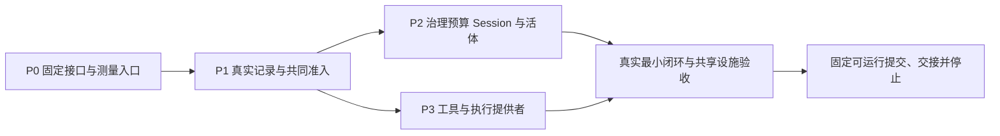

# 推进计划

## 推进方式与交付点

按可运行的能力流程推进，每段都有对应验收和文档对账。P0/P1 是必须先验证的
共同基础；通过后依据真实输入并行，不排成五种角色依次接棒的固定流水线。

原完整批次的 M1 必须使用真实 JSONL、当前授权、Session/Run、独立工具执行和双入口答复；
模型由确定性驱动替代，不声明已经交付智能体模型运行。M2 在 M1 之上消费真实
OpenRouter，不另写一套 demo 审批。P5 完成后才接受 M2 及整批。用户已将本会话
终点改为下面的运行基线，完整 M1、P4 和整批 P5 不再自动派发。

为了让其它产品设计会话取得可靠依赖，本会话以运行基线作为最终交接点：
真实记录/准入与治理预算前提就绪后，贯通 Agent 活体、Session 文本输入/Run、
工具定义装载及一次受控调用，由确定性驱动形成输入到结果的真实闭环。
交接固定可运行装配、公开包提交、实际覆盖和剩余能力；不以 baseline API 或
临时替身交付，也不把它称为 M1 完成。其它会话可以先消费正式语言无关规格，
需要目标 TS API 或实际运行时的工作等待这个已验证交接点。
该节点的行为、范围和交接材料集中归[最小运行基线](runtime-baseline.md)，其
子场景通过不抵扣 M1/M2 的完整验收。

本轮继续 P0/P1 及 P2/P3 中被基线直接消费的实现、必要故障验证和包产物交接。
先用真实管理入口建立 grant，贯通 allow 调用；未交付的 ask 路径必须显式不可
执行。既有完整 HD 设计保留为后续输入，其全部实现不作为这条 allow 链路的
前置条件；新实现仍须遵守已接受的身份、权限、记录和资源责任不变量。
日志/trace、JSONL 与本地预算计量随共享依赖收口，扩展观测和模型计量按
基线页的停止条件处理。基线通过后停止新派发并整理剩余工作，等待用户新规划。

用户要求生产/研发/debug 的 log 与 trace 具有统一工程基础。先研究固定 DSH
实现和其它 TS/JS harness 的实际做法，再按工程观测契约固定最小共享设施与接入
责任。P1 及其后的有状态/副作用边界消费该设施；纯共享数据包不因此增加运行时
依赖。具体选型、接口和新增包须有受审设计及独占实现者，不由各业务作者各造一套。
该选择已由 [D-010](../../../decisions/D-010-shared-diagnostics.md) 固定，具体四输入归
[观测施工稿](observability.md)。records 实现通过后，先由 infrastructure-developer
交付 diagnostics 的 D1/O01–O08 真实包；P1 jsonl/admission 再消费该产物并行实现，
共同验证 O09/O10。诊断设施的设计通过不代替共享实现通过。

D1-R1 实施反例要求先闭合目录级资源责任：现有每来源 factory 只核对物理文件，
不能表达新旧来源和 pending 共用的容量。由原观测设计作者在
`observability-directory.md` 提出最小公共修订，固定显式目录 owner、来源 slot/
字节 reservation、关闭/失败责任与宿主独占前提的实际成立方式；不以均分、复扫
或隐式全局表隐藏共同责任，也不静默禁止原设计允许的新旧代并存。范围只修复
本地预算与创建/释放接口，不扩展查询、远程观测或通用保留框架。该修订先独立
审阅及必要机制验证，再更新受影响施工输入；原作者可并行完成其余独立反例。
新的实现选择不能原地改变正式 OB 语义。任务只写上述候选、专属证据和 tmp，
主调度负责接受依据、公共输入及消费者的对账。

## 当前最小闭环实施 wave

本节是当前执行安排，后面的 P0–P5 表只保留原完整批次分工。所列“待交付”是
未满足的具体输入，不是允许先用替身开工；实际派发同时固定本计划提交、所属
设计提交和每个已通过验收的前置产物提交。下一层仅在这些版本真实存在并完成
相应验收后开放，不用未来分支名或作者预计替代产物。

| 交付任务与前置版本 | 唯一实现及写入归属 | 本次退出依据与下一消费者 |
|---|---|---|
| D1 目录修复与整合 | 原 infrastructure-developer `/root/diagnostics`：`packages/observation/diagnostics/`；产品起点 `a1be742`，设计 `327735f` 加本计划提交中的 D-011 采用；整合者独占根锁/native 安装及对账 | R1 两条真实 RED 和关闭未知资源身份修复；R2–R6 在同一产品提交回归，O01–O08、真实 flock 与 tarball 消费通过；形成唯一 D1 产物后供下行使用 |
| P1 JSONL 与共同准入 | D1 产物待上行交付；已接受 records `c1783fd`、共享设计 `8f4cfa9`。infrastructure-developer 独占 `packages/storage/jsonl/`，kernel-developer 独占 `packages/coordination/admission/`；不共同写公共入口 | 各自 TDD 及公开包产物，再由明确指定的 verification-developer 创建下述测试载体，在 `apps/local-harness/tests/storage-admission/` 验证真实磁盘/两进程/提交故障/尾部恢复与 O09/O10；整合者接受同一组合提交，不能用两个单包 GREEN 开放业务 |
| P2 治理、本地费用和运行状态 | P1 组合产物待交付；逻辑稿 `058c77c`、`cd16f1` 及提供者映射 `f98ac926` 已接受为基线施工输入。capability-developer 分别独占 `packages/governance/{tenant,authorization,budget}/`、`packages/session/{session,projection}/`；kernel-developer 独占 `packages/core/agent/`；infrastructure-developer 独占 `packages/session/persistence/` | 仅实现基线需要的真实身份/对象访问、grant、当前配置、本地预算预留/结算/unknown、唯一活体/Run、文本/结果及恢复；沿 AR/SR 原 R0–R5 切片。公共类型/注册面先由所属 owner 固定并实际可消费，再展开依赖者 |
| P3 工具与本地执行 | P1 产物及相邻治理/Session 端口待交付；`0a6e91e` 与 P2 `f98ac926` 已对齐，TL/LE 基线设计已接受。capability-developer 独占 `packages/tools/tools/`，infrastructure-developer 独占 `packages/tools/local-execution/` | 工具稿 T0–T2 的定义自声明、原 Action/attempt、真实 allow 文件效果与原结果/unknown；消费 P2 实际预算/授权。无权限、跨租户、参数/声明不符均不可执行；完整 `human-decisions` 实现及 ask 接续不成为本节点前置 |
| 最小应用与独立验收 | 上述 P2/P3 可消费产物待交付；application-developer 独占 `apps/local-harness/src/` 和应用配置，verification-developer 独占 `apps/local-harness/tests/runtime-baseline/` 及本次独立消费者；其它写路径只在具体派发时另行限定 | 按 runtime-baseline 五门，从真实入口走文本→唯一 Run→grant 下的文件调用→原结果；实际重启认回 Session/Run/call，已完成效果不重复、未知不盲重发；公开包独立安装/定义工具/提交/查询，整合者固定提交与运行命令并停止 |

P3 在工具包前先由指定 capability-developer 独占
`packages/governance/human-decisions/` 中 T0-H 实际被 TL 消费的共享形状、纯 fold
及其测试；该交付以独立公开消费为门，不能扩展为完整审批实现。随后工具 owner
消费此固定产物，不复制该定义，具体顺序沿已接受工具稿 T0–T2。

D1 的目录产品实施期间，verification-developer 可以独立验证已固定原生依赖的
产物安装测量：仅写 `tools/package-checks/` 与 `evidence/native-consumer-checks/`，
消费 `ce73873` 的真实根锁、批准清单及叶依赖。保留默认禁脚本、真实闭包和仓库外
解析隔离，只构建获准依赖；通过实际 addon 加载识别 rebuild 空成功，相关负例及
真实 tarball 消费才是退出依据。这项测量开发不消费尚未完成的目录实现，D1 最终
整合仍须用修复后的真实产品再次完成独立消费，不能以工具通过代替产品通过。

P1 当前提供者映射已在 `2c3aede7` 迁到 `packages/storage/jsonl/design.md` 与
`packages/coordination/admission/design.md`，按[共享稿的采用记录](shared-interfaces.md#p1-映射迁移的采用)
进入后续四输入。该任务只迁移既定技术责任、签名和验收
义务：records/work-data 的已实现公共源码保持权威，原共享稿保留来源、接受范围
与导航，不出现第二份独立演化的接口。该准备可与 D1 修复并行，作者仅写两个
设计正文、共享稿及专属 `evidence/p1-provider-mapping/`；根索引和对账归整合者。
冻结规格、业务语义、产品源码和 manifest 无写权；发现新设计选择时交回所属
设计处理，不能在迁移中静默改义或提前宣布 P1 就绪。

用户要求复用旧系统的租户与授权业务经验。原生 explorer 已从
`omne-next/omne_harness` 固定 `6263fed` 交付
[语言无关研究](../../../research/tenant-authorization-invariants.md)，来源提交
`13b7d18` 经 `ea68d20` 合入；38 个源码/要求/测试链接和行段已核对。P2 的 TG/AU
实现者在准备反例时消费该材料，特别核对角色上限、重新加入身份、租户停用、
定义版本授权与撤权次序；不能把旧测试的绿色预期代入当前规格。研究不接受旧
实现，也不扩展完整 HITL；若新证据影响当前承诺，按所属设计处理后再更新消费者。

P1 的 verification-developer 同时独占最小测试载体的
`apps/local-harness/package.json`、`tsconfig.json` 和 `vitest.config.ts`，只建立
组合测试所需的叶子配置与脚本；不提前实现应用业务或复制包内行为。整合者负责
根 workspace 发现、锁文件及根检查入口，将该成员纳入实际命令执行。P1 组合
验收须证明根命令确实发现并运行测试，不能只留下未被执行的文件。该交付接受后，
叶子配置写权在明确固定的提交移交 application-developer，原验证者继续只拥有
所派测试目录；两者不同时写配置。当前还没有该载体或配置产物。

P2/P3 各 owner 同时负责本包真实入口、准入/拒绝、结果、失败和退出边界的
diagnostics 接入，使用同一受限记录面，不另造日志或费用权威。应用提供关联
上下文并持有目录管理面；最终验证 owner 读取真实输出，核对跨 Agent/Session/
工具链关联、内容裁剪、失败可见和资源关闭。完整 query/export 或 Cordis logger
桥不代替这些测量，也不是本次全量前置。费用结算由预算 owner 验证，日志不充当
金额或耐久结算依据。

整合者负责各共享边界版本冻结、消费者更新、HUB 组合验证和文档对账。P1 前置
不齐只阻止依赖它的产品实施，当前映射修订可以完成；后续成员的细分派发须沿
已固定正文，不在本表预造尚不存在的 TS API。基线所需故障/恢复验收由最后一行
承担，不能因完整 P5 后置而漏掉；完整 HD、P4、M2 与完整 P5 不再自动派发。

## 任务输入与写入归属

以下路径相对工作树根。每份实际派发固定本包 commit、所消费规格版本、验收 ID、
前置交付 commit、可写完整路径和整合者。任务内可以细化算法与测试，不自行改变
验收或公开语义。尚未取得的前置版本不能用“兄弟任务应该会提供”代替。

下表保留原 P0–P5 的职责分配，实际派发按上述终点选择基线子集；表中完整 M1/M2
退出条件只用于未来相应交付，不把未纳入本会话的后续任务当成当前硬依赖。

| 任务 | 四份输入在本包的具体收敛 | 实施与写入归属 | 交付/停止条件 |
|---|---|---|---|
| P0 接口与测量起点 | 目标：让后续任务共享可编译、可校验、无环的边界；验收 A30/31；规格：共享数据、记录/协调端口及实施格式；计划：先实际环境探针再锁定消费者输入 | kernel-developer 负责 `packages/core/work-data/` 与 coordination 纯接口；infrastructure-developer 负责 records/锁可行性探针；verification-developer 负责真实进程/磁盘/传输断点夹具。每次派发进一步分开具体文件，公共入口只有一个写入负责人 | 两进程锁/暂停/死亡探针及最小记录 round-trip 有实际结果；Schema/接口/字段类型/错误结果/依赖图在可读提交固定。未验证的原生锁或相互冲突接口阻止其消费者，不能靠 mock 放行 |
| P1 记录与联合准入 | 目标：真实持久的有序协调域；验收 A05–08、A28 的提交部分；规格：DR/CC、记录格式与 writer；计划：失败回执/尾部恢复/撤权顺序逐条 TDD | infrastructure-developer：`packages/storage/records/`、`packages/storage/jsonl/`；kernel-developer：`packages/coordination/admission/` 的短门/位置/精确使用；verification-developer：该组合的故障夹具。共同提交的业务规则由后续 capability owner 提供 | 真实磁盘+两进程+故障重启符合，不只串行 happy path；在批准/Session 写入接入前固定共同门与事件批次端口 |
| P2 治理预算、Session 与活体 | 目标：受权文本输入能成为唯一可恢复工作，工具所需预算参与者真实可用；验收 A01–04/A09/A11/A17 及 A26 本地子场景；规格：TG/AU/BG-01–04/SR/AR/CB；计划：治理/预算/运行准备按端口并行，最终真实组合验收 | capability-developer：`packages/governance/tenant/`、`packages/governance/authorization/`、`packages/governance/budget/`、`packages/session/session/`、`packages/session/projection/`；infrastructure-developer：`packages/session/persistence/`；kernel-developer：`packages/core/agent/`，scope 只有有证据缺口才派写入 | 两主体/两租户真实入口隔离，grant/设置/预算实际提交和恢复，唯一激活/驱动，输入竞态与退出真实收口；正式契约无法接入时提出反例，不由应用绕过 |
| P3 工具审批与 M1 | 目标：定义自声明的真实工具经系统审批后执行/拒绝，重启仍能处理；验收 A10–20、A26 本地子场景及 A01–09/A28–32 的 M1 回归；规格：TL/AU/HD/BG、独立执行与控制；计划：执行者和请求权威按既定端口并行，组合者接真实实现 | capability-developer：`packages/tools/tools/`、`packages/governance/human-decisions/`；infrastructure-developer：`packages/tools/local-execution/`；application-developer：`apps/local-harness/` 的本机凭据/CLI/确定性驱动装配；观测能力单独指定 `packages/observation/engineering/` 的负责人 | A12/A15/A16/A19 不可只留单测；Session/池双入口、单次调用读控与真实文件效果通过，消费 P2 真实预算 owner，状态对账完成才记 M1 已交付 |
| P4 文本模型与 Loop | 目标：真实 OpenRouter 工具建议进入 M1 同一条路径；验收 A21–27，并回归 M1 受影响项；规格：MC/BG/CD、上下文/待答编码；计划：离线协议先 RED/GREEN，再真实模型联调 | capability-developer：`packages/model/llm/`、`packages/context/system-prompt/`、`packages/agent/loop/`；预算原 owner 在 `packages/governance/budget/` 负责新增价格/计量事实接入；infrastructure-developer：`packages/model/openrouter/`；application-developer：`apps/local-harness/` 的文本入口和装配 | 模型/既有预算/Loop 组合真实，A24 不可退化全答屏障，A22 无凭据/费用授权时保持未执行；明确阻塞该项而继续独立离线工作 |
| P5 动态、恢复与整批交付 | 目标：最终集成版本符合全部本批标准；验收 A01–32；规格：相同精确依赖及所有已接受实施修订；计划：跨进程故障/动态撤除/模型和工具 unknown，随后对账与独立审阅 | verification-developer：`apps/local-harness/tests/` 中专门指定的组合/压力文件、`tools/package-checks/`；各原 owner 修复自己的实现；派发者作为整合者拥有根配置和本工作包对账 | 真实组合、独立产物、相关模型/静态检查、文档对账都完成；未解决阻断、未执行 A22 或未知被伪报成功时不能接受 M2/整批 |

P0 的探针可放在允许的 `tmp/`，只有经过 TDD 的正式实现才能进入产品包。
P0 内按实际依赖分别固定共享边界：已独立审阅、且不依赖 records/admission
未决项的 work-data 子集可先接受为实施输入，再独立完成 TDD、产物与 HUB 验证。
records/codec 消费该已验证产物；admission 与 jsonl 的联合实施仍须等待各自
完整接口及前置实现。子集接受的精确提交、范围与证据归[交付对账](delivery.md)，
不能将部分输入已固定写成整个 P0 或全部共享接口已接受。
原生依赖/SSE 组件版本选择由实际探针与锁定发行物决定，不要求先移植完整 DSH native 层。
P0 的 SSE 组件测量可与 diagnostics 实施独立推进：verification-developer 只在
专属探针与证据目录验证成熟解析库的真实分帧、分块 UTF-8、注释、usage 尾帧和
断连/取消输入，固定版本与原始事件。它不实现 MC owner、不加载模型凭据，
也不把分帧通过写成 A23/A24 或路由兼容性通过；实际适配与结算仍归 P4。
P0 同时由 verification-developer 在 `tools/package-checks/` 先写失败场景并改造
现有源基线检查：按实际来源/目标入口分类支持自有包和已交付目标导出，移除
“所有包必须仅导出 ./baseline 且同属 DSH commit”的失效前提。保留原件/许可/
源码映射、真实 imports、无环依赖和独立 tarball 消费检查；不能简单跳过新增包。
整合者负责安装规则：默认禁用依赖脚本，只对已核对并锁定的原生依赖执行必要
构建；隔离消费者须复现同一安装并实际加载，不能因为 `--ignore-scripts` 安装
退出 0 就认定 native 可用。P5 再扩展组合场景，而不是到 P5 才允许新包通过检查。
P2/P3/P4 表中列出的职责范围需要进一步切成互不争写的任务；它们不是授权一个
agent 独占所有列出的包。应用测试由应用者维护普通流程，验证者只写派发明确
分给自己的跨边界测试文件；不得同时修改同一文件。

已接受接口足以支持的下阶段设计可以与当前实现并行。P0 records 实施期间，
独立细化 P2 租户、授权与预算的操作/记录、消费端口及共同门参与者；
[治理接口](governance-interfaces.md) 的 `058c77c` 已经独立复核与 HUB 探针复验，
接受为施工输入，不重开已经接受的 records/准入语义。
设计引用正式 TG/AU/BG 与当前共享数据，不以尚未交付的 provider 行为为前提。
P2 的产品实施仍等待 P1 真实组合及相关共享实现通过，不能因候选稿已写就提前
派发依赖未定接口的联合开发；之后 Session/工具作者消费固定版本及实际产物。
[Agent/Session 施工交接](session-runtime-interfaces.md) 的 `cd16f1` 已经独立复核
并按[对账范围](delivery.md#p2-agentsession-施工输入)接受，固定运行身份、
附着/唯一驱动/队列/控制/恢复端口，以及 TL/HD 的相邻交接；具体 Cordis 装配
仍有独立设计义务，不因接口稿通过而算已完成。

这些输入固定后，由独立设计者提前形成 `tool-decision-interfaces.md`，与 P1 实施
并行收敛 TL/HD/local-execution 的交接：定义/命令/权限声明的同单位发布，
冻结 Action 与 proposed 登记，allow/deny/ask，独立 attempt 接纳与停止墓碑，
一次决定消费、原 Step 接续、双入口答复、动态撤除及重启核实。范围沿 M1、
最小运行基线和 A10–20/A26/A28–32；语义消费正式 TL/HD/AU/BG/SR/AR/CD/CC/DR
精确版本及已接受治理/Session 施工接口，不重新发明共同门或代理其状态权威。

设计验收要求每条关键路径有可实施的公开端口、记录/同批责任和失败后果，
明确工具、审批和执行提供者各自的插件/service/注入依赖/Context/Fiber/effect
映射及真实组合测量。运行时映射与语言无关语义分别表达；候选矛盾先报告所属
条款，不原地改冻结规格。main `59139bb` 的维护规则已经合入 HUB，按
[当前设计归属](../../../maintenance/organization.md#当前实现设计的归属)与
[规格维护](../../../maintenance/spec-maintenance.md)进入包/应用长期正文；
本任务直接消费该规则，不制定第二套文档治理。

写入仅限该候选、专属证据与 tmp，主调度拥有计划/索引和接受记录。先独立审阅，
再由指定 owner 实现真实共享接口并通过公开产物/组合验证，之后才能并行展开
消费者。设计本身不依赖尚未交付的 P1 行为，产品实现仍消费 P1 真实产物；
不能将候选记法、临时替身或 probe 当作已交付 TL/HD API。

P2 的具体提供者映射由另一位设计作者在 `runtime-provider-interfaces.md` 统一固定，
与上述 TL/HD 设计及 D1 修复并行。输入是已接受治理 `058c77c`、Agent/Session
`cd16f1`、共享端口及官方 Cordis 4.0.2；它拥有 TG/AU/BG/AR/SR 和必要身份接入的
插件 exports、service key、依赖注入、Context/Fiber/effect、就绪/撤除/替换/恢复
责任，以及应用对实际 P1 factory 产物的挂载关系。TL/HD/local-execution 的具体
提供者继续归工具接口稿，不由本任务复制。两个稿件以受管端口组合：工具稿中的
相邻服务键只是消费要求，按本稿的固定选择对齐；共同版本受审后才供实施者消费。

该任务的验收对应 A01–09/A11/A17/A18/A26/A28–32 中的运行组合责任：单域唯一
状态权威、恢复后就绪、当前授权/引用事实可用性、业务工作与插件生命周期分离、
真实资源清理失败的保有和恢复、旧代不能控制新代。设计必须能走通最小运行基线
从装配到输入、工作许可、工具接口、结果及关闭的实际责任链；P1 尚未交付的行为
明确待产品验证。已有语言无关保证与逻辑端口按原版本引用，不以映射之名复制
状态机或构造通用插件框架。对关键 Cordis 未知只做必要的固定版本源码核对或
有限机制探针，不能以加载成功证明业务生命周期通过。

写入仅限该候选、`evidence/runtime-provider-design/` 与专属 tmp；实际派发固定
目标/验收/规格/计划和独占作者，完成后独立只读审阅。P2 产品消费受审映射及 P1
真实共享实现；应用装配者不补业务状态转移。长期正文归属已由上述规范固定，
本任务完成本批具体技术设计及其必要落档。

当前已发生依赖消费的映射已落到下列长期正文。目录设计采用 D-011，P2 映射
采用 `f98ac926`，TL/LE 基线采用 `0a6e91e`；完整 HD 保留后续候选。具体接受
依据分别在原施工入口维护，设计接受与产品前置就绪分别判断：

| 当前设计 | 唯一作者与正文归属 | 进入消费者前的闭合 |
|---|---|---|
| diagnostics 及目录 owner | 原观测设计作者负责 `packages/observation/diagnostics/design.md`；D-010 与 R1 采用范围分别引用 | D1 原实施者消费受审修订，创建/关闭接口和实际 R1/R6 验证通过后开放 P1 |
| TL/HD/local-execution | 工具接口作者负责 `packages/tools/tools/design.md`、`packages/governance/human-decisions/design.md`、`packages/tools/local-execution/design.md` | 拒绝/待批/真实结果和控制的共同面、P2 服务代次及 reader 来源对齐，真实共享产物就绪后展开消费者 |
| P2 提供者和宿主装配 | 原运行提供者作者负责 `packages/governance/tenant/design.md`、`packages/governance/authorization/design.md`、`packages/governance/budget/design.md`、`packages/core/agent/design.md`、`packages/session/session/design.md`、`packages/session/persistence/design.md`、`packages/session/projection/design.md` 与 `apps/local-harness/design.md` | 按已接受治理/SR 语义固定恢复、注入、当前检查、装载效应与撤除责任；应用引用各包正文，不能复制业务状态权威；仅为设计正文授权，不创建包代码/manifest |

原施工稿保留固定历史修订，当前入口转为来源、接受范围和正文导航，不能让两份
接口独立演化；已实现签名引用公共源码。不存在的实现不因设计落档变为已交付成员。
纯共享 work-data/records 的简短映射沿现有 README 维护，不创建空插件设计。
主调度负责限定各次可写文件、整合与相互导航；不要求先迁移全部历史材料才允许
无关的局部修复。后续四输入除精确 spec 外，还必须给出实际消费的包/应用设计
快照和未关闭义务，使用新的共享研发契约核对。

评审按对象委派：architecture-reviewer 判断设计，spec-reviewer 判断已定设计的
规格表达，plan-reviewer 判断依赖/写入归属/兑现与验收安排。现有待审稿只展开
受影响的判断，不重跑同一问题的三轮审计；普通内部缺陷修复沿原契约和相关测量。

**共享文件由整合者单独拥有**：根 package.json、pnpm-workspace.yaml、pnpm-lock.yaml、
共享 TS/测试配置、Makefile/scripts 检查入口、包索引、本工作包和当前架构投影。
新增应用成员须扩展 workspace/构建/类型/测试发现；现有 build 仅聚合 packages，
不能误以为新增 apps 会自动被全量检查。叶子作者提交其 package.json 变更需求，
整合者集中更新锁文件和共享入口，保持实际声明闭包。

精确公共数据/records/coordination 文件分别指定一个 owner。消费方只能提修改
请求，或按计划明确允许的固定版本替身并行；临时替身不进入已交付产品装配。
整合者负责最后真实组合、证据核对与接受，不能把 worker 的“全绿”当端到端结果。

## TDD 循环

每项产品新增行为/缺陷修复按以下顺序执行；测试围绕本表验收与规范不变量，
不根据实现内部类名、私有 Map 或函数调用次数反向编写。

1. 选一个最小可观察行为，写清验收 ID、前提、刺激和外部结果；先写失败测试。
   新 API 允许先有无业务行为的编译边界，使测试失败在“目标行为缺失”而非
   语法错误、环境缺失或夹具拼错。用实际运行确认 RED 原因。
2. 实现让该行为成立的最小改动，运行目标测试与受影响回归，确认 GREEN。
   不以扩大默认授权、吞错误、移除失败场景或改目标预期换取通过。
3. 在 GREEN 上改善命名、依赖和组合；重构后运行受影响检查。需要新增行为
   再进入下一轮 RED，不一次堆完一个包再补测试。
4. 将关键 RED/GREEN/重构结果关联到源码或可复查补丁、命令、环境和日志。
   不要求每个 RED 单独发布一个提交，也不要求为每行代码生成账本；每项验收
   的关键行为链必须能复查。测试首次已通过时核对它是已有符合行为还是没测到目标。
5. 通过该任务的真实组合与文档对账，再请求整合者接受；有新变化/失败/疑点才
   扩大或重复检查，RED 与 GREEN 是不同测量，不属于无意义重复。

已有 fork 不因采用 TDD 被机械删除重写；保留测试用于行为刻画，目标变化用
新的失败场景引导改造。纯重构先确认现有测量能保护目标。探索原型与正式产品
实现分开，不能将未验证原型直接搬入并称为 TDD；也不得删除别人的改动来“重来”。
普通文案/链接等低影响维护用文档检查，不制造无意义单元测试。

替身只放在可控时钟、传输、I/O 故障点或尚未接入的明确端口，必须保留真实
约束：修订冲突、去重、当前授权、取消墓碑、未知分类等。独占写入和同步恢复
必须在真实 OS/文件系统验证；取消必须观察真实执行者；模型线上事实必须保留
其真实证据。测试替身吞掉约束时先修测量，不继续给实现加补丁。

连续迭代未缩小验收差距时，停止堆叠修复，指出反例来自测试、实现、规格还是
前提。内部实现问题可自主换方案；公共语义变化回到设计/规格，不降低验收。
规格/验收冲突停止依赖工作并向派发者提交最小待裁决项，独立合法工作继续。

## 验证层次与执行入口

| 时点 | 必需测量 |
|---|---|
| 每条行为 | 本包针对验收 ID 的 RED/GREEN，相关类型检查；依赖已构建且通过公开入口消费 |
| 公共边界变化 | 真实消费者/提供者契约测试、跨包编译、包依赖/来源/独立 tarball 消费 |
| P1/P3/P4 完成 | 对应真实组合、故障与断点恢复；不能用单元测试数量抵扣 |
| 规格/状态关系变化 | 原 catalog/frozen 检查，受影响 TLA+ 正向及指定反例；新承诺先有自己的规格和模型/场景映射 |
| 每次集成交付 | 受影响验证证据、文档对账、`make docs-check BASELINE=<本次基线>`、`git diff --check` |
| P5 | 当前 `make check BASELINE=<本批起点>` 加已接入的应用/真实提供者检查，以及单独有授权的 A22；如实列缺口 |

现有命令能力以[验证规范](../../../maintenance/verification.md)、根 package.json
和工具包为准；尚未存在的测试/应用命令在对应任务落地时写入开发指南并实际运行，
不能把本计划中的未来路径当可运行命令。风格、静态类型和运行测试分别检查：
本批沿现有严格 TS 配置与锁定的 Prettier；增加静态规则须服务具体缺口、由
整合者维护。尚未配置独立 linter，不能把 tsc 或 formatter 冒充已经运行它。

用户要求项目级 TS/JS 自动格式化。固定版本 Prettier、共享配置、编辑批次后的
指定文件修正、提交前检查与 CI 配置已接入，HUB 冻结安装与产品组合检查通过，
见[格式化交付](delivery.md#tsjs-格式化工具交付)。格式化只覆盖受维护 TS/JS 源码、测试和配置脚本，不改冻结
规格、黄金字节夹具、归档证据或生成物；不自动整理 imports 或替换业务语义。
该任务与运行时开发并行，整合时对新增代码运行同一入口；不将其变成新的产品
架构设计阶段。实际命令和是否安装本地 hook 按验证结果写入开发指南。

## 每次交付的文档对账

**代码通过、文档仍说旧事实时，交付尚未完成。** 最小运行基线及每个被接受的
增量都执行下表；README 的“已实现”范围必须由本次源码和证据支持。

| 核对对象 | 必须更新或明确不变的事实 |
|---|---|
| 本包 [delivery.md](delivery.md) | 任务/验收状态、具体源码修订、已采用规格、RED/GREEN 与组合证据、未执行/失败/未知、剩余责任和下一项工作 |
| [目标](scope.md)/[验收](acceptance.md)/[实施规格](implementation-spec.md)/本计划 | 实际范围、接口、依赖或施工安排变化先同步；不得事后回写目标使失败消失；旧接受/结果保留精确版本 |
| 相关叶子 README、UPSTREAM/provenance 与 [packages 索引](../../../../packages/README.md) | 实际入口/依赖/支持环境、哪些仍 baseline、哪些目标路径已验证；新文件/修改来源和许可 |
| [当前核心架构](../../../architecture/core-capabilities.md)及相关运行时投影 | 设计接受、源起点完成、目标实现/验证分别表达；移除已经过时的“下一步”，不扩大到未交付 PF |
| 相关需求覆盖/提案/决定/精确规格 | 需求与语义所有者不被实现覆盖；如有新选择按复议/发布规则处理；冻结文件不原地改；只更新当前投影，历史证据不改写 |
| 开发指南、workspace/验证规范、应用与工具说明 | 当前可执行命令、新成员和检查发现范围、必要环境/配置、实际验证边界；不存在的 CI/应用能力不称已建立 |
| 四输入派发材料与交接 | 消费基线、负责写入者、组合负责人、未解除阻塞均与当前事实一致 |

每条记录区分 planned、in_progress、implemented、verified、accepted、blocked；
accepted 由派发者协调有权接受者填写，worker 不能自授。没有实现/验证变更时，
保留原结果与其输入范围，不为了“最新”伪造重跑时间。已过时的结论标明适用旧
修订并给当前入口，历史日志和模型事实保持原样。重大差异先改含义拥有者再改投影。

对账证据至少含：验收 ID、采用契约/实施版本、源码修订、测试/命令与环境、
结果/日志位置、覆盖限制、文档变更或经核对的不变理由。证据存入本目录下按交付
分组的 evidence；临时输出放授权 tmp，必要证据在清理工作树前保全。
本次文档交付也执行同样原则：产品验收全为 planned/未执行，不能填上旧 666 项
源测试的通过结果来表示 A01–32 已完成。

## 工作树、审阅与完成权

继续以现有 HUB 为整合入口；实际研发开始时按上述依赖形成具体 wave，从已验证
HUB commit 建同根 spoke，主检出留在 main。新并行任务不嵌套 worktree、不同时
争写公共文件；每次合入 HUB 核对真实集成结果，保留证据后才清理已释放的 spoke。

本工作包成形后委派 architecture-reviewer 独立只读检查范围、依赖和竞态。
评审指出问题、不修改或接受设计；作者处置后按影响复核。后续涉及新能力保证、
规格修订或架构取舍的交付同样评审；普通局部实现和文档修复不机械扩成设计评审。

四份完整输入及其对账/评审已交付；用户后续已授权按本计划自驱实施和验收。
当前具体 wave 与实际句柄见[交付对账](delivery.md)。共享契约设计须先独立评审、
实现并在 HUB 核验，依赖它的各包才并行推进；不依赖新接口的探针与工程检查可先并行。
真实模型费用环境留待后续 A22 执行时落定；本会话在运行基线交接后停止。
main 合并/对外发布不因本地实施或测试通过自动发生。
