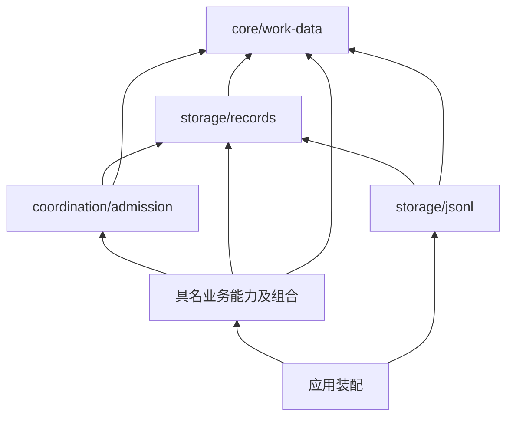

# P0 共享接口实施稿

本稿消费四份开工输入 [scope](scope.md)、[acceptance](acceptance.md)、
[implementation-spec](implementation-spec.md)、[plan](plan.md) 的
`e11cc6990c1354e7baf138cc2f501effc7b413f6` 版本。它固定 P0/P1 的 TS 表达与
`core-journal/1` 实施格式，供独立评审；尚未表示产品实现、验收或正式规格发布。
精确语义仍归下列已接受 v1，不原地修改其 Schema：

- [data.agent-runtime-identity](../../../../spec/data/agent-runtime-identity/v1/contract.md)
  与其 [Schema](../../../../spec/data/agent-runtime-identity/v1/schema.json)。
- [data.core-work](../../../../spec/data/core-work/v1/contract.md) 与其
  [Schema](../../../../spec/data/core-work/v1/schema.json)。
- [capability.durable-records](../../../../spec/capabilities/durable-records/v1/contract.md)
  的 DR-01–05。
- [composition.core-work-coordination](../../../../spec/compositions/core-work-coordination/v1/contract.md)
  的 CC-01–07 及本批适用的 [组合场景](../../../../spec/compositions/core-work-coordination/v1/scenarios.md)。

## 依赖与实现所有者

箭头表示消费公开入口；类型依赖同样计入无环检查。



| 目录 / 包名 | 唯一职责与公开入口 |
|---|---|
| `packages/core/work-data` / `@omne-harness-lite/work-data` | 默认入口导出本页共享 DTO、精确 Schema 验证、无损 JSON 值与规范编码；无运行状态、Cordis 或业务服务依赖 |
| `packages/storage/records` / `@omne-harness-lite/records` | 默认入口导出下述 DR 端口、批次/回执、实施 envelope 校验与 codec；无文件、锁或业务 reducer |
| `packages/coordination/admission` / `@omne-harness-lite/admission` | 默认入口提供同步短门、位置与耐久完成、精确使用的责任登记；不实现权限/预算/Session 的状态转移 |
| `packages/storage/jsonl` / `@omne-harness-lite/jsonl` | 默认目标入口提供真实 writer；现有 `/baseline` 的普通文件行为只按实际迁移消费者保留 |

不新建「transaction」「event bus」「universal state」包。JSON 值与规范编码放
work-data，是因为 Action 精确比较、operation 输入和 records 都要使用同一语义；
物理行和 envelope 的编码归 records。业务事件定义、校验与 reducer 留在各 owner。
本文 TS 块按同一模块可编译；落包时按上表分开，以公开 import 连接。

自有新包使用 `private:true`、`license:"UNLICENSED"`，provenance 为
`format:1`、非空 scope、`files:[]`、完整覆盖 src 的
`project_files:[{path,purpose}]`，省略上游 repository/commit/archive 字段；
不伪造 LICENSE/UPSTREAM 或新增许可授予。DSH 派生包仍保留原 provenance、
MIT 与 UPSTREAM。默认导出是 `".":{types:"./dist/index.d.ts",import:"./dist/index.js"}`；
整合者将新增 Schema 资源列入 files。该元数据沿 P0 checker 的共同输入，
源码来源分类不由各包另造。

## 共享值、完整 DTO 与 Schema 消费

TS 表达是 Schema 的静态投影。`string` 本身不证明非空/来源可信，`number` 本身
不证明整数范围，结构对象不授予操作权；这些在解析或行为边界验证。所有输出
深拷贝并深冻结，拒绝 accessor、原型实例、循环、稀疏数组、symbol、undefined、
函数、bigint 和非有限数；不调用输入的 `toJSON`。普通或 null 原型对象的自有
可枚举数据属性可接纳；不可枚举属性也拒绝，避免隐藏输入被丢弃。

```ts
export type JsonValue = null | boolean | number | string | JsonObject | readonly JsonValue[];
export type JsonObject = { readonly [key: string]: JsonValue };
export type OpaqueId = string;
export type SessionRef = Readonly<{ tenantId: OpaqueId; sessionId: OpaqueId }>;
export type AgentRef = SessionRef & Readonly<{ incarnationId: OpaqueId }>;
export type UserRef = Readonly<{ userId: OpaqueId }>;
export type MembershipRef = Readonly<{ tenantId: OpaqueId; userId: OpaqueId }>;
export type DefinitionRef = Readonly<{ ownerTenantId: OpaqueId; definitionId: OpaqueId }>;
export type DefinitionVersion = Readonly<{ definition: DefinitionRef; version: OpaqueId }>;
export type RunRef = Readonly<{ session: SessionRef; runId: OpaqueId }>;
export type StepRef = Readonly<{ run: RunRef; stepId: OpaqueId }>;
export type WorkRef = Readonly<{ tenantId: OpaqueId; workId: OpaqueId }>;
export type WorkOwner = StepRef | WorkRef;
export type MediaRef = Readonly<{ tenantId: OpaqueId; mediaId: OpaqueId }>;
export type MediaMetadata = Readonly<{
  media: MediaRef; sha256: string; byteLength: number; mimeType: string; filename?: string;
}>;
export type ResourceRef = Readonly<{
  tenantId: OpaqueId; kind: string; resourceId: OpaqueId; version: OpaqueId;
}>;
export type SecretRef = Readonly<{
  kind: "secret_version"; tenantId: OpaqueId; secretId: OpaqueId; version: OpaqueId;
}>;
export type Binding = Readonly<{
  implementationId: OpaqueId; generation: OpaqueId; configurationRevision: OpaqueId;
  environment: ResourceRef; parserVersion: OpaqueId;
}>;
export type Confirmation =
  | Readonly<{ confirmation: "none" | "before_effect"; provisionalContract?: ResourceRef }>
  | Readonly<{ confirmation: "provisional"; provisionalContract: ResourceRef }>;
export type Action = Readonly<{
  tenantId: OpaqueId; callId: OpaqueId; attemptId: OpaqueId; owner: WorkOwner;
  definition: DefinitionVersion; toolKey: OpaqueId; commandKey: OpaqueId;
  declarationVersion: OpaqueId; binding: Binding; params: JsonObject;
  resources: readonly ResourceRef[]; permissions: readonly string[];
  grantorKinds: readonly string[]; impact: string;
}> & Confirmation;
export type CallRef = Readonly<{ owner: WorkOwner; callId: OpaqueId; attemptId: OpaqueId }>;
export type RequestRef = Readonly<{ tenantId: OpaqueId; requestId: OpaqueId }>;
export type Money = Readonly<{ integer: string; scale: number; currency: string }>;
export type OperationRef = Readonly<{
  namespace: OpaqueId; principalId: OpaqueId; operationId: OpaqueId;
}>;
export type Decision = Readonly<{
  request: RequestRef; contentVersion: OpaqueId; outcomeVersion: OpaqueId; actor: UserRef;
}> & (
  | Readonly<{ outcome: "answer"; answer: JsonValue }>
  | Readonly<{ outcome: "approve" | "reject"; answer?: never }>
);
export type TextBlock = Readonly<{ blockId: OpaqueId; kind: "text"; text: string }>;
export type MediaBlock = Readonly<{
  blockId: OpaqueId; kind: "image" | "audio" | "video" | "file"; media: MediaRef;
  delivery: "model_native" | "agent_attachment";
}>;
export type ToolCallBlock = Readonly<{
  blockId: OpaqueId; kind: "tool_call"; call: CallRef; action: Action;
}>;
export type ToolResultBlock = Readonly<{
  blockId: OpaqueId; kind: "tool_result"; call: CallRef;
  outcome: "succeeded" | "failed" | "denied_before_execution" |
    "cancelled_before_execution" | "interrupted" | "unknown";
  value: JsonValue;
}>;
export type DeferredReceiptBlock = Readonly<{
  blockId: OpaqueId; kind: "deferred_receipt"; call: CallRef; request: RequestRef;
  continuationId: OpaqueId; status: "pending";
}>;
export type ContentBlock = TextBlock | MediaBlock | ToolCallBlock | ToolResultBlock | DeferredReceiptBlock;
export type InputBlock = TextBlock | MediaBlock;
export type Input = Readonly<{
  session: SessionRef; inputId: OpaqueId; revision: number; content: readonly InputBlock[];
  busyBehavior: "queue" | "interrupt_then_run"; literal: boolean;
}>;
export type ProtocolVersion = Readonly<{ protocolId: string; version: string }>;
export type BackgroundDeclaration =
  | Readonly<{ mode: "unsupported" }>
  | Readonly<{
      mode: "supported"; executionOwnerProtocol: ProtocolVersion;
      requiredResources: readonly string[]; reconnectProtocol: ProtocolVersion;
      form: "independent_execution";
      automatic?: Readonly<{ thresholdMs: number; stopMarginMs: number }>;
    }>;
export type AuthorizationDeclaration = Readonly<{
  version: string; permissions: readonly string[];
  resourceResolver: Readonly<{ resolverId: string; version: string }>;
  grantorKinds: readonly string[]; impactTemplate: string;
}> & Confirmation;
export type Command = Readonly<{
  commandKey: string; inputSchema: JsonObject | boolean; outputSchema: JsonObject | boolean;
  authorization: AuthorizationDeclaration; effect: "read" | "write" | "external";
  cancellation: "supported" | "unsupported"; background: BackgroundDeclaration;
  requiredSkills: readonly DefinitionVersion[]; environmentCapabilities: readonly string[];
}>;
export type ToolDefinition = Readonly<{
  definition: DefinitionVersion; toolKey: string; commands: readonly Command[];
}>;
export interface DataTypes {
  OpaqueId: OpaqueId; SessionRef: SessionRef; AgentRef: AgentRef; UserRef: UserRef;
  MembershipRef: MembershipRef; DefinitionRef: DefinitionRef; DefinitionVersion: DefinitionVersion;
  RunRef: RunRef; StepRef: StepRef; WorkRef: WorkRef; WorkOwner: WorkOwner;
  MediaRef: MediaRef; MediaMetadata: MediaMetadata; ResourceRef: ResourceRef; SecretRef: SecretRef;
  Binding: Binding; Action: Action; CallRef: CallRef; RequestRef: RequestRef; Money: Money;
  OperationRef: OperationRef; Decision: Decision; Input: Input; ContentBlock: ContentBlock;
  AuthorizationDeclaration: AuthorizationDeclaration; Command: Command;
  ToolDefinition: ToolDefinition; BackgroundDeclaration: BackgroundDeclaration; InputBlock: InputBlock;
}
export type ValidationIssue = Readonly<{
  path: string; code: "invalid_json" | "schema" | "unsupported_number" | "capacity";
  message: string;
}>;
export type Checked<T> =
  | Readonly<{ ok: true; value: T }>
  | Readonly<{ ok: false; issues: readonly ValidationIssue[] }>;
export type JsonLimits = Readonly<{ maxBytes: number; maxDepth: number; maxNodes: number }>;
export declare function parseJson(text: string, limits: JsonLimits): Checked<JsonValue>;
export declare function copyJson(value: unknown, limits: JsonLimits): Checked<JsonValue>;
export declare function parseData<K extends keyof DataTypes>(
  type: K, value: unknown, limits: JsonLimits,
): Checked<DataTypes[K]>;
export declare function canonicalJson(value: JsonValue): string;
export declare function equalJson(a: JsonValue, b: JsonValue): boolean;
```

`DataTypes` 覆盖两个 Schema 的每个 `$defs`（SessionRef 的别名不重新定义）。
顶层 Schema 的 `oneOf` 不是每个命名类型的验证器；`parseData("OperationRef", …)`
解析精确 `#/$defs/OperationRef`。类型不枚举权限/授予者/资源词汇，词汇注册与
当前语义由 AU/TG/TL owner 校验。SecretRef 是可传输值，不允许把秘密原文放入 params。

共享包打包两份**逐字相同**的正式 Schema 资源；构建检查来源路径、SHA-256 和
全部 `$defs` 名称映射，独立 tarball 不依赖仓库根 `spec/`。不另维护改写版 Schema，
不通过 HTTP 解析 `.invalid` 引用。使用 `ajv@8.20.0` 的 draft-2020-12 入口，
先注册两个完整 `$id`，再编译每个精确 `$defs` 引用。关闭 coercion、默认值注入、
删除额外属性和远程加载；`strictSchema=true`、`strictNumbers=true`、
`strictTypes=false`、`strictRequired=false`、`allowUnionTypes=true`、
`ownProperties=true`。后两项 strict 的放宽仅适配正式 Schema 中父级类型/条件
结构，不跳过结构校验或接受未知关键词。配置依据是
[Ajv options](https://ajv.js.org/options) 和
[draft-2020-12 入口](https://ajv.js.org/json-schema.html#draft-2020-12-breaking)。

JSON 文本用 `jsonc-parser@3.3.1` 的 visitor 取得词法位置、对象边界和属性名，
`disallowComments=true`、`allowTrailingComma=false`、`allowEmptyContent=false`，
任何 parse error 都拒绝。每个对象独立保存已见的**解码后**属性名，重复键即拒绝；
构造对象使用 null 原型和数据属性，不让 `__proto__` 成为原型操作。该库本身
允许容错，项目必须检查所有错误并禁止把部分解析当有效值；API 来源见
[官方 README](https://github.com/microsoft/node-jsonc-parser/blob/main/README.md)。

规范编码命名 `core-json/1`：递归按 UTF-16 code unit 顺序排序对象键，数组保序，
字符串使用 JSON 字符串转义，不裁剪、折叠大小写或做 Unicode 归一化；无空白。
数字使用有限 JS number 的 JSON 十进制表达；整数须在安全整数范围，负零拒绝。
文本数字 token 与重新编码后的十进制值必须数学相等（符号/系数/十进制指数比较，
不靠两次 Number 相等）；例如 `1e3` 与 `1000` 等价，
`9007199254740993`、`0.100000000000000005` 不可先舍入后接纳。
这是此 JS 实施支持范围，错误为 `unsupported_number`，不声称正式 Schema
禁止所有更大整数。Money.integer 保持字符串，绝不转 Number。
`canonicalJson` 只接受已通过上述验证的值，遇到无效运行时输入抛具名编程错误；
外部入口先使用 Checked API。摘要仅辅助索引，最终仍比较规范串。

| Schema 的宽边界 | 后续必须消费的额外校验 |
|---|---|
| `Action.params: object` | TL 固定命令的完整 inputSchema；AU 固定 resolver/声明词汇；对象解析及跨 tenant 关系；冻结后执行完全同一值 |
| `tool_result.value: {}` | TL 原调用 outputSchema 与实际终态；错误结果的具名契约；用户不能导入为可信结果 |
| `Decision.answer: {}` | HD 原请求的答复 Schema/选项；本批系统 approve/reject 不开放任意 answer |
| `Command.inputSchema/outputSchema` | TL 在发布前验证 Schema 方言、全部引用可离线解析及支持关键词，编译失败不可发布；不允许网络载入或执行扩展关键词 |
| ID、版本、权限/资源名、Money | 分配权威、不复用、版本资格、词汇当前有效性和精确财务单位由各 owner 负责 |

共享包仍表达完整 ContentBlock/Input/Background/Confirmation v1；本批业务入口
单独拒绝非 text 输入、interrupt_then_run、provisional、background supported 等
未开放操作。不能修改共享类型把后续合法数据变成不存在，也不能因 Schema 接受
就开放本批未实现功能。

## Records 的批次、身份和读取边界

以下是实施数据，归 records，不混入正式 work-data。非空字符串字段须验证；
seq、stream revision 使用十进制非负整数字符串，内部可用 bigint，磁盘不用
JSON number。`"0"` 是空前缀/空 stream，完整提交前缀的 seq 从 1 连续递增。
修复未提交尾部后新 epoch 可占用曾分配但未成立的 seq；完整 Position 与 commitId
不复用，消费者不能仅凭 seq 将旧 pending 票据认作新批次。
一个批次对一个 stream 至多有一个 append，**每个批次令被触及 stream 的修订加 1**，
不是每条事件加 1；记录在 append 内有序，stream 顺序按 canonical StreamRef 排列。

```ts
export type Counter = string; // /^(0|[1-9][0-9]*)$/; never compare lexically
export type Principal =
  | Readonly<{ kind: "user"; user: UserRef }>
  | Readonly<{ kind: "system"; systemId: OpaqueId }>;
export type StreamRef = Readonly<{
  namespace: OpaqueId; owner: OpaqueId;
  scope: Readonly<{ kind: "tenant"; tenantId: OpaqueId }> | Readonly<{ kind: "system" }>;
  streamId: OpaqueId;
}>;
export type Causality = Readonly<{
  parentOperation?: OperationRef; initiator?: Principal; session?: SessionRef; work?: WorkOwner;
  call?: CallRef; request?: RequestRef; agent?: AgentRef;
  definition?: DefinitionVersion; binding?: Binding;
}>;
export type OwnedRecord<Kind extends string = string, Version extends string = string,
  Data extends JsonValue = JsonValue> = Readonly<{
  kind: Kind; version: Version; data: Data;
}>;
export type StreamAppend = Readonly<{
  stream: StreamRef; expectedRevision: Counter; records: readonly OwnedRecord[];
}>;
export type OperationInput = Readonly<{
  format: "core-operation/1"; operationKind: string;
  tenantId: OpaqueId | null; principal: Principal; target: JsonValue;
  arguments: JsonValue; preconditions: JsonValue; causality: Causality;
}>;
export type CommitRequest = Readonly<{
  operation: PreparedOperation;
  appends: readonly StreamAppend[]; result: JsonValue;
}>;
export type Position = Readonly<{
  coordinationDomain: OpaqueId; writerEpoch: Counter; commitId: OpaqueId; seq: Counter;
}>;
export type Watermark = Readonly<{
  coordinationDomain: OpaqueId; seq: Counter; commitId: OpaqueId | null;
}>;
export type Receipt = Readonly<{
  position: Position; operation: OperationRef; inputDigest: string; result: JsonValue;
  streams: readonly Readonly<{ stream: StreamRef; revision: Counter }>[];
}>;
export type CommitEnvelope = Readonly<{
  formatVersion: "core-journal/1"; position: Position; operation: OperationRef;
  inputEncoding: "core-json/1"; canonicalInput: string; inputDigest: string;
  appends: readonly StreamAppend[]; result: JsonValue;
}>;
export type Rejection = Readonly<{
  code: "invalid" | "capacity" | "stale_writer" | "closed" | "wrong_domain" |
    "namespace_denied" | "invalid_owner" | "unsupported_format";
  message: string;
}>;
export type RecordConflict =
  | Readonly<{ kind: "operation_input"; operation: OperationRef }>
  | Readonly<{
      kind: "revision"; currents: readonly Readonly<{ stream: StreamRef; revision: Counter }>[];
    }>;
export type CommitResult =
  | Readonly<{ status: "committed"; receipt: Receipt }>
  | Readonly<{ status: "conflict"; conflict: RecordConflict }>
  | Readonly<{ status: "rejected"; reason: Rejection }>
  | Readonly<{ status: "unavailable"; reason: string }>
  | Readonly<{ status: "unknown"; operation: OperationRef; diagnosticId: OpaqueId }>;
export type Head = Readonly<{
  watermark: Watermark; streams: readonly Readonly<{ stream: StreamRef; revision: Counter }>[];
}>;
export type ReadResult<T> =
  | Readonly<{ status: "read"; value: T }>
  | Readonly<{ status: "not_at_watermark"; available: Watermark }>
  | Readonly<{ status: "rejected"; reason: Rejection }>
  | Readonly<{ status: "unavailable"; reason: string }>;
export type OperationLookup =
  | Readonly<{ status: "committed"; receipt: Receipt; watermark: Watermark }>
  | Readonly<{ status: "pending_durability"; position: Position; watermark: Watermark }>
  | Readonly<{ status: "not_committed"; verifiedThrough: Watermark }>
  | Readonly<{ status: "unknown"; operation: OperationRef; diagnosticId: OpaqueId }>
  | Readonly<{ status: "unavailable"; reason: string }>;
export interface RecordReader {
  readHead(streams: readonly StreamRef[]): Promise<ReadResult<Head>>;
  readRange(query: Readonly<{
    afterSeq: Counter; through: Watermark; limit: number;
  }>): Promise<ReadResult<Readonly<{
    envelopes: readonly CommitEnvelope[]; through: Watermark; nextAfterSeq: Counter; complete: boolean;
  }>>>;
  lookupOperation(operation: OperationRef): Promise<OperationLookup>;
}
declare const preparedOperationBrand: unique symbol;
export type PreparedOperation = Readonly<{
  [preparedOperationBrand]: true; operation: OperationRef; canonicalInput: string;
}>;
declare const preparedCommitBrand: unique symbol;
export type PreparedCommit = Readonly<{
  [preparedCommitBrand]: true; operation: OperationRef; canonicalInput: string;
}>;
export type PendingCommit = Readonly<{
  status: "pending_durability"; position: Position; operation: OperationRef;
  completion: Promise<CommitResult>;
}>;
export type Submission = PendingCommit | CommitResult;
export interface RecordWriter extends RecordReader {
  readonly coordinationDomain: OpaqueId;
  readonly writerEpoch: Counter;
  prepareOperation(operation: OperationRef, input: OperationInput): Checked<PreparedOperation>;
  prepare(request: CommitRequest): Checked<PreparedCommit>;
  lookupPrepared(operation: PreparedOperation): Submission | Readonly<{ status: "not_seen" }>;
  commit(prepared: PreparedCommit): Submission;
  quarantine(diagnosticId: OpaqueId): void;
  closeWriter(): Promise<CloseResult>;
}
export type CloseResult =
  | Readonly<{ status: "closed"; watermark: Watermark }>
  | Readonly<{
      status: "blocked"; watermark: Watermark; diagnosticId: OpaqueId;
      pending: readonly OperationRef[]; lockHeld: boolean;
    }>;
export type AcquireResult =
  | Readonly<{ status: "acquired"; writer: RecordWriter; recovered: Watermark }>
  | Readonly<{ status: "busy" }>
  | Readonly<{ status: "unavailable"; reason: string; diagnosticId: OpaqueId }>;
export interface RecordProvider {
  readonly reader: RecordReader;
  acquireWriter(): Promise<AcquireResult>;
}
export type RecordLimits = CodecLimits & Readonly<{
  maxPendingCommits: number; maxPendingBytes: number;
}>;
export type NamespaceBinding = Readonly<{
  namespace: string; owners: readonly string[]; allowSystemScope: boolean;
}>;
export type JsonlProviderOptions = Readonly<{
  coordinationDomain: OpaqueId; directory: string;
  bindings: readonly NamespaceBinding[]; limits: RecordLimits;
}>;
// Exported by @omne-harness-lite/jsonl, not by records.
export declare function createJsonlProvider(options: JsonlProviderOptions): RecordProvider;
```

prepareOperation 只规范化并冻结原操作身份/输入，不要求当前工具实现或其它
业务资源存在。入口先在门外取得此值，再经短门 lookupPrepared 认回原操作；
只有 not_seen 才准备新的业务后果。这样已提交重试不会因为新版本装载失败而
丢失旧回执。返回旧内容前仍须核对当前读取资格；重新进入提交门时再查一次去重。

`prepare` 是无 I/O 的批次验证、冻结和预编码，在短门外调用。它不占修订/seq、
不读取授权、不开始写。PreparedOperation/PreparedCommit 都是 writer 实际创建的值；
伪造 TS cast、反序列化或其它 writer 创建的值均不能通过运行时身份检查。
最后编码所需的 seq/epoch/commitId 由 writer 在 commit 时填入；大块输入和记录
已在 prepare 编码，门内只做有界元数据组装，不重复解析大内容。

`commit` **同步**返回 Submission；其中 pending 的 completion 才返回 DR-02 的
最终结果。同步段只查去重/修订/状态、分配连续位置、封闭修订并入队；真实 I/O
在退出当前 JS 栈后按序启动，不能在 commit 内调用业务代码或同步写盘。
单独的基础设施消费者可等待 completion；业务应用只从 admission 取得提交入口，
不能持 RecordWriter 绕过当前权威。没有多域事务或通用用户插件 hook。
lookupPrepared 是同一 writer 内同步去重查询，核对对象真实性、operation 与规范
输入，返回原 pending/结果或同键异输入 conflict；not_seen 不代表跨故障的
未提交证明。隔离/关闭时不能返回可继续提交的 not_seen。quarantine 同步关掉新
提交和未启动写泵，保留已在途 I/O 的核实责任；此方法必须无业务回调、幂等，
不能假称撤回已耐久记录。所有 completion 对预期 I/O 故障 resolve 具名结果，
不以未处理的 Promise rejection 丢失操作责任；内部缺陷另有诊断并隔离。

可信 namespace、允许写的 owner/stream scope 由装配给 writer 的写入绑定限定；
这层检查防内部误接，不替代 TG/AU 的用户授权。核心域使用一个部署分配的稳定
namespace（如 `core`），**不以操作名或 tenant 替换去重 namespace**。
principalId 是 `core-json/1` 对 Principal 的规范串，由认证边界/内部系统身份构造；
tenant、目标、操作种类、调用者输入的前置修订和因果关系全部进入 canonicalInput。
因此同一用户同一 operationId 换 tenant/目标/输入会冲突，不能变成另一操作。
operationId 是去重键，不能作为 Principal、Action 或执行许可。

canonicalInput 取上面完整 OperationInput 的规范串，inputDigest 为其 UTF-8
SHA-256 小写十六进制。动态权限查询结果、生成的 commitId/时间/结果/事件不加入
原用户操作输入；已提交的同输入重试先返回原结果，不再生成对象身份或执行事件。
PreparedCommit 中 appends/result 是 owner 固定的拟提交后果，pending 重试也只能
认回第一次内容，不能用相同键替换它们。读取原结果前仍由入口检查当前读取资格。

多 stream 批次须至少有一个 append，每个 records 非空，owner 与 scope 明确，
不重复 StreamRef。tenantId 非 null 的业务操作只能写属于该租户的业务 stream；
需要跨 ownerTenant 的引用保留在数据中，不意味着可以写外租户 stream。
全局个人租户唯一性/自然人和部署初始化的联合关系可使用系统 scope stream，
但只由明确授权的 TG 管理组合列名声明；普通工具调用不因此得到系统写权限。
系统记录同样保存 Principal、操作输入和因果引用，不能借 null 隐藏租户归属。
causality.initiator 与已认证 Principal 分别保留；成员/委托和当前准入依据由相应
owner 的记录保存，不能因为 operation.principalId 相同就省去授权证据。
各 owner 用 `OwnedRecord<自己的 kind, 精确 version, 自己的数据类型>` 定义封闭
联合，调用 records 前用该 owner 的 Schema 和纯不变量检查验证，再在端口处
放宽为 OwnedRecord。records 只检查 envelope/JSON/所有者与修订，不运行任意
事件 validator 回调；恢复时未知 kind/version 由消费 owner 明确拒绝，不用 cast
让 JsonValue 自动变成 Session/批准/预算记录。

readRange 是**受信 owner 的域内原始恢复接口**，返回整份批次，不提供会破坏
原子关系的逐事件分页；应用不能直接暴露给用户。用户历史/池读取由业务 owner
做当前授权后投影。limit 限完整 envelope 数量，单 envelope 容量在准入前检查。
through 是先前 readHead 得到的精确水位；只返回 `afterSeq < seq <= through.seq`，
不存在或不匹配的 commitId/域返回 rejected，已知但尚不可达的水位返回
not_at_watermark。较新的 writer 不把读者水位静默改成最新值。

provider.reader 只读最近被本实例持锁核实/同步的完整前缀，在 writer 关闭后仍可
使用。新实例未能取得锁并确认前缀时读取返回 unavailable，不把看到完整 LF 当
耐久证据；首批不开放多个独立进程之间的实时历史读一致性协议。服务端一个进程
可以持续提供已确认历史，模型不可用不关闭该读面。JsonlProviderOptions 由受信
装配给定；缺失/非法 limits 拒绝建立提供者，无隐含不限量队列。队列容量只限制
在途提交并返回 capacity，不限制已保存人类请求总数或设答复超时。

lookupOperation 的 not_committed 只能来自持锁核实并同步的完整索引及水位；
有待写项为 pending，有未核实损坏/截尾为 unknown，普通索引 miss 不能作未提交
证明。not_committed 只证明该存储操作，不证明外部 attempt 无效果。若旧 writer
仍可追加或独立只读者不能确认当前前缀，返回 unknown/unavailable。

## 同步短门、两份视图与精确使用

本批一个 coordinator 独占一个 writer 的提交能力。业务 owner 保存自己的
immutable logical/durable 根；coordinator 仅保存有序票据、参与 owner 的发布动作
与资源责任，不读取它们的业务字段，也不提供任意 key/value 状态或自动事务回滚。
跨能力组合必须是下列具名关系之一，单 owner 管理变更也经过同一门以建立撤销序。

```ts
export type CompositionKind = "owner_change" | "input_run" | "action_execution" |
  "request_wait" | "answer_consequence" | "budget_call" | "content_media";
export type AdmissionFailure = Readonly<{
  status: "denied" | "conflict" | "unavailable"; owner: string; code: string;
}>;
declare const gateFrameBrand: unique symbol;
export type GateFrame = Readonly<{ [gateFrameBrand]: true }>;
export type OwnerPublication = Readonly<{
  owner: string;
  publishLogical: (position: Position, frame: GateFrame) => void;
  publishDurable: (receipt: Receipt, frame: GateFrame) => void;
}>;
export type UseBinding = Readonly<{
  owner: string; resourceId: OpaqueId; generation: OpaqueId; epoch: OpaqueId;
}>;
export type ReleaseResult =
  | Readonly<{ status: "released" }>
  | Readonly<{ status: "retained"; diagnosticId: OpaqueId }>;
export type ExactUse = Readonly<{
  binding: UseBinding;
  retainAt: (position: Position, frame: GateFrame) => void;
  release: (reason: "not_admitted" | "verified_not_committed" | "settled") => Promise<ReleaseResult>;
}>;
export type PreparedAdmission = Readonly<{
  composition: CompositionKind;
  commit: PreparedCommit;
  publications: readonly OwnerPublication[];
  uses: readonly ExactUse[];
}>;
export type AdmissionCompletion = Exclude<CommitResult, { status: "committed" }> |
  Readonly<{
    status: "committed"; receipt: Receipt; publication: "ready" | "blocked";
    diagnosticId?: OpaqueId;
  }>;
export type PendingAdmission = Readonly<{
  status: "pending_durability"; position: Position; operation: OperationRef;
  completion: Promise<AdmissionCompletion>;
}>;
export type AdmissionResult = PendingAdmission | AdmissionCompletion | AdmissionFailure;
export type CoordinatorStatus = Readonly<{
  phase: "open" | "closing" | "quarantined" | "closed";
  logical: Watermark; durable: Watermark; diagnosticId?: OpaqueId;
}>;
export interface AdmissionCoordinator {
  enter<T>(work: (frame: GateFrame) => T): T;
  lookupPrepared(frame: GateFrame, operation: PreparedOperation): AdmissionResult | Readonly<{ status: "not_seen" }>;
  submit(frame: GateFrame, prepared: PreparedAdmission): AdmissionResult;
  status(): CoordinatorStatus;
  close(): Promise<CloseResult>;
}
export declare function createAdmissionCoordinator(writer: RecordWriter): AdmissionCoordinator;
```

这是**受信内部组合接口**，不交给工具 body、声明 resolver、通知监听器或用户代码。
enter 只调用已绑定的受信组合代码；它拒绝重入和 thenable 返回，frame 退出即失效，
每次 owner 方法/submit 验证 frame 的真实归属与活动性。受信代码不得安排延迟工作
继续使用 frame。TS 无法证明无 await/无副作用，代码审阅和针对 Promise/重入的
运行测试是实现义务；检测违规后隔离域并具名报告，不吞异常当作普通拒绝。

每次准备先在门外完成外部查询、Schema 校验、资源取得、记录/候选根计算与
RecordWriter.prepare。进入门后，具名组合按固定顺序调用 owner 的**同步、纯条件
检查**：认证/租户与硬资格 → 对象修订与去重身份 → 定义/绑定/工作 epoch →
模式/grant/一次决定 → 预算及精确使用可取得性。owner 的精确版本和当前根必须
匹配准备的候选根；不匹配就退出重准备，不在门内做外部读取或运行 resolver。
纯检查不得改变状态；拒绝后按 owner 的审计路径提交具名拒绝结果，无法记录关键
拒绝则返回 audit_unavailable。未完整通过的操作没有逻辑准入位置或效果许可。

所有检查通过后由生命周期 owner 在同一 frame 内同步取得 ExactUse（只是将已准备
资源扣住，不执行 I/O）。使用者立即交给本次 PreparedAdmission；submit 成功前
仍是具名组合的责任。submit 先作 writer 的去重/当前修订判定，只有新 pending
才调用 retainAt 与全部 publishLogical；duplicate 返回原票据/结果而不重复消费
批准、预算或使用。未入队时使用在门外按 not_admitted 实际释放；清理失败保留
owner 的责任记录，不允许假称已释放。

publishLogical/publishDurable 只允许安装已经计算好的不可变根/水位及简单责任
指针；不做用户通知、资源清理、Schema 编译或权限查询。所有 owner 发布在同一
短门内完成，外部读取也经该门读取一致快照，不能观察半批发布。任何 publication
或 retainAt 抛错都是内部缺陷：立刻隔离 coordinator/writer，当前/后续票据按
实际写入分类，禁止效果，保留占位与资源；不能靠通用 undo 猜测回滚。
writer 已 committed 的记录仍返回 committed，附 `publication:"blocked"` 和诊断；
未能核实的记录返回 unknown。不得把已耐久事实因本地发布失败改称未提交。
正常拒绝应发生在纯检查阶段，不能把 throw 作为某一 owner 的 veto 协议。

writer 的入队与 coordinator 安装 logical 根在同一 JS 栈；写泵在栈退出后才能
启动，因此逻辑发布失败可以停止尚未开始的 I/O。队列中的确切位置即逻辑准入点，
对外只显示 pending_durability。writer 耐久 completion 由 coordinator 接收，
依 seq 顺序在另一短门提升全部参与 owner 的 durable 根，然后才完成**coordinator
自己的** completion 并允许通知/后续执行。不得直接把 writer 的 Promise 暴露给
业务，否则可能先收到 committed 却读到尚未安装的业务耐久状态。
只有 publication=ready 才能继续相关效果；blocked 允许认回提交事实，相关业务
读/写入口保持不可用，恢复重新建立根后才开放。查原 pending 时返回 coordinator
同一票据，不能临时包装原 writer Promise 绕过发布步骤。

每个 owner 的根只替换本 owner 在该位置的状态，不覆盖后来 logical 根；例如
耐久前缀推进到 n 时，logical 已在 n+2，不能把 n 的旧快照写回 logical。
owner 保留有序待确认候选根，或用纯 fold 重建对应水位。持锁恢复后先重放完整
耐久前缀，全部业务 owner 成功装载后才能 reopen；缺失/未知事件 owner 可以
阻止相关运行入口，但不能跳过记录后宣称恢复完成。

| 状态/交错 | 可供当前检查的含义 |
|---|---|
| 预算占用、对象修订、Run/批准消费占位已在 logical | 后续位置不能再消费同一余额/对象/决定，即使尚未 fsync |
| grant、成员资格增加、人类答案仅在 logical | 可显示 pending，但不能支持新的执行准入；使用 durable 正向事实 |
| revoke、停用、绑定撤除已在 logical | 立即封闭后续位置；不能因 durable 视图仍旧而允许新调用 |
| 调用 n 已准入，普通撤权 n+1 | n 形成耐久前缀后仍可使用原准入；不再次同义判权。阻止 n 须走精确控制 |
| 某次设置既收紧又放宽不同动作 | 按 owner 的确定语义，当前允许集合是 durable 允许集合与全部 pending 修改允许集合的交集；不能用笼统 revision 新旧推定它只放宽或只收紧 |
| 任一写/同步/发布失败 | 整个域 quarantined，未确认项不能执行；不越过缺口、释放未知预算/使用或自动重新准备 |

正向/负向含义由对应 owner 实现，不给 coordinator 一个“这个事件是 grant”
的全局业务枚举。瞬时失联/计划撤除也要在同一个 enter 短门关掉 owner 的当前
可用性，外部准备的 TTL 事实不能冒充已加入撤销屏障。

ExactUse 保留原 generation/epoch 的**真实资源责任**；普通撤除关新门但不销毁
已持有资源。耐久后，它由原调用/运行 owner 接管，直到原工作实际结算、停止/
隔离或可证明该批次未提交才允许 release。unknown 不释放；settled 必须有原
owner 的终态/安全证据，coordinator 不自行从 Promise resolve 推断。
此运行对象不可持久化；磁盘保存原绑定、attempt 和已准入事实，重启先由所属
owner 核实并重新关联，不从 JSON 复活 ExactUse。

Receipt、Position、Action 和 ExactUse 都不单独成为启动许可。P3/P4 的执行 owner
只接受本进程受约束、绑定原 call/model attempt 与执行 epoch 的许可，并核对已
耐久业务准入记录和自己的接纳/取消墓碑。它们的 start 原子段不能夹入 stop；
普通撤权不改旧准入，精确 stop 可以关掉旧执行许可。这是 TL/MC 实施端口的职责，
P1 不发明一个能从任意已提交记录铸造许可的通用 API。

### 调用顺序实例

下面是组合顺序，owner 函数名由其 P2/P3 接口确定，不是新的公开 API。

```text
门外：writer.prepareOperation(original operation/input)
enter(frame)：当前读取资格 + lookupPrepared；已知结果立即认回
门外：仅 not_seen 才解析 Action、准备候选 owner 根/记录/结果；writer.prepare(batch)
enter(frame)：
  从原 operation 认回已知票据；有结果时走当前读取资格，不生成新后果
  当前 TG/AU/SR/TL/HD/BG 纯检查；核对准备根和精确版本
  同步取得原工具/执行 owner 的 ExactUse
  submit(frame, action_execution + prepared batch + owner publications + uses)
门外：
  未准入 => 释放本次新增临时使用；按真实结果返回
  pending => 呈现 pending_durability；等待 coordinator completion
  committed + publication ready => 原执行 owner 核对墓碑，接纳精确 attempt
  committed + publication blocked => 保留已提交事实，隔离并恢复本地根；禁止效果
  unknown => 保留责任，只查询原 operation/attempt，不换键重发
```

若调用 n 与撤权 n+1 均 pending，writer 依序同步，n 完成时允许启动而所有 n+2
新调用已经被 logical 撤销封闭。若 n 的同步失败，n、n+1 都无 committed 回执，
域隔离；恢复持锁认回完整有效 n/n+1 后，旧 attempt 是否已发出仍由执行 owner
查询。本页不让存储恢复替执行者决定“再执行一次”。

## JSONL codec、writer epoch 和锁

物理行为严格 UTF-8、无 BOM，**一行一个完整 envelope**，每行只有末尾 LF；
CRLF、空行、尾随垃圾或重复键均不接纳。外层仅四字段：

```ts
export type JournalLine = Readonly<{
  formatVersion: "core-journal/1"; payload: string; byteLength: number; sha256: string;
}>;
export type CodecLimits = JsonLimits & Readonly<{ maxLineBytes: number; maxPayloadBytes: number }>;
export type DecodedLine = Readonly<{
  envelope: CommitEnvelope; payload: string; byteLength: number; sha256: string;
}>;
export declare function encodeEnvelope(envelope: CommitEnvelope, limits: CodecLimits): Checked<Uint8Array>;
export declare function decodeLine(completeLine: Uint8Array, limits: CodecLimits): Checked<DecodedLine>;
```

payload 是 canonicalJson(envelope)；外层也是 canonicalJson 后加 LF。
byteLength 和 sha256 针对 payload 字符串实际 UTF-8 字节，先核对再解析；双层
JSON 都用上面的严格 parser，拒绝未知/多余字段和超限。解码必须验证 payload
本身已是规范串、canonicalInput 也是 core-json/1 的规范 OperationInput、摘要
与 Principal/operation.principalId 对应；不能验证一份规范副本后执行另一份原文。
长度是实现限制内的安全整数，seq/epoch/revision 则保留十进制字符串。
UTF-8 有效性、重复键、结构和摘要通过后，再由恢复校验 epoch、seq、commitId
唯一、stream 前置修订/归属与操作键唯一性；codec 的单行成功不等于日志前缀有效。

writer epoch 使用同一 journal 的 records owner 管理批次，不新增需跨文件原子
提交的 epoch sidecar。初始化空 journal 的 epoch 批次是 seq=1；每次持锁恢复
并重新取得 writer 后，读取最后 epoch 值，加一并追加/同步新的 epoch 批次，再
返回 writer。epoch 使用 Counter、从 `"1"` 起，不凭 PID/时间生成或复用。

该批次固定 operation.namespace=`core.writer`、系统 principalId 按上述编码，
operationId=`epoch:<十进制epoch>`；`operationKind="writer.acquire"`、tenantId=null、
target 为 coordinationDomain、arguments 含新 epoch，preconditions 含上一 epoch。
append 指向 `{namespace:"core.writer",owner:"durable-records",scope:{kind:"system"},
streamId:"writer-epochs"}`，记录 kind=`writer.epoch`、version=`"1"`、
data=`{epoch:<字符串>}`，result 同样含 epoch。前置 stream 修订按一般规则加一。
所有普通批次必须属于最近一次已出现的 epoch，epoch 批次必须严格加一，恢复
时不接受普通写入伪造 epoch 事件。`core.writer` namespace 和该 stream 仅 provider
可写。首次失败而未获 writer 的 acquire 不产生可外传 epoch；完整未回执 epoch
批次在恢复认回后继续加一，决不回退覆盖。

writer epoch 和运行/执行 epoch 不同：前者隔离文件写入权，后者由 AR/SR/TL/MC
权威分配。核心数据的 incarnationId 同样不拿此计数替代。

锁端口只在 jsonl 内部实现与故障夹具之间使用，不成为业务包依赖：

```ts
export interface DomainLock {
  release(): Promise<Readonly<{ status: "released" }> | Readonly<{
    status: "failed"; diagnosticId: OpaqueId;
  }>>;
}
export interface DomainLockProvider {
  tryAcquire(): Promise<Readonly<{ status: "acquired"; lock: DomainLock }> |
    Readonly<{ status: "busy" }> | Readonly<{ status: "unavailable"; reason: string }>>;
}
```

tryAcquire 绑定部署预先打开/核对的固定域目录和稳定锁文件 inode，不接受用户
任意路径；真实进程内也登记 owner，防同进程误建两份 writer。锁在读取/修尾/
epoch 同步/普通提交/关闭排空期间连续持有。锁文件不删除或替换，暂停进程
不能按超时被偷锁；OS 进程死亡释放文件描述符后其它进程才可能获得。
实际 flock 绑定版本、构建、Linux/FS 与暂停/死亡证据由独立 P0 原生探针提供，
本文没有以接口声明代替该证据。

提供者串行写，处理短 write 直至完整行，文件 sync 及首次创建文件/目录必要
sync 完成后才提升 durable 水位。为区分局部失败，测试故障点至少包含写前、
部分字节、完整 LF 后、file sync 前/后、目录 sync 前/后、回执前。
任何 I/O 失败立即隔离域；即使后续位置还未 write，也不越过它继续执行。
明确未开始写的排队项可在诊断中保留 not_started，但对外完成不能用此推断所有
相关资源可释放；先完成同域未核实前缀和业务责任核对。

恢复在持锁下扫描**连续**前缀，未结束 LF 的最后字节片段才是可修尾部。
先将故障原件复制到新 evidence 文件、sync 文件与目录，核对已保存内容，再截回
最后完整行边界并 sync；保全/截回/同步失败均停止恢复。完整 LF 行哪怕只有一个
坏字节也不截掉；中间断序、摘要错、未知版本、完整无效 epoch 均拒绝写恢复。
完整有效但未回执的所有批次重新 sync 后成为已提交，lookup 返回原 Receipt。
恢复期间崩溃时保全文件不覆盖；下一次从仍存在的 journal 重复核对，不根据文件名
或“上次开始修复”标志直接宣称修尾成功。

closeWriter 同步先封闭新提交，异步排空和同步，再释放锁；同一次关闭重试认回
同一责任。失败返回 blocked 与 pending/lockHeld 真实状态，不谎报 closed；
锁释放失败则继续登记 owner。旧 PreparedCommit/RecordWriter 通过实例身份和
已关闭 epoch 状态拒绝。故障后读者可以读已确认完整历史，无法确认的范围具名
拒绝；读可用不表示可以接管执行。未知数据禁止自动迁移或重新建空文件。

### 黄金样例与反例

正式 records 作者建立以下固定夹具，字段顺序/字节/摘要由实现测试逐项核对，
不是只拿 encode 的输出再喂 decode 自证。G01 已由隔离 P0 生成器计算，下面是
完整外层**字面量**（末尾另有一个 LF）。实现直接将其保存为 fixture，测试不能
调用自己的 encode 动态更新期望值。

```json
{"byteLength":906,"formatVersion":"core-journal/1","payload":"{\"appends\":[{\"expectedRevision\":\"0\",\"records\":[{\"data\":{\"epoch\":\"1\"},\"kind\":\"writer.epoch\",\"version\":\"1\"}],\"stream\":{\"namespace\":\"core.writer\",\"owner\":\"durable-records\",\"scope\":{\"kind\":\"system\"},\"streamId\":\"writer-epochs\"}}],\"canonicalInput\":\"{\\\"arguments\\\":{\\\"epoch\\\":\\\"1\\\"},\\\"causality\\\":{},\\\"format\\\":\\\"core-operation/1\\\",\\\"operationKind\\\":\\\"writer.acquire\\\",\\\"preconditions\\\":{\\\"previousEpoch\\\":\\\"0\\\"},\\\"principal\\\":{\\\"kind\\\":\\\"system\\\",\\\"systemId\\\":\\\"local-host\\\"},\\\"target\\\":\\\"domain-1\\\",\\\"tenantId\\\":null}\",\"formatVersion\":\"core-journal/1\",\"inputDigest\":\"0479c584729c1c75fff3736735fd2ebcb1648fb6a1b962e30a0e96ea209b923e\",\"inputEncoding\":\"core-json/1\",\"operation\":{\"namespace\":\"core.writer\",\"operationId\":\"epoch:1\",\"principalId\":\"{\\\"kind\\\":\\\"system\\\",\\\"systemId\\\":\\\"local-host\\\"}\"},\"position\":{\"commitId\":\"commit-1\",\"coordinationDomain\":\"domain-1\",\"seq\":\"1\",\"writerEpoch\":\"1\"},\"result\":{\"epoch\":\"1\"}}","sha256":"8ef36ad938cd8123baf4ec87fba60be5d5ec5ba72da404fa604d69f01f4688d8"}
```

该样例的 OperationInput 是：

```json
{"format":"core-operation/1","operationKind":"writer.acquire","tenantId":null,"principal":{"kind":"system","systemId":"local-host"},"target":"domain-1","arguments":{"epoch":"1"},"preconditions":{"previousEpoch":"0"},"causality":{}}
```

| 固定样例 | 要保护的差异 |
|---|---|
| G01 epoch:1；G02 epoch:2 及其前后普通批次 | epoch 是耐久权利记录；崩溃认回无回执完整行后递增；没有普通批次冒充 acquire |
| G03 两个 tenant stream 的 owner-change（同一租户、不同 owner） | 一批多个 append，修订各加一；输入与输出结果完整保留；单 stream 失败整批不成立 |
| G04 `{"b":2,"a":"中\\n文"}` 与重排键形式 | 两份规范输入相等、UTF-8 字节长度与 JS string.length 不混用 |
| G05 `false` / `null` / 字段缺失 / 空数组 | 不隐式清除设置、不吞空值、不排序数组 |
| G06 `{"a":1,"\u0061":2}`、嵌套重复键、两个 payload 键 | 先词法拒绝，不能采用 last-key-wins 后再验摘要 |
| G07 不安全整数、非精确数、-0、稀疏数组、undefined、getter、toJSON | 不通过数字舍入/隐式序列化改变输入；指明非法值或实施不支持 |
| G08 同完整批次删最后 LF / 改中间字节并保留 LF | 前者可保全修尾，后者完整坏行拒绝恢复；不能把任意 parse error 当断尾 |
| G09 同 operation 同输入但替换拟提交 result；异输入同摘要的受控夹具 | 返回原结果；规范输入异值仍冲突，不仅看 digest；不重建 Run/重复执行 |

G01 的 payload 为 906 UTF-8 字节，完整物理行为 1235 字节；含 LF 的物理行
SHA-256 为 `e2c6b07b93cc7c5891141d96ccdc12fa5a96a0ca0b5f007ea93666811b022af5`。
G03 不涉及跨租户原子写授权；跨 tenant 的写要先被明确组合范围拒绝。
G02–G09 的正式固定输入/期望由 records/测量作者在本稿评审固定后落实，并在
P2/P3 消费前提供实际 codec round-trip 与反例证据。

## 分工、TDD 测量与进入消费者的门槛

| 次序 / 归属 | 输入与应先得到的 RED | GREEN 与证据范围 |
|---|---|---|
| P0 work-data 作者 | 本页全部 DTO/Schema 映射；多余键/嵌套 tenant 数据不等于授权；宽对象、数值精度、重复键、不可变快照 | TS 公开消费者与两份 Schema 一致，严格 JSON 黄金值；正式 Schema 哈希与 tarball 中资源核对。结构通过不宣称 A01/A10/A14 完成 |
| P0 records 作者 | 本页 envelope/ports/codec；字面量 G01–G09、非法 shape/seq/修订/owner；两 stream 及固定回执 | codec 独立黄金 round-trip、跨包可编译、完整字节证据；不是 DR 耐久实现验收 |
| P0 原生探针作者 | 独立既定任务，真实锁竞争/暂停/死亡/释放及 Node 构建 | 明确锁定 native 发行物、OS/FS/构建命令与实际证据；mock 不能放行 P1 writer |
| P1 jsonl 作者 | 已固定 records 产物与 native 证据；A05/A06/A07 的去重/冲突/断点/恢复 RED | 真实磁盘和两进程，完整前缀/水位/unknown/关闭，不能将 codec 通过当 fsync 通过 |
| P1 admission 作者 | 已固定 data/records；A08 的 n/n+1、pending grant、预算/决定双消费、publication 失败 RED | 单门/双视图、真实 records 组合、使用清理与隔离；不写 TG/AU/BG 业务规则替身进产品 |
| P1 独立组合验证作者 | 原 writer/admission 真产物；fsync 阻塞/失败、关闭重入、旧 frame/旧 writer/异 owner 伪造值 | A05–08/A30/A31 的联合证据；P2 前接口和文档对账到实际 commit |

同步门测试还需覆盖：返回 Promise 不能形成有效提交、通知重入只发生在门外、
prepare 与 enter 间撤权导致拒绝、门内已排位的同键重试不二次扣款/占位、
某 owner durable 发布失败后 committed 标明 publication blocked 且禁止效果、unknown 使用
仍有 owner、settled 清理失败不释放贡献。约束替身保留真实修订/去重/不越缺口
条件；真正 writer/恢复与资源清理结果必须在组合层交叉验证。

coordinator.close 先同步关新准入，等待已排位票据的记录结论与 owner durable
发布，再完成 writer 的排空/同步/释放；它不能直接转发 writer.closeWriter 而
遗漏自身待发布责任。已移交执行 owner 的在途效果由应用关闭协议先停止/结算或
明确隔离，不能先释放日志再让效果写回终态；人类待办保留耐久事实，不等待用户
回答才允许关闭。关闭失败仍有具名 owner/操作/资源与可诊断结果。

P0 是共享边界的可消费起点；其通过不代表完整 A05–08，更不代表 A01–32 全部通过。
根 workspace、锁文件、原检查器/包索引和工作包状态由整合者维护；作者只按派发
写各自成员与证据，不以临时 alias、手抄相同 DTO 或源码路径 import 解开并行依赖。
本稿形成后由主调度安排独立只读评审；有阻断项先修订本稿，固定接口提交后再
并行派发产品实现。业务事件 kind/version/schema 与具体组合在相应 P2/P3/P4 任务
开工前由其 owner 固定；P1 不预造整个系统的事件目录。

## 本稿的实际检查与待审范围

隔离探针位于本 spoke 的 `tmp/p0-interfaces/`，未进入产品包。实际 Node 为
`v24.18.0`；以 `npm install --ignore-scripts --no-audit --no-fund` 安装精确
ajv 8.20.0、jsonc-parser 3.3.1、TypeScript 6.0.3，包锁保留在该临时目录。
`node probe.mjs` 已编译两个原 Schema 的 30 个 `$defs` 引用，核对 DataTypes
覆盖去重后的 29 个定义；执行 5 个 parser 条件和 2 个 OperationRef 有效/无效
条件，并生成上述 G01 字面量。`tsc --strict --target ES2024 --module NodeNext
--moduleResolution NodeNext --noEmit interfaces.ts` 对抽取的全部 TS 声明通过。
这仅是 Schema/API/样例可行性证据，不是完整严格 JSON 实现、业务状态转移、
TDD 产品交付、native 构建或耐久性验证。

`make docs-check BASELINE=e11cc69` 通过 393 个 Markdown 文档及其关联检查，
`git diff --check` 通过。Python 环境/安装缓存和探针输出均放本任务允许的 tmp，
没有修改产品源码、根依赖或正式冻结文件。检查日志为 `docs-check.log`、
`probe-result.json`、`tsc-result.log`；清理 spoke 前由整合者按交付证据要求保全。

独立评审重点是：受信 owner publications 是否足够约束半发布/未知；同步排位
与去重、双视图/普通撤权和精确控制是否吻合 CC；epoch/尾部恢复是否保护 DR；
共享 DTO/宽对象与完整业务校验是否明确，且本接口没有把业务状态集中到核心。
所有 P1 真实 writer/联合准入验收仍未执行，native 探针版本事实等待其独立交付。
