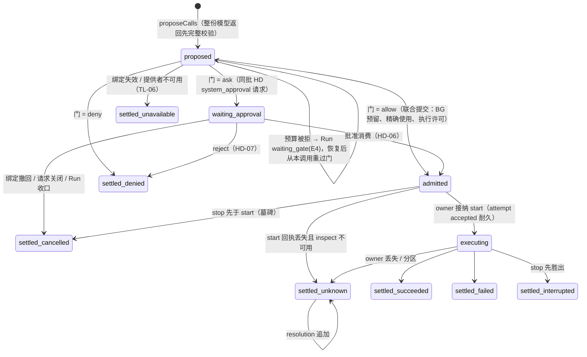

# 调用生命周期：五维状态机、转移、级联与恢复

[提案索引](README.md) · [不变式](invariants.md) · [需求](requirements.md)

本文件是工具调用状态机的候选正文：它不改写
[tools v1](../../../spec/capabilities/tools/v1/contract.md) 已定义的状态与声明，而是把散在
TL-07～12、[run-driver v2 RD-09～16](../../../spec/capabilities/run-driver/v2/contract.md)、
[session v1 SE-12～17](../../../spec/capabilities/session/v1/contract.md)、
[human-decisions v1](../../../spec/capabilities/human-decisions/v1/contract.md) 与
[生命周期组合 LC-04](../../../spec/compositions/session-run-agent-lifecycles/v1/contract.md)
里的调用行为放到一台可检查的机器上。接受后：新增的视图值与措辞进各契约下一版
（[缺口表](#契约措辞缺口表)），转移表进 [tools 提供者设计](../../../packages/tools/tools/design.md)，
attempt 账本与停止事实进 [local-execution 设计](../../../packages/tools/local-execution/design.md)。

## 五个正交维度

[runtime 草案](../tool-system/v1/runtime.md)提出"调用进展 / 等待关系 / 控制与效果"三维度；
对齐 D-014 之后，实际要分别记录、各有 owner 与流的是五个。把它们塞进一个枚举正是
[级联备忘](../tool-system/v1/session-run-cascade-memo.md)点名要避免的。

| 维度 | 状态集合 | owner / 流 | 依据 |
|---|---|---|---|
| A 调用进展 | `proposed → waiting_approval → admitted → executing → settled{succeeded, failed, denied_before_execution, cancelled_before_execution, unavailable, interrupted, unknown}`；`unavailable` 只在执行前（绑定失效、提供者或门不可用，不消耗 attempt，[缺口表](#契约措辞缺口表)）；`unknown` 之后只追加 `resolution`，不重写 | tools 包 / `tools(call)` | TL-07、RD-09 |
| B attempt 账本 | `absence → accepted → dispatch_intent → terminal`；`StopFence` 可在任一点建立（含 absence），与 start 在同一账本排序 | 执行 owner / `execution(ExecutionRef)` | TL-08；[LE 设计](../../../packages/tools/local-execution/design.md) |
| C 等待关系 | `foreground → detach_in_flight → detached_background`；或 `background_from_start`；`human_wait`（仅 `human` 调用）；终态后关系消失。权威是 Run 的[等待登记簿](#等待登记簿)，本维度是登记簿在调用上的投影 | Run 记登记与注销；tools 包投影关系视图 | TL-10、RD-09/14、U-41、U-59 |
| D 控制 | `none → stop_requested → stop_progressed{quiescent \| isolated \| unknown}`；与终态竞争按真实先后 | tools 包记意图；执行 owner 记物理事实 | TL-09 |
| E 结算交付 | `terminal → settling（arrival 已受理未裁决）→ settled 视图（continuation \| queue \| context \| closed）→ consumed` | Inbound（Session 包） | SE-12/14/17、RD-09 |

驱动器的"结算视图"（RD-09 封闭词表）是五维的派生投影，不是第六份状态。

## 等待登记簿

用户 2026-09-15 提议（[U-59](README.md#裁决记录2026-09-14用户)）：Run 有明确的等待状态，
需要 Run 等它的对象自己在 Run 上登记，办完注销。作者采纳：原来"Run 在等谁"散在三条推导
规则里（调用的等待关系、未答请求、正在等的门），入站裁决要各算一遍；合成一个对象后，
成员规则、路由、唤醒、控制级联都变成对登记簿的操作。

| 项 | 定义 |
|---|---|
| 登记项 `WaitClaim` | `{holder: CallRef \| GateRef, kind: call \| gate, since: StepRef \| null, ret?}`；一个 holder 至多一条开放登记；`since` 是登记时的当前 Step（首个 Step 前的依赖门为 null）；`ret` 只有门有，等于已耐久的 `run.gate.awaited.gateRet`（RD-11） |
| 事实 | `run.wait.claimed{holder, kind, since}` 与 `run.wait.released{holder, outcome}`，`outcome ∈ settled \| detached \| passed \| superseded \| failed \| cancelled`；登记与 holder 自己的耐久登记同一提交，注销与释放它的那条事实同一提交（[LC-03](../../../spec/compositions/session-run-agent-lifecycles/v1/contract.md) 形状 2；时点见下）；执行 owner 跨协调域时改走提交后反应（决定 b 留的边界，[未决项](README.md#未决项)） |
| 谁能登记 | 只有本 Run 提议并耐久登记的调用，和它进入的门。人类请求不是独立登记项：每个请求都附属于一个调用——系统审批附属于等审批的那个调用，问题与 Agent 发起的批准附属于 `human` 调用（U-44）——答复经该调用的准入或结算进入，一次等待只有一条登记（架构复核 A-1）。串行门是 Step 内的派发顺序、Yield 是 epoch 交接，都不登记。不接受任意对象，登记不是公开端口 |
| 登记与注销时点 | 调用：`tools.call.proposed` 同批登记（提议起 Run 就在等它：等门、等审批、等执行都算）；注销恰在下列之一——其结算 arrival 被裁决为 continuation 的提交（`settled`）、detach 确认或启动即后台的准入（`detached`）、Run 终态（`superseded \| failed \| cancelled`）。门：`run.gate.awaited` 同批登记，放行注销（`passed`）。结算已受理、尚未裁决的窗口（[SE-18](../../../spec/capabilities/session/v1/contract.md) 两次提交）里登记仍开放："Run 在等它"直到裁决说这是接续为止 |
| Run 的等待状态 | Step 收束后登记簿非空 ⇒ `waiting`；"等人 / 等工具 / 等门"是登记项的投影（run 下一版把 waiting_human / waiting_gate 收成 `waitingFor` 投影，不再是独立状态）。Step 收束 = 本 Step 的 attempt 已结算且提议已耐久登记（[作者裁决 9](README.md#第二轮作者裁决2026-09-15架构复核后)：RD-10 下一版把"阻止收束的视图"改为开下一 Step 的合批规则，前台调用执行期间 Step 已收束、Run 在 `waiting`） |
| 入站裁决 | 到达的结算的 holder 在其**发起 Run** 上有开放登记 ⇒ 对该 Run 是 continuation，同一提交注销（`settled`）；发起 Run 处于 interrupted 时 continuation 保留到 resume 消费（[A7](#interrupt中断之后可-resume)）。无开放登记 ⇒ Session 有活动 Run 则 context，否则 queue；Session 归档 ⇒ closed。判定对象是 refs 指向的发起 Run（[SE-14](../../../spec/capabilities/session/v1/contract.md) 原文），不是"当前活动 Run"；A 列改成一次查表 |
| 唤醒 | 任何注销都是驱动器的唤醒源（RD-11 出边的统一表述）；排队用户文本取入（[作者裁决 7](README.md#作者裁决2026-09-15按用户工作风格)）不注销任何登记，只在等待中开一步 |
| 控制级联 | interrupt：登记簿保留，收口只要求每个停止请求都有物理事实（含 unknown）；interrupt_then_run：整簿注销（`superseded`）且旧 Run 进终态 `superseded`，unknown 同样计入收口（[作者裁决 10](README.md#第二轮作者裁决2026-09-15架构复核后)），holder 的工作按 U-43 继续；不可恢复失败：整簿注销（`failed`），同上；cancel / force_stop：整簿注销（`cancelled`），holder 按 TL-11 停止；Yield 与归档不改登记簿 |
| 维度 C 的地位 | 调用上的等待关系是登记簿的投影：有开放登记 = foreground 或 human_wait（未过门时为 none），登记保持且 detach 已请求 = detach_in_flight，无登记 = background。一份权威，两处呈现 |
| 界面 | "正在等：…"直接列登记项，不再推导 |
| 证据 | [ToolCall 模型](evidence/README.md)的 `rel` 字段即登记簿的按调用投影：`Claimed(c)`（`rel ∈ {none, foreground, detach_in_flight, human_wait}`）= 该调用有开放登记，`Route` 的 A 列 = "holder 有开放登记且发起 Run 活动"，`RunInterruptThenRun` 把全部 `rel` 置为 background = 整簿注销；模型把结算与裁决相邻建模，不区分受理未裁决的窗口；门不建模（[抽象与边界](evidence/README.md#抽象与边界)） |

受影响契约（都已在[缺口表](#契约措辞缺口表)）：run 下一版（登记簿字段与事实、`waiting`
收敛、终态 `superseded`）、run-driver 下一版（Step 收束与合批规则、唤醒集合 = 注销）、
session 下一版（A 列查表）、tools 下一版（关系为投影）、human-decisions 下一版（请求附属于
调用、答复按登记簿路由）。

## 维度 A 的状态图

六种 `settled_*` 都进入维度 E 的 `settling`，直到 arrival 被裁决。

## 转移表

事件 kind 三段式（[U-33](../session-run-agent-lifecycles/README.md#裁决记录2026-09-14用户)），
每条带 `eventId`、`(stream, seq)`、`operationId`（U-34）；结算 arrival 的来源级 dedupKey 固定为
`(call, attempt)`。现有 tools 设计的两段名（`call_terminal`、`result_delivery_changed` 等）按此
重命名。

| 转移 | 触发者 | 提交面（门外 prepare / 门内 check） | 同批伙伴与记录 | 依据 |
|---|---|---|---|---|
| → proposed | 驱动器 ProposeCalls | `omneTools.proposeCalls` + `omneRun.prepareCalls{propose}` | `tools.call.proposed` + `run.calls.proposed`；整份返回不合法则 `invalid_proposal` 收口 Step，不执行任何一项 | TL-07、RD-08/09 |
| proposed → admitted | 驱动器（门 = allow） | `omneTools.adjudicateCall` + AU allow + BG reserve + `omneRun.prepareCalls{admit}` + AR pinWork | `tools.call.admitted` + `run.call.admitted` + BG reservation + AU 审计；TL-13 守卫在此只能把 allow 收紧 | TL-07/13、BG-03、RD-09 |
| proposed → waiting_approval | 驱动器（门 = ask） | 同上 + `omneHD.prepareSystemRequest` | `tools.call.waiting` + `hd.request.created` + Run 等待位置 | TL-07、HD-03 |
| proposed 停留（预算被拒） | 驱动器 | BG reserve 拒绝 | 不产生 attempt；Run `waiting_gate(kind=budget, ret=E4)`；恢复后从本调用重过门 | RD-09/12、BG-03 |
| waiting_approval → admitted | 驱动器 AdmitApproved | `omneRun.prepareConsumeDecision` + HD 消费 + BG + 执行许可 | `run.approval.consumed`（引用被消费 answer 的 eventId）+ `tools.call.admitted` | HD-06、RD-11 |
| waiting_approval → settled | HD reject / TL-06 绑定撤回 / Run 收口 | HD-07 或 tools 的关闭片段 | `tools.call.settled{denied_before_execution \| cancelled_before_execution}` + `hd.request.*` 关闭 | HD-07、TL-06、RD-13 |
| admitted → executing | 执行 owner `start(attempt, permit, binding)` | owner 自己的短门：核 permit、绑定、执行 epoch、墓碑、去重 | `execution.attempt.accepted`；真实 I/O 前 `execution.attempt.dispatch_intent` + BG 暴露交付意图 | TL-08、LE 设计 |
| executing → settled | 执行 owner terminal；组合者是该 owner 的 `ToolExecutionLink`（[cordis.md](cordis.md#插件与服务依赖)） | owner 账本 terminal + `omneToolState.prepareTerminal/checkTerminal` + `omneSession.accept{source: call_settlement}` 组成一个提交 | `execution.attempt.terminal` + `tools.call.settled{outcome}` + `inbound.arrival.accepted{call_settlement, dedupKey}`；同域同批，跨域沿 CC-05 | TL-07、SE-12、RN-09 |
| settling → settled 视图 | 裁决者 | Inbound 短提交（[Session 设计 §7.3](../../../packages/session/session/design.md#73-意图路由裁决者算法)） | `inbound.arrival.classified{...}` | SE-14/18 |
| 任一 → stop_requested | 用户 `stopCall` / Run 收口 | `omneTools.stopCall` → owner `requestStop` | `tools.control.requested` + `execution.stop.fenced`；先于 start 也建墓碑 | TL-08/09 |
| stop_requested → stop_progressed | 执行 owner | owner 物理事实 | `execution.stop.progressed{physical, isolation, cleanup, effect}` → `tools.control.progressed` | TL-09 |
| foreground → detach_in_flight → detached_background | 用户 detach / 自动阈值 / interrupt_then_run | `omneTools.detachCall` → owner `detach(attempt)` | `tools.relation.detach_requested` / `tools.relation.detached`；owner 确认不再依赖 Agent 临时资源 | TL-10、RD-09/13 |
| 迟到事实 | 旧执行者 | `omneRun.recordLateFact` | `run.late_fact.recorded`；隔离证据，不复活工作 | TL-09、RD-13 |

`unknown` 的后续核实只追加 `tools.call.resolved`，保留原 unknown（TL-07）。终态与 detach
竞争：终态先到则按当时的关系结算、detach 请求作废（TL-10"完成与 detach 竞争按原实际结果
回答"）；detach 确认先到则按后台关系结算，结果按[迟到结果](#占位与迟到结果的投影)进入模型。

## 内建人类请求工具

PF-005 的 Agent 发起请求在 RD-02 的意图联合里没有独立意图，模型表达提问只能经
ProposeCalls，所以它是一次工具调用：多命令工具 `human`，恰好两条命令 `ask_user`
（kind = question）与 `request_approval`（kind = agent_approval），没有第三条（用户裁决
[U-44](README.md#裁决记录2026-09-14用户)；omne-next `omne_harness` 的
`design_docs/interfaces/hitl-agent-request-tools-contract.md` 同样只定义这两个工具，其参数、
返回值与回复模板是 human-tool 设计的起点）。执行 owner 是 HD 提供者。用户裁决（U-41）：
答复是该调用的返回值；U-44 进一步明确：问题与批准请求的答复本质上就是用户的提示词，只是
以工具调用结果（ToolMessage）的形式呈现给 Agent，Agent 发起的批准是上下文提示、不是系统
机制，真正的系统机制是系统发起的 HITL（TL-07 ask 门 → HD system_approval）。能力授权申请
（PF-005.C3）不是第三条命令：Agent 用 `ask_user` 表达需要，授予本身走系统发起的专属同意流程。

参照 DSH `c291e79` 的 `dsh-tool-ask-user` / `dsh-user-questions`（工具体内 `await ask()`，答案作
普通工具结果返回；等待是进程内 Promise，崩溃后 `interruptedTurnClosers` 合成错误结果）：
拿它的问题/选项/意图/答案词汇、工具 Schema 与客户端卡片；等待机制换成下面这条路径。

| 步骤 | 内容 | 依据 |
|---|---|---|
| 1 提议与准入 | `human ask_user` / `human request_approval` 经 ProposeCalls 提议；门为 allow（问人不需要批准）；联合提交里 HD 作为执行 owner `start` = 耐久创建请求并把 continuation 绑定到该调用位置；BG 来源为零费用 | HD-01/03、TL-07、PF-005.C4/C5 |
| 2 等待 | 调用视图为 `waiting_human`：与 RD-09 的 `waiting_approval` 同列——不阻止 Step 收束，需要开 Step 时以 deferred_receipt 占位（[占位规则](#占位与迟到结果的投影)）；Step 收束后无新内容则 Run 进入 waiting_human；RD-14 的 Yield 前提不含该视图，等人期间实例可退役 | RD-09/10/11/14、HD-03 |
| 3 答复 | `HD.answer` 在同一提交里记唯一决定、把调用结算为 `succeeded{answer}`、受理结算 arrival；裁决为 continuation → 重取或开 Step；该 tool_use 尚未占位则其 tool_result 即答复，已占位则答复以 `system_reminder{human_answer}` 进入到达的 Step，两者恰居其一 | HD-02/05/08、SE-14 |
| 4 控制 | interrupt 保留请求并加全 Run 阻塞（HD-04 / RN-04"独立问题保留原 Run"），须显式 resume；interrupt_then_run 保留请求，但该调用的登记随旧 Run 整簿注销、旧 Run 进终态 `superseded`，答复按[登记簿](#等待登记簿)对当时的活动 Run 路由（[作者裁决 3](README.md#作者裁决2026-09-15按用户工作风格)，[B4](#interrupt_then_run中断后立刻接新输入)）；Run 不可恢复失败也保留请求（U-43：Run 与调用生命周期错位，答复到达按 SE-14 C 列触发新 Run 接上）；cancel / force_stop 同提交关闭请求并结算 `cancelled_before_execution`；用户对该调用单次 `stopCall` 即撤回问题，处置同 cancel；迟到答复按 HD-02 返回当前结果，不生成 arrival | HD-04、RN-03/04、SE-14 human_answer 行 |
| 5 崩溃 | 调用（proposed/admitted）与请求（HD-03）都耐久；重启后 RD-04 四步取得驱动，答复照常路由 | RD-16 |

两条命令的差异：

| 命令 | 答复的去向 | 附加义务 |
|---|---|---|
| `ask_user` | 答复内容作为 tool_result | 选项标签即答案值；`custom` 覆盖单选；批量问题按 id 回填 |
| `request_approval` | 决定（approve / reject / comment）作为 tool_result，本质是用户提示词：告诉 Agent 用户对拟执行动作的态度 | 不产生任何可被系统门消费的决定、不建立 standing permission（omne-next HT-6 同）；之后真正执行的动作照常过 TL-07 门，需要人类确认的仍由系统发起 system_approval；PF-005.C10 的可追溯由答复耐久在历史里给出，"越界重新请求"是 Agent 的提示纪律，系统不比对目标 |

不纳入首版：任意工具体在执行中途 `interrupt()` 再回到断点。执行 owner 不保存调用栈，
LangGraph 式恢复要求中断点之前无副作用，与 TL-08 叠加后可用面很窄；需要中途问人的
工具拆成两次调用由模型编排。将来若有真实场景，作为声明能力 `resumable: replay` 另开。

## 占位与迟到结果的投影

业务逻辑（用户 2026-09-14 明确）：一个调用切到后台后，Agent 是继续推进还是停下来等，
由它自己决策；决策要有上下文，这个上下文就是一条占位的工具消息，让它知道调用已转后台、
完成后会有通知。omne-next `omne_harness` 的
`design_docs/interfaces/tool-result-retrieval-and-detachment-contract.md` 已有同一逻辑的三类
合成消息（离场占位 ToolMessage、转储信封 ToolMessage、`human` 角色加 `<system_reminder>`
的完成通知）与取回工具，本节以它为起点。

模型只在 Step 边界看到调用；一个调用离开前台（转后台、启动即后台、等审批、等人、暂行
staging）后，下一 Step 必须让模型知道"这个 tool_use 还没有结果"，之后结果才能以别的形态
回来。[RD-09](../../../spec/capabilities/run-driver/v2/contract.md) 已定占位形态；
[RD-10](../../../spec/capabilities/run-driver/v2/contract.md)"只有 deferred_receipt 而没有可喂给
模型的新内容时不开 Step"与上述业务逻辑冲突：占位的**首次**呈现本身就是要喂给模型的新
内容，否则模型没有机会决策。本节把它改为"首次呈现开 Step，重复呈现不开 Step"，并补迟到
结果的形态（决定 ac）；两处都进[缺口表](#契约措辞缺口表)。

| 模型的决策 | 系统的对应 |
|---|---|
| 继续推进（发起别的调用或输出） | Run 照常；后台调用的结果到达时按 SE-14 进入（同一 Run 未结束 → context，下一 Step 以 `system_reminder{late_result}` 呈现） |
| 停下来等（本轮不再输出，结束） | Step 收束、Run 按 RN-02 完成；结果到达 → C 列 queue → trigger 开新 Run，其首个 Step 以 `system_reminder{late_result}` 呈现（omne-next 的"完成通知"） |
| 主动取回（大结果或想看中间帧） | 首版不设取回工具；帧与结果的读面归 UI；omne-next 的 `read_tool_result_or_file` 与转储信封列为候选（[未决项](README.md#未决项)） |

omne-next 的回流策略四值（`silent` / `inform` / `wake_continuation` / `compensate`，
`design_docs/cross-cutting/durable-wait-and-detached-execution.md`）在这里的对应：同一 Run 内到达
= inform（下一 Step 呈现），Run 已结束 = wake_continuation（trigger 开新 Run）；这两种由
SE-14 的路由自动给出，不需要工具声明。`silent`（结果自行定格、不通知模型）与 `compensate`
（失败时唤醒补偿）首版不做，作为候选记入[未决项](README.md#未决项)。

| 时点 | 进入模型的块 | 规则 |
|---|---|---|
| 调用离开前台；或 Step 因审批就绪、门恢复、队首用户文本而提前开启时调用仍在前台 | 驱动器开下一 Step，在该 tool_use 的 tool_result 位置放 `tool_result{content: [deferred_receipt{call, reason: detached_background \| background_from_start \| waiting_approval \| waiting_human \| staged_provisional \| foreground_pending, notice: "完成后会有通知"}]}`；`foreground_pending` 是[作者裁决 9](README.md#第二轮作者裁决2026-09-15架构复核后)新增的原因（前台调用未结算、Step 提前开启），词表只有这一份，消息流提案按引用消费 | RD-09 视图表；满足供应方"每个 tool_use 恰一条 tool_result"的成对格式而不伪造答案（CD-03）；占位的首次呈现是可喂给模型的新内容（开 Step 让模型决策），已呈现过的占位不再单独触发开 Step（RD-10 措辞修订，缺口表） |
| 结果或答复在同一 Step 内到达且该 tool_use 尚未占位 | 该 tool_use 的 tool_result 即结果 | 前台调用、Step 内答复的 `human` 调用 |
| 结果或答复在占位之后到达 | 新块 `system_reminder{reminderKind: late_result \| human_answer, ref: {call, attempt}, outcome, content: ContentBlock[]}` 进入到达的 Step 的输入 | 一个调用的最终结果恰以 tool_result 或 system_reminder 之一进入模型一次（T-14）；到达顺序按 arrival 的 acceptedOrder |

`system_reminder` 是 CD 下一版新增的内容块种类：系统产生、不可由用户输入导入（与
deferred_receipt 同一规则）、耐久记录一份；投影按模型族由 MC-07 装配决定——Anthropic
类模型投影为带系统提醒框架的 user message，OpenAI 类模型投影为 developer message；
`content` 里的媒体块仍按 MC-11 交集与 `delivery` 处理。同一块种类还承载 hooks 的
`additionalContext`（`reminderKind: hook_context`，[hooks 兼容提案](../hooks-compat/mapping.md)）与
系统通知（`system_notice`：续跑刹车、前台上限、预算），使"系统向模型说话"只有一种块。
多条 reminder 在同一 Step 输入里排在新用户文本之前。

## 前台上限与自动转后台

TL-10 第二段已定：用单调执行时长，HITL 等待不计；恢复不清零；单次转换失败保持前台并
报告；只有 interrupt_then_run 要求"转换失败则中断"。用户裁决 [U-45](README.md#裁决记录2026-09-14用户)：
Run 状态机与工具执行状态机解耦、可以错位，一次 Run 可以有多个并行工具，有的按声明执行一段
时间后自动转后台，有的不会；不存在"Run 执行预算"这样的跨状态机刹车。据此 TL-10 里"Run
剩余执行预算"与 `stopMarginMs` 两项进[缺口表](#契约措辞缺口表)删除；omne-next
`design_docs/cross-cutting/durable-wait-and-detached-execution.md` 的离场策略、批次组合矩阵
（attached + born-detached 混合）与降级律是补充参考。本提案补的点（决定 m、n、ab）：

| 内容 | 采纳 |
|---|---|
| 计时与转换决定归属 | 调用运行时（tools 包）持计时：到点向 owner 发 `detach`，驱动器只看视图变化，owner 只兑现 |
| 有效阈值 | `min(声明 limitMs, 系统上限)`，两值与计时来源在准入时记录到调用 |
| 不可转后台的工具超过前台上限 | 声明 `foreground: {limitMs, onLimit: detach \| stop \| keep_waiting}`；缺省 `keep_waiting`：Run 等到工具自然结束或用户 stop，没有别的刹车；声明 `stop` 的工具到点 stop |
| 转换的可见中间态 | 沿 RD-09 的 `detach_in_flight`，不加新态 |
| 调用级 `detach` 的取值 | 只有 `on_start \| auto`：模型不能否决定义或运维声明的 `onLimit: detach`（用户裁决，取代决定 j 的 `never`） |
| 同批混合 | 同一 Step 提议的多个调用各按自己的声明走：有的前台等完、有的到点转后台、有的启动即后台；Step 收束只看仍阻塞的那些（RD-10），后台的按[占位与迟到结果](#占位与迟到结果的投影)回来 |

## 控制与级联表

上半部分是 Run 控制对三种等待关系的处置（[PF-013.C4](../../requirements/product/user/PF-013-session-run-lifecycle-and-pending-input-control.md) 表逐行落实），
下半部分是 LC-04 其余触发；这张表闭合[级联备忘 §1](../tool-system/v1/session-run-cascade-memo.md)。

| 触发 | 未启动（proposed / waiting_approval / admitted 未 start） | foreground | detach_in_flight | detached_background / background_from_start | human_wait | 依据 |
|---|---|---|---|---|---|---|
| Run interrupt（LC-04 行 6） | 墓碑 + `cancelled_before_execution`；审批请求关闭 | stop，留下真实结局 | stop（不等 detach 回答，RD-13） | **也 stop**（PF-013.C4 第三行） | 保留请求，加全 Run 阻塞 | RN-03、RN-04、HD-04、RD-13；步骤见[动作链](#interrupt-与-interrupt_then_run-的动作链) |
| Run interrupt_then_run（行 8） | 同上 | 可转后台者 detach；不可转者 stop | 等 detach 结果：确认 → 后台；失败 → stop | 保持后台 | 保留请求；旧 Run 整簿注销并进终态 `superseded`，答复按[登记簿](#等待登记簿)对当时的活动 Run 路由（[作者裁决 3](README.md#作者裁决2026-09-15按用户工作风格)；与 HD-04"答复不驱动新 Run"不同） | PF-013.C4、RD-13、HD-04；[动作链](#interrupt-与-interrupt_then_run-的动作链) |
| Run cancel（行 5） | 同上 | stop | stop | stop（普通 cancel 包括后台调用，TL-11） | 关闭请求 + `cancelled_before_execution` | RN-03、TL-11 |
| Run force_stop（行 2 / 行 5） | 同上 | epoch 撤销 + stop；旧执行者结果走 `late_fact` | 同左 | 同左；隔离未证实则 Run stopping | 同 cancel | RN-05、RD-13 |
| Run completed（行 4） | 不存在（收束前提） | 不存在（收束前提） | 不存在（阻止收束） | 继续；终态后的结算按 SE-14 C 列为 queue（trigger 开新 Run） | 不存在（Run 等人时不结算） | SE-17、RD-10 |
| Run 不可恢复失败 → failed（行 4，RD-13 末段） | 未准入（proposed / waiting_approval）→ `cancelled_before_execution`，审批请求关闭：过门是 Run 的动作；已准入未 start 的继续，owner 照常 start | 继续；等待位置随 Run 释放，结算按 C 列 queue 触发新 Run 接上（U-43：Run 与调用生命周期错位，调用状态耐久） | 同左 | 继续；结算按 C 列 queue | 保留请求；答复按 C 列 queue 触发新 Run | RD-08/13、SE-14、U-43；RN-02 措辞入[缺口表](#契约措辞缺口表) |
| 实例计划退役 / 驱动器 Yield（行 7） | 阻止 Yield 直到过门或 start 回执 | 阻止 Yield；热宽限到期按 interrupt 收口记 yield_forced | 阻止 Yield 直到确认 | 不受影响 | 不阻止 Yield | RD-14 |
| 实例崩溃 / 进程重启（RD-16 窗口表；LC-04 无此行） | 见[恢复窗口](#恢复窗口) | 同左 | 同左 | 重新关联同一 attempt（inspect/subscribe） | 请求耐久，答复照常路由 | RD-16、TL-11、PF-003.C6 |
| 写入权丢失（CC-02/04；LC-04 无此行） | 停在水位 | 驱动器停在水位；owner 持独立资源可继续到 terminal，结算等写入权恢复 | 同左 | 同左 | 同左 | CC-02/04 |
| Session 归档 / 删除（行 1） | 不存在（前提无非终态 Run） | 不存在 | 不存在 | 政策 b（决定 f）：继续；结算到达 archived Session → `closed(closed_by_archive \| closed_by_delete)`；删除后结果按数据治理 | 不存在 | SE-02、SE-14 D2 |
| 租户撤权 / 绑定撤回（TL-06） | 未准入 → `stale_binding` / `unavailable` | 已准入保留原实现闭包排空 | 同左 | 同左；紧急停用要单独发 stop | 请求按 HD-04 关闭 | TL-06 |

## interrupt 与 interrupt_then_run 的动作链

上面的级联表只回答"每种等待关系怎么处置"；这里沿[完整动作链](../../architecture-guide/reference/contract-description.md#沿完整动作链核对组合)
把两条用户动作从入口到下一个 Step 逐步列出拥有者。已发布契约直接引用；契约没有说的
由本提案给政策，作者按"先筛过度设计、再从顶层建模自行决定"的方式裁决
（[作者裁决 1～5](README.md#作者裁决2026-09-15按用户工作风格)），架构评审复核。
核对来源是 2026-09-15 的只读核对（主检出 `tmp/next-design-prep/followup-interrupt.md`）。

### interrupt（中断，之后可 resume）

| # | 步骤 | 拥有者 | 事实 | 本提案补的候选政策 |
|---|---|---|---|---|
| A1 | 入口与权限 | [PF-013.C10](../../requirements/product/user/PF-013-session-run-lifecycle-and-pending-input-control.md)（同租户管理员须明确获准）；提供者设计 [session §5](../../../packages/session/session/design.md) 的 `session.emergency_control` | — | 候选：run 下一版在 [RN-03](../../../spec/capabilities/run/v1/contract.md) 写明控制权限键与合法发起者（Session owner；持 `session.emergency_control` 的同租户管理员），登记依据进 TG（[缺口表](#契约措辞缺口表)） |
| A2 | 受理 | [RN-03](../../../spec/capabilities/run/v1/contract.md)（operationId、精确 RunRef、观察 epoch；`stale_target` / `ended`） | `run.control.requested{interrupt}` | — |
| A3 | 关 Step、终止在途 attempt | RN-03、[RD-08](../../../spec/capabilities/run-driver/v2/contract.md)、[RD-16](../../../spec/capabilities/run-driver/v2/contract.md)（已流出前缀不可恢复） | attempt 结算 `cancelled`（[delta-protocol §4](../message-stream/delta-protocol.md#4-失败中断与部分内容)） | 候选：model-execution 下一版在 [MC-04](../../../spec/capabilities/model-execution/v1/contract.md) 写明 interrupt 与强停共用 TL-08 型的 attempt 接纳账本与迟到启动墓碑（[缺口表](#契约措辞缺口表)） |
| A4 | 级联到调用 | PF-013.C4、RN-03、[TL-11](../../../spec/capabilities/tools/v1/contract.md)、[HD-04](../../../spec/capabilities/human-decisions/v1/contract.md)；[级联表](#控制与级联表)第 1 行 | `tools.control.requested` + `execution.stop.fenced`（[转移表](#转移表)） | — |
| A5 | owner 的物理事实 | [TL-08 / TL-09](../../../spec/capabilities/tools/v1/contract.md) | `execution.stop.progressed{physical, cleanup, effect}` → `tools.control.progressed` | 作者裁决 5：封闭三轴词表 `physical: quiescent \| isolated \| unknown`、`cleanup: done \| retained`、`effect: none \| possible \| confirmed`；[维度 D](#五个正交维度) 与 [local-execution 设计](../../../packages/tools/local-execution/design.md)按此对齐（`active` 只是 stop_requested 期间的中间观察，不是终值） |
| A6 | 收口完成 → interrupted | RN-03、[LC-04 行 6](../../../spec/compositions/session-run-agent-lifecycles/v1/contract.md) | `run.state.changed{→ interrupted}` + `run.epoch.closed{interrupt}` | 作者裁决 2：收口完成 = 每个停止请求都有物理事实（含 `unknown`）或调用已结算；`unknown` 计入真实结局，Run 照常到 interrupted，unknown 留在调用（`possibleEffect`）与控制记录上长期可见；不设"收口中"的 Run 状态。提供者映射：[run 设计 `prepareCloseOut`](../../../packages/session/run/design.md#提交面) |
| A7 | 中断期间与之后到达的结算、答复 | [SE-14](../../../spec/capabilities/session/v1/contract.md) A / B 列、[RD-13](../../../spec/capabilities/run-driver/v2/contract.md) | `inbound.arrival.classified{continuation \| context}` + `run.wait.released{holder, settled}` 同批 | 作者裁决 1、8（[等待登记簿](#等待登记簿)）：Run 等的就是登记簿里的开放登记——它提议的调用（含等审批、等人的）与它进入的门；后台调用不登记；interrupted Run 保留登记簿（RN-04）。裁决查的是 holder 的**发起 Run**：被停的前台调用结算时登记开放 → 对本 Run 是 continuation，裁决提交同批注销，continuation 保留到 resume 消费；被停的后台调用结算 → context（下一 Step 可见，不唤醒）。R0 interrupted、R1 已在跑时 R0 的答复仍是 R0 的 continuation，不进 R1 |
| A8 | resume | RN-03、[RN-08](../../../spec/capabilities/run/v1/contract.md)、[RD-04](../../../spec/capabilities/run-driver/v2/contract.md)、[SE-18](../../../spec/capabilities/session/v1/contract.md)、[LC-06](../../../spec/compositions/session-run-agent-lifecycles/v1/contract.md) | `run.epoch.issued{compat}` + `run.state.changed{interrupted → running}` | — |
| A9 | 消费 pending continuation、开 Step | [RD-06、RD-09、RD-10](../../../spec/capabilities/run-driver/v2/contract.md) | `run.step.opened{cutpoint}` + `inbound.arrival.consumed`；被停调用以 `settled(interrupted)` 进 `tool_result` | — |
| A10 | 停止未知的可见状态与超时 | 契约未覆盖 | — | 作者裁决 2：没有系统级超时。owner 的有界等待到期即报 `unknown`（TL-09 的"时限只结束等待"），此后 Run 已 interrupted、调用带 `possibleEffect`；界面显示"停止未确认"并提供 force_stop（[RN-05](../../../spec/capabilities/run/v1/contract.md)）作升级路径；unknown 的调用不因 resume 自动重试（TL-09）。[作者裁决 10](README.md#第二轮作者裁决2026-09-15架构复核后)：interrupted 上的 force_stop 在有 unknown 调用时**不**直接 cancelled——RN-03 那句"直达 cancelled"的前提（自有调用在 interrupt 时已停止）此时不成立；Run 进 `stopping`，对每个 unknown 调用发 `stopCall{mode: force}`，owner 报 `isolated` 或隔离另行证实后才 `cancelled(force_stopped)`（RN-05）；没有 unknown 调用时维持直达 |

### interrupt_then_run（中断后立刻接新输入）

| # | 步骤 | 拥有者 | 事实 | 本提案补的候选政策 |
|---|---|---|---|---|
| B1 | 受理与同提交行 | [SE-08](../../../spec/capabilities/session/v1/contract.md)、[LC-04 行 8](../../../spec/compositions/session-run-agent-lifecycles/v1/contract.md)、SE-04 | `queue.item.enqueued` + 复合意图 + `run.control.requested{interrupt, supersededByInput}`（[session 设计 §9](../../../packages/session/session/design.md)） | 候选：SE-08 正文引用的"LC-04 行 11"应为行 8（[缺口表](#契约措辞缺口表)） |
| B2 | 旧 Run 在途工具 | [RN-04](../../../spec/capabilities/run/v1/contract.md)、RD-13、[TL-10](../../../spec/capabilities/tools/v1/contract.md)；[级联表](#控制与级联表)第 2 行 | `tools.relation.detach_requested / detached`，失败则 `tools.control.requested` | — |
| B3 | 旧 Run 终点 | RN-04、RD-13 | `run.state.changed{→ superseded}` + `run.epoch.closed{superseded}` + `run.wait.released{*, superseded}` 同批 | 作者裁决 3：`superseded` 是终态（run 下一版与 completed / failed / cancelled 并列；LC-04 行 8 随之改写），holder 的工作按 U-43 继续。收口完成的条件与 interrupt 相同：每个停止请求都有物理事实，`unknown` 计入（[作者裁决 10](README.md#第二轮作者裁决2026-09-15架构复核后)）——unknown 的调用与后台调用对新 Run 的危险相同，后者不阻止新 Run，前者也不该；SE-08 的"原责任继续阻止新驱动"删除（[缺口表](#契约措辞缺口表)）。unknown 留在调用上长期可见并进 B5 的清单；不设系统超时（作者裁决 2） |
| B4 | 旧 Run 的 pending continuation 与人类请求 | RN-04（"保留"）、[HD-04](../../../spec/capabilities/human-decisions/v1/contract.md)、[SE-17](../../../spec/capabilities/session/v1/contract.md)（只覆盖终态） | — | 作者裁决 3：终态提交**整簿注销**——未消费的 continuation 改判为 context；其后到达的调用结算与人类答复按[登记簿](#等待登记簿)查表路由（没有开放登记：有活动 Run → context，以 `system_reminder{late_result \| human_answer}` 进入其下一 Step；无活动 Run → queue 触发新 Run）；请求本身保留、仍可答（HD-04 的"答复不驱动新 Run"改为"答复按登记簿路由"）。旧 Run 不可 resume，归档不需要特殊规则（终态） |
| B5 | 新 Run 的创建与首个 Step 的切点 | [SE-06](../../../spec/capabilities/session/v1/contract.md)、[RD-06](../../../spec/capabilities/run-driver/v2/contract.md) | B3 的同批：`inbound.arrival.accepted{system_notice}` → `classified{context}`；随后 `queue.items.taken` + `run.lifecycle.created` + `run.epoch.issued` + `run.step.opened{cutpoint}` + `inbound.context.advanced` | 作者裁决 4、12：被保留的工作清单（转后台的调用、保持后台的调用、停止未确认的调用、未答请求，各带引用）在 B3 的提交里作为一条 `origin: system` 的 context 到达进入 Inbound，由本 Session 下一个开 Step 的 Run 在切点消费（投影为一条 `system_reminder{system_notice}`："上一轮被打断：N 个调用在后台继续、M 个问题待答、K 个停止未确认"），恰一次；没有活动 Run 时它不触发 Run（SE-14 B/C 列对 `system_notice` 的例外，[缺口表](#契约措辞缺口表)），文本被撤回、队首是 command / trigger 时它就等下一个有模型 Step 的 Run；命令 Run 没有模型 Step，不消费。结果与答复到达后再以 `late_result \| human_answer` 进入（[占位与迟到结果](#占位与迟到结果的投影)，U-46） |
| B6 | 旧 Run 后台结果在新 Run 下的呈现 | [SE-16](../../../spec/capabilities/session/v1/contract.md)、SE-14 B 列 | `inbound.arrival.classified{context}` + `inbound.context.advanced` | 由作者裁决 1、3 闭合：后台调用没有登记、旧 Run 的登记已整簿注销 → context → 新 Run 下一 Step 的 `system_reminder{late_result}`；不再依赖"发起 Run 是否仍在等待"的推断 |
| B7 | 停止 / 交接未知 | SE-08、TL-09/11 | `execution.stop.progressed{physical: unknown}`，收口照常 | 作者裁决 10：unknown 计入收口，没有 `pending{unknown}`、新 Run 照常开；交接未知（detach 无回答）先按 TS-07 回退为前台再 stop，同样收口。升级路径是对该调用的单次 `stopCall{mode: force}`（tools 下一版：owner 尝试隔离，TS-05 的 `forced_isolation`），不是 Run 级 force_stop——旧 Run 已是终态 |
| B8 | 日后对旧 Run 显式 resume | RN-04 | 返回 `superseded` | 作者裁决 3：终态不可 resume。RN-04 的"核对旧逻辑目标是否仍可合法接续"随之删除——被越过的 Run 没有残留可接，恢复只会空转 |

### 与 U-43 的边界

| 对象 | interrupt / interrupt_then_run（用户动作） | failed（系统结局，U-43） |
|---|---|---|
| 未准入调用 | `cancelled_before_execution`，审批关闭 | 同 |
| 已在后台的调用 | interrupt：全部 stop（PF-013.C4）；interrupt_then_run：保持后台 | 不动 |
| 未答的人类请求 | 保留；interrupt 加全 Run 阻塞（HD-04），interrupt_then_run 其 `human` 调用的登记随整簿注销、答复进活动 Run（作者裁决 3） | 保留，答复按 C 列开新 Run |
| 停止未知的调用 | 计入收口，长期可见；interrupt 后可 Run 级 force_stop（经 stopping，作者裁决 10）；interrupt_then_run 后只能单调用 `stopCall{force}` | 同左（Run 已终态） |
| 等待登记簿 | interrupt 保留；interrupt_then_run 整簿注销（作者裁决 3） | 整簿注销 |

差异在语义上清楚，但契约正文尚未按 U-43 改写（RN-02"不可恢复失败才关闭剩余请求"、
HD-04 无"Run 失败保留请求"），随[缺口表](#契约措辞缺口表)一次发版；在那之前"按契约写
实现"会写出与 U-43 相反的失败处置。

### 自然完成的判定基准

Run 的自然完成按 [RN-02](../../../spec/capabilities/run/v1/contract.md) 与 [RD-10](../../../spec/capabilities/run-driver/v2/contract.md)：
Step 收束后，本 Run 的接续全部结算、无待答的阻塞请求、无未消费的就绪接续或审批、无
Run 级等待位置、不在门等待、剩余后台责任已确认独立 → completed。判定的**基准是模型
响应**：本 Step 的 attempt 没有产生任何调用提议，Step 就没有阻止收束的视图也不产生接续，
上述条件随之成立，Run 自然完成；产生了调用，Run 至少要等这些调用的视图不再阻止收束。
两处刻意偏差：启动即后台的调用不阻止完成（占位后结果晚到开新 Run）；没有调用但仍有未答
问题时 Run 停在 waiting_human 而不是 completed。这句"以模型响应为基准"登记为 RD-10
的措辞补充（[缺口表](#契约措辞缺口表)）。

### 等待期间的排队用户输入（作者裁决 7）

用户 2026-09-15 的产品期望：当前 Run 不再等待模型响应、又没有完成时（Step 已收束，
在等前台调用、人类答复或门），若请求队列里有用户的普通文本，产品应自动消费它，而不是
干等到 Run 结束。现状：[SE-15](../../../spec/capabilities/session/v1/contract.md) 只在"无活动
占位"时取批开新 Run，[RD-10 / RD-11](../../../spec/capabilities/run-driver/v2/contract.md) 的等待
出边不看队列，[PF-013.C5](../../requirements/product/user/PF-013-session-run-lifecycle-and-pending-input-control.md)
的 `queue` 只说"新消息耐久等待"，没说等到什么时候——三者合起来就是"干等"。
需求已按用户原话登记（[PF-013 变更记录](../../requirements/product/user/PF-013-session-run-lifecycle-and-pending-input-control.md#变更记录)）。

候选机制（不加第三种到达行为，`queue` 的含义改为"在当前 Run 的下一个空闲点消费"）：

| 项 | 候选 | 依据 / 边界 |
|---|---|---|
| 空闲点 | Run 处于 `waiting`（Step 已收束、登记簿非空；等工具、等人、等门都是它的投影），且该门不是开 Step 的前提（RD-06 的路由、技能、工具绑定可用）；Step 内（attempt 进行中）不算。按[作者裁决 9](README.md#第二轮作者裁决2026-09-15架构复核后)，前台调用执行期间 Step 已经收束、Run 就在 `waiting`，所以"一次普通前台工具跑几分钟、用户追加文本"正是这里（架构复核 A-2 指出旧措辞下这个入口不可达） | RD-09 / RD-10 下一版；"不注入正在进行的 LLM / tool call"（PF-013.C5）仍成立 |
| 消费动作 | Session 的 `takeBatch` 增加"取入既有 Run"形态：同一提交 `queue.items.taken{into: RunRef}` + `run.step.opened{cutpoint}`，不创建 Run、不换 epoch；合批规则与 SE-06 相同（连续合格 text 项，遇 command / trigger 停止） | SE-06 / SE-15 下一版；LC-02 占位不变（同一 Run 继续持有） |
| 切点内容 | 用户文本 + 上一 Step 每个尚无 tool_result 的 tool_use 各一条 `deferred_receipt`（仍在前台执行的 `foreground_pending`、等审批的 `waiting_approval`、等人的 `waiting_human`、转换中的按当时关系）；模型必须知道它们还没回来（[占位](#占位与迟到结果的投影)、U-46）。这是合批规则的提前开启形态：每个 tool_use 仍恰有一个块 | RD-06 新来源；`foreground_pending` 进 CD 下一版词表（[缺口表](#契约措辞缺口表)） |
| 与接续的次序 | RD-10 的收束后判定顺序改为：完成 → 审批就绪 → 就绪接续 → **队首合格文本** → 等待；接续与文本同时就绪时同一 Step 一起消费（接续在前，文本在后，保持模型呈现顺序）。就绪接续永远排在文本前，所以连续的用户文本不会饿死已就绪的结果：每次开 Step 都先带上当时就绪的接续 | RD-10 下一版；模型不建模队列与这条优先级，由场景 TS-23 与驱动器单测验收 |
| 前台语义 | 前台调用仍是 Run 的等待位置（登记开放）：文本 Step 结束后它未结算，Run 回到 waiting；结算到达仍按 SE-14 A 列为 continuation；它已被占位，所以结果以 `system_reminder{late_result}` 进入到达的 Step（T-14），不再有第二个 tool_result | TL-10 不变；"前台 = 模型等它回来"变成"模型等它回来，除非用户先说话" |
| 人类请求 | waiting_human 下的普通文本不是答复（HD-04 答复走 `answer`），请求保留、位置保留；模型看到文本与请求占位后可以继续等、也可以 stopCall 撤回问题 | HD-04；内建工具第 4 步 |
| 有序命令 / trigger | 队首是 command 或 trigger 时不取入既有 Run，仍等 Run 终态后由 SE-15 一项一 Run | SE-07 / RN-06 |
| 基线与恢复 | Run 的 basis 仍是首批；后续取入的批以 `supplement` 记在 Run 上，RN-08 恢复时按 Step 切点重建；`interrupt_then_run` 与 hold 不受影响（hold 时不取） | RN-02 / RN-08；PF-013.C3 |
| 模型证据 | ToolCall 模型加 `RunSteer`（waiting → running，无公平性、不消费任何调用）：已有不变式在"等待中被用户文本唤醒、前台调用仍开放"的交错下继续成立；模型的 `RunWait`（前台调用执行中即可 waiting）与作者裁决 9 的 Step 收束定义一致 | [evidence](evidence/README.md) |

另一边：保持 `queue` = 等到 Run 结束（现状），另加第三种到达行为 `steer`；代价是用户
要理解三个选项、默认值之争回到产品层。作者不建议。

## 恢复窗口

按 [RD-16](../../../spec/capabilities/run-driver/v2/contract.md) 的窗口表，把调用五维的恢复判定
逐窗口落实；执行 owner 重启先恢复账本与墓碑再接收 start（TL-08）。

| 崩溃窗口 | 恢复判定 |
|---|---|
| proposed 已耐久、门未完成 | 重跑 decide，同 operationId 认回；不重复提议 |
| admitted 已耐久、owner 无 accepted | 通过 TL 恢复许可核对原准入与控制后向原 owner 以同 attemptId 重发 start（RD-16"同 ID 重发，不产生第二个 attempt"） |
| accepted 已耐久、无 dispatch_intent | 可证明未进入效果位置：按恢复许可继续，或按当前准入重新派发同一 attempt |
| dispatch_intent 已耐久、terminal 不明 | `possible_effect` / unknown：只 inspect，不重发；核实不了记 unknown 与费用暴露 |
| terminal 已耐久、arrival 未受理 | 重交同一 sourceVersion / operation 直到 Inbound 回执认回 |
| arrival 已受理、未裁决 | 裁决者启动扫描（SE-18）；驱动器重取在扫描完成后 |
| `human` 请求已创建、未答复 | 请求与调用均耐久；等待照常，答复照常路由 |
| stop 墓碑已耐久、物理结果未知 | 保持 stopping / retained；不虚报强制中止 |

## 契约措辞缺口表

不单独发版（决定 g）；随工具与 hooks 闭环成形后一次处理。

| 契约与条款 | 缺口 | 建议 |
|---|---|---|
| [SE-13](../../../spec/capabilities/session/v1/contract.md)"问答型 human_answer 承载答复" | D2 下工具发起的问题由 HD 作为执行 owner 结算该调用，答复经 `call_settlement` 承载 | `human_answer` 只承载审批决定；RunDriver 模型的 `QIds` 并入调用；一条规则少一个例外 |
| [RD-09](../../../spec/capabilities/run-driver/v2/contract.md) 视图词表 | 缺 `waiting_human`（不阻止收束、deferred_receipt 占位）；"跨 Step 晚到的结果在到达的 Step 呈现"没定形态 | 新增视图值；晚到结果以 `system_reminder` 呈现（[占位与迟到结果](#占位与迟到结果的投影)） |
| [RD-10](../../../spec/capabilities/run-driver/v2/contract.md) 开 Step 判定 | "只有 deferred_receipt 而没有可喂给模型的新内容时不开 Step"让模型没有机会就"继续还是等"决策 | 下一版改为：占位首次呈现即开 Step；已呈现过的占位不再触发 |
| [RD-09 / RD-10](../../../spec/capabilities/run-driver/v2/contract.md) Step 收束与"阻止收束的视图" | 前台执行、转换中、准入未 start 都"阻止收束"，Run 因而在 AwaitCalls 里保持 running，登记簿定义的 `waiting` 到不了，排队文本没有入口（架构复核 A-2） | 下一版按作者裁决 9：Step 收束 = attempt 已结算且提议已耐久登记；原"阻止收束"改为开下一 Step 的**合批规则**——切点必须为上一 Step 每个 tool_use 恰给一个块（已裁决未占位的接续给 tool_result，其余给 `deferred_receipt`），驱动器缺省等本批前台登记全部注销再开（结果一起回，供应方成对格式），只在审批就绪、门恢复、队首合格文本三种情况提前开；观察行为（TS-15 的"等齐"）不变 |
| [RD-14](../../../spec/capabilities/run-driver/v2/contract.md) Yield 前提 | 未提 `waiting_human`；"前台阻止 Yield"靠视图词表 | 明确 Yield 按登记簿：有 `foreground` / `detach_in_flight` 类登记即阻止，`human_wait` 与门不阻止 |
| [TL-07](../../../spec/capabilities/tools/v1/contract.md)"预留失败不是 deny" | 与 BG-03 的映射靠 RD-09 补出（停留 proposed、Run waiting_gate） | 下一版把"预算被拒停留 proposed"写进 TL-07 |
| [SE-04](../../../spec/capabilities/session/v1/contract.md) closed 词表、SE-13 来源枚举 | hooks 兼容层需要 `closed_by_guard` 与 `hook_continuation` | 随 hooks 提案一并进入 |
| [TL-10](../../../spec/capabilities/tools/v1/contract.md) 前台上限 | 缺 `onLimit` 与计时归属；"Run 剩余执行预算"与 `stopMarginMs` 与 U-45（Run 与工具解耦）冲突 | 下一版补声明字段，删 Run 预算项与 `stopMarginMs`，有效阈值 = min(声明, 系统上限) |
| [TL-01](../../../spec/capabilities/tools/v1/contract.md) 投影 | 单操作工具去掉 `command` 层（决定 i）未写明 | 下一版补两种投影 |
| [CD-03/04](../../../spec/data/core-work/v1/contract.md) `Command` / `BackgroundDeclaration` / `ContentBlock` | 缺 `foreground`、`startModes`、`concurrency`、`media`、`frames`、结果形状；`cancellation` 只有二值；`automatic` 与 `foreground` 重叠；内容块缺 `system_reminder`（决定 ac）；`deferred_receipt.reason` 词表缺 `foreground_pending`（作者裁决 9），且消息流提案曾另写一份（架构复核 B-新4） | 按 [schema.md 维度总表](schema.md#维度总表)一次进入下一版，删 `automatic`；占位 `reason` 词表只有本提案这一份（六值）；受影响消费者：所有引用 CD v1 的契约（session、run、run-driver、HD、AU、MC、tools）需在同批指向新版 |
| [TL-07](../../../spec/capabilities/tools/v1/contract.md) 终态词表 | `unavailable` 在 RD-09 / RD-11 / TL-06 中作结算结果出现，TL-07 六种 outcome 没有它 | 下一版加 `unavailable`（执行前，不消耗 attempt），结果形状同步 |
| [MC-07](../../../spec/capabilities/model-execution/v1/contract.md) 装配 | 缺 `system_reminder` 块按模型族投影为 user / developer message 的规则 | 下一版补投影规则；投影选择器只能选不能改 |
| [HD](../../../spec/capabilities/human-decisions/v1/contract.md) v1 | 缺"HD 作为 `human` 工具执行 owner"的条款：start = 创建请求、requestStop = 关闭、answer = 同提交结算调用；HD-08 的唯一 continuation 意图在 question / agent_approval 类下变为 call_settlement；agent_approval 的答复不产生可被门消费的决定（U-44）；HD-04 未提用户单次 `stopCall` 撤回问题，也未提 Run 失败保留请求（U-43）；程序化作答者（hooks 提案） | 下一版补条款与结算接收器端口（[cordis.md](cordis.md#插件与服务依赖)） |
| [run-driver](../../../spec/capabilities/run-driver/v2/contract.md) v2 → v3 | RD-06 切点来源"问答型 human_answer"、RD-09/11 视图与出边、RD-13 失败收口不再处置已准入调用（U-43）、RD-17 S1 受理后守卫（hooks 提案）都要改；RunDriver 模型的 `QIds` / `AskQuestion` 并入调用后六个配置须重做 | 与 tools 下一版同批；受影响消费者：run-driver 提供者设计、场景 S04/S18/S19 |
| [run](../../../spec/capabilities/run/v1/contract.md) v1 RN-02 | "不可恢复失败才沿其具名终止政策关闭剩余请求"与 U-43 冲突：失败只取消未准入的调用，已准入调用与未答问题保留并在新 Run 接上 | 下一版改措辞；不引入 Run 级执行预算（U-45） |
| [SE-12](../../../spec/capabilities/session/v1/contract.md) arrival closed 原因 | hooks 兼容层需要 `closed_by_guard`（与 SE-04 同名） | 随 hooks 提案一并进入 |
| [TL-12](../../../spec/capabilities/tools/v1/contract.md) 帧耐久性 | "实时帧可以非耐久"与 U-42"帧缺省耐久、与 Session 日志同域 append-only"不一致；Session 域需要帧流 `frames(S)` | 下一版：缺省耐久，transient 只由显式声明；session 下一版登记 `frames(S)` 流（[frames.md](frames.md#记录等级)） |
| [RN-01 / RN-04](../../../spec/capabilities/run/v1/contract.md) 等待位置集合 | 只列为字段，没有成员规则；SE-14 的 A / B 分列完全依赖它，现在只在 RunDriver 模型注释里 | 下一版写入[等待登记簿](#等待登记簿)：登记项（调用、门；请求附属于调用）、两条事实、登记与注销的提交边界（提议即登记；裁决为 continuation、detach、门放行、Run 终态注销）；interrupted 保留，superseded / failed / cancelled 整簿注销（作者裁决 1、3、8） |
| [RN-03 / RN-05](../../../spec/capabilities/run/v1/contract.md) 安全收口、控制权限与 interrupted 上的强停 | "安全收口"未说 `unknown` 是否计入；没有"收口中"状态；控制权限键与合法发起者未命名；"interrupted 上 force_stop 直达 cancelled"的前提（自有调用已停止）在 unknown 下不成立（架构复核 A-3） | 下一版：unknown 计入收口结果、Run 照常 interrupted、unknown 长期可见（作者裁决 2）；有 unknown 调用时 force_stop 经 `stopping` 与单调用强停取得隔离依据后才 cancelled，无 unknown 时直达（作者裁决 10）；写明 `session.emergency_control` 与发起者（PF-013.C10），依据登记进 TG |
| [SE-08](../../../spec/capabilities/session/v1/contract.md) 交叉引用与 unknown | 正文引"LC-04 行 11"，该行不存在（提案级联矩阵的编号），实际是行 8；"停止或交接未知时原责任继续阻止新驱动"与作者裁决 10 冲突 | 下一版改为行 8；删除"阻止新驱动"，unknown 计入收口、新 Run 照常开、清单注明停止未确认；本提案级联表与模型注释已按 LC-04 行号改正 |
| [SE-14](../../../spec/capabilities/session/v1/contract.md) 系统通知的到达 | 被保留工作清单作为 `origin: system` 的 context 到达（作者裁决 12）时，B / C 列会在无活动 Run 时把它当 queue 触发 Run | 下一版：`system_notice` 类 context 无活动 Run 时只等待、不触发，由下一个有模型 Step 的 Run 消费 |
| [TL-11](../../../spec/capabilities/tools/v1/contract.md) 单调用强停 | 只有 Run 级 force_stop 有隔离语义；终态 Run 下停止未知的调用没有升级路径（架构复核 A-3） | 下一版：`stopCall{mode: force}` = owner 尝试隔离并报 `physical: isolated \| unknown`（LE 的 `forced_isolation` 已有实现依据）；Run 级 force_stop 对每个 unknown 调用发它 |
| [RN-04](../../../spec/capabilities/run/v1/contract.md) / [SE-02](../../../spec/capabilities/session/v1/contract.md) / [SE-17](../../../spec/capabilities/session/v1/contract.md) 被越过的 Run | 残留 continuation 只写"保留"，无消费 / 转 queue / 关闭出边；interrupted 是非终态，永久阻止归档 | 下一版按作者裁决 3：`superseded` 为 run 的新终态（LC-04 行 8 改写），同批整簿注销、continuation 改判 context；归档不再需要特殊规则 |
| [HD-04](../../../spec/capabilities/human-decisions/v1/contract.md) 被越过 Run 的答复 | "独立问题保留原 Run，答复不驱动新 Run" | 下一版：答复按登记簿查表路由（作者裁决 3）；请求不独立登记，附属于调用（作者裁决 8） |
| [RD-06](../../../spec/capabilities/run-driver/v2/contract.md) 切点来源 | 没有"上一个 Run 被保留的工作清单" | 下一版加一类来源：复合意图的清单投影为 `system_reminder{system_notice}`（作者裁决 4） |
| [RD-10](../../../spec/capabilities/run-driver/v2/contract.md) 自然完成 | 完成条件只以 Run 义务陈述，没写判定基准 | 下一版补一句：基准是模型响应——本 Step 无调用提议且其余条件成立即 completed（[自然完成的判定基准](#自然完成的判定基准)） |
| [TL-09](../../../spec/capabilities/tools/v1/contract.md) 停止的物理事实 | 只说"受理、真实停止、清理、外部结果分开返回"，无封闭词表；local-execution 设计与本提案维度 D 不一致 | 下一版封闭三轴词表 `physical / cleanup / effect`（作者裁决 5）；local-execution 设计随之对齐 |
| [MC-04](../../../spec/capabilities/model-execution/v1/contract.md) interrupt 的归属 | 只为强停写了接纳账本与迟到启动墓碑 | 下一版写明 interrupt 共用 |
| [CT-03](../../../spec/capabilities/media-content/v1/contract.md) 与 PF-015 制品 | 工具生成媒体的引用不记录产生它的调用与 attempt；制品（[PF-015](../../requirements/product/agent/PF-015-artifact-management-and-isolated-working-copies.md)）无任何契约 | CT 下一版给 `retainReference` 加来源 `producedBy{call, attempt}`；制品对象与读取入口按作者裁决 6 另开能力设计（[schema.md 制品](schema.md#制品与呈现去重)） |
| [SE-04 / SE-06 / SE-15](../../../spec/capabilities/session/v1/contract.md) 等待期间的排队文本 | `queue` 到达行为只说"耐久等待"，取批只在无活动占位时开新 Run；Run 在等工具或人时队列干等 | 下一版按作者裁决 7：`takeBatch` 增加取入既有 Run 的形态（`queue.items.taken{into}` + `run.step.opened` 同提交），`queue` 的含义为"当前 Run 的下一个空闲点消费"（[等待期间的排队用户输入](#等待期间的排队用户输入作者裁决-7)） |
| [RD-06 / RD-10 / RD-11](../../../spec/capabilities/run-driver/v2/contract.md) 等待出边与切点来源 | 等待出边封闭为接续 / 审批 / 请求关闭 / 门恢复，不含队首文本；切点来源没有"取入的用户批" | 下一版：唤醒集合加"队首合格文本"，判定顺序在就绪接续之后、等待之前；切点来源加取入的用户批与在途调用的 `deferred_receipt` |
| [RN-02 / RN-08](../../../spec/capabilities/run/v1/contract.md) basis 与补充批 | Run 只记首批 basis | 下一版：后续取入的批记 `supplement`，恢复按 Step 切点重建 |

提供者设计的配套义务（不是契约缺口）：[tools 设计](../../../packages/tools/tools/design.md)仍是
session-run@1 基线，接受后按本提案重写（detach、interrupt_then_run、三段式事件名）；
[local-execution 设计](../../../packages/tools/local-execution/design.md)的停止词表按作者裁决 5 对齐；
[run 设计](../../../packages/session/run/design.md)已补 `prepareCloseOut` 与 `epoch.closed{interrupt}`。
