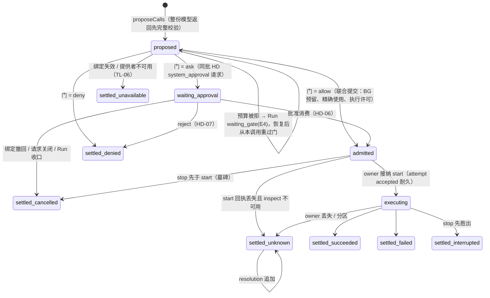

# 调用生命周期：五维状态机、转移、级联与恢复

[提案索引](README.md) · [不变式](invariants.md) · [需求](requirements.md)

本文件是工具调用状态机的候选正文：它不改写
[tools v1](../../../spec/capabilities/tools/v1/contract.md) 已定义的状态与声明，而是把散在
TL-07～12、[run-driver v2 RD-09～16](../../../spec/capabilities/run-driver/v2/contract.md)、
[session v1 SE-12～17](../../../spec/capabilities/session/v1/contract.md)、
[human-decisions v1](../../../spec/capabilities/human-decisions/v1/contract.md) 与
[生命周期组合 LC-04](../../../spec/compositions/session-run-agent-lifecycles/v1/contract.md)
里的调用行为放到一台可检查的机器上。接受后：新增的视图值与措辞进各契约下一版
（[缺口表](#契约措辞缺口表)），转移表进 [tools 提供者设计](../../../packages/tools/tools/design.md)，
attempt 账本与停止事实进 [local-execution 设计](../../../packages/tools/local-execution/design.md)。

## 五个正交维度

[runtime 草案](../tool-system/v1/runtime.md)提出"调用进展 / 等待关系 / 控制与效果"三维度；
对齐 D-014 之后，实际要分别记录、各有 owner 与流的是五个。把它们塞进一个枚举正是
[级联备忘](../tool-system/v1/session-run-cascade-memo.md)点名要避免的。

| 维度 | 状态集合 | owner / 流 | 依据 |
|---|---|---|---|
| A 调用进展 | `proposed → waiting_approval → admitted → executing → settled{succeeded, failed, denied_before_execution, cancelled_before_execution, unavailable, interrupted, unknown}`；`unavailable` 只在执行前（绑定失效、提供者或门不可用，不消耗 attempt，[缺口表](#契约措辞缺口表)）；`unknown` 之后只追加 `resolution`，不重写 | tools 包 / `tools(call)` | TL-07、RD-09 |
| B attempt 账本 | `absence → accepted → dispatch_intent → terminal`；`StopFence` 可在任一点建立（含 absence），与 start 在同一账本排序 | 执行 owner / `execution(ExecutionRef)` | TL-08；[LE 设计](../../../packages/tools/local-execution/design.md) |
| C 等待关系 | `foreground → detach_in_flight → detached_background`；或 `background_from_start`；`human_wait`（仅 `human` 调用）；终态后关系消失 | tools 包记关系事实；驱动器折叠视图 | TL-10、RD-09/14、U-41 |
| D 控制 | `none → stop_requested → stop_progressed{quiescent \| isolated \| unknown}`；与终态竞争按真实先后 | tools 包记意图；执行 owner 记物理事实 | TL-09 |
| E 结算交付 | `terminal → settling（arrival 已受理未裁决）→ settled 视图（continuation \| queue \| context \| closed）→ consumed` | Inbound（Session 包） | SE-12/14/17、RD-09 |

驱动器的"结算视图"（RD-09 封闭词表）是五维的派生投影，不是第六份状态。

## 维度 A 的状态图

六种 `settled_*` 都进入维度 E 的 `settling`，直到 arrival 被裁决。

## 转移表

事件 kind 三段式（[U-33](../session-run-agent-lifecycles/README.md#裁决记录2026-09-14用户)），
每条带 `eventId`、`(stream, seq)`、`operationId`（U-34）；结算 arrival 的来源级 dedupKey 固定为
`(call, attempt)`。现有 tools 设计的两段名（`call_terminal`、`result_delivery_changed` 等）按此
重命名。

| 转移 | 触发者 | 提交面（门外 prepare / 门内 check） | 同批伙伴与记录 | 依据 |
|---|---|---|---|---|
| → proposed | 驱动器 ProposeCalls | `omneTools.proposeCalls` + `omneRun.prepareCalls{propose}` | `tools.call.proposed` + `run.calls.proposed`；整份返回不合法则 `invalid_proposal` 收口 Step，不执行任何一项 | TL-07、RD-08/09 |
| proposed → admitted | 驱动器（门 = allow） | `omneTools.adjudicateCall` + AU allow + BG reserve + `omneRun.prepareCalls{admit}` + AR pinWork | `tools.call.admitted` + `run.call.admitted` + BG reservation + AU 审计；TL-13 守卫在此只能把 allow 收紧 | TL-07/13、BG-03、RD-09 |
| proposed → waiting_approval | 驱动器（门 = ask） | 同上 + `omneHD.prepareSystemRequest` | `tools.call.waiting` + `hd.request.created` + Run 等待位置 | TL-07、HD-03 |
| proposed 停留（预算被拒） | 驱动器 | BG reserve 拒绝 | 不产生 attempt；Run `waiting_gate(kind=budget, ret=E4)`；恢复后从本调用重过门 | RD-09/12、BG-03 |
| waiting_approval → admitted | 驱动器 AdmitApproved | `omneRun.prepareConsumeDecision` + HD 消费 + BG + 执行许可 | `run.approval.consumed`（引用被消费 answer 的 eventId）+ `tools.call.admitted` | HD-06、RD-11 |
| waiting_approval → settled | HD reject / TL-06 绑定撤回 / Run 收口 | HD-07 或 tools 的关闭片段 | `tools.call.settled{denied_before_execution \| cancelled_before_execution}` + `hd.request.*` 关闭 | HD-07、TL-06、RD-13 |
| admitted → executing | 执行 owner `start(attempt, permit, binding)` | owner 自己的短门：核 permit、绑定、执行 epoch、墓碑、去重 | `execution.attempt.accepted`；真实 I/O 前 `execution.attempt.dispatch_intent` + BG 暴露交付意图 | TL-08、LE 设计 |
| executing → settled | 执行 owner terminal；组合者是该 owner 的 `ToolExecutionLink`（[cordis.md](cordis.md#插件与服务依赖)） | owner 账本 terminal + `omneToolState.prepareTerminal/checkTerminal` + `omneSession.accept{source: call_settlement}` 组成一个提交 | `execution.attempt.terminal` + `tools.call.settled{outcome}` + `inbound.arrival.accepted{call_settlement, dedupKey}`；同域同批，跨域沿 CC-05 | TL-07、SE-12、RN-09 |
| settling → settled 视图 | 裁决者 | Inbound 短提交（[Session 设计 §7.3](../../../packages/session/session/design.md#73-意图路由裁决者算法)） | `inbound.arrival.classified{...}` | SE-14/18 |
| 任一 → stop_requested | 用户 `stopCall` / Run 收口 | `omneTools.stopCall` → owner `requestStop` | `tools.control.requested` + `execution.stop.fenced`；先于 start 也建墓碑 | TL-08/09 |
| stop_requested → stop_progressed | 执行 owner | owner 物理事实 | `execution.stop.progressed{physical, isolation, cleanup, effect}` → `tools.control.progressed` | TL-09 |
| foreground → detach_in_flight → detached_background | 用户 detach / 自动阈值 / interrupt_then_run | `omneTools.detachCall` → owner `detach(attempt)` | `tools.relation.detach_requested` / `tools.relation.detached`；owner 确认不再依赖 Agent 临时资源 | TL-10、RD-09/13 |
| 迟到事实 | 旧执行者 | `omneRun.recordLateFact` | `run.late_fact.recorded`；隔离证据，不复活工作 | TL-09、RD-13 |

`unknown` 的后续核实只追加 `tools.call.resolved`，保留原 unknown（TL-07）。终态与 detach
竞争：终态先到则按当时的关系结算、detach 请求作废（TL-10"完成与 detach 竞争按原实际结果
回答"）；detach 确认先到则按后台关系结算，结果按[迟到结果](#占位与迟到结果的投影)进入模型。

## 内建人类请求工具

PF-005 的 Agent 发起请求在 RD-02 的意图联合里没有独立意图，模型表达提问只能经
ProposeCalls，所以它是一次工具调用：多命令工具 `human`，命令 `ask`（kind = question）、
`request_approval`（kind = agent_approval）、`request_consent`（kind = specialized_consent），
执行 owner 是 HD 提供者。用户裁决（U-41）：答复是该调用的返回值。

参照 DSH `c291e79` 的 `dsh-tool-ask-user` / `dsh-user-questions`（工具体内 `await ask()`，答案作
普通工具结果返回；等待是进程内 Promise，崩溃后 `interruptedTurnClosers` 合成错误结果）：
拿它的问题/选项/意图/答案词汇、工具 Schema 与客户端卡片；等待机制换成下面这条路径。

| 步骤 | 内容 | 依据 |
|---|---|---|
| 1 提议与准入 | `human ask` 经 ProposeCalls 提议；门为 allow（问人不需要批准）；联合提交里 HD 作为执行 owner `start` = 耐久创建请求并把 continuation 绑定到该调用位置；BG 来源为零费用 | HD-01/03、TL-07、PF-005.C4/C5 |
| 2 等待 | 调用视图为 `waiting_human`：与 RD-09 的 `waiting_approval` 同列——不阻止 Step 收束，需要开 Step 时以 deferred_receipt 占位（[占位规则](#占位与迟到结果的投影)）；Step 收束后无新内容则 Run 进入 waiting_human；RD-14 的 Yield 前提不含该视图，等人期间实例可退役 | RD-09/10/11/14、HD-03 |
| 3 答复 | `HD.answer` 在同一提交里记唯一决定、把调用结算为 `succeeded{answer}`、受理结算 arrival；裁决为 continuation → 重取或开 Step；该 tool_use 尚未占位则其 tool_result 即答复，已占位则答复以 `system_reminder{human_answer}` 进入到达的 Step，两者恰居其一 | HD-02/05/08、SE-14 |
| 4 控制 | interrupt 与 interrupt_then_run 都保留请求并加全 Run 阻塞（HD-04 / RN-04"独立问题保留原 Run"），须显式 resume；cancel / force_stop 与 Run 不可恢复失败（决定 y）同提交关闭请求并结算 `cancelled_before_execution`；用户对该调用单次 `stopCall` 即撤回问题，处置同前；迟到答复按 HD-02 返回当前结果，不生成 arrival | HD-04、RN-02/04、SE-14 human_answer 行 |
| 5 崩溃 | 调用（proposed/admitted）与请求（HD-03）都耐久；重启后 RD-04 四步取得驱动，答复照常路由 | RD-16 |

三条命令的差异：

| 命令 | 答复的去向 | 附加义务 |
|---|---|---|
| `ask` | 答复内容作为 tool_result | 选项标签即答案值；`custom` 覆盖单选；批量问题按 id 回填 |
| `request_approval` | 请求内容必须携带结构化目标 `target{toolKey, commandKey, paramsDigest \| resourceRefs}`（决定 z）；决定（approve / reject / comment）作为 tool_result；approve 同时产生绑定该目标的一次性决定 `decisionRef` | 后续调用在准入门引用 `decisionRef`；门把 CD-04 Action 的 toolKey / commandKey 与参数摘要或解析出的资源同目标精确比较，相符则经 `prepareConsumeDecision` 同批消费，不符则 `denied_before_execution{approval_scope_mismatch}` 并要求新请求（PF-005.C10）；决定不跨 attempt、不跨 Session、不覆盖 AU 的 deny |
| `request_consent` | 专属同意结果作为 tool_result | 授予经 AU 的专属能力结算（HD-05）；不建立会话权限或持续授权（PF-005.C3）；首版没有合格的专属能力提供者，按 TL-03 标 unavailable、不进 manifest（[HD 设计](../../../packages/governance/human-decisions/design.md)现状） |

不纳入首版：任意工具体在执行中途 `interrupt()` 再回到断点。执行 owner 不保存调用栈，
LangGraph 式恢复要求中断点之前无副作用，与 TL-08 叠加后可用面很窄；需要中途问人的
工具拆成两次调用由模型编排。将来若有真实场景，作为声明能力 `resumable: replay` 另开。

## 占位与迟到结果的投影

业务逻辑（用户 2026-09-14 明确）：一个调用切到后台后，Agent 是继续推进还是停下来等，
由它自己决策；决策要有上下文，这个上下文就是一条占位的工具消息，让它知道调用已转后台、
完成后会有通知。omne-next `omne_harness` 的
`design_docs/interfaces/tool-result-retrieval-and-detachment-contract.md` 已有同一逻辑的三类
合成消息（离场占位 ToolMessage、转储信封 ToolMessage、`human` 角色加 `<system_reminder>`
的完成通知）与取回工具，本节以它为起点。

模型只在 Step 边界看到调用；一个调用离开前台（转后台、启动即后台、等审批、等人、暂行
staging）后，下一 Step 必须让模型知道"这个 tool_use 还没有结果"，之后结果才能以别的形态
回来。[RD-09](../../../spec/capabilities/run-driver/v2/contract.md) 已定占位形态；
[RD-10](../../../spec/capabilities/run-driver/v2/contract.md)"只有 deferred_receipt 而没有可喂给
模型的新内容时不开 Step"与上述业务逻辑冲突：占位的**首次**呈现本身就是要喂给模型的新
内容，否则模型没有机会决策。本节把它改为"首次呈现开 Step，重复呈现不开 Step"，并补迟到
结果的形态（决定 ac）；两处都进[缺口表](#契约措辞缺口表)。

| 模型的决策 | 系统的对应 |
|---|---|
| 继续推进（发起别的调用或输出） | Run 照常；后台调用的结果到达时按 SE-14 进入（同一 Run 未结束 → context，下一 Step 以 `system_reminder{late_result}` 呈现） |
| 停下来等（本轮不再输出，结束） | Step 收束、Run 按 RN-02 完成；结果到达 → C 列 queue → trigger 开新 Run，其首个 Step 以 `system_reminder{late_result}` 呈现（omne-next 的"完成通知"） |
| 主动取回（大结果或想看中间帧） | 首版不设取回工具；帧与结果的读面归 UI；omne-next 的 `read_tool_result_or_file` 与转储信封列为候选（[未决项](README.md#未决项)） |

omne-next 的回流策略四值（`silent` / `inform` / `wake_continuation` / `compensate`，
`design_docs/cross-cutting/durable-wait-and-detached-execution.md`）在这里的对应：同一 Run 内到达
= inform（下一 Step 呈现），Run 已结束 = wake_continuation（trigger 开新 Run）；这两种由
SE-14 的路由自动给出，不需要工具声明。`silent`（结果自行定格、不通知模型）与 `compensate`
（失败时唤醒补偿）首版不做，作为候选记入[未决项](README.md#未决项)。

| 时点 | 进入模型的块 | 规则 |
|---|---|---|
| 调用离开前台 | 驱动器开下一 Step，在该 tool_use 的 tool_result 位置放 `tool_result{content: [deferred_receipt{call, reason: detached_background \| background_from_start \| waiting_approval \| waiting_human \| staged_provisional, notice: "完成后会有通知"}]}` | RD-09 视图表；满足供应方"每个 tool_use 恰一条 tool_result"的成对格式而不伪造答案（CD-03）；占位的首次呈现是可喂给模型的新内容（开 Step 让模型决策），已呈现过的占位不再单独触发开 Step（RD-10 措辞修订，缺口表） |
| 结果或答复在同一 Step 内到达且该 tool_use 尚未占位 | 该 tool_use 的 tool_result 即结果 | 前台调用、Step 内答复的 `human` 调用 |
| 结果或答复在占位之后到达 | 新块 `system_reminder{reminderKind: late_result \| human_answer, ref: {call, attempt}, outcome, content: ContentBlock[]}` 进入到达的 Step 的输入 | 一个调用的最终结果恰以 tool_result 或 system_reminder 之一进入模型一次（T-14）；到达顺序按 arrival 的 acceptedOrder |

`system_reminder` 是 CD 下一版新增的内容块种类：系统产生、不可由用户输入导入（与
deferred_receipt 同一规则）、耐久记录一份；投影按模型族由 MC-07 装配决定——Anthropic
类模型投影为带系统提醒框架的 user message，OpenAI 类模型投影为 developer message；
`content` 里的媒体块仍按 MC-11 交集与 `delivery` 处理。同一块种类还承载 hooks 的
`additionalContext`（`reminderKind: hook_context`，[hooks 兼容提案](../hooks-compat/mapping.md)）与
系统通知（`system_notice`：续跑刹车、前台上限、预算），使"系统向模型说话"只有一种块。
多条 reminder 在同一 Step 输入里排在新用户文本之前。

## 前台上限与自动转后台

TL-10 第二段已定：有效阈值由声明阈值、系统上限、Run 剩余执行预算共同得到，须在预算
截止前留出 `stopMarginMs`；用单调执行时长，HITL 等待不计；恢复不清零；单次转换失败
保持前台并报告，预算到期走停止；只有 interrupt_then_run 要求"转换失败则中断"。本提案
补三点（决定 m、n）：

| 内容 | 采纳 |
|---|---|
| 计时与转换决定归属 | 调用运行时（tools 包）持计时：到点向 owner 发 `detach`，驱动器只看视图变化，owner 只兑现 |
| 不可转后台的工具超过前台上限 | 声明 `foreground: {limitMs, onLimit: detach \| stop \| keep_waiting}`；缺省 `keep_waiting`，Run 执行预算是最终刹车；声明 `stop` 的工具到点 stop |
| 转换的可见中间态 | 沿 RD-09 的 `detach_in_flight`，不加新态 |
| Run 执行预算的拥有者 | 现有契约里"Run 剩余执行预算"只出现在 TL-10，run v1 / budget v1 都没定义其拥有者与到期控制；建议 run v1 下一版让 Run 携带执行截止（由 Session 或租户政策给定），到期由调度者发 interrupt（决定 aa，待用户）；在此之前 `keep_waiting` 只靠用户 stop 兜底，[缺口表](#契约措辞缺口表)登记 |
| 调用级 `detach` 的取值 | 只有 `on_start \| auto`：模型不能否决定义或运维声明的 `onLimit: detach`（决定 ab，取代决定 j 的 `never`） |

## 控制与级联表

上半部分是 Run 控制对三种等待关系的处置（[PF-013.C4](../../requirements/product/user/PF-013-session-run-lifecycle-and-pending-input-control.md) 表逐行落实），
下半部分是 LC-04 其余触发；这张表闭合[级联备忘 §1](../tool-system/v1/session-run-cascade-memo.md)。

| 触发 | 未启动（proposed / waiting_approval / admitted 未 start） | foreground | detach_in_flight | detached_background / background_from_start | human_wait | 依据 |
|---|---|---|---|---|---|---|
| Run interrupt（LC-04 行 5） | 墓碑 + `cancelled_before_execution`；审批请求关闭 | stop，留下真实结局 | stop（不等 detach 回答，RD-13） | **也 stop**（PF-013.C4 第三行） | 保留请求，加全 Run 阻塞 | RN-04、HD-04、RD-13 |
| Run interrupt_then_run（行 8/11） | 同上 | 可转后台者 detach；不可转者 stop | 等 detach 结果：确认 → 后台；失败 → stop | 保持后台 | 保留请求（同 interrupt 行；HD-04 / RN-04"独立问题保留原 Run"） | PF-013.C4、RD-13、HD-04 |
| Run cancel（行 4） | 同上 | stop | stop | stop（普通 cancel 包括后台调用，TL-11） | 关闭请求 + `cancelled_before_execution` | RN-03、TL-11 |
| Run force_stop（行 2/4） | 同上 | epoch 撤销 + stop；旧执行者结果走 `late_fact` | 同左 | 同左；隔离未证实则 Run stopping | 同 cancel | RN-05、RD-13 |
| Run completed（行 3） | 不存在（收束前提） | 不存在（收束前提） | 不存在（阻止收束） | 继续；终态后的结算按 SE-14 C 列为 queue（trigger 开新 Run） | 不存在（Run 等人时不结算） | SE-17、RD-10 |
| Run 不可恢复失败 → failed（行 4，RD-13 末段） | 墓碑 + `cancelled_before_execution` | stop，留下真实结局 | stop | 继续；结算按 C 列为 queue | 关闭请求 + `cancelled_before_execution`（RN-02"按具名终止政策关闭剩余请求"；决定 y，待用户） | RN-02、RD-08/13、HD-04 |
| 实例计划退役（行 6） | 阻止 Yield 直到过门或 start 回执 | 阻止 Yield；热宽限到期按 interrupt 收口记 yield_forced | 阻止 Yield 直到确认 | 不受影响 | 不阻止 Yield | RD-14 |
| 实例崩溃 / 进程重启（行 7） | 见[恢复窗口](#恢复窗口) | 同左 | 同左 | 重新关联同一 attempt（inspect/subscribe） | 请求耐久，答复照常路由 | RD-16、TL-11、PF-003.C6 |
| 写入权丢失（行 12） | 停在水位 | 驱动器停在水位；owner 持独立资源可继续到 terminal，结算等写入权恢复 | 同左 | 同左 | 同左 | CC-02/04 |
| Session 归档 / 删除（行 1） | 不存在（前提无非终态 Run） | 不存在 | 不存在 | 政策 b（决定 f）：继续；结算到达 archived Session → `closed(closed_by_archive \| closed_by_delete)`；删除后结果按数据治理 | 不存在 | SE-02、SE-14 D2 |
| 租户撤权 / 绑定撤回（TL-06） | 未准入 → `stale_binding` / `unavailable` | 已准入保留原实现闭包排空 | 同左 | 同左；紧急停用要单独发 stop | 请求按 HD-04 关闭 | TL-06 |

## 恢复窗口

按 [RD-16](../../../spec/capabilities/run-driver/v2/contract.md) 的窗口表，把调用五维的恢复判定
逐窗口落实；执行 owner 重启先恢复账本与墓碑再接收 start（TL-08）。

| 崩溃窗口 | 恢复判定 |
|---|---|
| proposed 已耐久、门未完成 | 重跑 decide，同 operationId 认回；不重复提议 |
| admitted 已耐久、owner 无 accepted | 通过 TL 恢复许可核对原准入与控制后向原 owner 以同 attemptId 重发 start（RD-16"同 ID 重发，不产生第二个 attempt"） |
| accepted 已耐久、无 dispatch_intent | 可证明未进入效果位置：按恢复许可继续，或按当前准入重新派发同一 attempt |
| dispatch_intent 已耐久、terminal 不明 | `possible_effect` / unknown：只 inspect，不重发；核实不了记 unknown 与费用暴露 |
| terminal 已耐久、arrival 未受理 | 重交同一 sourceVersion / operation 直到 Inbound 回执认回 |
| arrival 已受理、未裁决 | 裁决者启动扫描（SE-18）；驱动器重取在扫描完成后 |
| `human` 请求已创建、未答复 | 请求与调用均耐久；等待照常，答复照常路由 |
| stop 墓碑已耐久、物理结果未知 | 保持 stopping / retained；不虚报强制中止 |

## 契约措辞缺口表

不单独发版（决定 g）；随工具与 hooks 闭环成形后一次处理。

| 契约与条款 | 缺口 | 建议 |
|---|---|---|
| [SE-13](../../../spec/capabilities/session/v1/contract.md)"问答型 human_answer 承载答复" | D2 下工具发起的问题由 HD 作为执行 owner 结算该调用，答复经 `call_settlement` 承载 | `human_answer` 只承载审批决定；RunDriver 模型的 `QIds` 并入调用；一条规则少一个例外 |
| [RD-09](../../../spec/capabilities/run-driver/v2/contract.md) 视图词表 | 缺 `waiting_human`（不阻止收束、deferred_receipt 占位）；"跨 Step 晚到的结果在到达的 Step 呈现"没定形态 | 新增视图值；晚到结果以 `system_reminder` 呈现（[占位与迟到结果](#占位与迟到结果的投影)） |
| [RD-10](../../../spec/capabilities/run-driver/v2/contract.md) 开 Step 判定 | "只有 deferred_receipt 而没有可喂给模型的新内容时不开 Step"让模型没有机会就"继续还是等"决策 | 下一版改为：占位首次呈现即开 Step；已呈现过的占位不再触发 |
| [RD-14](../../../spec/capabilities/run-driver/v2/contract.md) Yield 前提 | 未提 `waiting_human` | 明确其不阻止 Yield |
| [TL-07](../../../spec/capabilities/tools/v1/contract.md)"预留失败不是 deny" | 与 BG-03 的映射靠 RD-09 补出（停留 proposed、Run waiting_gate） | 下一版把"预算被拒停留 proposed"写进 TL-07 |
| [SE-04](../../../spec/capabilities/session/v1/contract.md) closed 词表、SE-13 来源枚举 | hooks 兼容层需要 `closed_by_guard` 与 `hook_continuation` | 随 hooks 提案一并进入 |
| [TL-10](../../../spec/capabilities/tools/v1/contract.md) 前台上限 | 缺 `onLimit` 与计时归属 | 下一版补声明字段 |
| [TL-01](../../../spec/capabilities/tools/v1/contract.md) 投影 | 单操作工具去掉 `command` 层（决定 i）未写明 | 下一版补两种投影 |
| [CD-03/04](../../../spec/data/core-work/v1/contract.md) `Command` / `BackgroundDeclaration` / `ContentBlock` | 缺 `foreground`、`startModes`、`concurrency`、`media`、`frames`、结果形状；`cancellation` 只有二值；`automatic` 与 `foreground` 重叠；内容块缺 `system_reminder`（决定 ac） | 按 [schema.md 维度总表](schema.md#维度总表)一次进入下一版，删 `automatic`；受影响消费者：所有引用 CD v1 的契约（session、run、run-driver、HD、AU、MC、tools）需在同批指向新版 |
| [TL-07](../../../spec/capabilities/tools/v1/contract.md) 终态词表 | `unavailable` 在 RD-09 / RD-11 / TL-06 中作结算结果出现，TL-07 六种 outcome 没有它 | 下一版加 `unavailable`（执行前，不消耗 attempt），结果形状同步 |
| [MC-07](../../../spec/capabilities/model-execution/v1/contract.md) 装配 | 缺 `system_reminder` 块按模型族投影为 user / developer message 的规则 | 下一版补投影规则；投影选择器只能选不能改 |
| [HD](../../../spec/capabilities/human-decisions/v1/contract.md) v1 | 缺"HD 作为 `human` 工具执行 owner"的条款：start = 创建请求、requestStop = 关闭、answer = 同提交结算调用；HD-08 的唯一 continuation 意图在 question 类下变为 call_settlement；HD-04 未提用户单次 `stopCall` 撤回问题；`request_approval` 决定绑定结构化目标（决定 z）；程序化作答者（hooks 提案） | 下一版补条款与结算接收器端口（[cordis.md](cordis.md#插件与服务依赖)） |
| [run-driver](../../../spec/capabilities/run-driver/v2/contract.md) v2 → v3 | RD-06 切点来源"问答型 human_answer"、RD-09/11 视图与出边、RD-17 S1 受理后守卫（hooks 提案）都要改；RunDriver 模型的 `QIds` / `AskQuestion` 并入调用后六个配置须重做 | 与 tools 下一版同批；受影响消费者：run-driver 提供者设计、场景 S04/S18/S19 |
| [run](../../../spec/capabilities/run/v1/contract.md) v1 | 没有 Run 执行时长预算的拥有者与到期控制（决定 aa） | 下一版定义执行截止与到期控制种类 |
| [SE-12](../../../spec/capabilities/session/v1/contract.md) arrival closed 原因 | hooks 兼容层需要 `closed_by_guard`（与 SE-04 同名） | 随 hooks 提案一并进入 |
| [TL-12](../../../spec/capabilities/tools/v1/contract.md) 帧耐久性 | "实时帧可以非耐久"与 U-42"帧缺省耐久、与 Session 日志同域 append-only"不一致；Session 域需要帧流 `frames(S)` | 下一版：缺省耐久，transient 只由显式声明；session 下一版登记 `frames(S)` 流（[frames.md](frames.md#记录等级)） |
