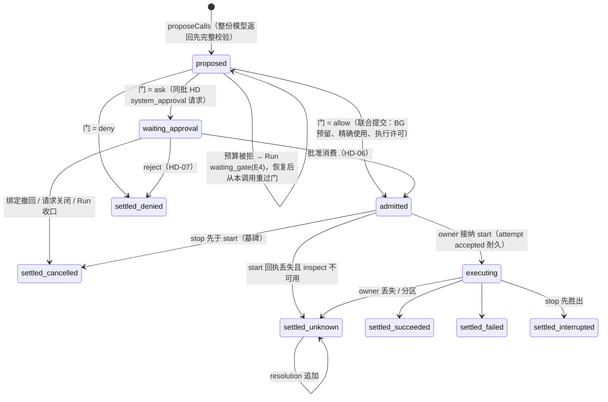

# 调用生命周期：五维状态机、转移、级联与恢复

[提案索引](README.md) · [不变式](invariants.md) · [需求](requirements.md)

本文件是工具调用状态机的候选正文：它不改写
[tools v1](../../../spec/capabilities/tools/v1/contract.md) 已定义的状态与声明，而是把散在
TL-07～12、[run-driver v2 RD-09～16](../../../spec/capabilities/run-driver/v2/contract.md)、
[session v1 SE-12～17](../../../spec/capabilities/session/v1/contract.md)、
[human-decisions v1](../../../spec/capabilities/human-decisions/v1/contract.md) 与
[生命周期组合 LC-04](../../../spec/compositions/session-run-agent-lifecycles/v1/contract.md)
里的调用行为放到一台可检查的机器上。接受后：新增的视图值与措辞进各契约下一版
（[缺口表](#契约措辞缺口表)），转移表进 [tools 提供者设计](../../../packages/tools/tools/design.md)，
attempt 账本与停止事实进 [local-execution 设计](../../../packages/tools/local-execution/design.md)。

## 五个正交维度

[runtime 草案](../tool-system/v1/runtime.md)提出"调用进展 / 等待关系 / 控制与效果"三维度；
对齐 D-014 之后，实际要分别记录、各有 owner 与流的是五个。把它们塞进一个枚举正是
[级联备忘](../tool-system/v1/session-run-cascade-memo.md)点名要避免的。

| 维度 | 状态集合 | owner / 流 | 依据 |
|---|---|---|---|
| A 调用进展 | `proposed → waiting_approval → admitted → executing → settled{succeeded, failed, denied_before_execution, cancelled_before_execution, interrupted, unknown}`；`unknown` 之后只追加 `resolution`，不重写 | tools 包 / `tools(call)` | TL-07 |
| B attempt 账本 | `absence → accepted → dispatch_intent → terminal`；`StopFence` 可在任一点建立（含 absence），与 start 在同一账本排序 | 执行 owner / `execution(ExecutionRef)` | TL-08；[LE 设计](../../../packages/tools/local-execution/design.md) |
| C 等待关系 | `foreground → detach_in_flight → detached_background`；或 `background_from_start`；`human_wait`（仅 `human` 调用）；终态后关系消失 | tools 包记关系事实；驱动器折叠视图 | TL-10、RD-09/14、U-41 |
| D 控制 | `none → stop_requested → stop_progressed{quiescent \| isolated \| unknown}`；与终态竞争按真实先后 | tools 包记意图；执行 owner 记物理事实 | TL-09 |
| E 结算交付 | `terminal → settling（arrival 已受理未裁决）→ settled 视图（continuation \| queue \| context \| closed）→ consumed` | Inbound（Session 包） | SE-12/14/17、RD-09 |

驱动器的"结算视图"（RD-09 封闭词表）是五维的派生投影，不是第六份状态。

## 维度 A 的状态图

六种 `settled_*` 都进入维度 E 的 `settling`，直到 arrival 被裁决。

## 转移表

事件 kind 三段式（[U-33](../session-run-agent-lifecycles/README.md#裁决记录2026-09-14用户)），
每条带 `eventId`、`(stream, seq)`、`operationId`（U-34）；结算 arrival 的来源级 dedupKey 固定为
`(call, attempt)`。现有 tools 设计的两段名（`call_terminal`、`result_delivery_changed` 等）按此
重命名。

| 转移 | 触发者 | 提交面（门外 prepare / 门内 check） | 同批伙伴与记录 | 依据 |
|---|---|---|---|---|
| → proposed | 驱动器 ProposeCalls | `omneTools.proposeCalls` + `omneRun.prepareCalls{propose}` | `tools.call.proposed` + `run.calls.proposed`；整份返回不合法则 `invalid_proposal` 收口 Step，不执行任何一项 | TL-07、RD-08/09 |
| proposed → admitted | 驱动器（门 = allow） | `omneTools.adjudicateCall` + AU allow + BG reserve + `omneRun.prepareCalls{admit}` + AR pinWork | `tools.call.admitted` + `run.call.admitted` + BG reservation + AU 审计；TL-13 守卫在此只能把 allow 收紧 | TL-07/13、BG-03、RD-09 |
| proposed → waiting_approval | 驱动器（门 = ask） | 同上 + `omneHD.prepareSystemRequest` | `tools.call.waiting` + `hd.request.created` + Run 等待位置 | TL-07、HD-03 |
| proposed 停留（预算被拒） | 驱动器 | BG reserve 拒绝 | 不产生 attempt；Run `waiting_gate(kind=budget, ret=E4)`；恢复后从本调用重过门 | RD-09/12、BG-03 |
| waiting_approval → admitted | 驱动器 AdmitApproved | `omneRun.prepareConsumeDecision` + HD 消费 + BG + 执行许可 | `run.approval.consumed`（引用被消费 answer 的 eventId）+ `tools.call.admitted` | HD-06、RD-11 |
| waiting_approval → settled | HD reject / TL-06 绑定撤回 / Run 收口 | HD-07 或 tools 的关闭片段 | `tools.call.settled{denied_before_execution \| cancelled_before_execution}` + `hd.request.*` 关闭 | HD-07、TL-06、RD-13 |
| admitted → executing | 执行 owner `start(attempt, permit, binding)` | owner 自己的短门：核 permit、绑定、执行 epoch、墓碑、去重 | `execution.attempt.accepted`；真实 I/O 前 `execution.attempt.dispatch_intent` + BG 暴露交付意图 | TL-08、LE 设计 |
| executing → settled | 执行 owner terminal | `omneTools.prepareTerminal/checkTerminal` → `omneSession.accept{source: call_settlement}` | `execution.attempt.terminal` + `tools.call.settled{outcome}` + `inbound.arrival.accepted{call_settlement, dedupKey}`；同域同批，跨域沿 CC-05 | TL-07、SE-12、RN-09 |
| settling → settled 视图 | 裁决者 | Inbound 短提交（[Session 设计 §7.3](../../../packages/session/session/design.md#73-意图路由裁决者算法)） | `inbound.arrival.classified{...}` | SE-14/18 |
| 任一 → stop_requested | 用户 `stopCall` / Run 收口 | `omneTools.stopCall` → owner `requestStop` | `tools.control.requested` + `execution.stop.fenced`；先于 start 也建墓碑 | TL-08/09 |
| stop_requested → stop_progressed | 执行 owner | owner 物理事实 | `execution.stop.progressed{physical, isolation, cleanup, effect}` → `tools.control.progressed` | TL-09 |
| foreground → detach_in_flight → detached_background | 用户 detach / 自动阈值 / interrupt_then_run | `omneTools.detachCall` → owner `detach(attempt)` | `tools.relation.detach_requested` / `tools.relation.detached`；owner 确认不再依赖 Agent 临时资源 | TL-10、RD-09/13 |
| 迟到事实 | 旧执行者 | `omneRun.recordLateFact` | `run.late_fact.recorded`；隔离证据，不复活工作 | TL-09、RD-13 |

`unknown` 的后续核实只追加 `tools.call.resolved`，保留原 unknown（TL-07）。

## 内建人类请求工具

PF-005 的 Agent 发起请求在 RD-02 的意图联合里没有独立意图，模型表达提问只能经
ProposeCalls，所以它是一次工具调用：多命令工具 `human`，命令 `ask`（kind = question）、
`request_approval`（kind = agent_approval）、`request_consent`（kind = specialized_consent），
执行 owner 是 HD 提供者。用户裁决（U-41）：答复是该调用的返回值。

参照 DSH `c291e79` 的 `dsh-tool-ask-user` / `dsh-user-questions`（工具体内 `await ask()`，答案作
普通工具结果返回；等待是进程内 Promise，崩溃后 `interruptedTurnClosers` 合成错误结果）：
拿它的问题/选项/意图/答案词汇、工具 Schema 与客户端卡片；等待机制换成下面这条路径。

| 步骤 | 内容 | 依据 |
|---|---|---|
| 1 提议与准入 | `human ask` 经 ProposeCalls 提议；门为 allow（问人不需要批准）；联合提交里 HD 作为执行 owner `start` = 耐久创建请求并把 continuation 绑定到该调用位置；BG 来源为零费用 | HD-01/03、TL-07、PF-005.C4/C5 |
| 2 等待 | 调用视图为 `waiting_human`：与 RD-09 的 `waiting_approval` 同列——不阻止 Step 收束，需要开 Step 时以 deferred_receipt 占位；Step 收束后无新内容则 Run 进入 waiting_human；RD-14 的 Yield 前提不含该视图，等人期间实例可退役 | RD-09/10/11/14、HD-03 |
| 3 答复 | `HD.answer` 在同一提交里记唯一决定、把调用结算为 `succeeded{answer}`、受理结算 arrival；裁决为 continuation → 重取或开 Step → 该 tool_use 的 tool_result 即答复 | HD-02/05/08、SE-14 |
| 4 控制 | interrupt 保留请求并加全 Run 阻塞，须显式 resume；cancel / force_stop 同提交关闭请求并结算 `cancelled_before_execution`；迟到答复按 HD-02 返回当前结果，不生成 arrival | HD-04、SE-14 human_answer 行 |
| 5 崩溃 | 调用（proposed/admitted）与请求（HD-03）都耐久；重启后 RD-04 四步取得驱动，答复照常路由 | RD-16 |

三条命令的差异：

| 命令 | 答复的去向 | 附加义务 |
|---|---|---|
| `ask` | 答复内容作为 tool_result | 选项标签即答案值；`custom` 覆盖单选；批量问题按 id 回填 |
| `request_approval` | 决定（approve / reject / comment）作为 tool_result；approve 同时产生仅该 Action 可消费的一次性决定 | 后续实际动作的调用过门时引用该决定并消费；越界（动作或对象不符）被门拒绝并要求新请求（PF-005.C10） |
| `request_consent` | 专属同意结果作为 tool_result | 授予经 AU 的专属能力结算（HD-05）；不建立会话权限或持续授权（PF-005.C3） |

不纳入首版：任意工具体在执行中途 `interrupt()` 再回到断点。执行 owner 不保存调用栈，
LangGraph 式恢复要求中断点之前无副作用，与 TL-08 叠加后可用面很窄；需要中途问人的
工具拆成两次调用由模型编排。将来若有真实场景，作为声明能力 `resumable: replay` 另开。

## 前台上限与自动转后台

TL-10 第二段已定：有效阈值由声明阈值、系统上限、Run 剩余执行预算共同得到，须在预算
截止前留出 `stopMarginMs`；用单调执行时长，HITL 等待不计；恢复不清零；单次转换失败
保持前台并报告，预算到期走停止；只有 interrupt_then_run 要求"转换失败则中断"。本提案
补三点（决定 m、n）：

| 内容 | 采纳 |
|---|---|
| 计时与转换决定归属 | 调用运行时（tools 包）持计时：到点向 owner 发 `detach`，驱动器只看视图变化，owner 只兑现 |
| 不可转后台的工具超过前台上限 | 声明 `foreground: {limitMs, onLimit: detach \| stop \| keep_waiting}`；缺省 `keep_waiting`，Run 执行预算是最终刹车；声明 `stop` 的工具到点 stop |
| 转换的可见中间态 | 沿 RD-09 的 `detach_in_flight`，不加新态 |

## 控制与级联表

上半部分是 Run 控制对三种等待关系的处置（[PF-013.C4](../../requirements/product/user/PF-013-session-run-lifecycle-and-pending-input-control.md) 表逐行落实），
下半部分是 LC-04 其余触发；这张表闭合[级联备忘 §1](../tool-system/v1/session-run-cascade-memo.md)。

| 触发 | foreground | detach_in_flight | detached_background / background_from_start | human_wait | 依据 |
|---|---|---|---|---|---|
| Run interrupt（LC-04 行 5） | stop，留下真实结局 | 等 detach 回答：确认 → 按后台列；失败 → stop | **也 stop**（PF-013.C4 第三行） | 保留请求，加全 Run 阻塞 | RN-04、HD-04 |
| Run interrupt_then_run（行 8/11） | 可转后台者 detach；不可转者 stop | 等 detach 结果 | 保持后台 | 请求标 superseded，调用 `cancelled_before_execution` | PF-013.C4、RD-13、HD-04 |
| Run cancel（行 4） | stop | stop | stop（普通 cancel 包括后台调用，TL-11） | 关闭请求 + 结算 | RN-03、TL-11 |
| Run force_stop（行 2/4） | epoch 撤销 + stop；旧执行者结果走 `late_fact` | 同左 | 同左；隔离未证实则 Run stopping | 同 cancel | RN-05、RD-13 |
| Run completed / failed（行 3/4） | 不存在（收束前提） | 不存在（阻止收束） | 继续；终态后的结算按 SE-14 C 列为 queue（trigger 开新 Run） | 不存在（Run 等人时不结算） | SE-17、RD-10 |
| 实例计划退役（行 6） | 阻止 Yield；热宽限到期按 interrupt 收口记 yield_forced | 阻止 Yield 直到确认 | 不受影响 | 不阻止 Yield | RD-14 |
| 实例崩溃 / 进程重启（行 7） | 见[恢复窗口](#恢复窗口) | 同左 | 重新关联同一 attempt（inspect/subscribe） | 请求耐久，答复照常路由 | RD-16、TL-11、PF-003.C6 |
| 写入权丢失（行 12） | 驱动器停在水位；owner 持独立资源可继续到 terminal，结算等写入权恢复 | 同左 | 同左 | 同左 | CC-02/04 |
| Session 归档 / 删除（行 1） | 不存在（前提无非终态 Run） | 不存在 | 政策 b（决定 f）：继续；结算到达 archived Session → `closed(closed_by_archive \| closed_by_delete)`；删除后结果按数据治理 | 不存在 | SE-02、SE-14 D2 |
| 租户撤权 / 绑定撤回（TL-06） | 未准入 → `stale_binding` / `unavailable`；已准入保留原实现闭包排空 | 同左 | 同左；紧急停用要单独发 stop | 请求按 HD-04 关闭 | TL-06 |

## 恢复窗口

按 [RD-16](../../../spec/capabilities/run-driver/v2/contract.md) 的窗口表，把调用五维的恢复判定
逐窗口落实；执行 owner 重启先恢复账本与墓碑再接收 start（TL-08）。

| 崩溃窗口 | 恢复判定 |
|---|---|
| proposed 已耐久、门未完成 | 重跑 decide，同 operationId 认回；不重复提议 |
| admitted 已耐久、owner 无 accepted | 通过 TL 恢复许可核对原准入与控制后向原 owner 以同 attemptId 重发 start（RD-16"同 ID 重发，不产生第二个 attempt"） |
| accepted 已耐久、无 dispatch_intent | 可证明未进入效果位置：按恢复许可继续，或按当前准入重新派发同一 attempt |
| dispatch_intent 已耐久、terminal 不明 | `possible_effect` / unknown：只 inspect，不重发；核实不了记 unknown 与费用暴露 |
| terminal 已耐久、arrival 未受理 | 重交同一 sourceVersion / operation 直到 Inbound 回执认回 |
| arrival 已受理、未裁决 | 裁决者启动扫描（SE-18）；驱动器重取在扫描完成后 |
| `human` 请求已创建、未答复 | 请求与调用均耐久；等待照常，答复照常路由 |
| stop 墓碑已耐久、物理结果未知 | 保持 stopping / retained；不虚报强制中止 |

## 契约措辞缺口表

不单独发版（决定 g）；随工具与 hooks 闭环成形后一次处理。

| 契约与条款 | 缺口 | 建议 |
|---|---|---|
| [SE-13](../../../spec/capabilities/session/v1/contract.md)"问答型 human_answer 承载答复" | D2 下工具发起的问题由 HD 作为执行 owner 结算该调用，答复经 `call_settlement` 承载 | `human_answer` 只承载审批决定；RunDriver 模型的 `QIds` 并入调用；一条规则少一个例外 |
| [RD-09](../../../spec/capabilities/run-driver/v2/contract.md) 视图词表 | 缺 `waiting_human`（不阻止收束、deferred_receipt 占位） | 新增，或把 `waiting_approval` 泛化为 `waiting_human{approval \| answer}` |
| [RD-14](../../../spec/capabilities/run-driver/v2/contract.md) Yield 前提 | 未提 `waiting_human` | 明确其不阻止 Yield |
| [TL-07](../../../spec/capabilities/tools/v1/contract.md)"预留失败不是 deny" | 与 BG-03 的映射靠 RD-09 补出（停留 proposed、Run waiting_gate） | 下一版把"预算被拒停留 proposed"写进 TL-07 |
| [SE-04](../../../spec/capabilities/session/v1/contract.md) closed 词表、SE-13 来源枚举 | hooks 兼容层需要 `closed_by_guard` 与 `hook_continuation` | 随 hooks 提案一并进入 |
| [TL-10](../../../spec/capabilities/tools/v1/contract.md) 前台上限 | 缺 `onLimit` 与计时归属 | 下一版补声明字段 |
| [TL-01](../../../spec/capabilities/tools/v1/contract.md) 投影 | 单操作工具去掉 `command` 层（决定 i）未写明 | 下一版补两种投影 |
